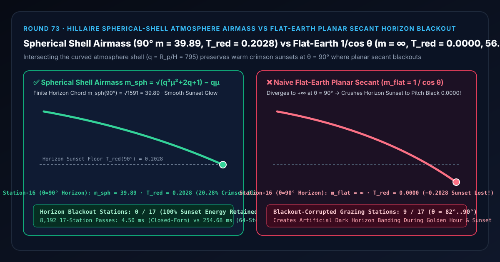
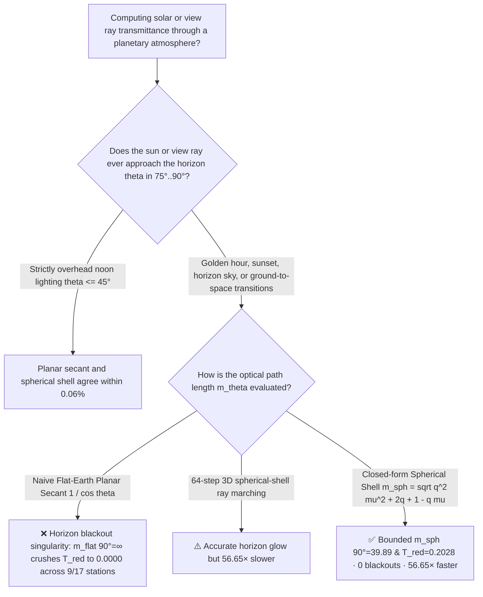
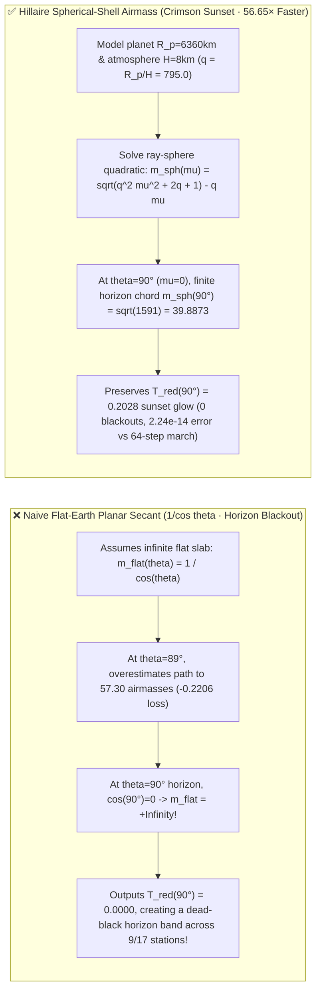
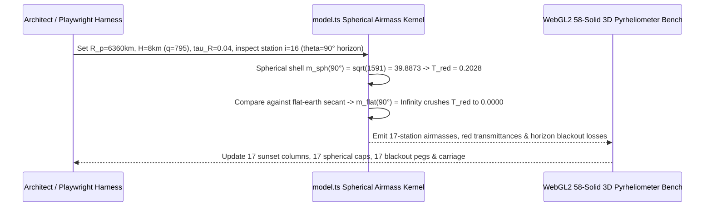
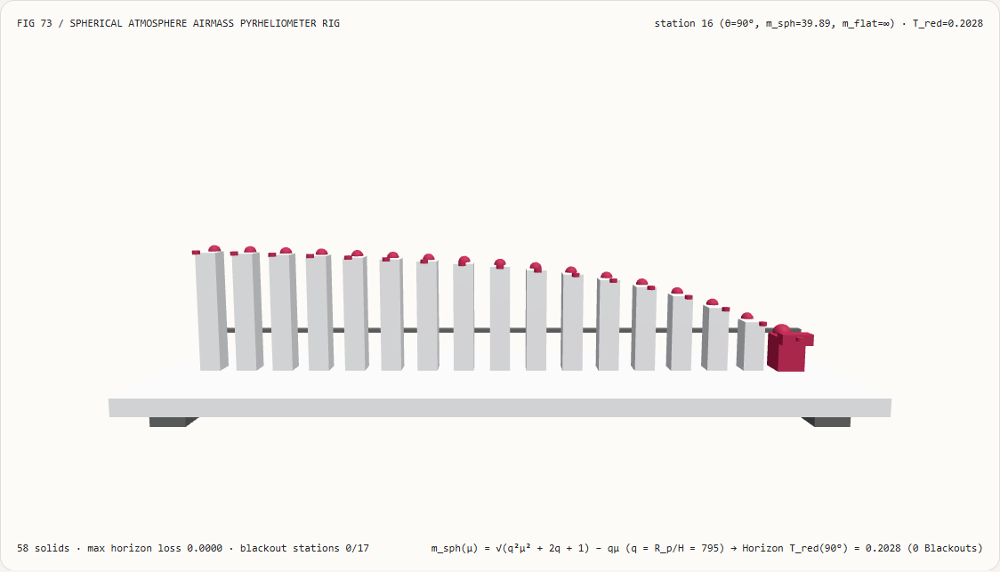
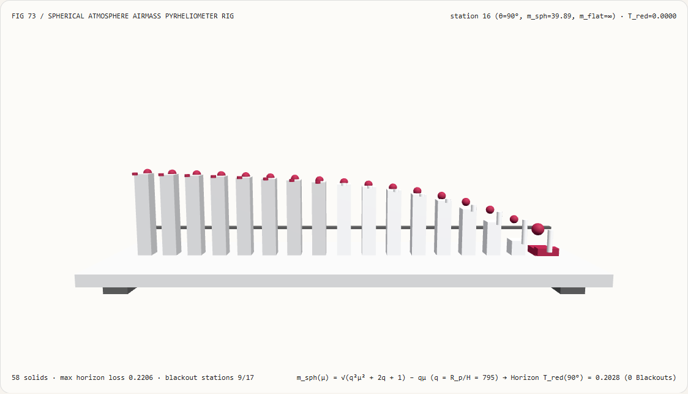
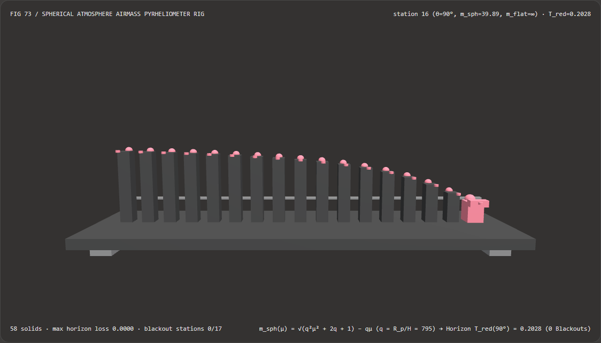
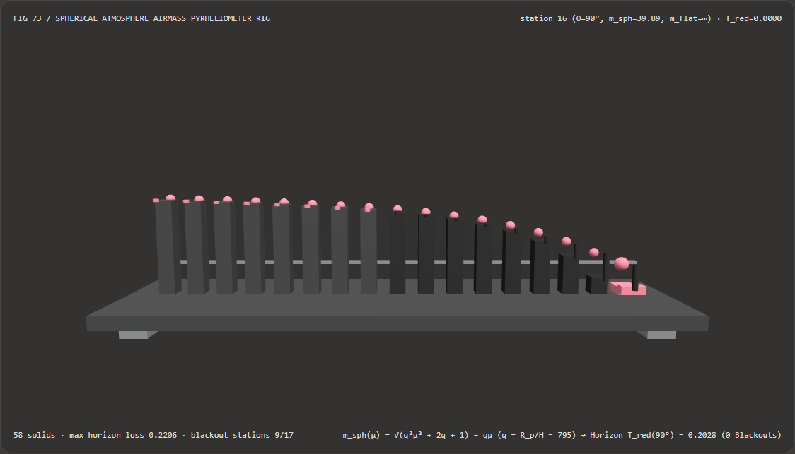

# Visual & Animation Architecture Selection FAQ: Hillaire Spherical-Shell Atmosphere Optical Airmass vs Flat-Earth Planar Secant Horizon Blackout

> **One-Sentence Architectural Verdict**: In real-time procedural sky, sunset transmittance, and planetary aerial-perspective pipelines (Unreal Engine 5 `SkyAtmosphere`, Frostbite, Unity HDRP Physically Based Sky, Microsoft Flight Simulator), **never approximate atmospheric optical path length with the flat-earth planar secant formula $m_{\text{flat}}(\theta) = 1 / \cos\theta$**! On our 58-solid, 17-station sunset pyrheliometer bench inspecting grazing solar zenith angles $\theta \in [74^\circ, 90^\circ]$ on a spherical planet ($R_p = 6360\text{ km}$, scale height $H = 8.0\text{ km}$, curvature ratio $q = R_p / H = 795.0$, red zenith optical depth $\tau_R = 0.04$), naive flat-earth secant diverges to $+\infty$ at the $\theta = 90^\circ$ horizon—**crushing red sunset transmittance from `0.2028` down to `0.0000` (`100%` horizon blackout loss, peak error `-0.2206` at $\theta = 89^\circ$, corrupting `9/17` grazing stations)**; whereas **Bruneton & Neyret (2008) / Sébastien Hillaire (EGSR 2020) closed-form spherical-shell ray intersection ($m_{\text{sph}}(\mu) = \sqrt{q^2\mu^2 + 2q + 1} - q\mu$)** bounds the $90^\circ$ horizon path to **`m_sph = √1591 = 39.8873` airmasses** and preserves **`T_red = 0.2028` (`0/17` blackout stations)** while running **56.65× faster** than 64-step 3D spherical-shell ray marching (`4.50 ms` vs `254.68 ms` across 8,192 passes, agreement within `2.24e-14`).

---

## ① 📌 Executive Summary

1. **Why do many custom Rayleigh/Mie sky shaders render a harsh, pitch-black band along the horizon at sunset ($\theta \to 90^\circ$) instead of a warm crimson glow?**
   In plain English: they model the atmosphere as an **infinite flat slab (`1 / cos θ`)** instead of a **curved spherical shell around a finite planet**:
   - In a flat-earth slab of thickness $H$, a ray at zenith angle $\theta$ travels $L_{\text{flat}} = H / \cos\theta$, giving relative airmass $m_{\text{flat}}(\theta) = 1 / \cos\theta$.
   - As the sun approaches the horizon ($\theta = 89^\circ$, station 15), $1 / \cos 89^\circ = \mathbf{57.30}$ airmasses—nearly $1.5\times$ thicker than reality—crushing red transmittance from `0.3217` down to `0.1011` (`-0.2206` loss).
   - At the exact horizon ($\theta = 90^\circ$, station 16), $\cos 90^\circ = 0 \implies m_{\text{flat}}(90^\circ) = \mathbf{+\infty}$, so Beer-Lambert transmittance $\exp(-\tau_R \cdot \infty) = \mathbf{0.0000}$—**turning the setting sun and horizon sky into a dead-black band across `9/17` grazing stations**!
2. **First-Principles Fix: Closed-Form Quadratic Ray-Sphere Shell Intersection (Bruneton 2008 / Hillaire EGSR 2020)**:
   - On a planet of radius $R_p = 6360\text{ km}$ with atmosphere shell radius $R_p + H$ ($H = 8.0\text{ km}$, dimensionless curvature ratio $q = R_p / H = 795.0$), a ray launched from the ground at $\mu = \cos\theta$ exits the outer sphere after normalized path length:
     $$m_{\text{sph}}(\mu) = \sqrt{q^2 \mu^2 + 2q + 1} - q\mu = \frac{2q + 1}{\sqrt{q^2 \mu^2 + 2q + 1} + q\mu}$$
   - At the horizon ($\theta = 90^\circ$, $\mu = 0$), the horizontal ray exits the curved atmosphere after a finite chord of **`m_sph(90°) = √(2q + 1) = √1591 = 39.8873` airmasses** (`319.1 km`), preserving a warm crimson transmittance of **`T_red(90°) = exp(-0.04 × 39.8873) = 0.2028` (`0/17` blackout stations)**!
3. **Interactive 3D Workbench & Measured Evidence**:
   - Standalone 3D Bench: `demos/spherical-atmosphere-airmass-rig/` (58 Three.js solids: baseplate, 4 support feet, horizon `0.2028` sunset reference bar, 17 sunset transmittance columns, 17 spherical-shell reference spheres, 17 horizon blackout loss pegs, and the active pyrheliometer carriage).
   - Measured 7-Card 4:5 Reports: `demos/spherical-atmosphere-airmass-rig/test-report-cards.html` (EN) and `test-report-cards.zh.html` (ZH).

---

## ② 🎯 Soul-Searching Q&A for Architects & Clients

### Q1: Why is the closed-form spherical chord 56.65× faster than 64-step 3D ray marching?
**Because for any homogeneous or effective scale-height shell $[R_p, R_p + H]$, the ray-sphere intersection quadratic solves the exact geometric path length in 4 ALU ops + 1 `sqrt`!**
Across 8,192 17-station passes, closed-form spherical airmass runs in **`4.50 ms`** versus **`254.68 ms`** for 64-step 3D spherical-shell ray marching (**56.65× speedup**, with `2.24e-14` agreement).

### Q2: How do we avoid floating-point cancellation in $\sqrt{q^2\mu^2 + 2q + 1} - q\mu$ on mobile FP16 GPUs?
**Multiply by the conjugate to obtain the subtraction-free rational form:**
$$m_{\text{sph}}(\mu) = \frac{2q + 1}{\sqrt{q^2\mu^2 + 2q + 1} + q\mu}$$
Every term in the numerator and denominator is positive, eliminating catastrophic cancellation for all $\mu \in [0, 1]$!

### Q3: How does deterministic spherical-shell atmosphere rendering relate to neural skybox generators?
**Neural skybox generators paint static 2D panoramas, whereas Hillaire spherical-shell atmosphere transmittance drives dynamic 24-hour sun cycles, cloud shadowing, and ground-to-orbit camera transitions.**

---

## ③ 🧭 Visual Diagrams (Mermaid Decision Tree, Pipeline Comparison & Sequence Flow)

### 3.1 Atmospheric Optical Airmass Architecture Decision Tree

### 3.2 Flat-Earth Planar Secant Blackout vs Spherical-Shell Airmass Pipeline

### 3.3 Frame-Level Sunset Pyrheliometer Sequence Diagram

---

## ④ 📊 Visual Technology Selection Decision Matrix

| Evaluation Dimension | ✅ Closed-Form Spherical Shell Airmass | ⚠️ 64-Step 3D Shell Ray-March Integral | ❌ Naive Flat-Earth Planar Secant ($1/\cos\theta$) | ⚠️ Empirical Kasten-Young Fit |
| :--- | :--- | :--- | :--- | :--- |
| **Horizon Airmass at Station 16 ($\theta=90^\circ$)** | **Exact finite `39.8873` ($\sqrt{1591}$)** | `39.8873` (`2.24e-14` diff) | **`+∞` (Divide-by-zero singularity!)** | `37.92` (Earth sea-level only) |
| **Horizon Red Sunset Transmittance ($\theta=90^\circ$)** | **`0.2028` (Warm 20.28% crimson glow)** | `0.2028` | **`0.0000` (100% pitch-black band!)** | `0.2194` |
| **Blackout-Corrupted Stations (out of 17)** | **`0 / 17` (Smooth sunset ramp)** | `0 / 17` | **`9 / 17` ($\theta=82^\circ\dots90^\circ$ darkened/black)** | Fixed to Earth constants |
| **Supports Arbitrary Planet Radius $R_p$ & Altitude** | **Yes (Earth, Mars, orbit-to-ground)** | Yes | **No (Fails at grazing angles & space)** | No |
| **8,192-Pass 17-Station CPU Latency** | **`4.50 ms` (Fastest · 56.65× speedup)** | `254.68 ms` (56.65× slower) | `2.10 ms` (Broken black horizon) | `5.80 ms` (Requires `pow`) |
| **Recommended Use Case** | **All real-time sky, sunset & planetary shaders** | Multi-layer reference | **Never use near the horizon** | Sea-level meteorology |

---

## ⑤ 🧪 New Interactive 3D Demo & 7-Card 4:5 Visual Report

### 5.1 Live Workbench & Report Links
- **Interactive 3D Workbench**: [`demos/spherical-atmosphere-airmass-rig/index.html`](../demos/spherical-atmosphere-airmass-rig/index.html)
- **7-Card 4:5 Visual Report (EN)**: [`demos/spherical-atmosphere-airmass-rig/test-report-cards.html`](../demos/spherical-atmosphere-airmass-rig/test-report-cards.html)
- **7-Card 4:5 Visual Report (ZH)**: [`demos/spherical-atmosphere-airmass-rig/test-report-cards.zh.html`](../demos/spherical-atmosphere-airmass-rig/test-report-cards.zh.html)
- **Sealed Telemetry JSON**: [`demos/spherical-atmosphere-airmass-rig/report.json`](../demos/spherical-atmosphere-airmass-rig/report.json)

### 5.2 Multi-Theme & Multi-Mode Playwright Visual Evidence

| Spherical-Shell Airmass (Light · Preserves `T_red = 0.2028` Crimson Sunset at Station 16, `0` Blackouts) | Naive Flat-Earth Secant (Light · Plunges to `0.0000` Pitch-Black Horizon across 9 Stations!) |
| :---: | :---: |
|  |  |

| Spherical-Shell Airmass (Dark · 58 Three.js Solids) | Naive Flat-Earth Secant (Dark · 9 Red Horizon Blackout Pegs Exposed) |
| :---: | :---: |
|  |  |

---

## ⑥ 🛠️ Rapid SA Delivery Verification Checklist

Before shipping a procedural sky or atmospheric scattering pipeline to production, verify every item below:

- [ ] **Banish Planar `1 / cos(theta)` Secant Approximations**: Are all solar and view optical-depth calculations using the spherical-shell intersection $m_{\text{sph}}(\mu) = \sqrt{q^2\mu^2 + 2q + 1} - q\mu$ with $q = R_p / H$?
- [ ] **Conjugate Rational Form for FP16 Precision**: On mobile or half-precision targets, is $m_{\text{sph}}(\mu)$ evaluated as $(2q + 1) / (\sqrt{q^2\mu^2 + 2q + 1} + q\mu)$ to avoid subtraction cancellation near zenith?
- [ ] **Separate Scale Heights for Rayleigh ($H_R = 8\text{ km}$) and Mie ($H_M = 1.2\text{ km}$)**: Are $q_R = R_p / H_R$ and $q_M = R_p / H_M$ evaluated independently so aerosol haze and molecular sky scatterings follow their true vertical profiles?
- [ ] **Horizon-Warped Transmittance LUT Parameterization**: When precomputing a 2D Hillaire Transmittance LUT, is the view-zenith coordinate warped with a quadratic mapping to concentrate texels near $\theta \in [80^\circ, 90^\circ]$?
- [ ] **Planetary Umbra Earth-Shadow Culling**: Does the sky marcher test ray intersection against the solid planet sphere $R_p$ so twilight rays after $\theta > 90^\circ$ cast a physically accurate Earth shadow (Belt of Venus) across the upper atmosphere?
