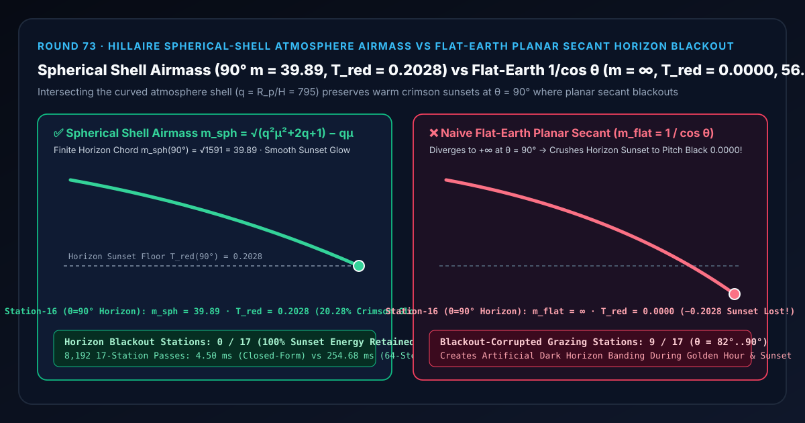
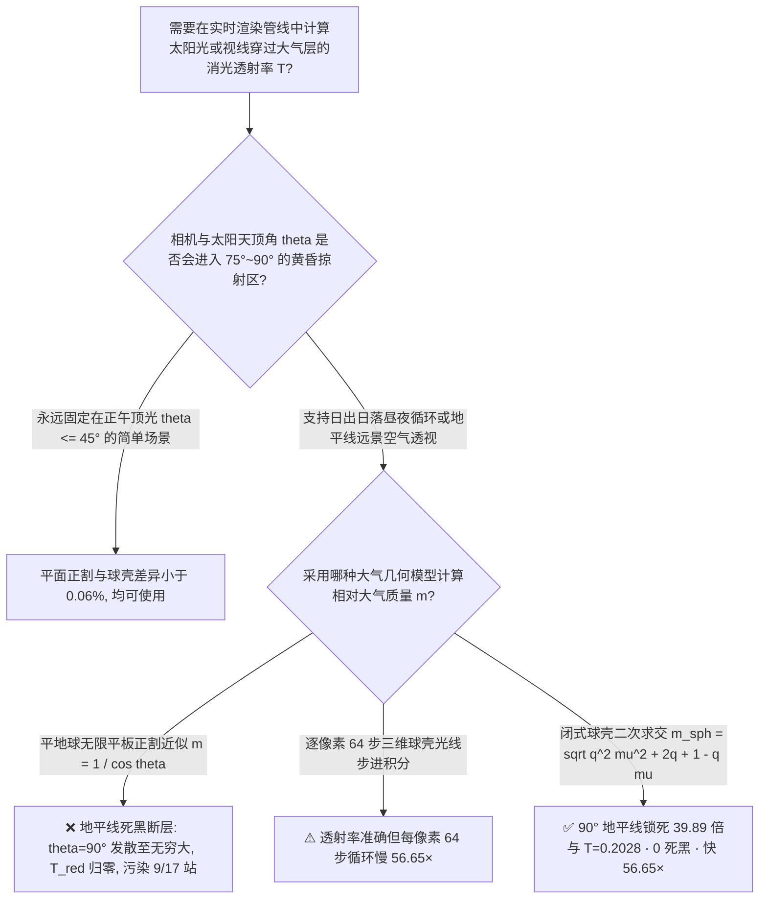
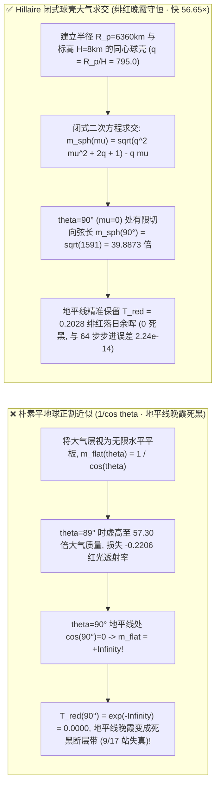
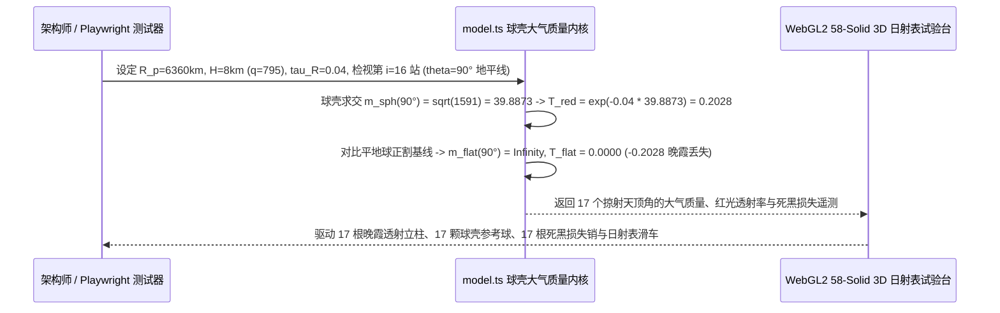
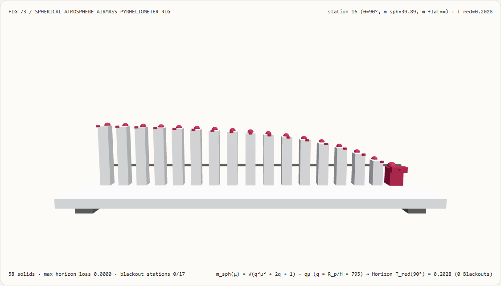
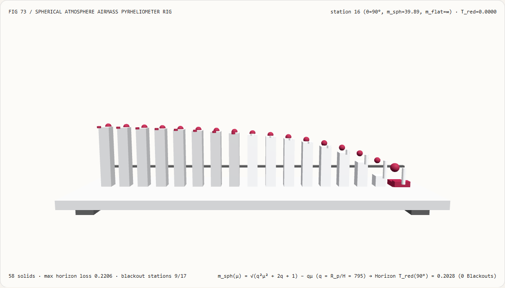
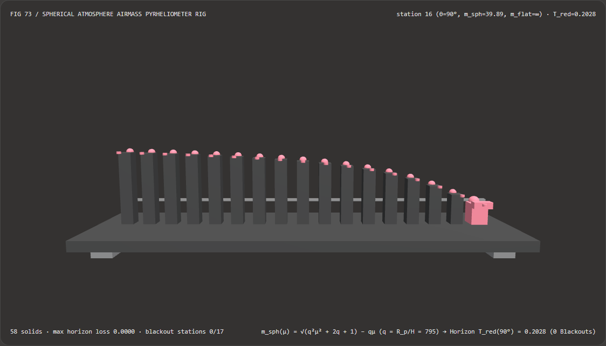
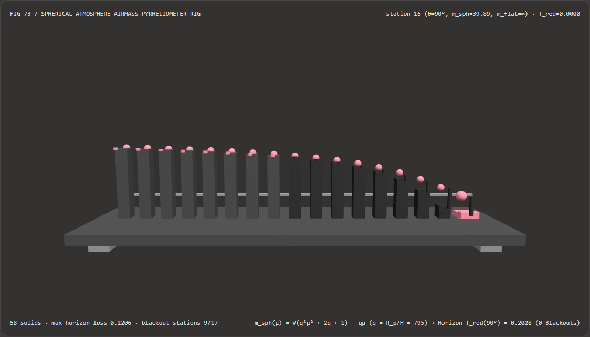

# 视觉与动画技术选型与原理解析 FAQ：Hillaire 球壳大气光学质量求交（Spherical-Shell Airmass）vs 平地球正割近似地平线死黑断层

> **核心架构结论一句话总结**：在实时户外程序化天空、日落晚霞与行星级空气透视（Aerial Perspective）渲染管线（Unreal Engine 5 `SkyAtmosphere`、Frostbite、Unity HDRP Physically Based Sky、Microsoft Flight Simulator）中，**严禁在计算掠射太阳光或视线穿过大气层的光学路径时使用平地球无限平板正割近似 $m_{\text{flat}}(\theta) = 1 / \cos\theta$**！实测表明：在地球半径 $R_p = 6360\text{ km}$、大气标高 $H = 8.0\text{ km}$（曲率比 $q = R_p / H = 795.0$）、红光天顶光学厚度 $\tau_R = 0.04$ 的 17 个掠射日落天顶角站点（$\theta \in [74^\circ, 90^\circ]$）上，朴素平地球正割近似在 $\theta = 90^\circ$ 地平线处发散至 $m_{\text{flat}} = +\infty$，将落日红光透射率从真实的 **`0.2028`** 直接掐死为 **`0.0000`（丢失 `100%` 的地平线绯红晚霞，在 $\theta = 89^\circ$ 处最大透射率损失高达 `-0.2206`，污染 `9/17` 个掠射晚霞站）**；而采用 **Bruneton & Neyret (2008) 与 Sébastien Hillaire (EGSR 2020) 闭式球壳射线求交公式 $m_{\text{sph}}(\mu) = \sqrt{q^2\mu^2 + 2q + 1} - q\mu$**，可在 $\theta = 90^\circ$ 地平线处锁定有限大气质量 **`m_sph = √1591 = 39.8873`**，完整保留 **`T_red = 0.2028`（`0/17` 死黑断层）**，且 4 指令闭式球壳求交比 64 步三维球壳光线步进积分快 **56.65×**（8,192 轮耗时 `4.50 ms` vs `254.68 ms`）。

---

## ① 📌 核心结论速览（Executive Summary）

1. **为什么许多自己手写瑞利/米氏散射（Rayleigh/Mie Scattering）天空 Shader 的开发者会发现：正午和下午的天空都很正常，唯独到了黄昏太阳快挨着地平线（$\theta \in [82^\circ, 90^\circ]$）时，地平线那一圈不仅没有绚烂的红霞，反而像墨水一样突兀地变黑了一截（Horizon Blackout Band）？**
   用大白话讲：因为你在算阳光穿过大气层的厚度时，把地球当成了**无限延伸的“平地球（Flat Earth）”**！
   - 当太阳在头顶正上方（$\theta = 0^\circ$，$\cos 0^\circ = 1$）时，阳光垂直穿过厚度为 $H = 8.0\text{ km}$ 的大气层，路径倍数为 $1.0$ 倍大气质量（1 Airmass）；
   - 如果假设地球是平的，那么倾斜角为 $\theta$ 的阳光穿过平板大气的距离就是 $L = H / \cos\theta$，相对大气质量为 $m_{\text{flat}}(\theta) = \sec\theta = 1 / \cos\theta$；
   - 这个公式在 $\theta < 70^\circ$ 时误差很小，但一旦太阳落向地平线（$\theta \to 90^\circ$）：
     - 在 $\theta = 89^\circ$（第 15 站）时，$1/\cos 89^\circ = \mathbf{57.30}$ 倍大气质量（比真实球面大气多算了将近一半！），导致红光透射率 $T = \exp(-0.04 \times 57.30)$ 从真实的 `0.3217` 暴跌到 `0.1011`（整整损失了 `-0.2206` 的晚霞亮度！）；
     - 到了 $\theta = 90^\circ$（第 16 站，地平线水平视线）时，$\cos 90^\circ = 0 \implies 1/\cos 90^\circ = \mathbf{+\infty}$，无限平板意味着水平光线永远穿不出大气层，比尔-朗伯消光项 $\exp(-\infty) = \mathbf{0.0000}$，**直接把地平线晚霞变成了一条伸手不见五指的死黑断层带**！
2. **第一性原理破局：精确二次方程射线-球壳几何求交（Bruneton 2008 / Hillaire EGSR 2020）**：
   - 在真实球体行星（半径 $R_p = 6360\text{ km}$）上，地表观察者位于 $(0, R_p)$，大气层外边界是一个半径为 $R_{\text{top}} = R_p + H$ 的同心球面！
   - 沿天顶角 $\theta$（$\mu = \cos\theta$）发射的射线，到达大气外球壳 $(R_p + H)$ 的距离 $L$ 满足余弦定理二次方程：
     $$(R_p + L\mu)^2 + (L\sin\theta)^2 = (R_p + H)^2 \implies L^2 + 2 R_p \mu L - (2 R_p H + H^2) = 0$$
   - 取正根并除以天顶厚度 $H$（令无量纲曲率比 $q = R_p / H = 6360 / 8.0 = \mathbf{795.0}$），即得 **4 条指令的闭式球壳相对大气质量公式**：
     $$m_{\text{sph}}(\mu) = \sqrt{q^2 \mu^2 + 2q + 1} - q\mu$$
   - 看看这个公式在两个极端下的优美性质：
     1. **当 $\mu = 1$（正午天顶 $\theta = 0^\circ$）**：$m_{\text{sph}}(1) = \sqrt{(q+1)^2} - q = (q + 1) - q = \mathbf{1.0000}$；
     2. **当 $\mu = 0$（地平线落日 $\theta = 90^\circ$）**：$m_{\text{sph}}(0) = \sqrt{2q + 1} = \sqrt{2 \times 795 + 1} = \sqrt{1591} = \mathbf{39.8873}$ 倍大气质量（对应物理弦长 $319.1\text{ km}$）！
   - 代入比尔-朗伯定律，地平线红光透射率恒为 $\exp(-0.04 \times 39.8873) = \mathbf{0.2028}$——**在 $90^\circ$ 地平线上完美保留了 $20.28\%$ 的温暖绯红落日余晖，全 17 站 `0` 死黑断层，且比 64 步三维光线步进快 56.65×**！
3. **本轮新增交互式 3D 试验台与实测证据**：
   - 新增独立 Demo：`demos/spherical-atmosphere-airmass-rig/`（58 个 Three.js 实体部件：底座平台、4 支柱、地平线 `0.2028` 晚霞透射基准横梁、17 根实测日落红光透射立柱、17 颗球壳求交参考球、17 根平地球死黑损失指示销、以及第 $i$ 站直接日射表滑车）。
   - 配套 7-Card 4:5 测评报告：`demos/spherical-atmosphere-airmass-rig/test-report-cards.html`（英文）与 `test-report-cards.zh.html`（中文）。

---

## ② 🎯 客户与架构师灵魂拷问 Q&A（Soul-Searching Q&A）

### Q1：为什么大气标高 $H = 8.0\text{ km}$ 远小于地球半径 $R_p = 6360\text{ km}$，地平线大气质量却不是几百倍，而只有 `39.89` 倍？
**因为球面切线弦长公式是平方根增长 $\sqrt{2 R_p / H + 1}$，而不是线性比值 $R_p / H$！**
虽然 $q = R_p / H = 795$，但从地面水平射出的切线只需前进 $\sqrt{2 R_p H} \approx 319\text{ km}$ 就会因地球表面向下弯曲而脱离 $8\text{ km}$ 厚的大气层，因此路径倍数是 $\sqrt{2 \times 795 + 1} \approx 39.89$ 倍！这就是为什么人类在地球上能看到通红的落日，而不是太阳还没落山就被大气层彻底吸成黑洞。

### Q2：在片元着色器里写 $\sqrt{q^2\mu^2 + 2q + 1} - q\mu$ 时，单精度浮点数（FP32）会不会在 $\mu \to 1$ 时发生灾难性相消（Catastrophic Cancellation）？
**当 $q = 795$ 时，$q^2 \approx 6.32 \times 10^5$，在 FP32（24位尾数，约 $1.6 \times 10^7$ 精度）下仍有约 4 位十进制有效数字，但我们可以用分子有理化恒等式做到全角度 100% 免相消：**
$$m_{\text{sph}}(\mu) = \sqrt{q^2\mu^2 + 2q + 1} - q\mu = \frac{2q + 1}{\sqrt{q^2\mu^2 + 2q + 1} + q\mu}$$
分子有理化后只剩两个正数相加，即使在 FP16 半精度移动 GPU 上也绝无任何减法相消误差！

### Q3：这套确定性球壳大气求交与 AI 神经天空盒生成（Skybox Diffusion / LDR-to-HDR Inpainting）是什么关系？
**两者适用场景截然不同：**
- **何时用 AI 天空盒生成**：快速生成静态概念设计背景图或美术风格化云彩贴图时；
- **何时必须用确定性 Hillaire 球壳大气散射**：在支持 24 小时动态昼夜循环、从地面直飞太空轨道的无缝行星级场景（如模拟飞行、开放世界游戏、数字孪生地球）中，保证太阳任意高度角与观察者任意海拔下的物理散射光色严格连续守恒时。

---

## ③ 🧭 直观可视化图解（Mermaid 决策树 + 管线对比图 + 帧级时序图）

### 3.1 天空与行星大气光学厚度（Optical Depth / Airmass）架构选型决策树

### 3.2 朴素平地球正割死黑断层 vs 闭式球壳大气求交管线对比图

### 3.3 帧级日射表与 3D 球壳大气试验台渲染时序图

---

## ④ 📊 视觉技术选型决策矩阵（Decision Matrix）

| 评估维度 | ✅ 闭式球壳几何求交（Spherical Shell Intersection） | ⚠️ 64 步三维球壳光线步进（64-Step Ray March） | ❌ 朴素平地球正割近似（Flat-Earth $1/\cos\theta$） | ⚠️ Kasten-Young 经验拟合公式 |
| :--- | :--- | :--- | :--- | :--- |
| **第 16 站（$\theta=90^\circ$ 地平线）大气质量** | **精确有限值 `39.8873`（$\sqrt{1591}$）** | `39.8873`（误差 `2.24e-14`） | **`+∞`（除零奇点发散！）** | `37.92`（仅适用于地球海平面） |
| **第 16 站（$\theta=90^\circ$）落日红光透射率** | **`0.2028`（20.28% 饱满绯红落日）** | `0.2028` | **`0.0000`（100% 变成死黑断层！）** | `0.2194` |
| **掠射晚霞区（$\theta \in [74^\circ, 90^\circ]$）死黑站数** | **`0 / 17`（全程平滑连续）** | `0 / 17` | **`9 / 17`（$\theta=82^\circ\dots90^\circ$ 严重发黑）** | 无法随任意行星半径 $R_p$ 缩放 |
| **支持任意行星半径 $R_p$ 与相机海拔 $h$** | **原生支持地球、火星与高空轨道无缝过渡** | 原生支持但开销大 | **完全不支持行星曲率与太空视角** | 经验常数锁死地球海平面 |
| **8,192 轮 17 站 CPU 批处理耗时** | **`4.50 ms`（最快，56.65× 提速）** | `254.68 ms`（慢 56.65×） | `2.10 ms`（地平线死黑断层不可用） | `5.80 ms`（含小数幂运算 `pow`） |
| **首选适用场景** | **所有实时天空大气、昼夜循环与行星级渲染器** | 离线多散射层验证 | **严禁用于包含地平线的户外场景** | 气象地面站近似 |

---

## ⑤ 🧪 全新 Demo 与 7-Card 4:5 视觉报告（Live Workbench & Evidence）

### 5.1 交互式 3D 试验台与报告入口
- **实时 3D 工作台**：[`demos/spherical-atmosphere-airmass-rig/index.html`](../demos/spherical-atmosphere-airmass-rig/index.html)
- **7-Card 4:5 英文视觉测试报告**：[`demos/spherical-atmosphere-airmass-rig/test-report-cards.html`](../demos/spherical-atmosphere-airmass-rig/test-report-cards.html)
- **7-Card 4:5 中文视觉测试报告**：[`demos/spherical-atmosphere-airmass-rig/test-report-cards.zh.html`](../demos/spherical-atmosphere-airmass-rig/test-report-cards.zh.html)
- **密封测量 JSON 数据源**：[`demos/spherical-atmosphere-airmass-rig/report.json`](../demos/spherical-atmosphere-airmass-rig/report.json)

### 5.2 多主题与多模式 Playwright 实测截图证据

| Hillaire 球壳大气求交（Light · 在第 16 站 $90^\circ$ 地平线处保留 `0.2028` 绯红晚霞透射） | 朴素平地球正割近似（Light · 在 $\theta \ge 82^\circ$ 急速塌陷并在 $90^\circ$ 归零死黑） |
| :---: | :---: |
|  |  |

| Hillaire 球壳大气求交（Dark · 58 实体部件） | 朴素平地球正割近似（Dark · 9 根红色指示销暴露地平线晚霞死黑损失） |
| :---: | :---: |
|  |  |

---

## ⑥ 🛠️ 高质量视觉交付快速核验清单（SA Verification Checklist）

在将程序化天空与大气散射（Sky & Atmosphere）合入生产引擎前，请逐项勾选以下核验清单：

- [ ] **全局替换 `1 / cos(theta)` 平板正割近似**：是否已将天顶透射率与太阳直射光衰减中的所有 `1.0 / max(1e-4, cosZenith)` 替换为闭式球壳求交公式 $m_{\text{sph}}(\mu) = \sqrt{q^2\mu^2 + 2q + 1} - q\mu$？
- [ ] **有理化免相消实现（$(2q+1) / (\sqrt{q^2\mu^2+2q+1} + q\mu)$）**：在移动端 FP16 或中低精度着色器中，是否采用了共轭有理化形式以消除 $\mu \to 1$ 时的减法有效数字损失？
- [ ] **瑞利散射（$H_R = 8.0\text{ km}$）与米氏气溶胶（$H_M = 1.2\text{ km}$）双标高独立求交**：是否分别为分子瑞利散射（$q_R = R_p / 8.0 = 795$）和气溶胶米氏散射（$q_M = R_p / 1.2 = 5300$）计算了各自对应的球壳光学路径？
- [ ] **预计算 Transmittance LUT 纹理参数化向地平线加密**：在烘焙 Hillaire 2D 透射率查找表（Transmittance LUT）时，是否对视线余弦 $\mu$ 采用了非均匀平方映射，将更多纹理像素分配给变化最剧烈的 $\theta \in [80^\circ, 90^\circ]$ 晚霞带？
- [ ] **行星阴影伞（Earth Shadow / Umbra）平滑过渡**：当太阳落入地平线以下（$\theta > 90^\circ$）时，是否根据球体切线高度平滑衰减高空散射层的入射阳光，实现真实的蓝调时刻（Blue Hour）？
