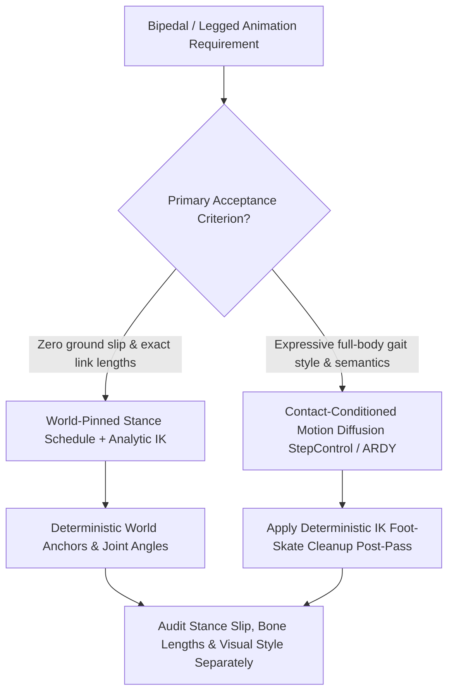
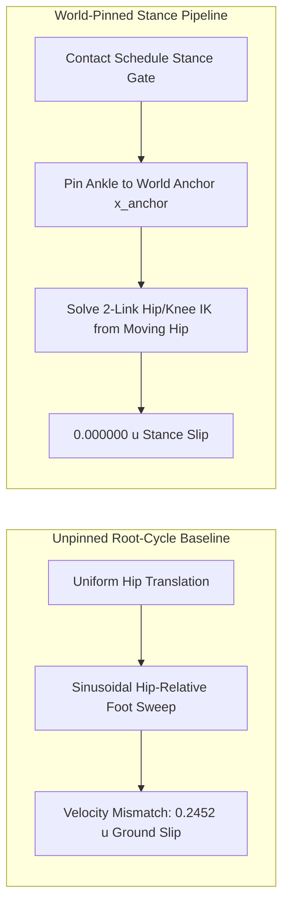
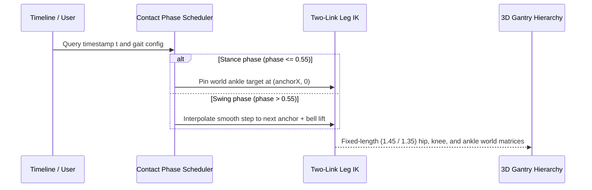

# Grounded steps without foot skating: stance-contact locking and gait IK FAQ

**Understand in 3 minutes why animated characters moonwalk on ice, and reproduce a zero-slip stance-locked bipedal rig in 10 minutes.**

[中文](stance-contact-locking-faq.md) · [Interactive Demo](https://turbo998.github.io/animation/demos/contact-stance-rig/) · [Measured 7-Card Report](../demos/contact-stance-rig/test-report-cards.html)

## ① 📌 Executive Summary

- **Foot skating happens when legs swing in hip-local space while the hip translates uniformly in world space.** Combining linear root translation with a sinusoidal local foot offset causes the planted foot to slide back and forth across the floor during stance.
- **Separate stance pinning from swing interpolation.** While a foot is in contact with the ground (55% of each cycle here), pin its ankle target to a fixed world ground anchor $(x_{\text{anchor}}, 0)$ and solve analytical two-link inverse kinematics (`1.45 / 1.35` leg segments) from the moving hip. Across 81 sampled gait frames, maximum locked stance slip is `1.78e-15` scene units (floating-point rounding), whereas the unpinned baseline slips by `0.2452` scene units at `0.2s`.
- **Contact schedules bridge generative priors and deterministic kinematics.** Learned motion models decide when feet step and how the upper body coordinates; world-anchor IK guarantees that a planted foot stays planted.
- **65-solid bipedal gantry rig, 13 local acceptance checks.** Scene geometry is `synthetic`; kinematic conformance and Node CPU timings are `measured`; `StepControl` / `ARDY` neural diffusion inference, frictional contact physics, and humanoid balance control are `not_measured`.

**Daily capability direction check:** *StepControl: Long-Horizon Human Motion Generation from Foot-Contact Schedules* ([arXiv:2610.38153](https://arxiv.org/abs/2610.38153), submitted 2026-10-28, WACV 2027) and *ARDY: Autoregressive Diffusion with Hybrid Representation for Interactive Human Motion Generation* ([arXiv:2607.08741](https://arxiv.org/abs/2607.08741), submitted 2026-07-09, SIGGRAPH 2026) elevate explicit foot-contact schedules and kinematic constraints into primary interfaces for mitigating foot sliding. Verified 2026-11-10; this demo implements deterministic world-anchor pinning and two-link IK without executing neural diffusion weights.

## ② 🎯 Architect & Client Q&A

### Q1 When should we choose AI motion/video models vs code-driven contact locking?

Evaluate conditioned motion diffusion models (`StepControl`, `ARDY`) or video models when you need expressive full-body style, asymmetric limping, stop-and-go transitions, or natural upper-body secondary motion.

Choose deterministic world-anchor contact locking and analytical IK when building mechanical gait explainers, robotics/exoskeleton visualizers, or post-processing cleanup stages where planted feet must remain verifiably stationary on a world ruler.

### Q2 Under what constraints is code-driven stance locking strictly superior?

Code is strictly better when acceptance requires **exact segment length conservation (`1.45 / 1.35`), zero world-space stance slip (`< 1e-12`), arbitrary timeline scrubbing with identical forward/reverse matrices, and atomic rejection of unreachable gait parameters**.

Even contact-conditioned diffusion models can leave residual millimeter-to-centimeter foot drift during denoising, so production pipelines routinely pair learned generation with deterministic IK foot-skate cleanup. Conversely, analytical two-link IK alone does not synthesize expressive torso style—keep geometric contact locking and learned motion naturalness clearly separated.

### Q3 How does the underlying pipeline eliminate foot skating from first principles?

Split every gait cycle of each leg into two explicit phases:

During the **stance phase** ($\text{phase} \le 0.55$), the foot is planted on the ground. Its target in world coordinates is pinned to $(x_{\text{anchor}}, 0)$. As the hip continues moving forward at $v = \text{stride} \times \text{cadence}$, the vector from the hip to the pinned ground anchor changes continuously. Analytical two-link inverse kinematics (law of cosines) computes the exact hip and knee angles that connect the moving hip to the stationary ground anchor while preserving the `1.45` thigh and `1.35` shank lengths.

During the **swing phase** ($\text{phase} > 0.55$), the foot lifts off the current anchor and travels to the next world anchor $x_{\text{anchor}} + \text{stride}$. Horizontal progression uses a zero-endpoint-velocity cubic Hermite curve ($3s^2 - 2s^3$), and vertical lift uses a smooth quartic bell ($16s^2(1-s)^2 \cdot \text{clearance}$) so touchdown occurs without impact velocity spikes.

The unpinned baseline (`skating`) fails because it drives the stance foot with a cosine wave relative to a linearly moving hip—linear and sinusoidal velocities cannot cancel across an interval, producing `0.2452` scene units of ground skating.

### Q4 How can I reproduce this in 10 minutes?

1. Run `npm run dev` and open `/demos/contact-stance-rig/`, initialized at `0.20 s` during left-foot stance.
2. Scrub the timeline between `0.10 s` and `0.35 s` in `locked` mode: the left foot pad remains pinned on the orange world anchor block, and the rendered ankle world matrix X/Y coordinates remain unchanged.
3. Switch to `skating` mode at `0.20 s`: observe the foot pad drifting `0.2452` scene units off the ground anchor.
4. Edit Stride (`0.6–1.6`), Cadence (`0.5–2.5 Hz`), and Swing lift (`0.1–0.65`); test an invalid stride such as `2.8` to verify atomic rejection and state retention.
5. Click `Export schedule` to download `STANCE_CONTACT_SCHEDULE.json` with contact flags, world matrices, and slip telemetry.
6. Run `npx vitest run tests/stance-contact.test.ts`, then build and run `node scripts/benchmark-stance-contact.mjs` against a port 4335 preview server.

## ③ 🧭 Visual Diagrams

## ④ 📊 Architect Decision Matrix

| Criterion | Unconstrained Video / Motion Diffusion | Contact-Conditioned Diffusion (`StepControl` / `ARDY`) | World-Pinned Stance + Analytic IK (This Demo) | Unpinned Root-Cycle Baseline (`skating`) |
| --- | --- | --- | --- | --- |
| World-space stance slip | Frequent visible moonwalking | Greatly reduced, subject to denoising tolerance | Measured `1.78e-15` scene units (floating-point zero) | Slips by `0.2452` scene units at `0.2s` |
| Thigh / shank length conservation | Not guaranteed in pixel space | Depends on skeletal decoder representation | Exact `1.45 / 1.35` segment preservation | Preserves bone lengths but violates ground pin |
| Arbitrary timeline seeking / reversal | Requires re-sampling or frame cache | Autoregressive / context-window dependent | Pure timestamp function; exact forward/reverse match | Pure timestamp function with contact drift |
| Expressive full-body motion diversity | High visual variety | Supports limping, pauses, jumping, waypoints | Deterministic gantry / mechanism kinematics only | None |
| Best architectural role | Concept mood videos | Character motion synthesis | Mechanism explainers & IK cleanup verification | Diagnostic anti-pattern baseline |

**Quantitative example:** With `stride = 1.2`, `cadence = 1.25 Hz`, and `stanceRatio = 0.55`, each stance window lasts `0.44 s` while the hip advances `0.66` scene units. In `locked` mode the left ankle remains fixed at `anchorX = 0.33`; in `skating` mode the mismatch between linear hip translation and sinusoidal foot sweep causes `0.2452` scene units of ground slip at `t = 0.20 s`.

## ⑤ 🧪 New Capability Demo & Benchmark Findings (with 7-Card)

[Sealed data](../demos/contact-stance-rig/report.json) records 65 3D solids, 81 sampled gait frames, and solver equivalence between analytical law-of-cosines IK and 40-step knee-angle bisection. Maximum ankle position difference across all tiers is `1.54e-12` scene units (threshold `< 1e-10`).

| Node CPU Biped Pose Queries | Analytic 2-Link Gait IK Median | 40-Step Knee Bisection Median |
| --- | --- | --- |
| 128 | 0.41 ms | 0.65 ms |
| 1024 | 0.64 ms | 2.64 ms |
| 8192 | 4.73 ms | 19.07 ms |

Each load tier runs 7 alternating repetitions after warmup on Node CPU (excluding WebGL rendering and display latency). At 8192 biped poses, closed-form analytical IK is `4.03×` faster than 40-step angle bisection while producing identical world-pinned postures.

[Measured 7-Card Report (EN)](../demos/contact-stance-rig/test-report-cards.html) · [中文七卡](../demos/contact-stance-rig/test-report-cards.zh.html). Scene geometry is `synthetic`, local kinematic assertions and CPU timings are `measured`, and `StepControl` / `ARDY` neural inference, contact friction dynamics, and robot balance control are `not_measured`.

## ⑥ 🛠️ Architect Checklist

- [ ] Separate world-space root translation from stance-foot world pinning; never drive planted feet purely in hip-local sinusoids.
- [ ] Partition each gait cycle into explicit stance and swing intervals with inspectable boolean contact flags.
- [ ] Verify that planted ankle world coordinates $(x, y)$ match the active ground anchor within `< 1e-12` across all stance samples.
- [ ] Verify that thigh and shank segment lengths (`1.45 / 1.35`) remain invariant across all gait phases without bone stretching.
- [ ] Use zero-endpoint-velocity horizontal and vertical curves during swing to avoid impact velocity spikes at touchdown.
- [ ] Validate stride, cadence, swing lift, and hip height against the non-singular two-link workspace and reject invalid drafts atomically.
- [ ] Verify that forward and reverse timestamp scrubbing produce identical hierarchical world matrices.
- [ ] Add a deterministic IK contact-locking pass downstream when deploying generative motion models in production.
- [ ] Keep Node CPU kinematic solve timings separate from browser GPU rendering metrics.
- [ ] Label unexecuted neural diffusion models, friction solvers, and robotics controllers explicitly as `not_measured`.

**Primary sources:** [StepControl (arXiv:2610.38153)](https://arxiv.org/abs/2610.38153) (submitted 2026-10-28, WACV 2027) conditions long-horizon motion diffusion on binary left/right foot-contact schedules; [ARDY (arXiv:2607.08741)](https://arxiv.org/abs/2607.08741) (submitted 2026-07-09, SIGGRAPH 2026) combines explicit root features with kinematic constraints for interactive motion generation. Verified 2026-11-10; this demo is an original deterministic kinematic benchmark and does not run those neural models.
