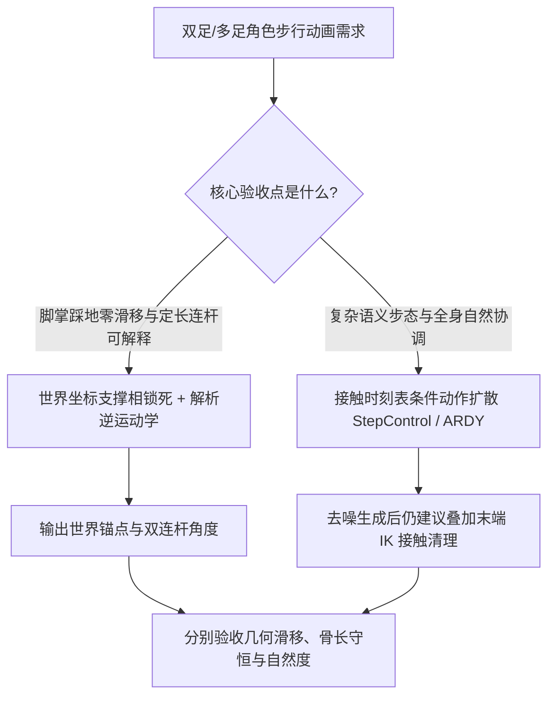
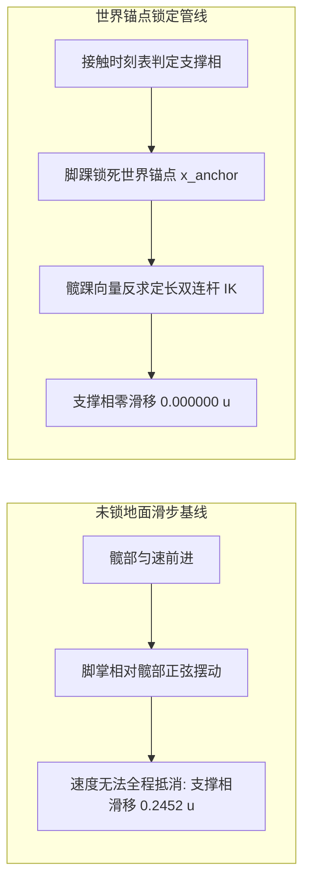
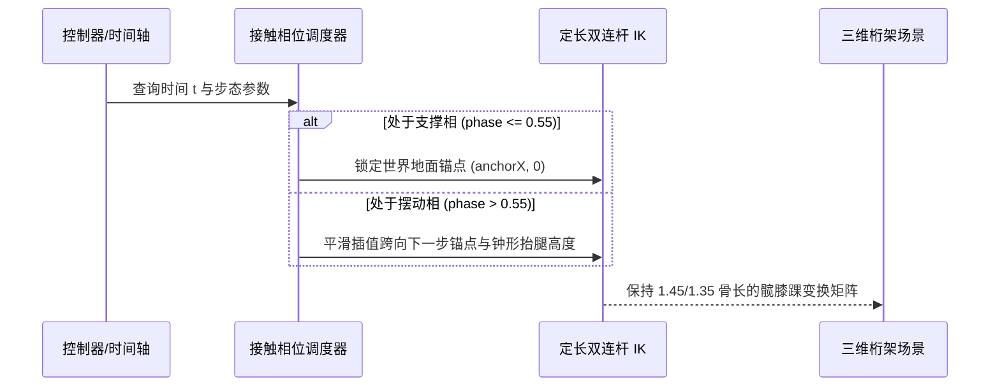

# 脚掌落地不打滑：支撑相接触锁定与步态逆运动学选型 FAQ

**3 分钟看懂为什么动画人物会“太空步滑行”，10 分钟复刻支撑相零滑移的双足步态锁死管线。**

[English](stance-contact-locking-faq.en.md) · [交互 Demo](https://turbo998.github.io/animation/demos/contact-stance-rig/) · [中文七卡](../demos/contact-stance-rig/test-report-cards.zh.html)

## ① 📌 核心结论速览

- **滑步（Foot Skating）的根源是“在根骨骼局部空间摆腿，却在世界空间匀速推胯”。** 如果髋部沿时间匀速前进，而脚掌只按正弦或余弦相对髋部来回摆动，脚掌在踩地期间的世界坐标就会来回漂移。
- **支撑相（Stance）与摆动相（Swing）必须分层控制。** 脚掌落地期间（本例占周期 55%），先把踝关节目标锁死在世界地面锚点 $(x_{\text{anchor}}, 0)$，再从移动中的髋部反求大腿（`1.45`）与小腿（`1.35`）关节角，实测 81 个步态采样帧的最大地面滑移仅 `1.78e-15` 示意单位（浮点舍入级），而未锁地面基线在 `0.2s` 处滑移达 `0.2452` 示意单位。
- **接触时刻表是生成模型与确定性运动学的共同接口。** 模型擅长决定“何时迈步、身体如何协调”，而世界坐标锚点与定长逆运动学负责保证“落地那只脚绝对不蹭地”。
- **65 实体双足桁架，13 项本机实测验收。** 场景为 `synthetic`；运动学与 Node CPU 求解耗时为 `measured`；`StepControl` / `ARDY` 神经扩散推理、刚体摩擦动力学与真实双足机器人平衡控制为 `not_measured`。

**每日能力方向核验：** 2026-10-28 提交的 WACV 2027 论文 *StepControl: Long-Horizon Human Motion Generation from Foot-Contact Schedules*（[arXiv:2610.38153](https://arxiv.org/abs/2610.38153)）与 SIGGRAPH 2026 论文 *ARDY: Autoregressive Diffusion with Hybrid Representation for Interactive Human Motion Generation*（[arXiv:2607.08741](https://arxiv.org/abs/2607.08741)）均将显式左右脚接触时刻表（Foot-Contact Schedule）与运动学约束作为消除长时序滑步的核心控制信号。2026-11-10 核验原文；本例仅实现确定性世界锚点锁死与双连杆逆运动学，未运行论文扩散模型。

## ② 🎯 客户与架构师灵魂拷问 Q&A

### Q1 何时选 AI 动作/视频大模型，何时选代码驱动接触锁定？

如果需要生成复杂情绪步态（如跛行、急停转身、双脚跳跃）或长镜头全身自然律动，可评估 `StepControl`、`ARDY` 等带接触条件的动作扩散模型或视频模型。

如果需要向客户讲解机械步态、外骨骼/机甲联动、或者在三维/网页端交付“脚掌踩在地面刻度线上纹丝不动”的可交互动画，代码驱动的世界锚点锁死加定长逆运动学可以直接提供逐帧可核验的零滑移保证。

### Q2 在什么约束下代码驱动严格更优？

当验收标准包含**固定腿段长度（`1.45 / 1.35`）、精确落地世界坐标锚点、任意拖拽时间轴无历史漂移、以及确定性边界拒绝**时，代码管线严格更优。

神经动作生成即使加入接触引导，在去噪过程中仍可能残留数厘米的脚底微滑，工程上往往仍需后处理 IK 锁死（Foot Skate Cleanup）。但纯代码双连杆 IK 不会自动生成生动的肩膀摆动或复杂地形适应——**几何锁死解决“不滑步”，学习先验解决“像真人”**，两者职责边界清楚。

### Q3 底层管线如何消灭“太空步”？

把走路拆成两个阶段看，原理一目了然：

第一阶段叫**支撑相（Stance Phase）**：脚已经踩实地面。此时世界坐标系里这只脚的落点 $(x_{\text{anchor}}, 0)$ 就是死锚点，不能再跟着髋部移动。髋部继续向前走，髋到脚踝的向量不断变化，我们用余弦定理反算出大腿和小腿该弯多少度，才能既保住 `1.45` 和 `1.35` 的定长骨头，又让脚底钉在原地。

第二阶段叫**摆动相（Swing Phase）**：脚离开地面迈向下一个锚点 $x_{\text{anchor}} + \text{stride}$。水平方向采用首尾速度为零的平滑三次 Hermite 曲线过渡，垂直方向采用钟形抬腿曲线 $(16 s^2 (1-s)^2 \cdot \text{clearance})$，保证起脚和落地瞬间不发生速度硬撞击。

未锁地面基线（`skating`）之所以滑步，是因为它把支撑相的脚踝写成髋部匀速位移与余弦摆动的叠加——髋走直线、脚走余弦，两者速度无法在整个支撑相内抵消，脚底就会在地面刻度尺上前后搓动 `0.2452` 示意单位。

### Q4 十分钟如何复刻？

1. `npm run dev` 后打开 `/demos/contact-stance-rig/`，默认停在 `0.20 s` 左脚支撑相。
2. 在 `0.10 s` 到 `0.35 s` 之间拖动时间滑块：锁定模式（`locked`）下左脚始终钉在地面橙色锚点块上，踝关节世界矩阵 X/Y 分量保持不变。
3. 切换到未锁滑步基线（`skating`）：同样在 `0.20 s` 观察，脚掌明显偏离地面橙色锚点 `0.2452` 示意单位。
4. 调整步幅（Stride `0.6–1.6`）、步频（Cadence `0.5–2.5 Hz`）与抬腿高度（Swing lift `0.1–0.65`）并点击应用；若输入越界值（如步幅 `2.8`），系统明确拒绝并保留原有效状态。
5. 点击导出 `STANCE_CONTACT_SCHEDULE.json`，检查支撑相状态、世界矩阵与骨长字段。
6. 运行 `npx vitest run tests\stance-contact.test.ts`；构建并在 4335 端口启动预览后执行 `node scripts\benchmark-stance-contact.mjs`。

## ③ 🧭 直观可视化图解

## ④ 📊 Architect Decision Matrix

| 评估维度 | 纯文本/视频扩散生成 | 接触条件动作模型 (`StepControl` / `ARDY`) | 本例世界锚点锁定 + 解析 IK | 根骨骼相对正弦基线 (`skating`) |
| --- | --- | --- | --- | --- |
| 支撑相脚掌世界滑移 | 常见明显滑步 | 显著压降，但仍受去噪精度影响 | 实测 `1.78e-15` 示意单位（浮点级零滑移） | `0.2s` 处滑移 `0.2452` 示意单位 |
| 大腿/小腿骨长守恒 | 像素空间不保证三维骨长 | 依赖骨骼解码表示 | 严格保持 `1.45 / 1.35` 定长 | 虽保骨长但破坏地面接触 |
| 任意时间轴跳转/倒放 | 需重跑或依赖帧缓存 | 自回归/流式依赖上下文窗口 | 纯时间戳函数，正逆序矩阵完全一致 | 纯时间戳函数但接触错误 |
| 复杂情绪与全身自然律动 | 视觉表现丰富 | 支持跛行、跳跃、路径跟随 | 仅限确定性桁架/机构步态演示 | 不具备 |
| 适用交付物 | 概念宣传片 | 游戏/虚拟人动作资产生成 | 机械步态讲解、IK 后处理门禁原型 | 仅作反面对比基线 |

**定量算例：** 当步幅 `stride = 1.2`、步频 `cadence = 1.25 Hz`、支撑相占比 `0.55` 时，单次支撑相持续 `0.44 s`，期间髋部水平前进 `0.66` 示意单位。锁定模式下脚踝始终停在 `anchorX = 0.33`；未锁基线因线性速度与余弦速度失配，在 `t = 0.20 s` 产生 `0.2452` 示意单位的地面搓动。

## ⑤ 🧪 全新 Demo 与 Benchmark 核心发现（含 7-Card）

[封存数据](../demos/contact-stance-rig/report.json)记录了 65 个三维实体、81 个步态采样帧、解析求解与 40 步膝角二分求解的等价性及耗时对照。两种求解器在全采样区间的最大踝部坐标差仅 `1.54e-12` 示意单位（门限 `< 1e-10`）。

| Node CPU 双足姿态查询数 | 解析双连杆步态 IK 中位数 | 40 步膝角二分求解中位数 |
| --- | --- | --- |
| 128 | 0.41 ms | 0.65 ms |
| 1024 | 0.64 ms | 2.64 ms |
| 8192 | 4.73 ms | 19.07 ms |

每档负载在预热后按交替顺序重复 7 次，记录 Node CPU 求解耗时中位数（不含 WebGL 渲染与屏幕显示）。在 8192 次双足姿态计算中，直接余弦定理求解比 40 步膝角二分搜索快约 `4.03×`，且两者输出相同的锁定地面姿态。

[中文七卡](../demos/contact-stance-rig/test-report-cards.zh.html) · [English](../demos/contact-stance-rig/test-report-cards.html)。画面为 `synthetic`，本机运动学与 CPU 计时为 `measured`；`StepControl` / `ARDY` 模型推理、地面摩擦动力学与机器人硬件平衡为 `not_measured`。

## ⑥ 🛠️ Architect Checklist

- [ ] 明确区分“根骨骼推进”与“支撑脚世界坐标锁死”，禁止在支撑相用局部正弦摆腿代替世界锚点。
- [ ] 将步态周期显式划分为支撑相（Stance）与摆动相（Swing），分别记录左右脚接触布尔状态。
- [ ] 验证支撑相内所有采样时刻的脚踝世界坐标 $(x, y)$ 与地面锚点误差 `< 1e-12`。
- [ ] 验证大腿与小腿连杆长度在任意步态相位下严格守恒（如 `1.45 / 1.35`），不靠拉伸骨头凑落点。
- [ ] 摆动相水平推进与垂直抬脚在起止点满足零速度平滑衔接，避免落地瞬时硬冲击。
- [ ] 对步幅、步频、抬腿高度与髋高执行可达空间校验，对奇异或越界输入执行原子拒绝。
- [ ] 验证正序播放与逆序拖拽到同一时间戳时，导出的世界变换矩阵完全一致。
- [ ] 若接入生成式动作模型，在管线末端保留确定性接触锁定（IK Foot Skate Cleanup）验收门。
- [ ] 区分 CPU 运动学求解耗时与浏览器 GPU 渲染帧耗时，不混用指标。
- [ ] 未执行的神经扩散模型、接触摩擦物理与真实机器人控制统一标注为 `not_measured`。

**一手来源：** [StepControl (arXiv:2610.38153)](https://arxiv.org/abs/2610.38153)（2026-10-28 提交，WACV 2027）通过未来左右脚接触时刻表控制长时序人体动作；[ARDY (arXiv:2607.08741)](https://arxiv.org/abs/2607.08741)（2026-07-09 提交，SIGGRAPH 2026）结合显式根特征与运动学约束实现交互式动作生成。2026-11-10 核验；本例为原创确定性运动学演示，未运行上述神经模型。
