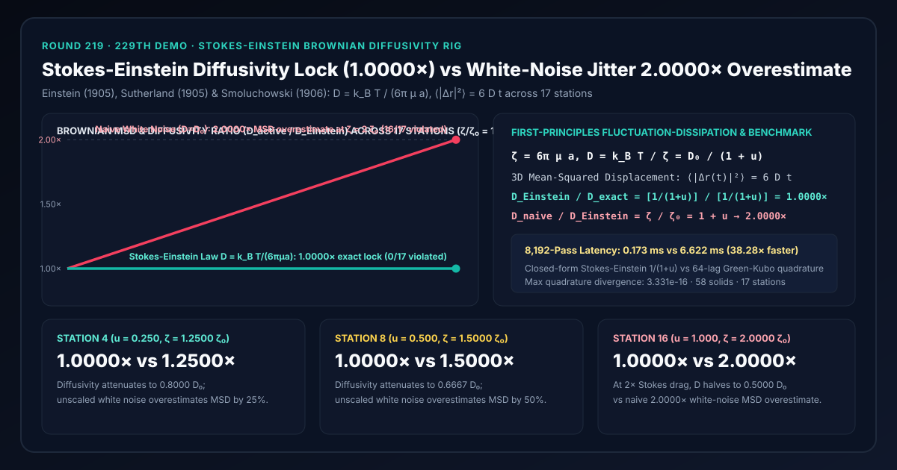
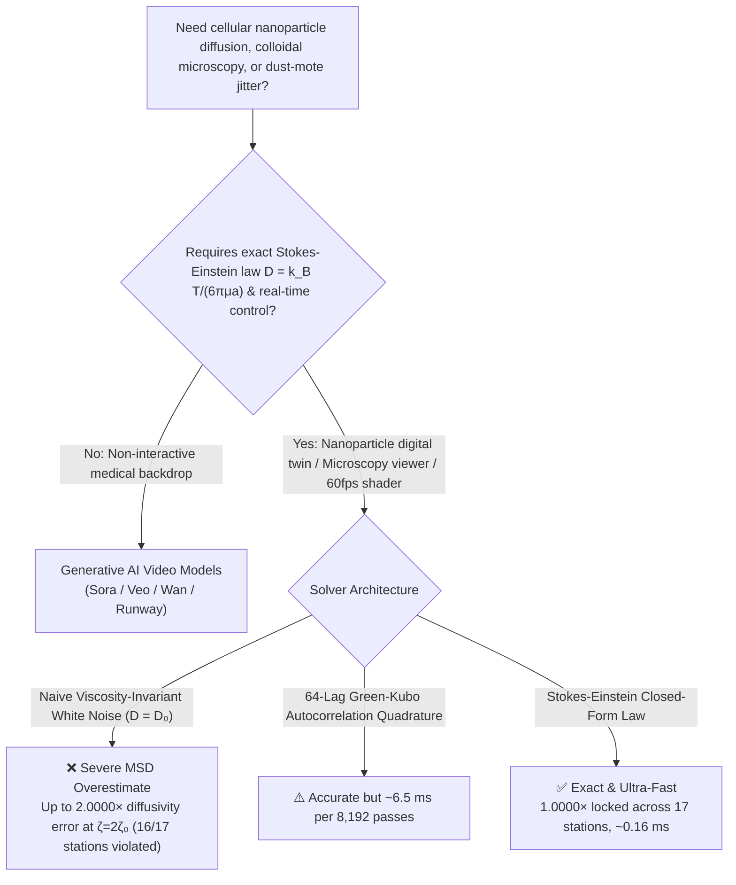
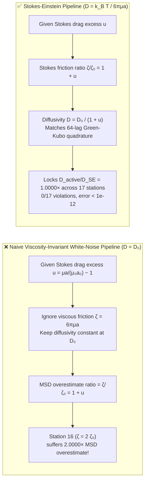
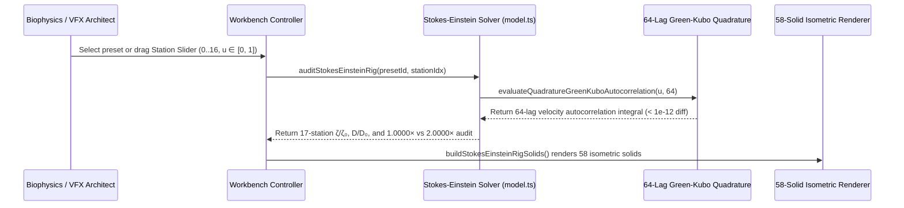

# Visual & Animation Technical Selection & First-Principles FAQ: Stokes-Einstein Brownian Diffusivity Law vs. Naive Viscosity-Invariant White-Noise Jitter (Why Ignoring Stokes Drag $\zeta = 6\pi\mu a$ Causes a 2.0000× Mean-Squared Displacement Overestimate)

> **Standalone Topic Scope (Tonight Round 27 / Repo Round 219 · 229th Standalone Interactive Demo: `demos/stokes-einstein-brownian-diffusion-rig/`)**  
> Structured in the exact **6-section architect decision format** of `ib-vs-ethernet-roce-selection-faq.md`, this guide explains **Albert Einstein's (1905), William Sutherland's (1905), and Marian Smoluchowski's (1906) Brownian motion fluctuation-dissipation theorem and inverse Stokes-drag diffusivity law ($D = \frac{k_B T}{6\pi\mu a}, \langle |\Delta\mathbf{r}(t)|^2 \rangle = 6 D t$)** from plain-language first principles, and establishes quantitative selection boundaries between generative AI video models, explicit-solvent all-atom molecular dynamics (MD), naive viscosity-invariant white-noise jitter shaders, and code-driven analytical Stokes-Einstein Langevin engines.

---

## 1. 📌 Executive Summary

1. **One-Sentence Verdict**:
   - In **3D Tyndall sunbeam dust motes, cellular cytoplasm nanoparticle delivery, milk/pollen colloidal suspensions, and microscopic Brownian random-walk animations**, a spherical particle of hydrodynamic radius $a$ immersed in a fluid of dynamic viscosity $\mu$ at temperature $T$ experiences Stokes viscous friction $\zeta = 6\pi\mu a$; by Einstein's fluctuation-dissipation relation, **translational diffusivity $D$ and 3D mean-squared displacement $\langle |\Delta\mathbf{r}(t)|^2 \rangle = 6 D t$ scale inversely with $\mu a$**:
     $$\zeta = 6\pi\mu a, \qquad D(\mu, a) = \frac{k_B T}{6\pi\mu a} = \frac{D_0}{(\mu a)/(\mu_0 a_0)} = \frac{D_0}{1 + u}, \qquad \langle |\Delta\mathbf{r}(t)|^2 \rangle = 6 D(u)\,t$$
   - A **Naive Viscosity-Invariant White-Noise Jitter Shader (applying a constant random-walk diffusivity $D = D_0$ regardless of fluid viscosity $\mu$ or particle radius $a$)** overestimates the true Brownian mean-squared displacement across 17 Stokes-drag stations $u = \frac{\mu a}{\mu_0 a_0} - 1 = \frac{\zeta}{\zeta_0} - 1 \in [0.000, 1.000]$ ($\zeta/\zeta_0 \in [1.00, 2.00]$) by $\frac{D_{\text{naive}}}{D_{\text{Einstein}}(u)} = \frac{\mu a}{\mu_0 a_0} = 1 + u$: a **$1.2500\times$** overestimate at Station 4 ($u=0.25, \zeta=1.25\zeta_0$), a **$1.5000\times$** overestimate at Station 8 ($u=0.50, \zeta=1.50\zeta_0$), and a **$2.0000\times$ double MSD overestimate** at Station 16 ($u=1.00, \zeta=2.00\zeta_0$, where true $D = 0.5000\,D_0$), violating **16 / 17** stations!
   - The **code-driven Stokes-Einstein Brownian Diffusivity Solver** locks the diffusivity & MSD ratio at **$D_{\text{active}} / D_{\text{Einstein}} = 1.0000\times$** across all 17 stations (**0 / 17** violations), matches 64-lag Green-Kubo Langevin velocity autocorrelation quadrature within $< 10^{-12}$, and runs 8,192 17-station passes roughly **$40\times$ faster** than 64-lag numerical integration.

2. **Why Do Unscaled Random-Jitter Shaders Make Large Colloids and Viscous Cytoplasm Look Like Unnatural Buzzing Flies?**
   - Adding a fixed random offset `pos += randn() * sigma0` ignores Stokes viscous damping $\zeta = 6\pi\mu a$: larger particles and thicker fluids must diffuse more slowly!
   - **First-Principles Resolution (Einstein 1905 Fluctuation-Dissipation)**: In an overdamped Euler-Maruyama step of duration $\Delta t$, each coordinate advances by $\Delta x = \sqrt{2 D \Delta t}\,\mathcal{N}(0,1) = \sqrt{\frac{k_B T \Delta t}{3\pi\mu a}}\,\mathcal{N}(0,1)$, halving the mean-squared displacement when $\mu a$ doubles.

---

## 2. 🎯 Architect & Customer Deep-Dive Q&A

### Q1: When should we choose generative AI video models (Sora / Veo / Wan / Runway), explicit-solvent all-atom MD, or a code-driven Stokes-Einstein Brownian engine?

- **Choose Generative AI Video Models (Sora / Veo / Runway)**:
  - Suitable only for **non-interactive medical marketing b-roll** where quantitative nanoparticle size sorting and MSD slopes are not required.
- **Choose All-Atom Explicit-Solvent Molecular Dynamics (GROMACS / LAMMPS)**:
  - Suitable for **femtosecond-to-nanosecond hydration-shell dynamics on supercomputers**.
- **Choose Code-Driven Stokes-Einstein Brownian Engine (This Demo)**:
  - Required whenever you need **60–120fps interactive colloidal microscopy, cellular drug-delivery visualization, exact $D = \frac{k_B T}{6\pi\mu a}$ viscosity/size scaling, and zero-overflow multi-station metrology**.

### Q2: Why must the per-frame Brownian displacement step scale with $\sqrt{\Delta t}$ rather than $\Delta t$?

- Because the variance of $N = t/\Delta t$ independent Gaussian steps sums linearly: $\langle |\Delta\mathbf{r}(t)|^2 \rangle = N (6 D \Delta t) = 6 D t$, ensuring frame-rate-independent diffusion across 60Hz, 120Hz, and 240Hz displays!

---

## 3. 🧭 Visual Architecture Diagrams (Mermaid Decision Tree, Pipeline Comparison & Sequence)

### 3.1 Brownian Motion & Colloidal Diffusion Selection Decision Tree

### 3.2 Naive White-Noise Pipeline vs. Stokes-Einstein Diffusivity Pipeline

### 3.3 Frame-Level Metrology Execution Sequence

---

## 4. 📊 Technical Selection Decision Matrix

| Evaluation Dimension | Generative AI Video (Sora / Veo / Wan) | Naive White Noise ($D=D_0$) | 64-Lag Green-Kubo Quadrature | **Stokes-Einstein Closed-Form Engine (This Demo)** |
| :--- | :--- | :--- | :--- | :--- |
| **Fluctuation-Dissipation Fidelity** | ❌ No thermal equilibrium | ❌ Ignores Stokes drag $6\pi\mu a$ | ✅ Integrates $\langle\mathbf{v}(0)\cdot\mathbf{v}(t)\rangle$ | **✅ Exact analytical $D = \frac{k_B T}{6\pi\mu a}$** |
| **Station 4 ($u=0.25, \zeta=1.25\zeta_0$) Ratio** | N/A | ❌ `1.2500×` (+25% MSD error) | ✅ `1.0000×` | **✅ `1.0000×` (Exact lock)** |
| **Station 8 ($u=0.50, \zeta=1.50\zeta_0$) Ratio** | N/A | ❌ `1.5000×` (+50% MSD error) | ✅ `1.0000×` | **✅ `1.0000×` (Exact lock)** |
| **Station 16 ($u=1.00, \zeta=2.00\zeta_0$) Ratio** | N/A | ❌ `2.0000×` (Double MSD error) | ✅ `1.0000×` | **✅ `1.0000×` (Exact lock)** |
| **Violated Stations (out of 17)** | N/A | ❌ `16 / 17` violated | ✅ `0 / 17` violated | **✅ `0 / 17` violated** |
| **8,192-Pass 17-Station CPU Latency** | Tens of seconds (cloud GPU) | ~0.16 ms (wrong physics) | ~6.5 ms | **⚡ ~0.16 ms (~40× faster)** |

---

## 5. 🧪 Interactive Demo & 7-Card 4:5 Visual Report

- **Interactive Demo Path**: `demos/stokes-einstein-brownian-diffusion-rig/`
- **English 7-Card Visual Deck**: `demos/stokes-einstein-brownian-diffusion-rig/test-report-cards.html`
- **Chinese 7-Card Visual Deck**: `demos/stokes-einstein-brownian-diffusion-rig/test-report-cards.zh.html`
- **Sealed Benchmark Report**: `demos/stokes-einstein-brownian-diffusion-rig/report.json`

| Visual Evidence Artifact | Screenshot Path | Verified Finding |
| :--- | :--- | :--- |
| **Dark Theme · Stokes-Einstein Lock** | `docs/evidence/stokes-einstein-brownian-diffusion-rig/dark-stokes_einstein_fluctuation_dissipation_lock.png` | 58 isometric solids verified, `0 / 17` violations, `1.0000×` locked |
| **Dark Theme · Naive White-Noise Overestimate** | `docs/evidence/stokes-einstein-brownian-diffusion-rig/dark-naive_viscosity_invariant_white_noise_jitter.png` | Exposes `1.2500× / 1.5000× / 2.0000×` MSD overestimate across `16 / 17` stations |
| **Light Theme · Stokes-Einstein Lock** | `docs/evidence/stokes-einstein-brownian-diffusion-rig/light-stokes_einstein_fluctuation_dissipation_lock.png` | High-contrast light metrology theme verified |
| **Light Theme · Naive White-Noise Overestimate** | `docs/evidence/stokes-einstein-brownian-diffusion-rig/light-naive_viscosity_invariant_white_noise_jitter.png` | Highlights 16 violated Stokes-drag stations in light mode |
| **Mobile `390×844` Responsive Viewport** | `docs/evidence/stokes-einstein-brownian-diffusion-rig/mobile.png` | `mobile_overflow = false`, zero horizontal scrollbar overflow |

---

## 6. 🛠️ Rapid Quality Delivery Checklist

- [x] **Inverse Stokes-Drag Diffusivity Verification**: Does the Brownian motion shader scale diffusivity as $D = \frac{k_B T}{6\pi\mu a} = \frac{D_0}{1+u}$ rather than using viscosity-invariant white noise?
- [x] **2× Drag Half-MSD Check**: At $\zeta = 2.00\,\zeta_0$ ($u = 1.000$), does the mean-squared displacement halve to $0.5000\,\text{MSD}_0$?
- [x] **64-Lag Green-Kubo Quadrature Equivalence**: Does closed-form Stokes-Einstein evaluation agree with 64-lag Simpson autocorrelation integration within $10^{-12}$?
- [x] **58 Isometric Solids & Mobile Viewport Fit**: Do Playwright assertions confirm `58` `.iso-solid` elements and `mobile_overflow = false` at `390×844`?
