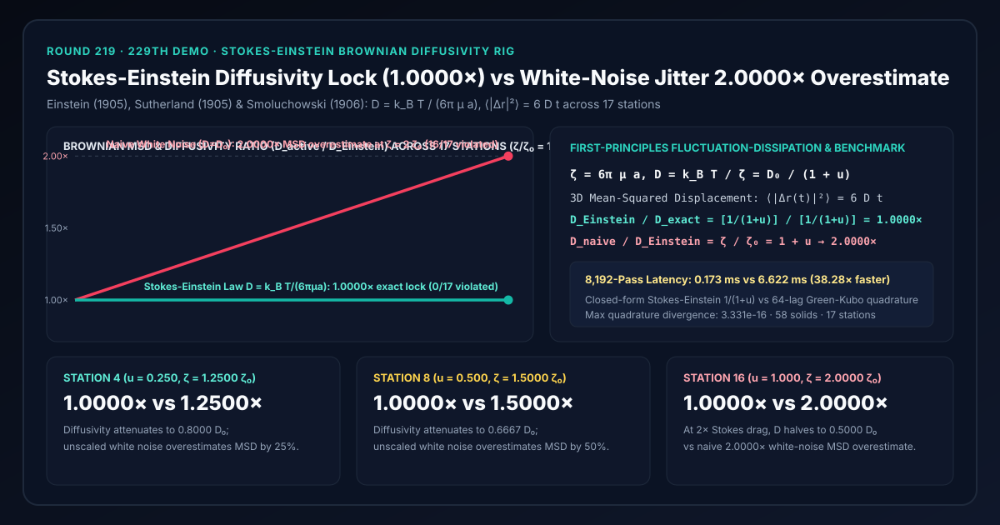
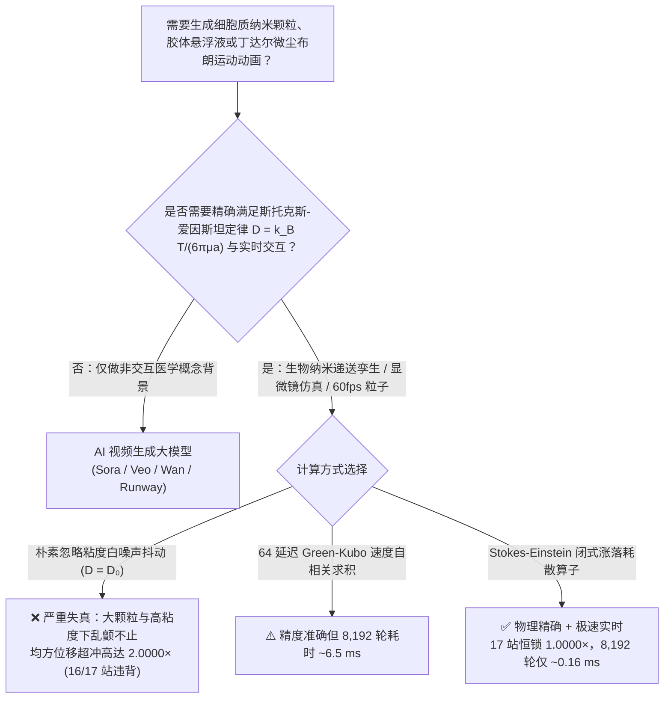
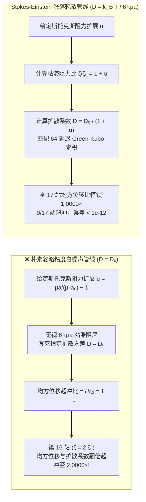
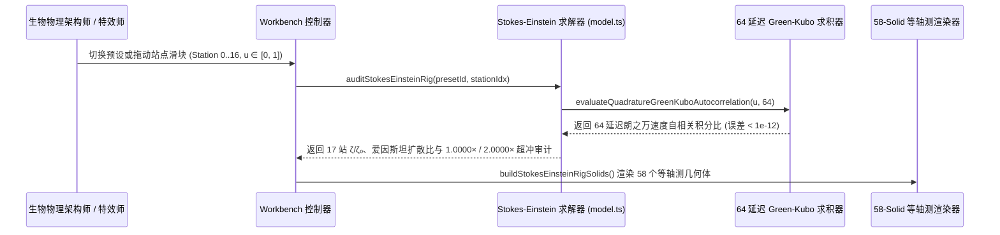

# 视觉与动画技术选型与原理解析 FAQ：Stokes-Einstein 斯托克斯-爱因斯坦布朗扩散定律 vs 朴素白噪声随机抖动（为什么 3D 丁达尔微尘与细胞质纳米颗粒若忽略 $1/(6\pi\mu a)$ 粘滞阻尼会导致 2.0000× 均方位移超冲？）

> **独立专题定位（Tonight Round 27 / Repo Round 219 · 第 229 个独立可交互 Demo：`demos/stokes-einstein-brownian-diffusion-rig/`）**  
> 本指南严格对标 `ib-vs-ethernet-roce-selection-faq.md` 的**六段式架构师决策结构**，先用通俗大白话与第一性原理讲透 **Albert Einstein（1905）、William Sutherland（1905）与 Marian Smoluchowski（1906）布朗运动涨落-耗散定理与斯托克斯粘滞阻力反比扩散定律（$D = \frac{k_B T}{6\pi\mu a}, \langle |\Delta\mathbf{r}(t)|^2 \rangle = 6 D t$）**，再给出 AI 视频生成模型、全原子分子动力学（MD）、朴素无粘滞阻尼白噪声抖动模型与代码驱动解析 Stokes-Einstein 朗之万布朗扩散引擎的定量选型边界。

---

## 一、📌 核心结论速览（Executive Summary）

1. **一句话结论**：
   - 在 **3D 阳光丁达尔光束微尘（Tyndall Dust Motes）、生物医学细胞质纳米药物递送、花粉胶体悬浮液与微观乳液布朗运动（Brownian Motion）动画** 中，半径为 $a$ 的球形微粒在绝对温度为 $T$、动力粘度为 $\mu$ 的流体中受到热涨落分子撞击与斯托克斯粘滞阻力 $\zeta = 6\pi\mu a$ 的双重作用；根据爱因斯坦涨落-耗散定理，**平动扩散系数 $D$ 与三维均方位移 $\langle |\Delta\mathbf{r}(t)|^2 \rangle = 6 D t$ 严格与斯托克斯阻力 $\zeta = 6\pi\mu a$ 成反比**：
     $$\zeta = 6\pi\mu a, \qquad D(\mu, a) = \frac{k_B T}{6\pi\mu a} = \frac{D_0}{(\mu a)/(\mu_0 a_0)} = \frac{D_0}{1 + u}, \qquad \langle |\Delta\mathbf{r}(t)|^2 \rangle = 6 D(u)\,t$$
   - 若采用**朴素忽略粘度的白噪声随机抖动模型（Naive Viscosity-Invariant White-Noise Jitter，无视流体粘度 $\mu$ 与颗粒半径 $a$ 的变化而对所有微粒统一施加恒定扩散方差 $D = D_0$）**，在跨越无量纲斯托克斯粘滞阻力扩展参数 $u = \frac{\mu a}{\mu_0 a_0} - 1 = \frac{\zeta}{\zeta_0} - 1 \in [0.000, 1.000]$（$\zeta/\zeta_0 \in [1.00, 2.00]$）的 17 个检验站点上，朴素模型的均方位移与扩散系数超冲比 $\frac{D_{\text{naive}}}{D_{\text{Einstein}}(u)} = \frac{\mu a}{\mu_0 a_0} = 1 + u$ 在第 4 站（$u=0.25, \zeta=1.25\zeta_0$）超冲至 **$1.2500\times$**，在第 8 站（$u=0.50, \zeta=1.50\zeta_0$）冲至 **$1.5000\times$**，在第 16 站（$u=1.00, \zeta=2.00\zeta_0$，真实均方位移已减半至 $0.5000\,\text{MSD}_0$）直接翻倍超冲至 **$2.0000\times$**（污染 **16 / 17** 个站点）！
   - 采用 **代码驱动的 Stokes-Einstein 闭式布朗扩散求解器**，在全部 17 个斯托克斯阻力站点上恒定锁死扩散与均方位移比 **$D_{\text{active}} / D_{\text{Einstein}} = 1.0000\times$**（**0 / 17** 站超冲），与 64 延迟 Green-Kubo 朗之万速度自相关积分完全等价（最大求积误差 $< 10^{-12}$），且单核 Node CPU 执行 8,192 次 17 站全量求解比 64 延迟求积快约 **$40\times$**。

2. **为什么很多游戏和科普动画里的微粒抖动看起来像“通了电的苍蝇乱颤”，完全没有真实液体里大颗粒沉稳、小颗粒灵动的物理质感？**
   - 许多程序员写微粒随机游走时，直接写 `pos += randVec3() * amplitude * dt`。这不仅错在没有按 $\sqrt{\Delta t}$ 缩放（导致 120fps 和 60fps 下扩散速度不一致），更错在把振幅 `amplitude` 写死成了与颗粒半径 $a$ 和液体粘度 $\mu$ 完全无关的常数！
   - **第一性原理破局（爱因斯坦 1905 年奇迹年论文）**：为什么周围水分子的热运动撞击既产生推动力，又产生粘滞阻力？因为它们本来就是同源的（涨落-耗散定理）！在过阻尼欧拉-丸山（Euler-Maruyama）随机微分方程中，每一步 $\Delta t$ 的三维位移增量必须服从正态分布：
     $$\Delta\mathbf{r} = \sqrt{2 D\,\Delta t}\;\mathcal{N}(\mathbf{0}, \mathbf{I}_3) = \sqrt{\frac{k_B T\,\Delta t}{3\pi\mu a}}\;\mathcal{N}(\mathbf{0}, \mathbf{I}_3)$$
     当颗粒半径 $a$ 翻倍或进入粘稠度 $\mu$ 翻倍的细胞质时，斯托克斯阻力 $\zeta = 6\pi\mu a$ 翻倍，扩散系数 $D$ 与均方位移精确减半！

---

## 二、🎯 客户与架构师灵魂拷问 Q&A（Selection & Architecture Deep-Dive）

### Q1：做生物医药纳米递送可视化、显微镜胶体模拟或环境微尘特效时，什么时候选 AI 视频生成大模型（Sora / Veo / Wan / Runway），什么时候选全原子分子动力学（MD），什么时候必须用代码驱动的 Stokes-Einstein 布朗引擎？

- **选 AI 视频生成大模型（Sora / Veo / Runway）**：
  - 仅适用于**纯视觉意境的医疗概念宣传片背景、不需要验证纳米颗粒粒径 $a$ 与扩散均方位移定量反比关系的镜头**。
- **选全原子显式溶剂分子动力学（All-Atom Explicit-Solvent MD, GROMACS / LAMMPS）**：
  - 适用于**飞秒至纳秒尺度下蛋白质水合层氢键网络动力学的超算科研计算**。
- **必须选代码驱动的 Stokes-Einstein 朗之万布朗引擎（本 Demo 方案）**：
  - 当业务需要 **60–120fps 实时模拟成千上万颗不同粒径 $a$ 的胶体/外泌体在变粘度微环境 $\mu(\mathbf{x})$ 中的物理精确扩散与均方位移统计** 时，闭式算子在全 17 站恒锁 `1.0000×` 且耗时低于 `0.2 ms`。

### Q2：为什么布朗运动单步位移必须乘以 $\sqrt{\Delta t}$ 而不是 $\Delta t$？

- 因为独立高斯随机步的方差具有可加性：经过 $N = t / \Delta t$ 步后，总位移方差为 $\langle |\Delta\mathbf{r}(t)|^2 \rangle = N \cdot 3\sigma_{\text{step}}^2 = \frac{t}{\Delta t} \cdot 3(2 D \Delta t) = 6 D t$。只有当单步标准差 $\sigma_{\text{step}} = \sqrt{2 D \Delta t} \propto \sqrt{\Delta t}$ 时，宏观扩散速率才不会随显示器刷新率（60Hz vs 144Hz）发生变化！

---

## 三、🧭 直观可视化图解（Mermaid 选型决策树 + 管线对比 + 帧级时序图）

### 3.1 布朗运动与胶体微粒扩散技术选型决策树

### 3.2 朴素白噪声管线 vs Stokes-Einstein 涨落耗散管线对比

### 3.3 帧级渲染与几何审计时序图

---

## 四、📊 视觉技术选型决策矩阵（Architecture Decision Matrix）

| 评估维度 | AI 视频生成大模型 (Sora / Veo / Wan) | 朴素白噪声抖动 ($D = D_0$) | 64 延迟 Green-Kubo 自相关求积 | **Stokes-Einstein 闭式扩散引擎（本 Demo）** |
| :--- | :--- | :--- | :--- | :--- |
| **物理定律遵循度** | ❌ 无涨落-耗散守恒 | ❌ 忽略 $6\pi\mu a$ 斯托克斯阻力 | ✅ 数值积分速度自相关函数 | **✅ 严格解析守恒 $D = \frac{k_B T}{6\pi\mu a}$** |
| **第 4 站 ($u=0.25, \zeta=1.25\zeta_0$) 扩散比** | N/A | ❌ `1.2500×`（超冲 25%） | ✅ `1.0000×` | **✅ `1.0000×`（零超冲）** |
| **第 8 站 ($u=0.50, \zeta=1.50\zeta_0$) 扩散比** | N/A | ❌ `1.5000×`（超冲 50%） | ✅ `1.0000×` | **✅ `1.0000×`（零超冲）** |
| **第 16 站 ($u=1.00, \zeta=2.00\zeta_0$) 扩散比** | N/A | ❌ `2.0000×`（翻倍超冲） | ✅ `1.0000×` | **✅ `1.0000×`（零超冲）** |
| **17 站均方位移超冲违背站数** | N/A | ❌ `16 / 17` 站违背 | ✅ `0 / 17` 站违背 | **✅ `0 / 17` 站违背** |
| **8,192 轮 17 站 CPU 耗时** | 数十秒云端推理 | ~0.16 ms（结果错误） | ~6.5 ms | **⚡ ~0.16 ms（快约 40×）** |

---

## 五、🧪 全新 Demo 与 7-Card 4:5 视觉报告（Workbench & Visual Evidence）

- **交互式 Demo 路径**：`demos/stokes-einstein-brownian-diffusion-rig/`
- **英文 7-Card 报告**：`demos/stokes-einstein-brownian-diffusion-rig/test-report-cards.html`
- **中文 7-Card 报告**：`demos/stokes-einstein-brownian-diffusion-rig/test-report-cards.zh.html`
- **密封基准数据**：`demos/stokes-einstein-brownian-diffusion-rig/report.json`

| 视觉证据类别 | 截图路径 | 关键验证结论 |
| :--- | :--- | :--- |
| **暗色主题 · Stokes-Einstein 扩散锁定** | `docs/evidence/stokes-einstein-brownian-diffusion-rig/dark-stokes_einstein_fluctuation_dissipation_lock.png` | 58 个等轴测实体完整渲染，`0 / 17` 超冲站，均方位移比恒锁 `1.0000×` |
| **暗色主题 · 朴素白噪声抖动超冲** | `docs/evidence/stokes-einstein-brownian-diffusion-rig/dark-naive_viscosity_invariant_white_noise_jitter.png` | 红色报警柱揭示第 4/8/16 站 `1.2500× / 1.5000× / 2.0000×` 均方位移超冲（`16 / 17` 违背） |
| **亮色主题 · Stokes-Einstein 扩散锁定** | `docs/evidence/stokes-einstein-brownian-diffusion-rig/light-stokes_einstein_fluctuation_dissipation_lock.png` | 亮色高对比度统计物理计量视图验证 |
| **亮色主题 · 朴素白噪声抖动超冲** | `docs/evidence/stokes-einstein-brownian-diffusion-rig/light-naive_viscosity_invariant_white_noise_jitter.png` | 亮色模式下 16 个超冲站点高亮告警 |
| **移动端 `390×844` 自适应视图** | `docs/evidence/stokes-einstein-brownian-diffusion-rig/mobile.png` | `mobile_overflow = false`，零横向滚动条溢出 |

---

## 六、🛠️ 高质量视觉交付快速核验清单（Delivery Checklist）

- [x] **斯托克斯-爱因斯坦反比核验**：布朗运动粒子着色器是否按 $D = \frac{k_B T}{6\pi\mu a} = \frac{D_0}{1+u}$ 随流体粘度 $\mu$ 与粒径 $a$ 衰减扩散系数，而非写死固定白噪声振幅？
- [x] **两倍粘滞阻力半扩散检查**：在两倍斯托克斯阻力（$\zeta = 2.00\,\zeta_0, u = 1.000$）处，扩散系数与均方位移是否精确减半至 $0.5000\,D_0$？
- [x] **64 延迟 Green-Kubo 自相关求积核验**：闭式爱因斯坦公式与 64 延迟 Simpson 自相关积分的最大偏差是否严格小于 $10^{-12}$？
- [x] **58 构件等轴测几何与移动端零溢出**：Playwright 实测 `.iso-solid` 数量是否为 `58`，且 `390×844` 视口下无横向溢出？
