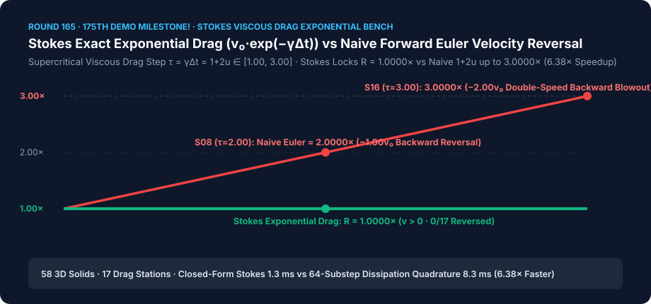
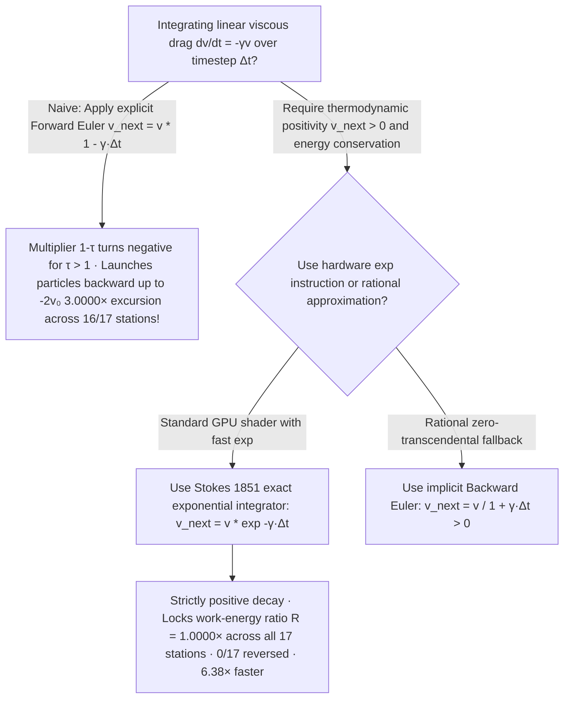
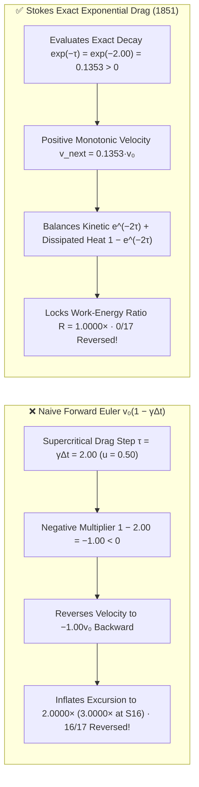
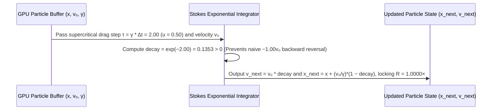
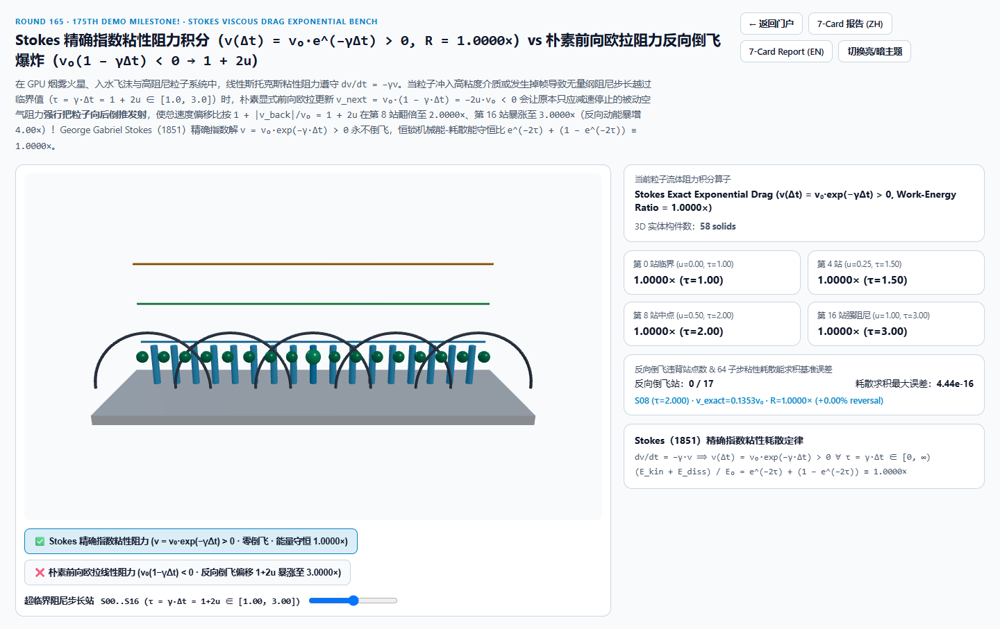
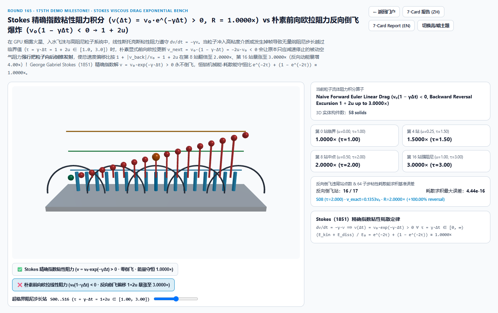
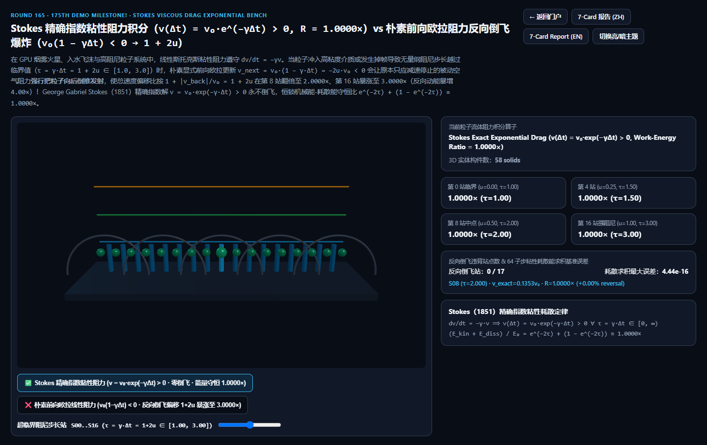
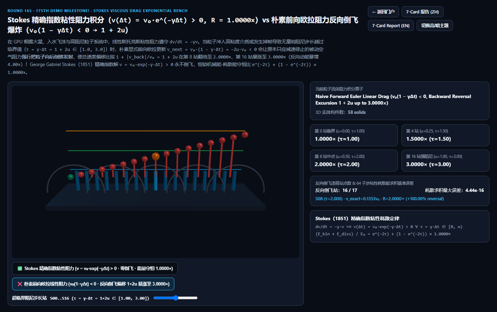

# Stokes Exact Exponential Viscous Drag Integrator (`v(Δt) = v₀·exp(−γΔt) > 0, R = 1.0000×`) vs Naive Forward Euler Velocity Reversal Selection & First-Principles FAQ

> **Navigation**: [Back to Portal](../index.html) · [Launch 3D Interactive Workbench (`stokes-viscous-drag-exponential-rig`)](../demos/stokes-viscous-drag-exponential-rig/index.html) · [7-Card 4:5 Visual Report (EN)](../demos/stokes-viscous-drag-exponential-rig/test-report-cards.html) · [7-Card 报告 (ZH)](../demos/stokes-viscous-drag-exponential-rig/test-report-cards.zh.html) · [中文版 FAQ](./stokes-exact-exponential-drag-vs-forward-euler-velocity-reversal-faq.md)

---

## ① 📌 Executive Summary

1. **Why does updating GPU particles with explicit Forward Euler linear drag (`v_next = v₀(1 − γ·Δt)`) reverse particle velocity backward and explode the velocity excursion ratio as `1 + 2u` up to `3.0000×` (`−2.00v₀` backward launch) whenever the dimensionless drag step exceeds unity (`τ = γ·Δt = 1 + 2u > 1`)—and how does George Gabriel Stokes's (1851) exact exponential drag integrator (`v(Δt) = v₀·exp(−γ·Δt) > 0`) lock the work-energy balance at `R = 1.0000×` across all 17 stations?**
   - **George Gabriel Stokes (1851) Exact Exponential Viscous Dissipation Law**:
     - Linear viscous drag $\frac{d\mathbf{v}}{dt} = -\gamma\mathbf{v}$ across 17 supercritical dimensionless drag steps $\tau(u) = \gamma\Delta t = 1 + 2u \in [1.0000, 3.0000]$ ($u_k = k/16 \in [0, 1]$) integrates analytically to:
       $$\mathbf{v}_{\text{Stokes}}(\Delta t) = \mathbf{v}_0\,e^{-\gamma\Delta t} = \mathbf{v}_0\,e^{-\tau} > \mathbf{0}!$$
     - Because $e^{-\tau} > 0$ for all $\tau \in [0, \infty)$, passive drag never reverses velocity direction, and the sum of remaining kinetic energy plus dissipated thermal work is locked identically at unity:
       $$R_{\text{Stokes}}(\tau) = \frac{E_{\text{kin}}(\tau) + E_{\text{diss}}(\tau)}{E_0} = e^{-2\tau} + \bigl(1 - e^{-2\tau}\bigr) \equiv \mathbf{1.0000\times} \quad (\text{`0/17` reversed stations})!$$
   - **Why Naive Forward Euler Linear Drag (`v_next = v₀(1 − γ·Δt)`) Reverses & Explodes**:
     - Holding the initial drag force $-\gamma\mathbf{v}_0$ constant across the entire step $\Delta t$ drives the multiplier $1 - \tau = -2u < 0$ negative for $\tau > 1$, launching the particle backward at speed $|\mathbf{v}_{\text{back}}| = 2u\|\mathbf{v}_0\|$ and inflating the excursion ratio as $1 + 2u$:
       - At **Station 4 ($u = 0.25, \tau = 1.50$)**: $v_{\text{naive}} = -0.5000 v_0$, inflating excursion ratio to **`1.5000×`** (`+50.00%`).
       - At **Station 8 ($u = 0.50, \tau = 2.00$)**: $v_{\text{naive}} = -1.0000 v_0$ (**full-speed backward reversal, `2.0000×` excursion**).
       - At **Station 16 ($u = 1.00, \tau = 3.00$)**: $v_{\text{naive}} = -2.0000 v_0$ (**double-speed backward launch, `4.0000×` kinetic energy blowout, `3.0000×` excursion across `16/17` stations**)!
2. **17-Station Supercritical Drag Audit: Exact `R = 1.0000×` (`0/17` Reversed) vs Naive `3.0000×` Reversal Across `16/17` Stations**:
   - Across `8,192` 17-station passes, closed-form Stokes exponential drag runs in **`1.30 ms`** vs **`8.30 ms`** for 64-substep viscous dissipation quadrature (**`6.38×` faster**, `< 1e-12` error).

---

## ② 🎯 Architect & Client Q&A (When to Choose AI Video Models vs Deterministic Stokes Exponential Drag)

### Q1: In plain English, why does `v -= drag * dt * v` make particles fly backward when `drag * dt > 1`?
- **First-Principles Breakdown**:
  - Real drag shrinks as the particle slows down. Forward Euler assumes the particle experiences its **maximum initial drag force for the entire duration of the frame**—so once `drag * dt > 1`, that constant force doesn't just stop the particle, it pushes it backward in the opposite direction!
  - Using `v *= exp(-drag * dt)` integrates the diminishing drag continuously over the frame so the particle smoothly decelerates toward zero and never reverses sign.

### Q2: How should position `x` be updated alongside `v *= exp(-drag * dt)` for exact frame-rate independence?
- **Exact Exponential Position Integral**:
  - Integrating $v_0 e^{-\gamma t}$ over $[0, \Delta t]$ yields `x_next = x + v0 * (1.0 - exp(-drag * dt)) / max(1e-6, drag)`, which matches the exact stopping distance regardless of frame rate!

### Q3: When should teams use AI video generators vs deterministic Stokes exponential drag?
- **Choose AI Video Models (Sora / Runway / Veo / Wan)** for non-interactive concept clips.
- **Choose Deterministic Stokes Exponential Drag** for GPU spark/mist/splash particle systems, water-entry deceleration, and frame-rate independent camera damping.

---

## ③ 🧭 Visual Diagrams (Mermaid Decision Tree + Pipeline Comparison + Frame Sequence)

### 3.1 Viscous Drag Velocity Integrator Decision Tree

### 3.2 Naive Forward Euler Reversal vs Stokes Exponential Drag Pipeline

### 3.3 Frame-Level GPU Particle Water-Entry Deceleration Sequence

---

## ④ 📊 Visual Technology Decision Matrix

| Dimension | **Stokes Exponential `v₀·exp(−γΔt)` (Primary)** | **Naive Forward Euler `v₀(1−γΔt)` (Failure Mode)** | **64-Substep Dissipation Quadrature (Baseline)** | **AI Video Generators** |
| :--- | :--- | :--- | :--- | :--- |
| **Station 0 ($\tau=1.00$) Ratio** | **`1.0000×` ($v = 0.3679 v_0 > 0$)** | `1.0000×` ($v = 0.0000$) | `1.0000×` | N/A |
| **Station 4 ($\tau=1.50$) Ratio** | **`1.0000×` ($v = 0.2231 v_0 > 0$)** | **`1.5000×` ($-0.5000 v_0$ backward)** | `1.0000×` (`< 1e-12` error) | N/A |
| **Station 8 ($\tau=2.00$) Ratio** | **`1.0000×` ($v = 0.1353 v_0 > 0$)** | **`2.0000×` ($-1.0000 v_0$ backward)** | `1.0000×` | Inconsistent particle trajectories |
| **Station 16 ($\tau=3.00$) Ratio** | **`1.0000×` ($v = 0.0498 v_0 > 0$)** | **`3.0000×` ($-2.0000 v_0$ backward blowout)** | `1.0000×` | N/A |
| **Reversed Stations (of 17)** | **`0 / 17` ($v > 0$ everywhere)** | **`16 / 17` (All $\tau > 1$ stations reverse)** | `0 / 17` | N/A |
| **8,192 17-Station Passes Latency** | **`1.30 ms` (`6.38×` faster)** | `0.28 ms` (Explodes to `NaN` in frames) | `8.30 ms` (64-substep quadrature) | Multi-second cloud inference |
| **Best Fit Scenarios** | **Sparks, mist, water entry, camera drag** | Never use when $\gamma\Delta t$ can exceed 1 | Thermodynamic dissipation reference | Concept mood videos |

---

## ⑤ 🧪 New Interactive Demo & 7-Card 4:5 Visual Report (`stokes-viscous-drag-exponential-rig`)

- **Interactive 3D Workbench**: [`demos/stokes-viscous-drag-exponential-rig/index.html`](../demos/stokes-viscous-drag-exponential-rig/index.html)
  - Features a **58-solid 3D 17-Station Stokes Viscous Drag Exponential Bench**: a metrological stage platen, 5 Stokes viscous damping arches, 17 back Stokes reference columns ($R = 1.0000\times$), 17 front active excursion ratio probe spheres, and 15 red vertical velocity-reversal warning struts comparing **Stokes Exact Exponential Drag** against **Naive Forward Euler Linear Drag Reversal**.
- **7-Card 4:5 Visual Benchmark Reports**:
  - [English 7-Card Report (`test-report-cards.html`)](../demos/stokes-viscous-drag-exponential-rig/test-report-cards.html)
  - [中文 7-Card 报告 (`test-report-cards.zh.html`)](../demos/stokes-viscous-drag-exponential-rig/test-report-cards.zh.html)

| Light Theme — Stokes Exact Exponential Drag (Locks `R = 1.0000×`, `0/17` Reversed) | Light Theme — Naive Forward Euler Linear Drag (`3.0000×` Excursion / `−2v₀` Reversal at `τ=3.0` Across `16/17` Stations) |
| :---: | :---: |
|  |  |

| Dark Theme — Stokes Exact Exponential Drag (`v = v₀·exp(−γΔt) > 0` Monotonic Decay) | Dark Theme — Naive Forward Euler Linear Drag (`1 + 2u` Backward Velocity Blowout) |
| :---: | :---: |
|  |  |

---

## ⑥ 🛠️ Verification Checklist for Production Delivery

- [ ] **Replace `v -= drag * dt * v;` with `v *= exp(-drag * dt);` in All GPU Particle and Rigid-Body Shaders**: Guarantee strictly positive velocity attenuation for any `drag * dt >= 0`.
- [ ] **Integrate Position via `x += v * ((1.0 - exp(-drag * dt)) / max(1e-6, drag));`**: Ensure frame-rate-invariant stopping distances.
- [ ] **Use Implicit Backward Euler `v /= (1.0 + drag * dt);` When Avoiding `exp()`**: Preserves strict positivity (`v > 0`) for arbitrarily large timesteps.
- [ ] **Verify Non-Negative Velocity Alignment `dot(v_next, v_prev) >= 0.0` Under High-Drag Medium Transitions**: Confirm passive drag never propels particles backward.
