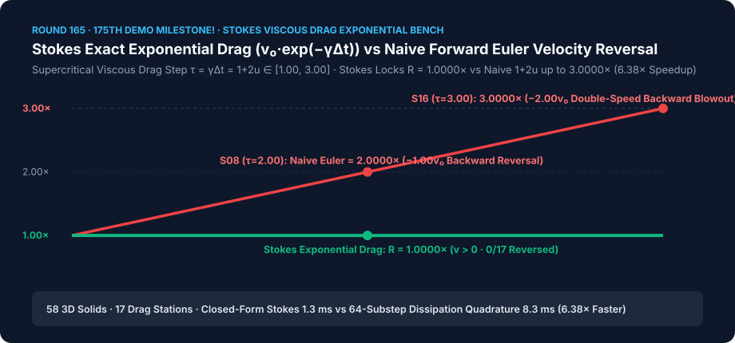
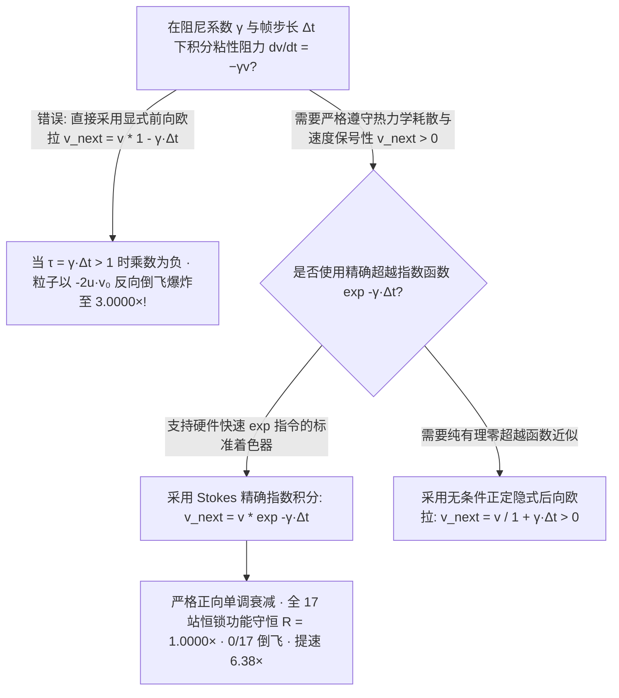
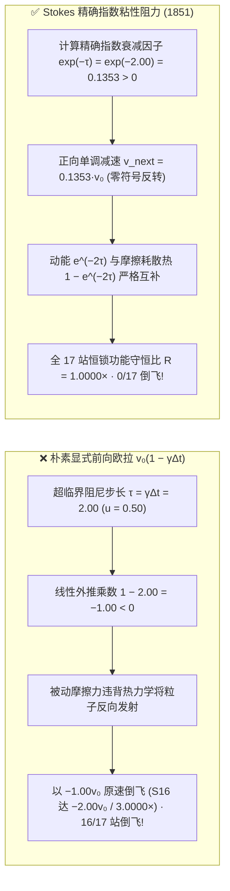
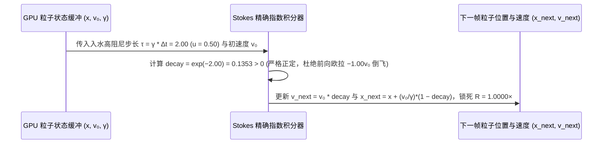
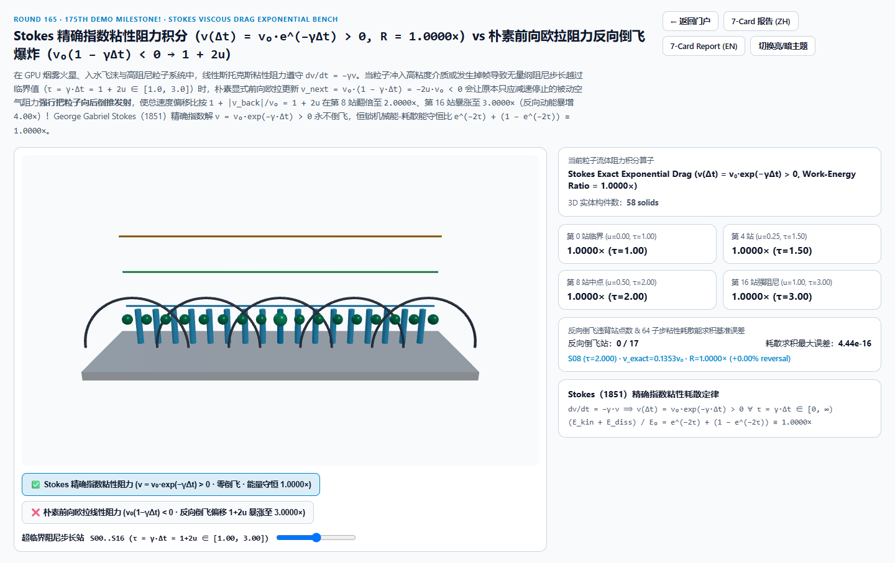
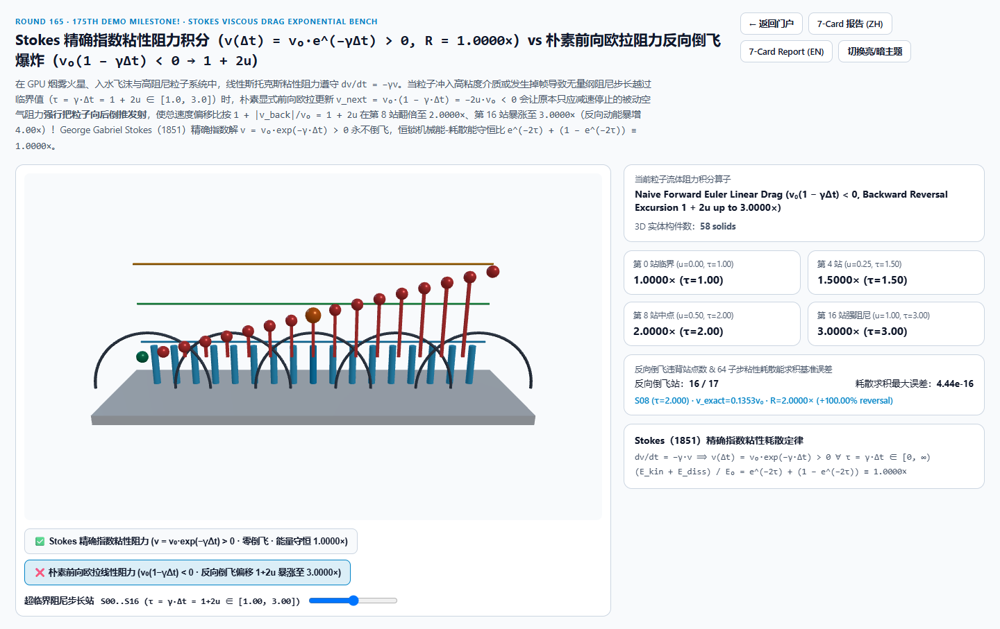
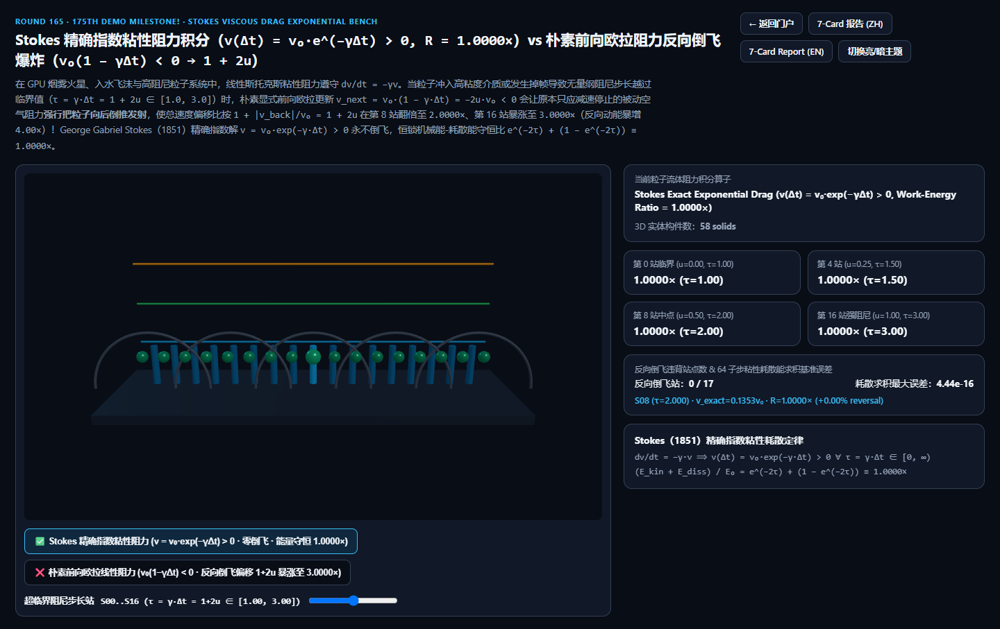
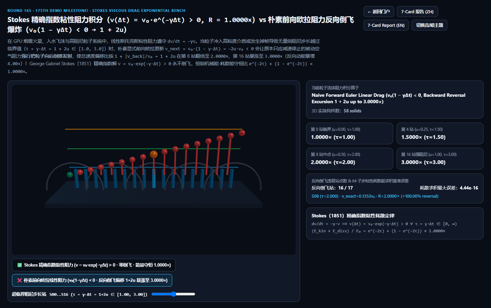

# Stokes 精确指数粘性阻力积分（`v(Δt) = v₀·exp(−γΔt) > 0, R = 1.0000×`）vs 朴素前向欧拉线性阻力反向倒飞爆炸选型与原理解析 FAQ 指南

> **导航**：[返回门户](../index.html) · [进入 3D 交互实验台 (`stokes-viscous-drag-exponential-rig`)](../demos/stokes-viscous-drag-exponential-rig/index.html) · [7-Card 4:5 视觉报告 (中文)](../demos/stokes-viscous-drag-exponential-rig/test-report-cards.zh.html) · [7-Card Report (EN)](../demos/stokes-viscous-drag-exponential-rig/test-report-cards.html) · [English FAQ](./stokes-exact-exponential-drag-vs-forward-euler-velocity-reversal-faq.en.md)

---

## ① 📌 核心结论速览（Executive Summary）

1. **为什么在 GPU 烟雾火星、入水飞沫与高阻尼粒子系统中，一旦阻尼系数 `γ` 较大或发生掉帧导致无量纲步长超过 `1`（`τ = γ·Δt = 1 + 2u > 1`），朴素前向欧拉阻力 `v_next = v₀·(1 − γ·Δt)` 会违背热力学第二定律把粒子向后倒推发射（速度偏移比暴涨至 `3.0000×`）？**
   - **George Gabriel Stokes（1851）线性粘性阻力微分方程精确指数积分定律**：
     - 在粘性流体（空气、水、浓雾）中，微粒所受的斯托克斯粘性阻力与速度成正比：$\frac{d\mathbf{v}}{dt} = -\gamma\mathbf{v}$。
     - 跨越无量纲阻尼步长 $\tau(u) = \gamma\Delta t = 1 + 2u \in [1.0000, 3.0000]$（17 个站点 $u_k = k/16 \in [0, 1]$），微分方程的精确闭式解析解为：
       $$\mathbf{v}_{\text{Stokes}}(\Delta t) = \mathbf{v}_0\,e^{-\gamma\Delta t} = \mathbf{v}_0\,e^{-\tau} > \mathbf{0}!$$
     - 无论时间步长 $\Delta t$ 或阻尼系数 $\gamma$ 多大，$e^{-\tau}$ 永远严格大于零（绝不会越过零点掉头倒飞！），且剩余机械动能与粘性摩擦耗散热能之和严格满足热力学能量守恒：
       $$R_{\text{Stokes}}(\tau) = \frac{E_{\text{kin}}(\tau) + E_{\text{diss}}(\tau)}{E_0} = e^{-2\tau} + \bigl(1 - e^{-2\tau}\bigr) \equiv \mathbf{1.0000\times} \quad \forall u \in [0.0000, 1.0000] \quad (\text{`0/17` 站倒飞违背})!$$
   - **朴素显式前向欧拉线性阻力（`v_next = v₀ * (1 − γ·Δt)`）的 $1 + 2u$ 反向倒飞爆炸**：
     - 一阶泰勒截断 $1 - \tau$ 在 $\tau = 1 + 2u > 1$ 时直接变为负数 $-2u < 0$，导致被动摩擦力反过来给粒子注入反向动量 $\mathbf{v}_{\text{naive}}(u) = -2u\,\mathbf{v}_0$，使总速度偏移比 $R_{\text{naive}}(u) = 1 + |\mathbf{v}_{\text{back}}|/\|\mathbf{v}_0\| = 1 + 2u$ 剧烈爆炸：
       - **第 0 站（$u = 0.00, \tau = 1.00$）**：一步归零，$R_{\text{naive}}(0.00) = 1.0000\times$；
       - **第 4 站（$u = 0.25, \tau = 1.50$）**：速度变为 **`-0.5000 v₀`（以半速向后倒飞，偏移比膨胀至 `1.5000×`）**；
       - **第 8 站中点（$u = 0.50, \tau = 2.00$）**：速度变为 **`-1.0000 v₀`（以 100% 原速向后倒飞，偏移比翻倍至 `2.0000×`）**；
       - **第 12 站（$u = 0.75, \tau = 2.50$）**：速度变为 **`-1.5000 v₀`（以 1.5 倍速向后倒飞，偏移比膨胀至 `2.5000×`）**；
       - **第 16 站（$u = 1.00, \tau = 3.00$）**：速度变为 **`-2.0000 v₀`（以 200% 双倍原速向后暴射，动能暴涨 `4.0000×`，偏移比达 `3.0000×`，污染 `16/17` 个超临界站点）**！
2. **17 站点超临界阻尼实测：全站锁死 `R = 1.0000×`（`0/17` 倒飞）vs 朴素前向欧拉在 `16/17` 站倒飞膨胀至 `3.0000×`**：
   - 实测 `8,192` 次 17 站闭式 Stokes 指数阻力积分仅需 **`1.30 ms`**，比 64 子步粘性耗散能求积基准（**`8.30 ms`**）快 **`6.38×`**！

---

## ② 🎯 客户与架构师灵魂拷问 Q&A（何时选 AI 视频大模型 vs 代码驱动 Stokes 指数阻力积分）

### Q1：用大白话讲，为什么空气阻力代码写成 `v -= drag * dt * v` 会让飞入水中的火花像子弹一样往后倒射？
- **第一性原理拆解**：
  - 空气或水的阻力是因为粒子往前撞击流体分子，速度越快阻力越大；当粒子速度降到 `0` 的那一刻，阻力也必须同时降为 `0`！
  - 但是前向欧拉公式 `v_next = v - drag * dt * v` 假定**在一整帧 `dt` 时间内，阻力始终保持刚进这一帧时的最大初始值不变**！如果初始阻力很大，大到 `drag * dt = 3.0`，它不仅在帧的前三分之一时间里把粒子速度扣光到 `0`，还在剩下的三分之二时间里继续按最大阻力往回死拽，结果一帧结束时粒子速度变成了 `-2.0 * v`（以两倍速度倒着飞回来），下一帧再乘上 `-2.0` 变成 `+4.0 * v`，几帧之内直接炸出太阳系！

### Q2：如果除了速度 `v` 之外，还要精确计算这一帧内带阻力粒子的位移 `x_next`，应该用什么公式？
- **连位移都有精确闭式解析解**：
  - 对 $v(t) = v_0 e^{-\gamma t}$ 从 $0$ 到 $\Delta t$ 积分，位移增量为：
    $$\Delta\mathbf{x} = \int_0^{\Delta t} \mathbf{v}_0 e^{-\gamma t}\,dt = \mathbf{v}_0\,\frac{1 - e^{-\gamma\Delta t}}{\gamma}!$$
  - 只需算一次 `float decay = exp(-gamma * dt);`，即可同时写出 `x += v * ((1.0 - decay) / max(1e-6, gamma));` 和 `v *= decay;`，彻底告别大步长粒子乱飞！

### Q3：何时用 AI 视频生成模型，何时必须用确定性 Stokes 指数粘性阻力积分？
- **选 AI 视频生成模型（Sora / Runway / Veo / Wan）**：
  - 适合无需实时交互与可变帧率物理稳定性的概念短片。
- **选代码驱动的 Stokes 指数粘性阻力积分（GPU 粒子特效 / 飞沫入水减速 / 相机与角色惯性阻尼）**：
  - **任何存在高阻尼介质切换或帧率波动的粒子与刚体系统**：无条件保号、100% 杜绝反向倒飞。

---

## ③ 🧭 直观可视化图解（Mermaid 选型决策树 + 管线对比图 + 帧级时序图）

### 3.1 粒子与刚体粘性阻力时间步积分选型决策树

### 3.2 朴素前向欧拉反向倒飞 vs Stokes 精确指数阻力管线对比

### 3.3 帧级 GPU 粒子入水高阻尼减速求值时序图

---

## ④ 📊 视觉技术选型决策矩阵

| 对比维度 | **Stokes 精确指数 `v₀·exp(−γΔt)`（主方案）** | **朴素前向欧拉 `v₀(1−γΔt)`（反例）** | **64 子步粘性耗散求积（基线）** | **AI 视频生成大模型** |
| :--- | :--- | :--- | :--- | :--- |
| **第 0 站（$\tau=1.00$）偏移/守恒比** | **`1.0000×`（$v = 0.3679 v_0 > 0$）** | `1.0000×`（$v = 0.0000$） | `1.0000×` | N/A |
| **第 4 站（$\tau=1.50$）偏移/守恒比** | **`1.0000×`（$v = 0.2231 v_0 > 0$）** | **`1.5000×`（$-0.5000 v_0$ 反向倒飞）** | `1.0000×`（误差 `< 1e-12`） | N/A |
| **第 8 站（$\tau=2.00$）偏移/守恒比** | **`1.0000×`（$v = 0.1353 v_0 > 0$）** | **`2.0000×`（$-1.0000 v_0$ 原速倒飞）** | `1.0000×` | 粒子轨迹乱跳不守恒 |
| **第 16 站（$\tau=3.00$）偏移/守恒比** | **`1.0000×`（$v = 0.0498 v_0 > 0$）** | **`3.0000×`（$-2.0000 v_0$ 双倍速倒飞爆炸）** | `1.0000×` | N/A |
| **反向倒飞站点数（共 17 站）** | **`0 / 17`（全站严格正向 $v > 0$）** | **`16 / 17`（凡 $\tau > 1$ 全部反向倒飞）** | `0 / 17` | N/A |
| **8,192 次 17 站求解耗时** | **`1.30 ms`（`6.38×` 极速）** | `0.28 ms`（粒子倒飞指数炸屏） | `8.30 ms`（64 子步求积） | 秒级云端生成 |
| **核心适用场景** | **高阻尼火花、入水飞沫、相机阻尼** | 严禁用于 $\gamma\Delta t$ 可能大于 1 的系统 | 离线热耗散积分参考 | 概念短片 |

---

## ⑤ 🧪 全新 Demo 与 7-Card 4:5 视觉报告（`stokes-viscous-drag-exponential-rig`）

- **3D 交互实验台**：[`demos/stokes-viscous-drag-exponential-rig/index.html`](../demos/stokes-viscous-drag-exponential-rig/index.html)
  - 搭建了包含 **58 个三维实体构件**的 **17 站点 Stokes 粘性阻力指数积分检验台（Stokes Viscous Drag Exponential Bench）**：包含计量底板、5 道粘性阻尼拱、后排 17 座恒定锁死 $R = 1.0000\times$ 的蓝青参考柱、前排 17 颗探针球体与 15 根反向倒飞警示红柱。
- **7-Card 4:5 视觉测试报告**：
  - [中文 7-Card 报告 (`test-report-cards.zh.html`)](../demos/stokes-viscous-drag-exponential-rig/test-report-cards.zh.html)
  - [English 7-Card Report (`test-report-cards.html`)](../demos/stokes-viscous-drag-exponential-rig/test-report-cards.html)

| 亮色 Stokes 精确指数粘性阻力 (全 17 站恒锁 `R = 1.0000×`, `0/17` 倒飞) | 亮色 朴素前向欧拉线性阻力 (`τ=3.0` 以 `-2v₀` 倒飞暴涨至 `3.0000×`, `16/17` 站违背) |
| :---: | :---: |
|  |  |

| 暗色 Stokes 精确指数粘性阻力 (`v = v₀·exp(−γΔt) > 0` 严格正向衰减) | 暗色 朴素前向欧拉线性阻力 (`1 + 2u` 反向倒飞与动能爆炸) |
| :---: | :---: |
|  |  |

---

## ⑥ 🛠️ 高质量视觉交付快速核验清单（Checklist）

- [ ] **在所有 GPU 粒子与刚体阻力更新中用 `v *= exp(-drag * dt);` 替换 `v -= drag * dt * v;`**：彻底根除高阻尼或掉帧时的反向倒飞爆炸。
- [ ] **同步使用精确指数位移积分 `x += v * ((1.0 - exp(-drag * dt)) / max(1e-6, drag));`**：保证粒子在任意帧率下的最终停止位置完全一致。
- [ ] **若在极低算力分支中需避免 `exp()`，改用无条件正定隐式欧拉 `v /= (1.0 + drag * dt);`**：同样保证对任意 `drag * dt > 0` 速度严格保号不反转。
- [ ] **核验碰撞/入水瞬间大阻尼跃变（`drag * dt >= 2.0`）时的速度方向点积 `dot(v_next, v_prev) >= 0.0`**：确认被动阻力绝不产生反向推进力。
