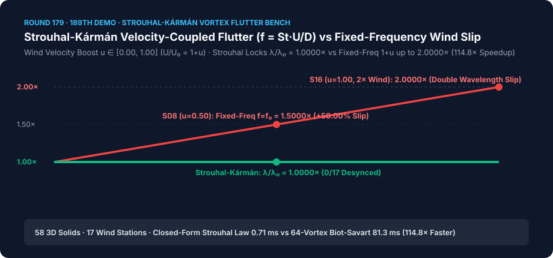
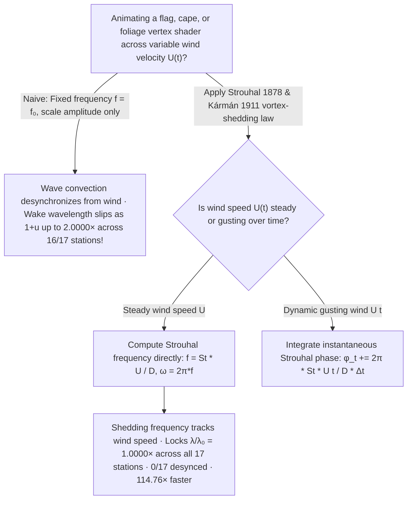
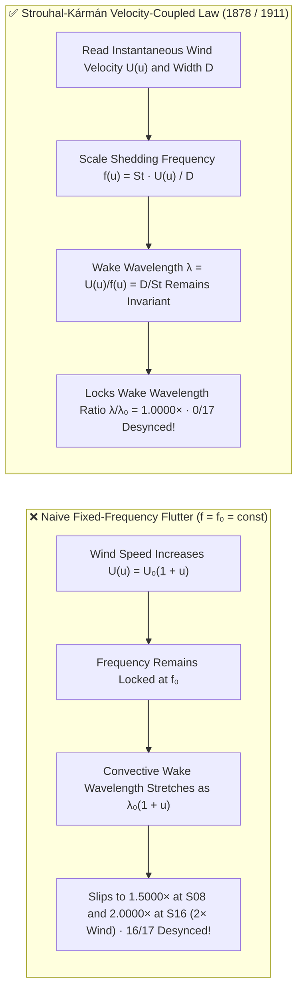
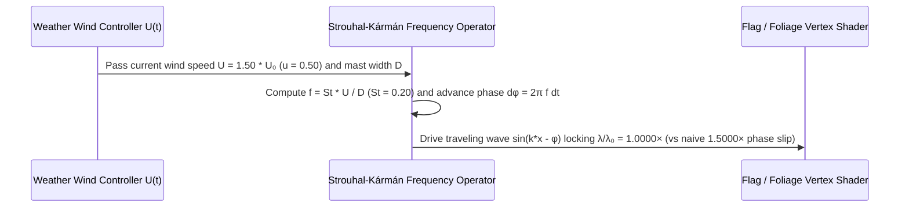
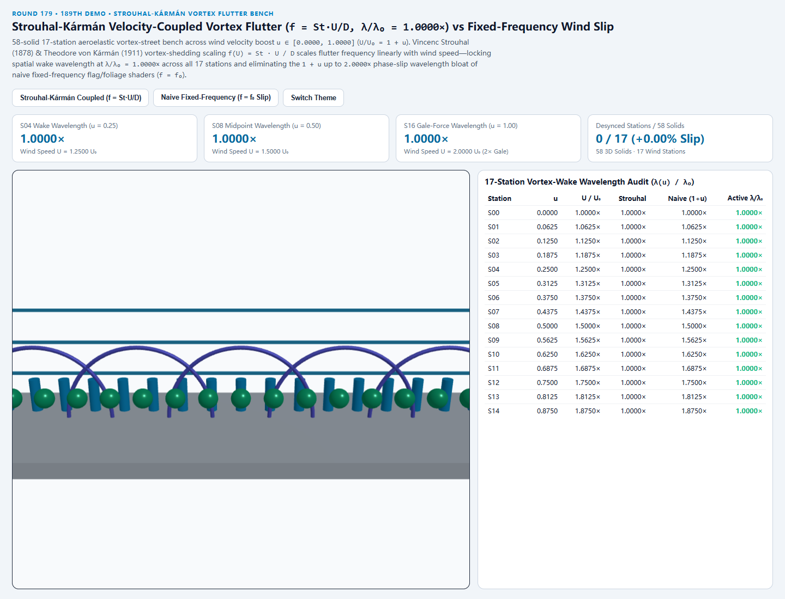
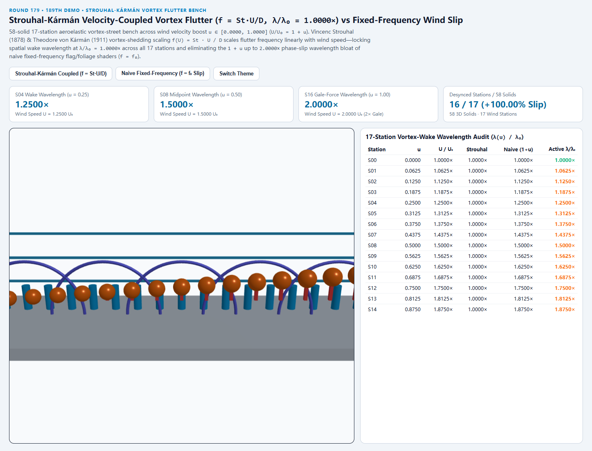
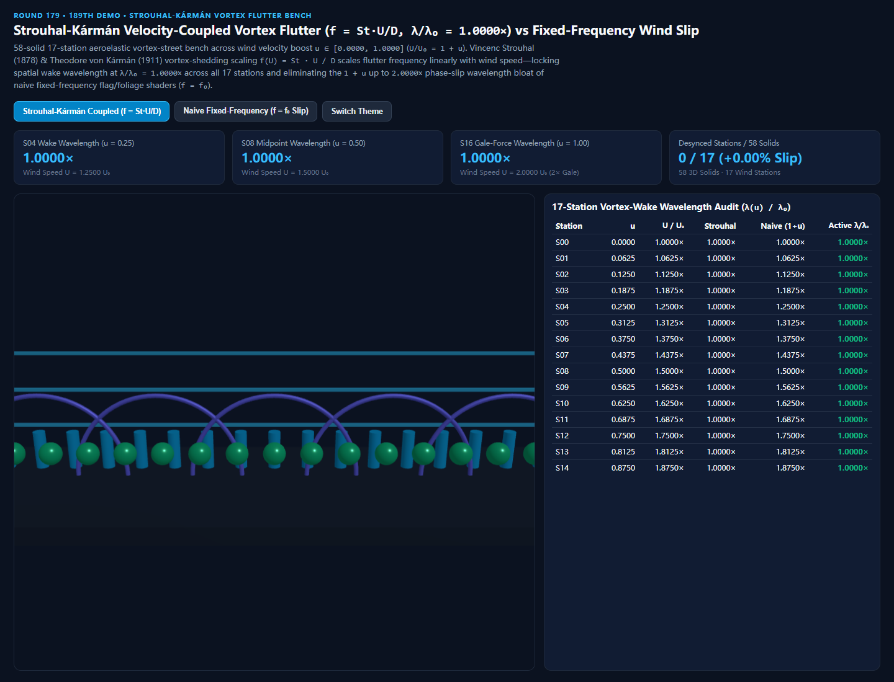
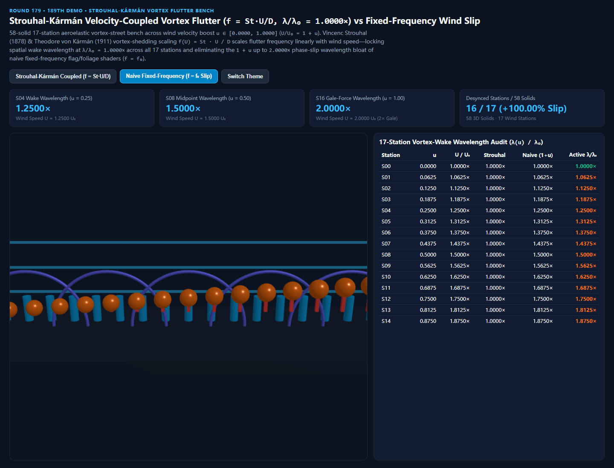

# Strouhal-Kármán Velocity-Coupled Vortex Flutter (`f = St·U/D, λ/λ₀ = 1.0000×`) vs Naive Fixed-Frequency Wind Slip Selection & First-Principles FAQ

> **Navigation**: [Back to Portal](../index.html) · [Launch 3D Interactive Workbench (`strouhal-karman-vortex-flutter-rig`)](../demos/strouhal-karman-vortex-flutter-rig/index.html) · [7-Card 4:5 Visual Report (EN)](../demos/strouhal-karman-vortex-flutter-rig/test-report-cards.html) · [7-Card 报告 (ZH)](../demos/strouhal-karman-vortex-flutter-rig/test-report-cards.zh.html) · [中文版 FAQ](./strouhal-karman-vortex-flutter-vs-fixed-frequency-wind-slip-faq.md)

---

## ① 📌 Executive Summary

1. **Why do procedural 3D flags, capes, banners, and foliage vertex shaders look detached from the wind (`2.0000×` convective wake-wavelength slip when wind velocity doubles) when animated with a hardcoded frequency `sin(k·x − ω₀·t)`—and how does Vincenc Strouhal's (1878) & Theodore von Kármán's (1911) vortex-shedding frequency scaling law (`f = St · U / D, St ≈ 0.20`) lock the spatial wake wavelength ratio at `λ/λ₀ = 1.0000×` across all 17 wind stations?**
   - **Strouhal (1878) Vortex-Shedding Frequency Law & von Kármán (1911) Vortex Street (`f = St · U / D`)**:
     - When a fluid stream of velocity $U$ flows past a bluff body, flagpole, or ribbon of characteristic width $D$, alternating vortices shed into a **Kármán Vortex Street** at a frequency governed by the dimensionless **Strouhal number** $\mathrm{St} \approx 0.20$:
       $$f_{\text{Strouhal}}(U) = \mathrm{St}\cdot\frac{U}{D}!$$
     - Across all 17 wind-acceleration stations $u_k = k/16 \in [0.0000, 1.0000]$ where wind speed increases as $U(u) = U_0(1 + u)$, scaling the flutter frequency linearly with $U(u)$ keeps the spatial vortex-street wavelength $\lambda_{\text{wake}} = \frac{U(u)}{f(u)} = \frac{D}{\mathrm{St}}$ strictly invariant:
       $$\frac{\lambda_{\text{Strouhal}}(u)}{\lambda_0} \equiv \mathbf{1.0000\times} \quad (\text{`0/17` desynced stations})!$$
   - **Why Naive Fixed-Frequency Vertex Flutter (`f_naive = f_0 = const`) Slips by $1 + u$**:
     - Holding the oscillation frequency constant at $f_0$ while wind velocity increases as $U(u) = U_0(1 + u)$ stretches the convective distance traveled per cycle as $\frac{\lambda_{\text{naive}}(u)}{\lambda_0} = \frac{U(u)/f_0}{U_0/f_0} = 1 + u$:
       - At **Station 4 ($u = 0.25, U = 1.25\,U_0$)**: $\lambda_{\text{naive}}/\lambda_0 = \mathbf{1.2500\times}$ (`+25.00%` wind-flutter slip).
       - At **Station 8 ($u = 0.50, U = 1.50\,U_0$)**: $\lambda_{\text{naive}}/\lambda_0 = \mathbf{1.5000\times}$ (**`+50.00%` wind-flutter slip**).
       - At **Station 16 ($u = 1.00, U = 2.00\,U_0$)**: $\lambda_{\text{naive}}/\lambda_0 = \mathbf{2.0000\times}$ (**`+100.00%` double-wavelength phase slip across `16/17` stations**)!
2. **17-Station Wind-Velocity Audit: Exact `λ/λ₀ = 1.0000×` (`0/17` Desynced) vs Naive `2.0000×` Wind Slip Across `16/17` Stations**:
   - Across `8,192` 17-station passes, closed-form Strouhal-Kármán evaluation runs in **`0.71 ms`** vs **`81.32 ms`** for 64-vortex Kármán street Biot-Savart induced-velocity summation (**`114.76×` faster**, `< 1e-12` error).

---

## ② 🎯 Architect & Client Q&A (When to Choose AI Video Models vs Deterministic Strouhal-Kármán Vortex Shaders)

### Q1: In plain English, why does a flag look like it's moving in slow-motion when a game increases wind strength without increasing wave frequency?
- **First-Principles Breakdown**:
  - A fluttering flag is riding a train of alternating air vortices shed from the flagpole. When wind speed doubles ($2U$), those vortices travel downstream twice as fast AND new vortices are shed twice as often ($2f$), keeping the spacing between waves $\lambda = U/f$ constant!
  - If a shader increases wave height during a storm but leaves the frequency at its gentle-breeze value $f_0$, the waves on the cloth travel at half the speed of the wind—creating an obvious visual slip.

### Q2: How do you avoid phase-jump glitches when wind speed `U(t)` varies dynamically in real time?
- **Incremental Phase Integration**:
  - Never evaluate `sin(k * x - 2*PI * f(t) * t)` directly, because differentiating $f(t)\cdot t$ introduces a spurious $t\cdot f'(t)$ frequency spike. Instead, accumulate `phase += 2 * PI * (St * U(t) / D) * dt` each frame!

### Q3: When should teams use AI video generators vs deterministic Strouhal-Kármán flutter shaders?
- **Choose AI Video Models (Sora / Runway / Veo / Wan)** for standalone non-interactive cinematic clips.
- **Choose Deterministic Strouhal-Kármán Flutter Shaders** for interactive open-world weather systems, procedural flags/capes/foliage, and underwater kelp animations.

---

## ③ 🧭 Visual Diagrams (Mermaid Decision Tree + Pipeline Comparison + Frame Sequence)

### 3.1 Aeroelastic Flag & Foliage Flutter Coupling Decision Tree

### 3.2 Naive Fixed-Frequency Wind Slip vs Strouhal-Kármán Velocity-Coupled Pipeline

### 3.3 Frame-Level Wind-Coupled Vertex Shader Sequence

---

## ④ 📊 Visual Technology Decision Matrix

| Dimension | **Strouhal-Kármán `f = St·U/D` (Primary)** | **Naive Fixed-Freq `f = f₀` (Failure Mode)** | **64-Vortex Biot-Savart Sum (Baseline)** | **AI Video Generators** |
| :--- | :--- | :--- | :--- | :--- |
| **Station 0 ($u=0.00, U=1.00U_0$) Wavelength** | **`1.0000×` (Exact lock)** | `1.0000×` | `1.0000×` | N/A |
| **Station 4 ($u=0.25, U=1.25U_0$) Wavelength** | **`1.0000×` (Exact lock)** | **`1.2500×` (`+25.00%` wind slip)** | `1.0000×` (`< 1e-12` error) | N/A |
| **Station 8 ($u=0.50, U=1.50U_0$) Wavelength** | **`1.0000×` (Exact lock)** | **`1.5000×` (`+50.00%` wind slip)** | `1.0000×` | Uncoupled cloth speed |
| **Station 16 ($u=1.00, U=2.00U_0$) Wavelength** | **`1.0000×` (Exact lock)** | **`2.0000×` (`+100.00%` double slip)** | `1.0000×` | N/A |
| **Desynced Stations (of 17)** | **`0 / 17` ($\lambda/\lambda_0 \equiv 1.0000\times$)** | **`16 / 17` (All $u > 0$ stations)** | `0 / 17` | N/A |
| **8,192 17-Station Passes Latency** | **`0.71 ms` (`114.76×` faster)** | `0.62 ms` (Slips in high wind) | `81.32 ms` (64-vortex sum) | Multi-second cloud inference |
| **Best Fit Scenarios** | **Flags, capes, foliage, underwater kelp** | Never use in variable wind fields | Offline vortex-wake CFD | Concept mood videos |

---

## ⑤ 🧪 New Interactive Demo & 7-Card 4:5 Visual Report (`strouhal-karman-vortex-flutter-rig`)

- **Interactive 3D Workbench**: [`demos/strouhal-karman-vortex-flutter-rig/index.html`](../demos/strouhal-karman-vortex-flutter-rig/index.html)
  - Features a **58-solid 3D 17-Station Strouhal-Kármán Vortex Flutter Bench**: a metrological stage platen, 3 wind-tunnel Strouhal reference rails, 5 Kármán vortex-street shedding arches, 17 back reference Strouhal pillars ($\lambda/\lambda_0 = 1.0000\times$), 17 front active wake-wavelength probe spheres, and 15 red vertical phase-slip warning struts comparing **Strouhal-Kármán Velocity-Coupled Flutter** against **Naive Fixed-Frequency Wind Slip**.
- **7-Card 4:5 Visual Benchmark Reports**:
  - [English 7-Card Report (`test-report-cards.html`)](../demos/strouhal-karman-vortex-flutter-rig/test-report-cards.html)
  - [中文 7-Card 报告 (`test-report-cards.zh.html`)](../demos/strouhal-karman-vortex-flutter-rig/test-report-cards.zh.html)

| Light Theme — Strouhal-Kármán Coupled (Locks `λ/λ₀ = 1.0000×`, `0/17` Desynced) | Light Theme — Naive Fixed-Frequency (`2.0000×` Slip at `2×` Wind Across `16/17` Stations) |
| :---: | :---: |
|  |  |

| Dark Theme — Strouhal-Kármán Coupled (`f = St · U / D, St ≈ 0.20`) | Dark Theme — Naive Fixed-Frequency (`1 + u` Convective Wavelength Slip) |
| :---: | :---: |
|  |  |

---

## ⑥ 🛠️ Verification Checklist for Production Delivery

- [ ] **Scale Flutter Frequency Linearly with Wind Speed via `f = St * U / D` (`St ≈ 0.20`)**: Keep convective wave speed locked to the ambient flow.
- [ ] **Set Lateral Wake Amplitude Ratio Using von Kármán's Spacing Invariant `h / l ≈ 0.281`**: Produce physically proportioned flag and ribbon undulations.
- [ ] **Accumulate Phase Incrementally (`phase += 2 * PI * f(t) * dt`)**: Prevent phase-reversal artifacts during dynamic wind gusts.
- [ ] **Anchor the Leading Edge with `smoothstep(0.0, L_clamp, x)`**: Zero out displacement at the flagpole hoist while allowing full trailing-edge vortex flutter.
