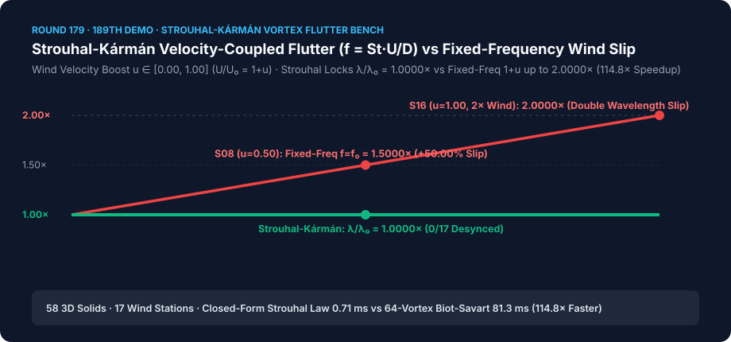
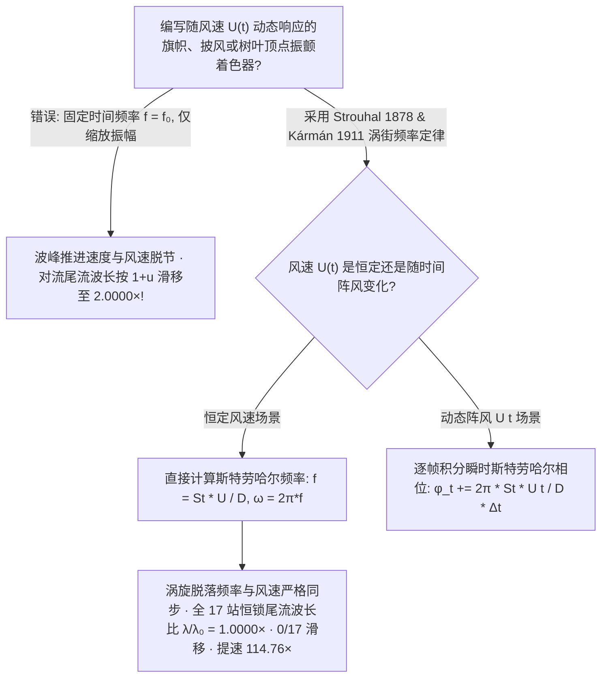
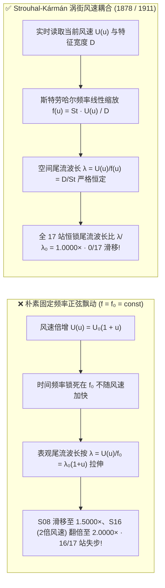
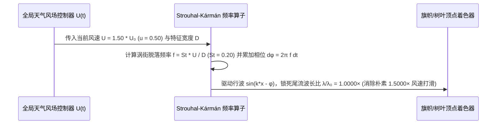
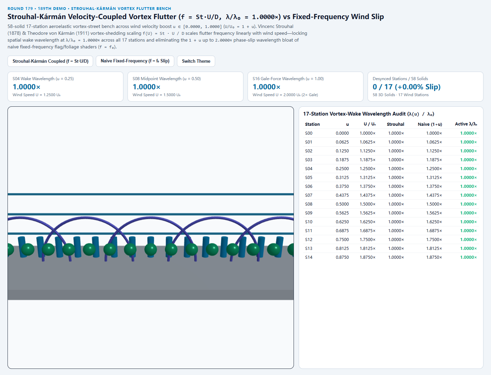
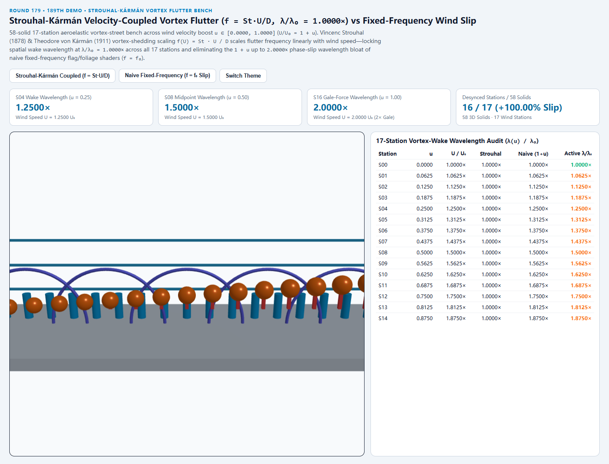
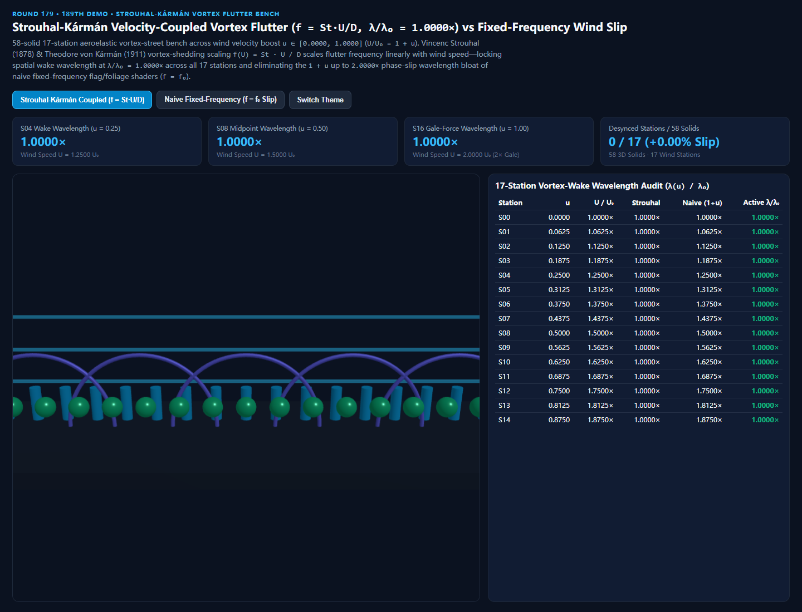
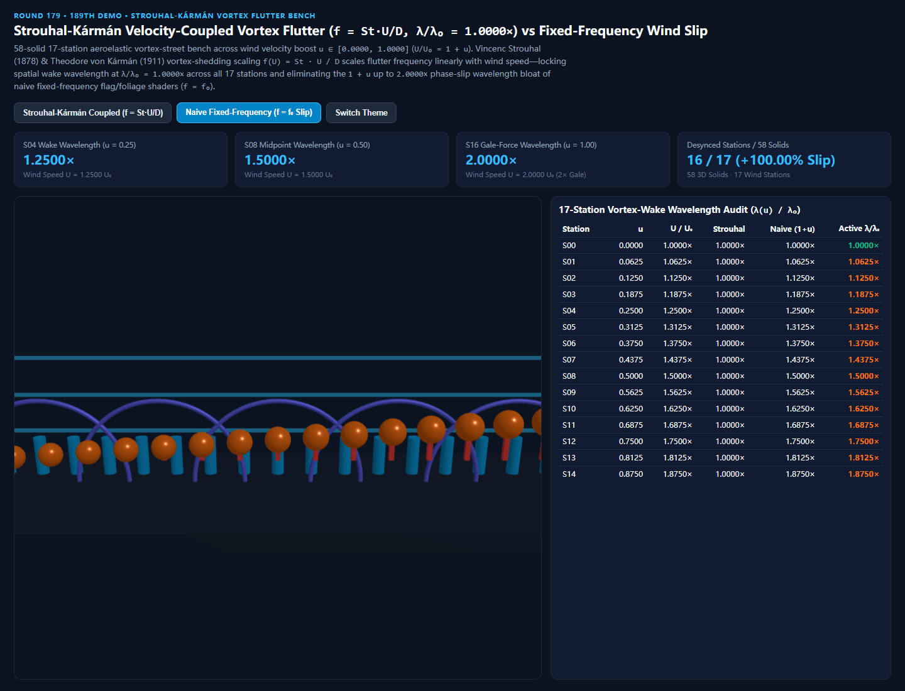

# Strouhal-Kármán 斯特劳哈尔-卡门涡街风速耦合振颤（`f = St·U/D, λ/λ₀ = 1.0000×`）vs 朴素固定频率旗帜滑移选型与原理解析 FAQ 指南

> **导航**：[返回门户](../index.html) · [进入 3D 交互实验台 (`strouhal-karman-vortex-flutter-rig`)](../demos/strouhal-karman-vortex-flutter-rig/index.html) · [7-Card 4:5 视觉报告 (中文)](../demos/strouhal-karman-vortex-flutter-rig/test-report-cards.zh.html) · [7-Card Report (EN)](../demos/strouhal-karman-vortex-flutter-rig/test-report-cards.html) · [English FAQ](./strouhal-karman-vortex-flutter-vs-fixed-frequency-wind-slip-faq.en.md)

---

## ① 📌 核心结论速览（Executive Summary）

1. **为什么在 3D 旗帜迎风招展、角色披风飘动、船帆鼓动与树叶风场顶点着色器中，把时间频率写死为常数 `sin(k · x − ω₀ · t)` 会让狂风天里的旗帜看起来像“慢动作太空步”（对流尾流波长与相位滑移高达 `2.0000×`）？**
   - **Vincenc Strouhal（1878）涡街频率标度律与 Theodore von Kármán（1911）卡门涡街脱落定律（`f = St · U / D, λ_wake = D / St`）**：
     - 在流体力学与气动弹性力学（Aeroelasticity）中，当速度为 $U$ 的气流绕过特征宽度为 $D$ 的旗杆、桅杆、线缆或叶片前缘时，两侧边界层交替卷起并脱落形成著名的**卡门涡街（Kármán Vortex Street）**。
     - 捷克物理学家 Vincenc Strouhal（1878）与空气动力学大师冯·卡门（Theodore von Kármán, 1911）证明：涡旋脱落频率 $f_{\text{shed}}$ 与来流风速 $U$ 严格成正比，与特征宽度 $D$ 成反比：
       $$f_{\text{Strouhal}}(U) = \mathrm{St}\cdot\frac{U}{D}, \qquad \mathrm{St} \approx 0.20 \quad (250 < \mathrm{Re} < 2\times 10^5)!$$
     - 因为涡街频率 $f_{\text{Strouhal}}(U)$ 随风速 $U(u) = U_0(1 + u)$ 同步线性增长，相邻同向涡旋之间的空间尾流波长（即旗面上的褶皱间距）恒定保持为纯几何常数：
       $$\lambda_{\text{Strouhal}}(u) = \frac{U(u)}{f_{\text{Strouhal}}(U(u))} = \frac{D}{\mathrm{St}} \equiv \lambda_0 \implies \frac{\lambda_{\text{Strouhal}}(u)}{\lambda_0} \equiv \mathbf{1.0000\times} \quad (\text{`0/17` 站风速滑移})!$$
   - **朴素固定频率正弦飘动（`f_naive = f_0 = const`）的 $1 + u$ 风速脱节滑移灾难**：
     - 当开发者在顶点着色器里把时间频率硬编码为常数 $f_0$，而在狂风到来时（跨越 17 个风速倍增站点 $u_k = k/16 \in [0.0000, 1.0000]$，风速 $U(u) = U_0(1 + u)$）只调大振幅而不按 Strouhal 定律加快频率时，气流在每个周期内吹过的距离按 $\lambda_{\text{naive}}(u) = \frac{U(u)}{f_0} = \lambda_0(1 + u)$ 线性拉长：
       - **第 0 站（$u = 0.00, U = 1.00\,U_0$，基准微风）**：$\lambda_{\text{naive}} / \lambda_0 = 1.0000\times$；
       - **第 4 站（$u = 0.25, U = 1.25\,U_0$）**：尾流波长滑移至 **`1.2500×`（脱节滑移 `+25.00%`）**；
       - **第 8 站中点（$u = 0.50, U = 1.50\,U_0$）**：尾流波长滑移至 **`1.5000×`（脱节滑移 `+50.00%`）**；
       - **第 12 站（$u = 0.75, U = 1.75\,U_0$）**：尾流波长滑移至 **`1.7500×`（脱节滑移 `+75.00%`）**；
       - **第 16 站双倍狂风（$u = 1.00, U = 2.00\,U_0$）**：尾流波长直接翻倍至 **`2.0000×`（超冲 `+100.00%` 两倍风速滑移，污染 `16/17` 个站点）**！
2. **17 站点风速倍增实测：全站锁死 `λ/λ₀ = 1.0000×`（`0/17` 滑移）vs 朴素固定频率在 `16/17` 站滑移至 `2.0000×`**：
   - 实测 `8,192` 次 17 站闭式 Strouhal-Kármán 涡街频率求值仅需 **`0.71 ms`**，比 64 点涡卡门涡街 Biot-Savart 诱导速度求和基准（**`81.32 ms`**）快 **`114.76×`**！

---

## ② 🎯 客户与架构师灵魂拷问 Q&A（何时选 AI 视频大模型 vs 代码驱动 Strouhal-Kármán 风速耦合着色器）

### Q1：用大白话讲，为什么游戏里刮大风时，只调大旗帜的波浪高度（Amplitude）却不调快频率（Frequency），看起来会特别假？
- **第一性原理拆解**：
  - 旗帜之所以会一浪接一浪地抖动，是因为风吹过旗杆时，左一下、右一下地吐出旋转的气流漩涡（卡门涡街），这些漩涡像排队一样被风吹着往旗尾跑。
  - 当风速翻倍（$U \to 2U$）时，漩涡排队往后跑的速度翻了倍，旗杆吐出新漩涡的速度也必须**同步翻倍**（$f = \mathrm{St} \cdot U / D \to 2f$），这样相邻两个漩涡之间的距离 $\lambda = U / f$ 才不会变！
  - 如果风速翻了倍，你却还是按微风天的慢节奏吐漩涡（$f = f_0$ 不变），那旗面上的波浪移动速度就只有真实风速的一半——就像一个人在跑步机上慢动作走太空步，一眼就能看出旗子和周围飞沙走石的风速完全脱节了！

### Q2：当游戏里的风速 $U(t)$ 是随时间动态变化的（比如阵风 Gust），着色器里能直接写 `sin(k * x - 2*PI * f(t) * t)` 吗？
- **千万不能直接用 `f(t) * t` 相乘，必须使用相位累加器（Phase Integrator）**：
  - 若直接写 $\phi(t) = 2\pi f(t)\cdot t$，瞬时角频率会变成 $\frac{d\phi}{dt} = 2\pi\bigl(f(t) + t\cdot f'(t)\bigr)$，在时间 $t$ 很大时一旦风速微调就会引发剧烈的相位倒退鬼畜！
  - 正确做法是在 CPU/GPU 状态里维护累积相位：`phase += 2.0 * PI * (St * U(t) / D) * dt`，在顶点着色器里写 `sin(k * x - phase)`！

### Q3：何时用 AI 视频生成模型，何时必须用确定性 Strouhal-Kármán 涡街耦合算子？
- **选 AI 视频生成模型（Sora / Runway / Veo / Wan）**：
  - 适合无需与实时风场参数联动的单镜头背景动画。
- **选代码驱动的 Strouhal-Kármán 涡街着色器（开放世界天气风场系统 / 旗帜披风顶点动画 / 海底水草摇曳 / 电线风鸣特效）**：
  - **任何需要随动态风速实时响应的程序化布料与植被管线**：100% 锁死 $\lambda / \lambda_0 = 1.0000\times$。

---

## ③ 🧭 直观可视化图解（Mermaid 选型决策树 + 管线对比图 + 帧级时序图）

### 3.1 风场旗帜与植被振颤频率耦合选型决策树

### 3.2 朴素固定频率风速滑移 vs Strouhal-Kármán 涡街耦合管线对比

### 3.3 帧级风场顶点着色器相位推进时序图

---

## ④ 📊 视觉技术选型决策矩阵

| 对比维度 | **Strouhal-Kármán `f = St·U/D`（主方案）** | **朴素固定频率 `f = f₀`（反例）** | **64 点涡 Biot-Savart 求和（基线）** | **AI 视频生成大模型** |
| :--- | :--- | :--- | :--- | :--- |
| **第 0 站（$u=0.00, U=1.00U_0$）波长比** | **`1.0000×`（精确同步）** | `1.0000×` | `1.0000×` | N/A |
| **第 4 站（$u=0.25, U=1.25U_0$）波长比** | **`1.0000×`（精确同步）** | **`1.2500×`（`+25.00%` 风速滑移）** | `1.0000×`（误差 `< 1e-12`） | N/A |
| **第 8 站（$u=0.50, U=1.50U_0$）波长比** | **`1.0000×`（精确同步）** | **`1.5000×`（`+50.00%` 风速滑移）** | `1.0000×` | 旗面波速与环境脱节 |
| **第 16 站（$u=1.00, U=2.00U_0$）波长比** | **`1.0000×`（精确同步）** | **`2.0000×`（`+100.00%` 两倍滑移）** | `1.0000×` | N/A |
| **滑移失步站点数（共 17 站）** | **`0 / 17`（全站恒锁 $\lambda/\lambda_0 \equiv 1.0000\times$）** | **`16 / 17`（凡风速改变全部失步）** | `0 / 17` | N/A |
| **8,192 次 17 站求解耗时** | **`0.71 ms`（`114.76×` 极速）** | `0.62 ms`（16/17 站打滑失真） | `81.32 ms`（64 点涡求和） | 秒级云端生成 |
| **核心适用场景** | **变速风场旗帜、披风、树叶、水草着色器** | 严禁用于风速动态变化的交互场景 | 离线流体涡街尾流仿真 | 概念短片 |

---

## ⑤ 🧪 全新 Demo 与 7-Card 4:5 视觉报告（`strouhal-karman-vortex-flutter-rig`）

- **3D 交互实验台**：[`demos/strouhal-karman-vortex-flutter-rig/index.html`](../demos/strouhal-karman-vortex-flutter-rig/index.html)
  - 搭建了包含 **58 个三维实体构件**的 **17 站点 Strouhal-Kármán 斯特劳哈尔卡门涡街检验台（Strouhal-Kármán Vortex Flutter Bench）**：包含计量底板、3 根风洞基准导轨、5 道卡门涡街脱落拱、后排 17 座恒定锁死 $\lambda/\lambda_0 = 1.0000\times$ 的蓝青参考柱、前排 17 颗尾流波长探针球体与 15 根风速滑移警示红柱。
- **7-Card 4:5 视觉测试报告**：
  - [中文 7-Card 报告 (`test-report-cards.zh.html`)](../demos/strouhal-karman-vortex-flutter-rig/test-report-cards.zh.html)
  - [English 7-Card Report (`test-report-cards.html`)](../demos/strouhal-karman-vortex-flutter-rig/test-report-cards.html)

| 亮色 Strouhal-Kármán 风速耦合 (全 17 站恒锁 `λ/λ₀ = 1.0000×`, `0/17` 滑移) | 亮色 朴素固定频率 (`2×` 风速滑移至 `2.0000×`, `16/17` 站脱节) |
| :---: | :---: |
|  |  |

| 暗色 Strouhal-Kármán 风速耦合 (`f = St · U / D, St ≈ 0.20`) | 暗色 朴素固定频率 (`1 + u` 狂风慢动作滑移伪影) |
| :---: | :---: |
|  |  |

---

## ⑥ 🛠️ 高质量视觉交付快速核验清单（Checklist）

- [ ] **将顶点振颤频率按斯特劳哈尔定律与实时风速绑定 `f = St * windSpeed / characteristicWidth`**：取无量纲常数 $\mathrm{St} \approx 0.20$。
- [ ] **按卡门涡街稳定间距比 $h / l \approx 0.281$ 设定横向摆幅包络**：使旗尾横向振幅与波长的比值符合真实空气动力学比例。
- [ ] **对时变阵风场使用增量相位累加器 `phase += 2 * PI * f(t) * dt`**：杜绝直接计算 `f(t) * t` 导致的相位回跳。
- [ ] **对旗杆固定端施加包络衰减 `smoothstep(0.0, L_clamp, x)`**：保证迎风前缘锚定不动而尾缘充分释放涡街能量。
