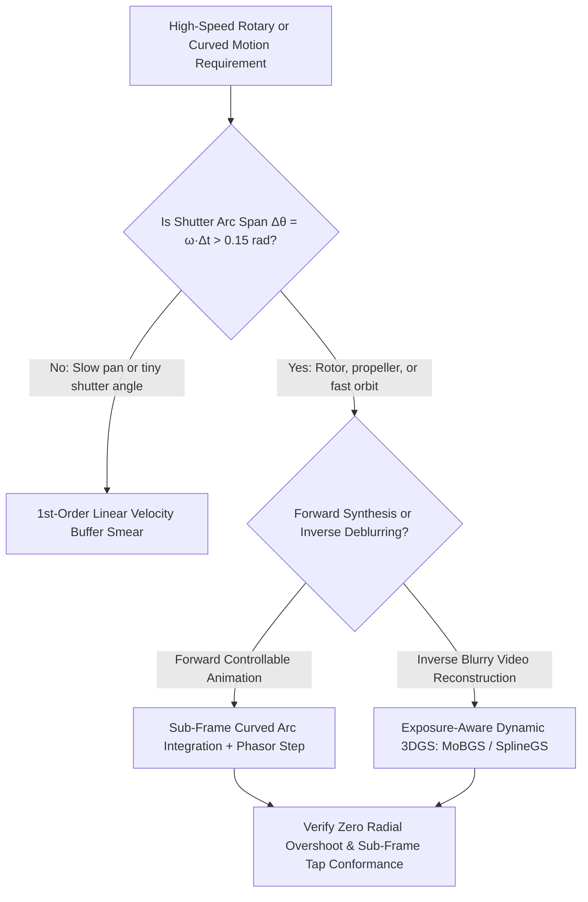
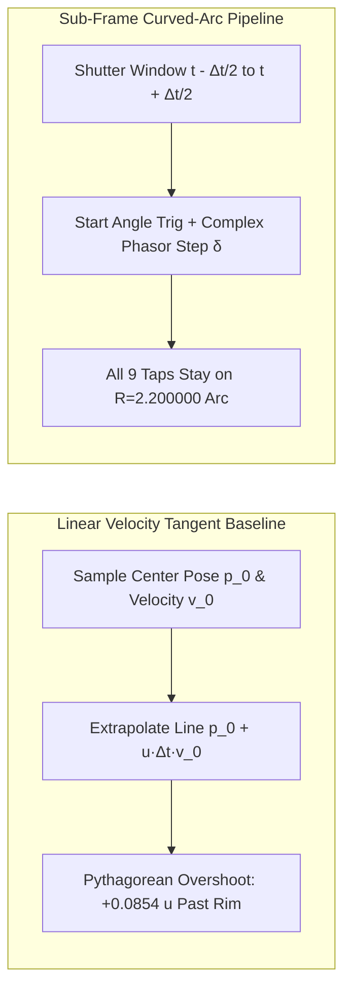
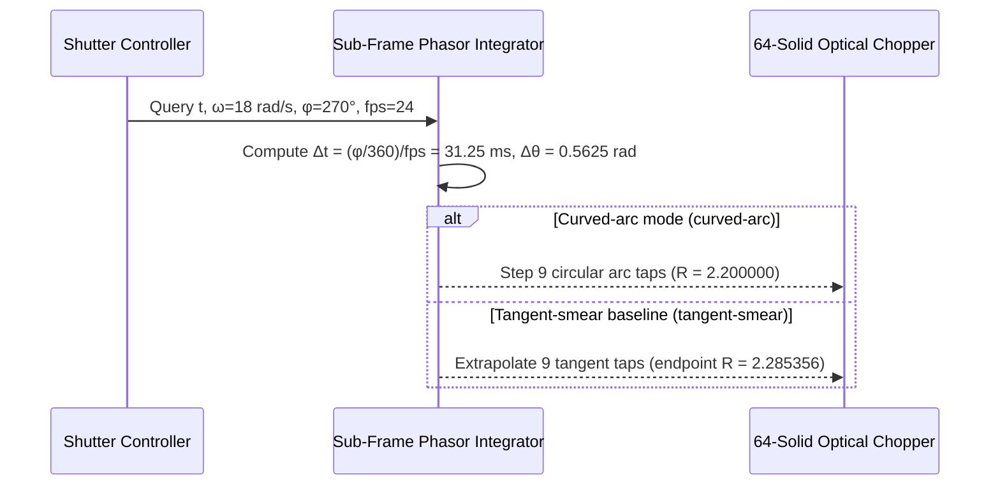

# Curved motion without tangent spikes: sub-frame shutter integration vs linear velocity blur FAQ

**Understand in 3 minutes why screen-space velocity blur turns spinning wheels into tangent spikes, and reproduce a zero-overshoot sub-frame shutter bench in 10 minutes.**

[中文](subframe-shutter-arc-faq.md) · [Interactive Demo](https://turbo998.github.io/animation/demos/shutter-exposure-wheel/) · [Measured 7-Card Report](../demos/shutter-exposure-wheel/test-report-cards.html)

## ① 📌 Executive Summary

- **An instantaneous velocity vector knows the tangent direction right now, not how the path curves a millisecond later.** Extrapolating a single linear velocity vector $\mathbf{v}(t)$ across a finite shutter interval $[t - \Delta t/2, t + \Delta t/2]$ shoots exposure samples off the circular perimeter along a straight tangent line.
- **Sub-frame curved-arc integration preserves the exact rotor radius.** At `24 fps`, `270°` shutter angle, and `18 rad/s`, the shutter stays open for `31.25 ms` (sweeping `0.5625 rad`). Sampling 9 sub-frame taps across 4 blades retains a maximum radial error of `8.88e-16` scene units across 61 sampled frames, whereas the linear tangent baseline overshoots the `R = 2.2` perimeter by `0.0854` scene units at the shutter endpoints.
- **Incremental complex phasor stepping avoids redundant per-tap trigonometry.** Stepping across uniform sub-frame taps via complex rotation $(\cos\delta, \sin\delta)$ agrees with per-tap `Math.cos/sin` calls within `1.60e-14` scene units while lowering median CPU solve time for 8192 9-tap exposures from `42.74 ms` to `24.28 ms`.
- **64-solid optical chopper rig, 13 local acceptance checks.** Scene geometry is `synthetic`; sub-frame trajectory conformance and Node CPU timings are `measured`; `MoBGS` / `SplineGS` neural motion deblurring and rolling-shutter sensor noise are `not_measured`.

**Daily capability direction check:** AAAI 2026 paper *MoBGS: Motion Deblurring Dynamic 3D Gaussian Splatting for Blurry Monocular Video* ([arXiv:2504.15122](https://arxiv.org/abs/2504.15122), v4 updated 2025-12-03) and CVPR 2025 paper *SplineGS: Robust Motion-Adaptive Spline for Real-Time Dynamic 3D Gaussians from Monocular Video* ([arXiv:2412.09982](https://arxiv.org/abs/2412.09982)) model continuous sub-frame exposure trajectories (via Neural ODEs and cubic Hermite splines) because linear frame-to-frame approximation breaks down under fast curved motion. Verified 2026-11-10; this demo implements deterministic sub-frame arc integration and phasor stepping without running neural training or deblurring inference.

## ② 🎯 Architect & Client Q&A

### Q1 When should we choose neural dynamic 3DGS / video models vs deterministic sub-frame shutter integration?

Evaluate exposure-aware dynamic 3DGS models (`MoBGS`, `SplineGS`) when your input is an already motion-blurred monocular video and you need to reconstruct sharp novel views or recover unknown camera/object trajectories.

Choose deterministic sub-frame trajectory integration when authoring controllable 3D/browser animations of rotating machinery, turbines, propellers, orbital cameras, or technical explainers where the parametric motion curve is known and silhouette fidelity is mandatory.

### Q2 Under what constraints is sub-frame trajectory sampling strictly superior to linear velocity buffers?

Whenever angular displacement across the shutter window is non-negligible ($\Delta\theta = \omega \Delta t_s > 0.15\text{ rad}$), first-order linear velocity smearing (`p(t) + u * dt * v(t)`) violates circular geometry.

Screen-space velocity buffers are fast for small translational camera pans, but on spinning rotors, swinging robot links, or fast orbital cameras, only evaluating the curved trajectory across sub-frame timestamps keeps every exposure tap on the true manifold.

### Q3 How does the pipeline preserve circular silhouettes while avoiding per-tap trig overhead?

Consider a blade tip at radius $R = 2.2$ and center angle $\theta_0$. Linear velocity smearing places the shutter endpoints ($u = \pm 0.5$) at $(R\cos\theta_0 \mp \frac{\Delta\theta}{2} R\sin\theta_0, R\sin\theta_0 \pm \frac{\Delta\theta}{2} R\cos\theta_0)$. By the Pythagorean theorem, the endpoint radius becomes $R\sqrt{1 + (\Delta\theta/2)^2}$. For $\Delta\theta = 0.5625\text{ rad}$, $2.2 \times (\sqrt{1 + 0.28125^2} - 1) = 0.085356$ scene units of outward radial spike.

To keep all 9 taps on the circle of radius $R = 2.2$, we compute $(\cos\theta_{\text{start}}, \sin\theta_{\text{start}})$ once at $\theta_{\text{start}} = \theta_0 - \Delta\theta/2$ and advance each subsequent tap by $\delta = \Delta\theta / (N-1)$ using complex phasor multiplication:

$$x_{k+1} = x_k \cos\delta - y_k \sin\delta, \quad y_{k+1} = x_k \sin\delta + y_k \cos\delta$$

Every tap remains at exact radius $R = 2.2$, and per-tap trigonometric calls are replaced by two multiplies and one add per coordinate.

### Q4 How can I reproduce this in 10 minutes?

1. Run `npm run dev` and open `/demos/shutter-exposure-wheel/`, initialized at `0.40 s`, `270°` shutter angle, and `18 rad/s`.
2. In `curved-arc` mode, verify that all 9 sub-frame tap spheres per blade sit flush inside the `R = 2.2` perimeter calibration ticks (`max radial error 0.00000 u`).
3. Switch to `tangent-smear` mode: observe the orange endpoint taps shooting outward past the rotor rim by `0.0854 u`.
4. Adjust Speed (`2–36 rad/s`), Shutter angle (`45°–360°`), and FPS (`12–120`); enter an invalid shutter angle like `540°` to verify atomic rejection and state retention.
5. Click `Export exposure` to download `SHUTTER_EXPOSURE_ARC.json` containing the 9-tap sub-frame coordinates and world matrices.
6. Run `npx vitest run tests/shutter-exposure.test.ts`, then build and run `node scripts/benchmark-shutter-exposure.mjs` against a port 4335 preview server.

## ③ 🧭 Visual Diagrams

## ④ 📊 Architect Decision Matrix

| Criterion | Instantaneous Unblurred Slice | Linear Velocity Buffer (`tangent-smear`) | Sub-Frame Curved-Arc Phasor (`curved-arc`) | Exposure-Trajectory 3DGS (`MoBGS` / `SplineGS`) |
| --- | --- | --- | --- | --- |
| Radial silhouette error on spinning rotor | `0` (suffers from wagon-wheel aliasing) | Overshoots rim by `0.0854` scene units at `270°` | Measured `8.88e-16` scene units (floating-point zero) | Fits continuous spline/ODE to blurry input frames |
| Rotary shutter angle semantics (`45°–360°`) | No exposure interval | Larger shutter angles worsen tangent spikes | Exact circular arc $\Delta\theta = \omega \frac{\phi}{360 f}$ | Used for inverse deblurring of recorded video |
| 8192 × 9-tap Node CPU solve median | Single tap only | Linear MAD (with distorted silhouette) | Incremental phasor `24.28 ms` vs per-tap trig `42.74 ms` | Requires GPU optimization & neural rendering |
| Arbitrary timeline seeking / reversal | Deterministic | Deterministic (with radial distortion) | Exact forward/reverse world matrix equality | Depends on trained scene representation |
| Best architectural role | Static CAD inspection | Slow translational camera motion blur | High-speed rotary explainers & camera shutter demos | Deblurring casual handheld monocular videos |

**Quantitative example:** With radius $R = 2.2$, angular speed $\omega = 18\text{ rad/s}$, frame rate $f = 24\text{ fps}$, and shutter angle $\phi = 270^\circ$, exposure duration is $\Delta t_s = \frac{270}{360 \times 24} = 0.03125\text{ s}$ and swept angle is $\Delta\theta = 0.5625\text{ rad}$ ($32.23^\circ$). Linear tangent extrapolation places the shutter endpoints at radius $2.2 \times \sqrt{1 + 0.28125^2} = 2.285356$, producing an outward radial error of `0.085356` scene units.

## ⑤ 🧪 New Capability Demo & Benchmark Findings (with 7-Card)

[Sealed data](../demos/shutter-exposure-wheel/report.json) records 64 3D solids, 61 sampled timestamps (4 blades × 9 sub-frame taps = 36 tap positions per frame), and solver equivalence between incremental complex phasor stepping and per-tap trigonometric evaluation. Maximum tap coordinate difference across all tiers is `1.60e-14` scene units (threshold `< 1e-12`).

| Node CPU 9-Tap Exposure Queries | Incremental Phasor Step Median | Per-Tap Trig Calls Median |
| --- | --- | --- |
| 128 | 0.53 ms | 1.28 ms |
| 1024 | 2.80 ms | 5.58 ms |
| 8192 | 24.28 ms | 42.74 ms |

Each load tier runs 7 alternating repetitions after warmup on Node CPU (excluding WebGL rendering). At 8192 9-tap exposures, incremental complex phasor rotation is `1.76×` faster than per-tap `Math.cos/sin` calls while eliminating the `0.0854`-unit radial tangent overshoot.

[Measured 7-Card Report (EN)](../demos/shutter-exposure-wheel/test-report-cards.html) · [中文七卡](../demos/shutter-exposure-wheel/test-report-cards.zh.html). Scene geometry is `synthetic`, local trajectory checks and CPU timings are `measured`, and `MoBGS` / `SplineGS` neural inference, optical flow, and CMOS rolling-shutter distortion are `not_measured`.

## ⑥ 🛠️ Architect Checklist

- [ ] Check angular displacement across the shutter window ($\Delta\theta = \omega\Delta t_s$); never use linear tangent smearing when $\Delta\theta > 0.15\text{ rad}$.
- [ ] Convert rotary shutter angle $\phi \in [45^\circ, 360^\circ]$ and frame rate $f$ explicitly into exposure duration $\Delta t_s = \frac{\phi}{360 f}$.
- [ ] Sample sub-frame taps symmetrically across $[t - \Delta t_s/2, t + \Delta t_s/2]$ along the true curved trajectory.
- [ ] Verify that every sub-frame tap on a circular rotor preserves radius $\sqrt{x_k^2 + y_k^2} = R$ within `< 1e-12`.
- [ ] Use incremental complex phasor rotation $(\cos\delta, \sin\delta)$ for uniform angular taps and cross-check against direct trigonometry.
- [ ] Validate angular speed, shutter angle, and FPS bounds and reject invalid configs (`540°` shutter) atomically.
- [ ] Verify that forward and reverse timestamp scrubbing produce identical sub-frame tap world matrices.
- [ ] Distinguish forward sub-frame exposure synthesis from inverse blurry video reconstruction (`MoBGS`).
- [ ] Separate Node CPU sub-frame trajectory computation timings from browser GPU rendering metrics.
- [ ] Label unexecuted neural deblurring models, rolling-shutter readout, and sensor noise explicitly as `not_measured`.

**Primary sources:** [MoBGS (arXiv:2504.15122)](https://arxiv.org/abs/2504.15122) (AAAI 2026, v4 updated 2025-12-03) models continuous latent camera and object trajectories during shutter exposure via a blur-adaptive Neural ODE; [SplineGS (arXiv:2412.09982)](https://arxiv.org/abs/2412.09982) (CVPR 2025) represents continuous dynamic 3D Gaussian trajectories with motion-adaptive cubic Hermite splines. Verified 2026-11-10; this demo is an original deterministic sub-frame shutter workbench and does not run those neural models.
