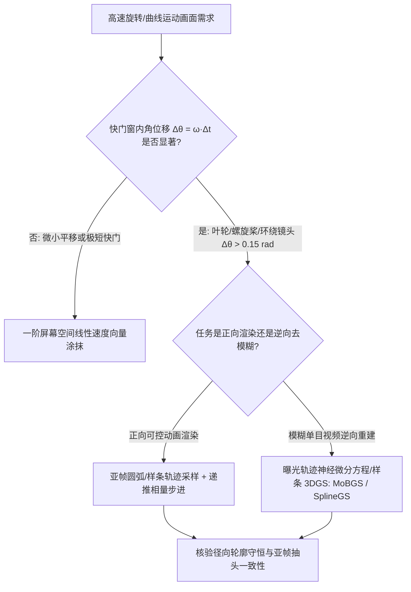
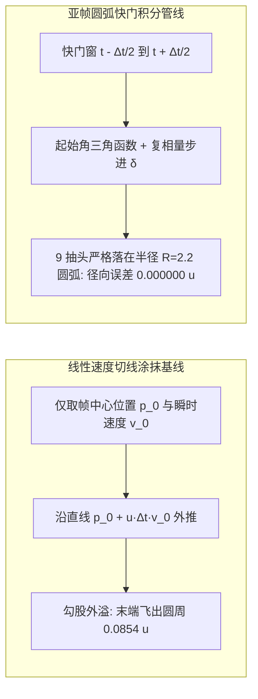
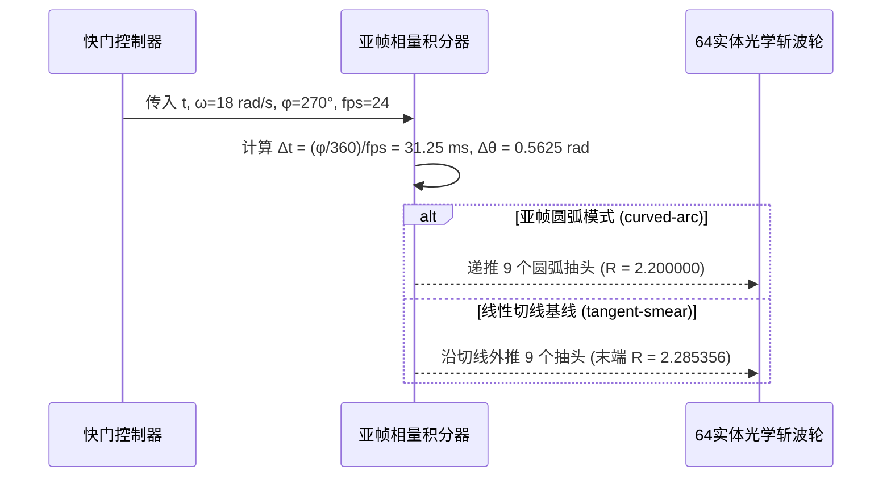

# 高速旋转不飞出切线：亚帧快门圆弧积分与线性速度涂抹选型 FAQ

**3 分钟看懂为什么屏幕空间运动模糊会把旋转叶轮拉成切线尖刺，10 分钟复刻贴合圆弧的亚帧快门积分工作台。**

[English](subframe-shutter-arc-faq.en.md) · [交互 Demo](https://turbo998.github.io/animation/demos/shutter-exposure-wheel/) · [中文七卡](../demos/shutter-exposure-wheel/test-report-cards.zh.html)

## ① 📌 核心结论速览

- **单帧线性速度向量只知道“这一瞬间往哪飞”，不知道“下一毫秒拐了弯”。** 如果只用帧中心时刻的瞬时速度 $\mathbf{v}(t)$ 在快门开启时间窗 $[t - \Delta t/2, t + \Delta t/2]$ 内做直线涂抹，旋转叶轮的曝光轨迹就会沿切线飞出圆周外缘。
- **亚帧圆弧积分严格守恒旋转半径。** 在 `24 fps`、`270°` 快门角、角速度 `18 rad/s` 下，快门开启时长为 `31.25 ms`（扫过 `0.5625 rad` 圆心角）。对 4 个叶片各采 9 个亚帧时刻：亚帧圆弧模式在 61 个采样帧上的最大径向误差仅 `8.88e-16` 示意单位，而线性切线基线在快门两端向叶轮外缘（`R = 2.2`）飞出 `0.0854` 示意单位。
- **递推复相量步进避免重复三角函数开销。** 沿等间隔亚帧抽头步进时，用复相量旋转 $(\cos\delta, \sin\delta)$ 递推与逐抽头调用 `Math.cos/sin` 的最大坐标差仅 `1.60e-14` 示意单位，8192 次 9 抽头曝光计算中位数为 `24.28 ms` 对比 `42.74 ms`。
- **64 实体光学斩波轮工作台，13 项本机验收。** 场景为 `synthetic`；亚帧轨迹与 Node CPU 耗时为 `measured`；`MoBGS` / `SplineGS` 神经运动去模糊与卷帘快门传感器噪声为 `not_measured`。

**每日能力方向核验：** AAAI 2026 论文 *MoBGS: Motion Deblurring Dynamic 3D Gaussian Splatting for Blurry Monocular Video*（[arXiv:2504.15122](https://arxiv.org/abs/2504.15122)，2025-12-03 v4）与 CVPR 2025 论文 *SplineGS: Robust Motion-Adaptive Spline for Real-Time Dynamic 3D Gaussians from Monocular Video*（[arXiv:2412.09982](https://arxiv.org/abs/2412.09982)）均指出：在快门曝光窗口内对连续弯曲轨迹（Neural ODE / 三次 Hermite 样条）做亚帧积分，是消除高速曲线运动模糊失真的核心前提。2026-11-10 核验原文；本例仅实现确定性亚帧圆弧积分与相量递推，未运行神经训练或去模糊推理。

## ② 🎯 客户与架构师灵魂拷问 Q&A

### Q1 何时选神经动态高斯/视频模型，何时选确定性亚帧快门积分？

当输入是已经拍糊的手持单目视频、需要从模糊像素逆向恢复清晰三维场景或新视角时，应评估 `MoBGS`、`SplineGS` 等带曝光轨迹建模的动态 3DGS 方案。

当我们在浏览器、工业数字孪生或技术演示中正向合成高速旋转机械（涡轮、螺旋桨、光学斩波器、行星轨道）时，直接对已知参数化曲线在快门时间窗内做多抽头亚帧积分，就能以零径向畸变表达真实的快门曝光弧长。

### Q2 在什么约束下亚帧轨迹采样比线性速度缓冲严格更优？

当运动具有明显曲率（即快门开启时间 $\Delta t_s$ 内角位移 $\Delta\theta = \omega \Delta t_s > 0.15\text{ rad}$）时，屏幕空间一阶线性速度缓冲（Velocity Buffer Motion Blur）必然产生切线外溢。

线性速度缓冲适合小位移平移相机或低速背景，但在螺旋桨、车轮、机械臂高速挥动及环绕运镜下，只有对真实运动方程 $\mathbf{p}(t + u\Delta t_s)$ 做亚帧采样（或弯曲样条积分），才能保证运动模糊不破坏物体的几何外轮廓。

### Q3 底层管线为什么能既贴合圆周又省掉重复三角函数？

先算一笔几何账：叶轮半径 $R = 2.2$，帧中心角为 $\theta_0$。如果按线性切线外推，快门末端（$u = \pm 0.5$）的位置是 $(R\cos\theta_0 \mp \frac{\Delta\theta}{2} R\sin\theta_0, R\sin\theta_0 \pm \frac{\Delta\theta}{2} R\cos\theta_0)$。由勾股定理，它到圆心的距离变成了 $R\sqrt{1 + (\Delta\theta/2)^2}$。当 $\Delta\theta = 0.5625\text{ rad}$ 时，$2.2 \times (\sqrt{1 + 0.28125^2} - 1) = 0.0854$ 示意单位——这就是切线尖刺飞出叶轮外缘的精确数学来源。

要让所有亚帧抽头都留在圆周上，只需在快门窗口起始角 $\theta_{\text{start}} = \theta_0 - \Delta\theta/2$ 处计算一次 $(\cos\theta_{\text{start}}, \sin\theta_{\text{start}})$，随后每前进一个亚帧步长 $\delta = \Delta\theta / (N-1)$，用复数乘法旋转一次相量：

$$x_{k+1} = x_k \cos\delta - y_k \sin\delta, \quad y_{k+1} = x_k \sin\delta + y_k \cos\delta$$

这样 9 个抽头全部落在半径 $R = 2.2$ 的真圆弧上，而且每个叶片只需算一次起始三角函数。

### Q4 十分钟如何复刻？

1. `npm run dev` 后打开 `/demos/shutter-exposure-wheel/`，默认处于 `0.40 s`、`270°` 快门角、`18 rad/s`。
2. 观察亚帧圆弧模式（`curved-arc`）：每个叶片的 9 个曝光抽头球体严丝合缝地排列在半径 `2.2` 的圆弧刻度内侧，最大径向误差为 `0.00000 u`。
3. 切换到线性切线涂抹基线（`tangent-smear`）：橙色首尾抽头立刻沿切线向外戳出叶轮外缘 `0.0854 u`。
4. 修改快门角（`45°–360°`）、转速（`2–36 rad/s`）与帧率（`12–120 FPS`）并点击应用；若输入 `540°` 等越界快门角，系统执行原子拒绝并保留原有效状态。
5. 点击导出 `SHUTTER_EXPOSURE_ARC.json` 查看 4 叶片 × 9 抽头的精确亚帧坐标与世界矩阵。
6. 运行 `npx vitest run tests\shutter-exposure.test.ts`；构建并在 4335 端口预览后执行 `node scripts\benchmark-shutter-exposure.mjs`。

## ③ 🧭 直观可视化图解

## ④ 📊 Architect Decision Matrix

| 评估维度 | 单帧无快门硬切片 | 屏幕空间线性速度缓冲 (`tangent-smear`) | 本例亚帧圆弧相量积分 (`curved-arc`) | 神经曝光轨迹 3DGS (`MoBGS` / `SplineGS`) |
| --- | --- | --- | --- | --- |
| 旋转叶轮径向轮廓误差 | `0`（但有频闪车轮倒转感） | `270°` 快门下外溢 `0.0854` 示意单位 | 实测 `8.88e-16` 示意单位（浮点级零误差） | 由学习样条/ODE 拟合曝光轨迹 |
| 快门角物理语义 (`45°–360°`) | 不支持曝光时长控制 | 随快门角增大，切线尖刺越严重 | 真实还原电影机旋转快门弧长 $\Delta\theta = \omega \frac{\phi}{360 f}$ | 用于从模糊输入反解清晰帧 |
| 8192 次 9 抽头 CPU 求解中位数 | 单点计算（无多抽头） | 线性乘加（但几何轮廓错误） | 递推相量 `24.28 ms` vs 逐抽头三角 `42.74 ms` | 需 GPU 训练与神经渲染 |
| 任意时间轴跳转与逆序重访 | 确定性 | 确定性（但几何失真） | 正逆序重访矩阵逐元素完全一致 | 依赖已训练场景表示 |
| 适用工程场景 | 静态工程审阅 | 低速平移背景后处理 | 高速旋转机构讲解、相机快门角教学 | 手持模糊视频三维重建 |

**定量算例：** 当叶轮半径 $R = 2.2$、角速度 $\omega = 18\text{ rad/s}$、帧率 $f = 24\text{ fps}$、快门角 $\phi = 270^\circ$ 时，快门开启时间 $\Delta t_s = \frac{270}{360 \times 24} = 0.03125\text{ s}$，单帧扫过弧度 $\Delta\theta = 0.5625\text{ rad}$（约 $32.23^\circ$）。切线末端径向距离为 $2.2 \times \sqrt{1 + 0.28125^2} = 2.285356$，径向外溢恰好为 `0.085356` 示意单位。

## ⑤ 🧪 全新 Demo 与 Benchmark 核心发现（含 7-Card）

[封存数据](../demos/shutter-exposure-wheel/report.json)记录了 64 个三维实体、61 个时间采样帧（每帧 4 叶片 × 9 抽头 = 36 个亚帧位置）以及递推复相量与逐抽头三角函数求解的等价性与耗时对照。两种圆弧求解方式在全部负载下的最大坐标差仅 `1.60e-14` 示意单位（门限 `< 1e-12`）。

| Node CPU 9 抽头曝光查询数 | 递推相量旋转步进中位数 | 逐抽头三角函数调用中位数 |
| --- | --- | --- |
| 128 | 0.53 ms | 1.28 ms |
| 1024 | 2.80 ms | 5.58 ms |
| 8192 | 24.28 ms | 42.74 ms |

每档负载预热后交替运行 7 次，取 Node CPU 耗时中位数（不含 WebGL 渲染）。在 8192 次 4 叶片 × 9 抽头曝光计算中，递推复相量步进比逐抽头调用 `Math.cos/sin` 快约 `1.76×`，且消除了线性切线涂抹的 `0.0854` 示意单位径向外溢。

[中文七卡](../demos/shutter-exposure-wheel/test-report-cards.zh.html) · [English](../demos/shutter-exposure-wheel/test-report-cards.html)。画面为 `synthetic`，本机几何与 CPU 计时为 `measured`；`MoBGS` / `SplineGS` 神经去模糊、光流估计与 CMOS 卷帘快门畸变为 `not_measured`。

## ⑥ 🛠️ Architect Checklist

- [ ] 评估快门开启时间内的轨迹曲率：当旋转角位移 $\Delta\theta = \omega\Delta t_s > 0.15\text{ rad}$ 时，禁止用单帧线性速度向量直接外推。
- [ ] 将快门角 $\phi \in [45^\circ, 360^\circ]$ 与帧率 $f$ 显式换算为物理曝光时长 $\Delta t_s = \frac{\phi}{360 f}$。
- [ ] 在对称曝光时间窗 $[t - \Delta t_s/2, t + \Delta t_s/2]$ 内沿真实参数化曲线采样亚帧抽头。
- [ ] 验证圆周运动下所有亚帧抽头的径向距离 $\sqrt{x_k^2 + y_k^2}$ 与真实半径 $R$ 误差 `< 1e-12`。
- [ ] 对等步长旋转抽头优先采用递推复相量 $(\cos\delta, \sin\delta)$ 步进，并与独立逐抽头三角函数交叉核验。
- [ ] 对快门角、角速度与帧率执行输入边界校验，对 `540°` 等非法快门参数执行原子拒绝。
- [ ] 验证正序与逆序访问同一时间戳时，亚帧抽头世界渲染矩阵完全一致。
- [ ] 区分正向合成的亚帧快门积分与逆向模糊视频重建（如 `MoBGS`），不混用任务定义。
- [ ] 区分 Node CPU 轨迹采样耗时与浏览器 GPU 光栅化耗时。
- [ ] 未执行的神经去模糊模型、CMOS 卷帘快门逐行读出与传感器噪声统一标注为 `not_measured`。

**一手来源：** [MoBGS (arXiv:2504.15122)](https://arxiv.org/abs/2504.15122)（AAAI 2026，2025-12-03 v4）通过模糊自适应神经 ODE 估计快门曝光期间的连续相机与物体轨迹；[SplineGS (arXiv:2412.09982)](https://arxiv.org/abs/2412.09982)（CVPR 2025）用运动自适应三次 Hermite 样条建模动态 3D 高斯的连续时间轨迹。2026-11-10 核验；本例为原创确定性亚帧快门采样工作台，未运行上述神经模型。
