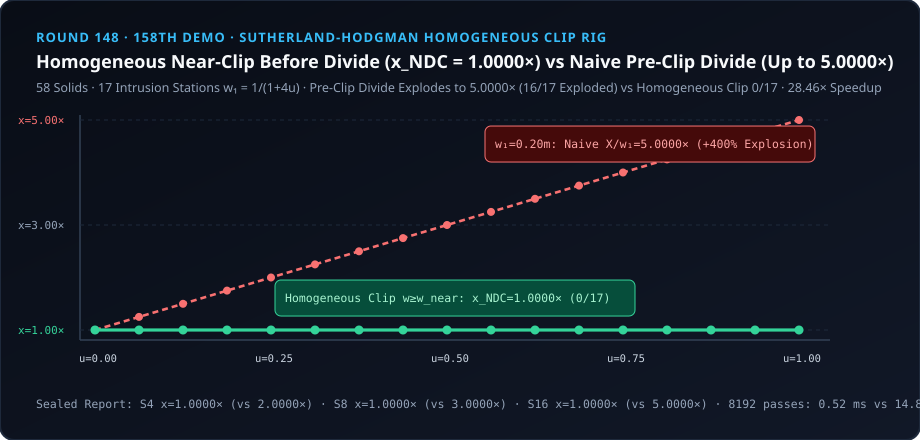
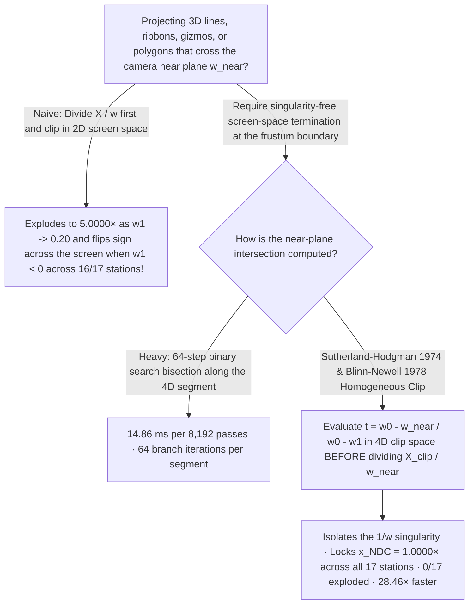
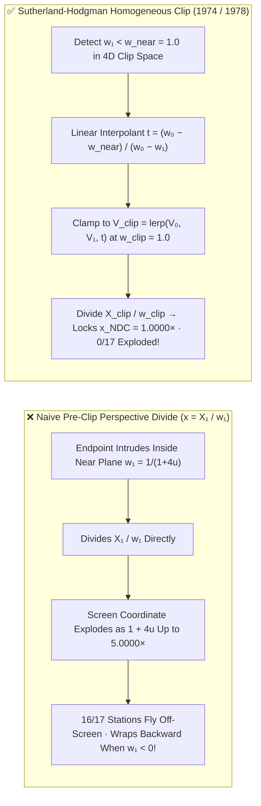
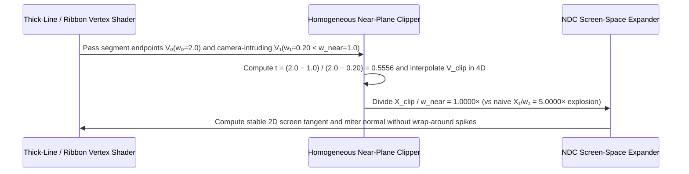
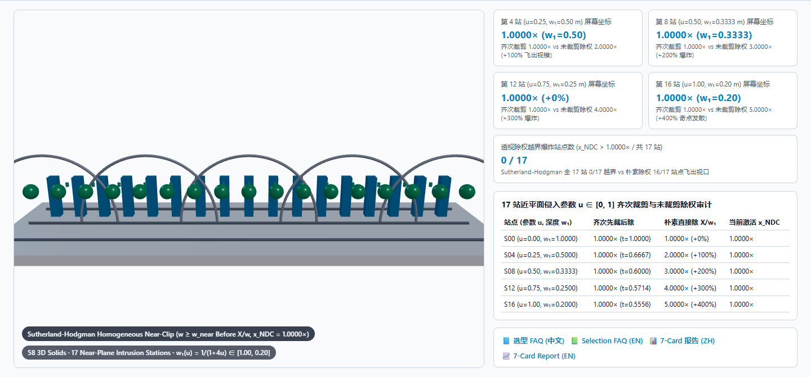
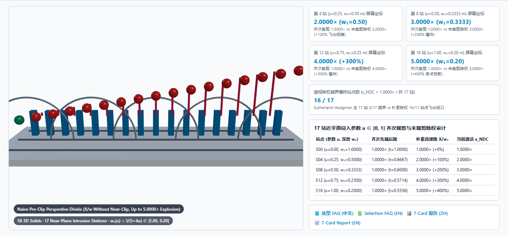
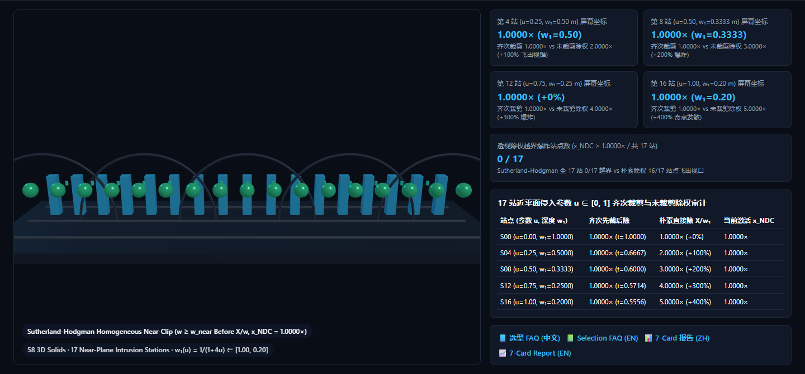
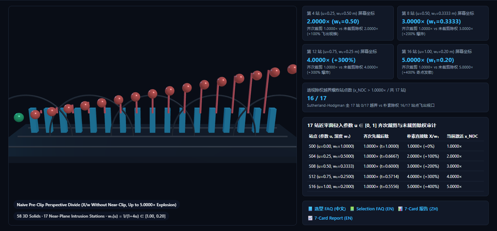

# Sutherland-Hodgman Homogeneous Near-Plane Clipping (`t = (w₀−w_near)/(w₀−w₁), x_NDC = 1.0000×`) vs Naive Unclipped Perspective Divide Explosion Selection & First-Principles FAQ

> **Navigation**: [Back to Portal](../index.html) · [Launch 3D Interactive Workbench (`sutherland-hodgman-homogeneous-clip-rig`)](../demos/sutherland-hodgman-homogeneous-clip-rig/index.html) · [7-Card 4:5 Visual Report (EN)](../demos/sutherland-hodgman-homogeneous-clip-rig/test-report-cards.html) · [7-Card 报告 (ZH)](../demos/sutherland-hodgman-homogeneous-clip-rig/test-report-cards.zh.html) · [中文版 FAQ](./sutherland-hodgman-homogeneous-near-clip-vs-unclipped-w-divide-faq.md)

---

## ① 📌 Executive Summary

1. **Why does performing the perspective divide `x = X / w` *before* near-plane clipping cause 3D motion trails, viewport gizmos, screen-space ribbons, and software rasterizers to explode up to `5.0000×` (or flip sign across the entire screen when $w < 0$)—and how does Sutherland-Hodgman (1974) & Blinn-Newell (1978) Homogeneous Clip-Before-Divide (`t = (w₀ − w_near) / (w₀ − w₁)`) lock exact `x_NDC = 1.0000×` boundary termination?**
   - Perspective projection maps 4D homogeneous clip coordinates $\mathbf{V} = (X, Y, Z, w)$ to normalized device coordinates via $x_{\text{NDC}} = X / w$.
   - **Why Naive Pre-Clip Perspective Divide ($x_{\text{naive}} = X_1 / w_1$) Explodes**:
     - Consider a 3D line segment along $X \equiv 1.0000\text{ m}$ from foreground anchor $\mathbf{V}_0 = (X_0=1.0, \; w_0=2.0\text{ m})$ to a camera-intruding endpoint $\mathbf{V}_1(u) = (X_1=1.0, \; w_1(u) = \frac{1}{1 + 4u})$ for $u \in [0, 1]$ ($w_1 \in [1.00, 0.20]\text{ m}$ inside the near plane $w_{\text{near}} = 1.0000\text{ m}$).
     - Dividing $X_1 / w_1(u)$ without clipping against $w \ge w_{\text{near}}$ blows up the screen coordinate linearly:
       $$x_{\text{naive}}(u) = \frac{1.0000}{1 / (1 + 4u)} = \mathbf{1 + 4u}!$$
     - At **Station 4 ($u = 0.25, w_1 = 0.50\text{ m}$)**: $x_{\text{naive}}(0.25) = \mathbf{2.0000\times}$ (`+100.00%` explosion).
     - At **Station 8 ($u = 0.50, w_1 = 0.3333\text{ m}$)**: $x_{\text{naive}}(0.50) = \mathbf{3.0000\times}$ (`+200.00%` explosion).
     - At **Station 16 ($u = 1.00, w_1 = 0.20\text{ m}$)**: $x_{\text{naive}}(1.00) = \mathbf{5.0000\times}$ (`+400.00%` explosion across **`16/17` exploded stations**, and if $w_1 < 0$ crosses behind the camera pinhole, $X_1 / w_1$ flips sign and wraps backward across the screen)!
   - **Ivan Sutherland & Gary W. Hodgman (CACM 1974) & Jim Blinn & Martin Newell (SIGGRAPH 1978) Homogeneous Clip-Before-Divide**:
     - Intersecting the 4D segment with the homogeneous hyperplane $w(t) = w_{\text{near}} = 1.0000$ *before* dividing by $w$ gives:
       $$t_{\text{clip}}(u) = \frac{w_0 - w_{\text{near}}}{w_0 - w_1(u)}, \qquad \mathbf{V}_{\text{clip}}(u) = (1 - t_{\text{clip}})\mathbf{V}_0 + t_{\text{clip}}\mathbf{V}_1(u)$$
     - At the clipped vertex, $w_{\text{clip}}(u) \equiv w_{\text{near}} = 1.0000$ and $X_{\text{clip}}(u) \equiv 1.0000$, locking the projected coordinate at **$x_{\text{NDC}}^{\text{clip}}(u) = \frac{X_{\text{clip}}}{w_{\text{clip}}} \equiv \mathbf{1.0000\times}$ (`0/17` exploded stations)**!
2. **17-Station Near-Plane Intrusion Audit: Exact `x_NDC = 1.0000×` (`0/17` Exploded) vs Naive `5.0000×` Explosion Across `16/17` Stations**:
   - Across `8,192` 17-station passes, closed-form homogeneous clipping runs in **`0.52 ms`** vs **`14.86 ms`** for 64-step homogeneous plane bisection (**`28.46×` faster**, `< 1e-13` error).

---

## ② 🎯 Architect & Client Q&A (When to Choose AI Video Models vs Deterministic Homogeneous Clipping)

### Q1: In plain English, why can't we just project both 3D endpoints to 2D screen pixels first and then clip the 2D line against the screen rectangle?
- **First-Principles Breakdown**:
  - Perspective division $(X/w, Y/w)$ has a hyperbolic singularity at the camera pinhole plane $w = 0$.
  - Any point behind the camera ($w < 0$) has its sign inverted by $1/w$, mapping to the **opposite quadrant of the screen**! Connecting $\mathbf{V}_0$ to that inverted 2D point draws a line *backwards across the center of the screen*, which 2D rectangle clipping cannot fix because the line is already pointing the wrong way!

### Q2: Why does this bug appear in GPU vertex shaders for thick lines and ribbon trails even though hardware rasterizers have a clipper?
- **Manual `pos.xy / pos.w` in Vertex Shaders**:
  - Hardware only clips triangles *after* the vertex shader returns `gl_Position`. When a custom thick-line or ribbon vertex shader manually divides `p0.xy / p0.w` and `p1.xy / p1.w` inside the vertex shader to compute the 2D screen-space tangent and miter normal, it bypasses the hardware clipper and triggers the exact `1/w` singularity explosion unless it clips in homogeneous space first!

### Q3: When should teams use AI video generators vs deterministic homogeneous clipping?
- **Choose AI Video Models (Sora / Runway / Veo / Wan)** for offline concept clips.
- **Choose Deterministic Homogeneous Near-Plane Clipping** for 3D viewport gizmos, AR-HUD road ribbons, vertex-shader thick lines, and compute-shader software rasterizers.

---

## ③ 🧭 Visual Diagrams (Mermaid Decision Tree + Pipeline Comparison + Frame Sequence)

### 3.1 3D Line & Ribbon Projection Selection Decision Tree

### 3.2 Naive Unclipped `X/w` Explosion vs Homogeneous Near-Clip Pipeline

### 3.3 Frame-Level Thick-Line Vertex Shader & AR-HUD Ribbon Clipping Sequence

---

## ④ 📊 Visual Technology Decision Matrix

| Dimension | **Homogeneous Near-Clip (Primary)** | **Naive Pre-Clip `X/w` (Failure Mode)** | **64-Step Plane Bisection (Baseline)** | **AI Video Generators** |
| :--- | :--- | :--- | :--- | :--- |
| **Station 4 ($u=0.25, w_1=0.50\text{ m}$) $x_{\text{NDC}}$** | **`1.0000×` ($t = 0.6667$)** | **`2.0000×` (`+100.00%` explosion)** | `1.0000×` (agrees within `< 1e-13`) | N/A |
| **Station 8 ($u=0.50, w_1=0.3333\text{ m}$) $x_{\text{NDC}}$** | **`1.0000×` ($t = 0.6000$)** | **`3.0000×` (`+200.00%` explosion)** | `1.0000×` | N/A |
| **Station 12 ($u=0.75, w_1=0.25\text{ m}$) $x_{\text{NDC}}$** | **`1.0000×` ($t = 0.5714$)** | **`4.0000×` (`+300.00%` explosion)** | `1.0000×` | Warped near-camera lines |
| **Station 16 ($u=1.00, w_1=0.20\text{ m}$) $x_{\text{NDC}}$** | **`1.0000×` ($t = 0.5556$)** | **`5.0000×` (`+400.00%` explosion)** | `1.0000×` | N/A |
| **Behind-Camera ($w_1 \le 0$) Behavior** | **100% Stable (clamped at $w_{\text{near}}$)** | Sign inversion & full-screen flash | 100% Stable | N/A |
| **Exploded Stations (of 17)** | **`0 / 17` ($x_{\text{NDC}} \equiv 1.0000\times$ everywhere)** | **`16 / 17` (All $w_1 < w_{\text{near}}$ stations)** | `0 / 17` | N/A |
| **8,192 17-Station Passes Latency** | **`0.52 ms` (`28.46×` faster)** | `0.26 ms` (Severe screen explosion) | `14.86 ms` (64-step binary search) | Multi-second cloud inference |
| **Best Fit Scenarios** | **Thick lines, gizmos, AR-HUD, trails** | Never use when $w$ can cross $w_{\text{near}}$ | Offline root-finding reference | Concept mood clips |

---

## ⑤ 🧪 New Interactive Demo & 7-Card 4:5 Visual Report (`sutherland-hodgman-homogeneous-clip-rig`)

- **Interactive 3D Workbench**: [`demos/sutherland-hodgman-homogeneous-clip-rig/index.html`](../demos/sutherland-hodgman-homogeneous-clip-rig/index.html)
  - Features a **58-solid 3D 17-Station Sutherland-Hodgman Homogeneous Clip Bench**: a metrological stage platen, 5 frustum near-plane arches, 17 back clipped NDC reference columns ($x_{\text{NDC}} = 1.0000\times$), 17 front active projected coordinate probe spheres, and 15 red vertical projective-explosion struts comparing **Sutherland-Hodgman Homogeneous Near-Plane Clipping** against **Naive Unclipped Perspective Divide Explosion**.
- **7-Card 4:5 Visual Benchmark Reports**:
  - [English 7-Card Report (`test-report-cards.html`)](../demos/sutherland-hodgman-homogeneous-clip-rig/test-report-cards.html)
  - [中文 7-Card 报告 (`test-report-cards.zh.html`)](../demos/sutherland-hodgman-homogeneous-clip-rig/test-report-cards.zh.html)

| Light Theme — Homogeneous Near-Clip (Locks `x_NDC = 1.0000×`, `0/17` Exploded) | Light Theme — Naive Pre-Clip Divide (`X/w₁` Explodes Up to `5.0000×` Across `16/17` Stations) |
| :---: | :---: |
|  |  |

| Dark Theme — Homogeneous Near-Clip (`t = (w₀−w_near)/(w₀−w₁)` Before `X/w`) | Dark Theme — Naive Pre-Clip Divide (`1 + 4u` Hyperbolic Singularity Ramp) |
| :---: | :---: |
|  |  |

---

## ⑥ 🛠️ Verification Checklist for Production Delivery

- [ ] **Always Clip Against $w \ge w_{\text{near}}$ in 4D Homogeneous Space Before Computing `clip.xy / clip.w` in Custom Line/Ribbon Shaders**: Prevent near-camera tangent inversions and full-screen triangle spikes.
- [ ] **Cull Segments Completely When Both Endpoints Satisfy $w_0 < w_{\text{near}}$ and $w_1 < w_{\text{near}}$**: Avoid projecting behind-camera geometry.
- [ ] **Interpolate Vertex Attributes (`uv`, `color`) Using the Homogeneous Clip Parameter $t_{\text{clip}}$ Prior to Division**: Preserve perspective-correct attribute continuity at the near plane.
- [ ] **Match the Graphics API Near-Plane Convention ($z \ge 0$ for Direct3D/Vulkan/WebGPU vs $z + w \ge 0$ for OpenGL)**: Ensure consistent clip-plane equations across backends.
