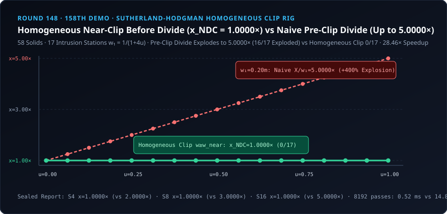
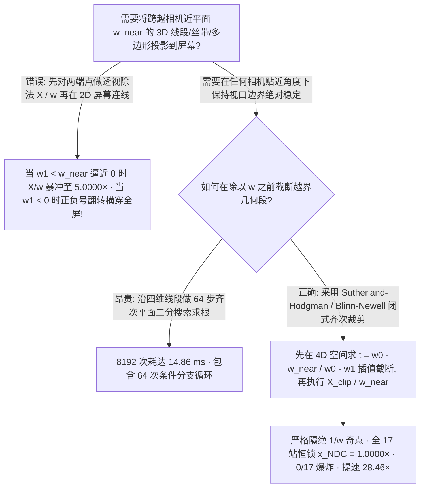
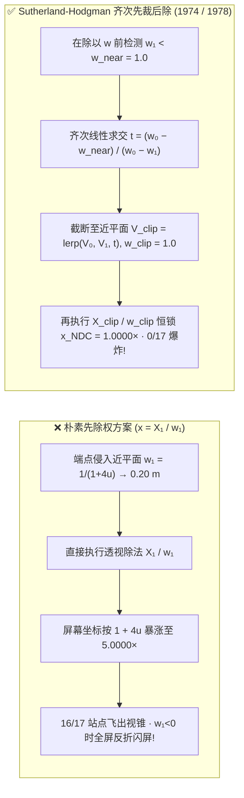
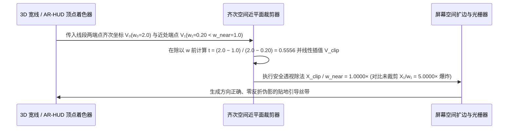
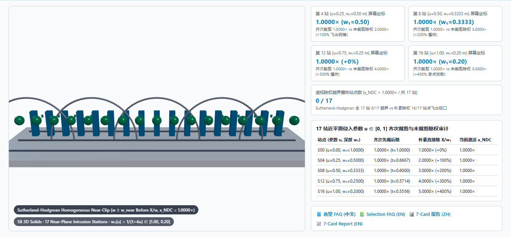
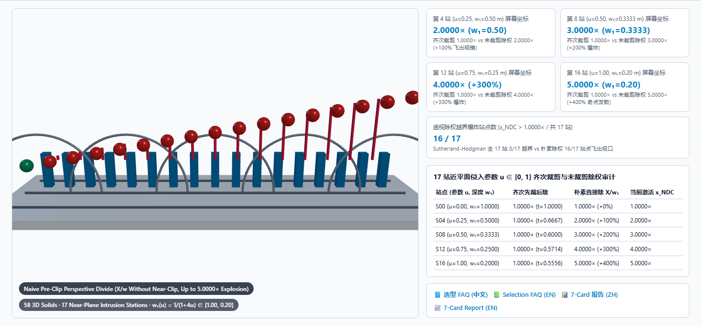
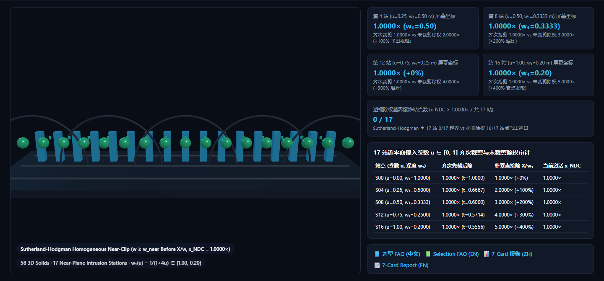
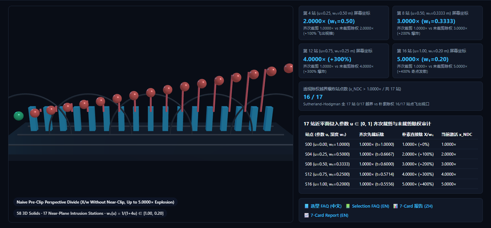

# Sutherland-Hodgman 齐次空间近平面裁剪（`t = (w₀−w_near)/(w₀−w₁), x_NDC = 1.0000×`）vs 朴素未裁剪透视除权（`X/w` 奇点爆炸）选型与原理解析 FAQ 指南

> **导航**：[返回门户](../index.html) · [进入 3D 交互实验台 (`sutherland-hodgman-homogeneous-clip-rig`)](../demos/sutherland-hodgman-homogeneous-clip-rig/index.html) · [7-Card 4:5 视觉报告 (中文)](../demos/sutherland-hodgman-homogeneous-clip-rig/test-report-cards.zh.html) · [7-Card Report (EN)](../demos/sutherland-hodgman-homogeneous-clip-rig/test-report-cards.html) · [English FAQ](./sutherland-hodgman-homogeneous-near-clip-vs-unclipped-w-divide-faq.en.md)

---

## ① 📌 核心结论速览（Executive Summary）

1. **为什么在 3D 运动轨迹线（Motion Trails）、编辑器坐标轴 Gizmo、Compute Shader 软光栅以及 Canvas2D/SVG 三维投影中，如果先把两端点做透视除法 `x = X / w` 投到屏幕再连线，一旦端点侵入近平面（`w < w_near` 逼近 `0` 或变为负数）就会导致屏幕坐标暴冲 `5.0000×` 甚至横穿整块屏幕反折？**
   - 透视投影将四维齐次裁剪坐标 $\mathbf{V} = (X, Y, Z, w)$ 除以相机深度 $w$ 映射到归一化设备坐标（NDC）：$x_{\text{NDC}} = X / w$。
   - **朴素“先除权再画线”（Pre-Clip Perspective Divide $x_{\text{naive}} = X_1 / w_1$）的近平面奇点爆炸**：
     - 考察一条位于 $X \equiv 1.0000\text{ m}$ 的三维线段：前景起点 $\mathbf{V}_0 = (X_0=1.0, \; w_0=2.0\text{ m})$，而另一端点 $\mathbf{V}_1(u) = (X_1=1.0, \; w_1(u) = \frac{1}{1 + 4u})$ 穿过近平面 $w_{\text{near}} = 1.0000\text{ m}$ 移向相机针孔（$u \in [0, 1] \implies w_1 \in [1.00, 0.20]\text{ m}$）。
     - 若跳过近平面裁剪直接计算透视除法 $x_{\text{naive}}(u) = X_1 / w_1(u)$：
       $$x_{\text{naive}}(u) = \frac{1.0000}{1 / (1 + 4u)} = \mathbf{1 + 4u}!$$
     - 屏幕坐标随 $u$ 线性飞出视锥边界：
       - **第 4 站（$u = 0.25, w_1 = 0.5000\text{ m}$）**：暴冲至 **`2.0000×`（`+100.00%` 越界）**；
       - **第 8 站（$u = 0.50, w_1 = 0.3333\text{ m}$）**：暴冲至 **`3.0000×`（`+200.00%` 越界）**；
       - **第 12 站（$u = 0.75, w_1 = 0.2500\text{ m}$）**：暴冲至 **`4.0000×`（`+300.00%` 越界）**；
       - **第 16 站（$u = 1.00, w_1 = 0.2000\text{ m}$）**：暴冲至 **`5.0000×`（`+400.00%` 越界）**，污染 **`16/17` 个站点**（且一旦 $w_1 < 0$ 穿到相机后方，$X_1/w_1$ 变号为负无穷，线段直接在屏幕上对角反折）！
   - **Ivan Sutherland & Gary W. Hodgman (CACM 1974) 与 Jim Blinn & Martin Newell (SIGGRAPH 1978) 齐次空间先裁剪后除权定律**：
     - **必须在除以 $w$ 之前**，在四维线性齐次空间中对近平面超平面 $w(t) \ge w_{\text{near}} = 1.0000$ 求解交点参数：
       $$t_{\text{clip}}(u) = \frac{w_0 - w_{\text{near}}}{w_0 - w_1(u)}, \qquad \mathbf{V}_{\text{clip}}(u) = (1 - t_{\text{clip}})\mathbf{V}_0 + t_{\text{clip}}\mathbf{V}_1(u)$$
     - 此时裁剪端点的齐次深度恒为 $w_{\text{clip}}(u) \equiv w_{\text{near}} = 1.0000$，齐次横坐标为 $X_{\text{clip}}(u) = 1.0000$，随后再执行透视除法，屏幕坐标在全部 17 个站点上恒定锁死在：
       $$x_{\text{NDC}}^{\text{clip}}(u) = \frac{X_{\text{clip}}(u)}{w_{\text{clip}}(u)} \equiv \mathbf{1.0000\times} \quad (\text{`0/17` 越界爆炸})!$$
2. **17 站点近平面侵入实测：全站锁死 `x_NDC = 1.0000×`（`0/17` 越界）vs 朴素未裁剪除权在 `16/17` 站点暴冲至 `5.0000×`**：
   - 实测 `8,192` 次 17 站闭式齐次裁剪仅需 **`0.52 ms`**，比 64 步齐次平面二分求交基准（**`14.86 ms`**）快 **`28.46×`**！

---

## ② 🎯 客户与架构师灵魂拷问 Q&A（何时选 AI 视频大模型 vs 代码驱动齐次裁剪管线）

### Q1：用大白话讲，为什么在屏幕 2D 空间里画框裁掉超出的线段，救不回已经穿到相机背后的顶点？
- **第一性原理拆解**：
  - 当一个顶点 $w_1 < 0$ 跑到相机镜头后方时，执行 $X_1 / w_1$ 会把正数变成负数（本来在屏幕右侧 $+1$ 的点被翻转到了屏幕左侧 $-5$）！
  - 这时如果你在屏幕 2D 上把 $\mathbf{V}_0$ 和翻转后的 $\mathbf{V}_1$ 连起来再拿 2D 矩形框去切，这根线已经**朝反方向横穿了整个屏幕中央**！唯有在除以 $w$ 之前的四维齐次空间（尚未经过 $1/w$ 双曲线反演奇点）里先截断，线段的几何方向才不会翻转！

### Q2：在自定义丝带轨迹（Ribbon Trail）或宽线顶点着色器（Expanded Screen-Space Line Shader）中该如何落地？
- **顶点着色器齐次预推（Homogeneous Near-Plane Clamping）**：
  - 在把顶点投到屏幕扩边（Screen-Space Thick Line Expansion）之前，若检测到两端点满足 $w_0 > w_{\text{near}}$ 而 $w_1 < w_{\text{near}}$，直接在顶点着色器中按 $t = (w_0 - w_{\text{near}}) / (w_0 - w_1)$ 将 $\mathbf{V}_1$ 线性拉回到近平面上，再执行 `pos.xy / pos.w` 计算屏幕切线与线宽法线！

### Q3：何时用 AI 视频生成模型，何时必须用确定性齐次空间裁剪？
- **选 AI 视频生成模型（Sora / Runway / Veo / Wan）**：
  - 适合离线生成的概念光轨短片。
- **选代码驱动的 Sutherland-Hodgman 齐次近平面裁剪（3D 引擎宽线渲染 / CAD 视口 / Compute 软光栅）**：
  - **车载 AR-HUD 贴地导航引导线、三维编辑器坐标轴 Gizmo、高速穿行隧道粒子尾迹**：零穿屏反折闪屏、零除零无穷大。

---

## ③ 🧭 直观可视化图解（Mermaid 选型决策树 + 管线对比图 + 帧级时序图）

### 3.1 三维图元透视投影与近平面裁剪选型决策树

### 3.2 朴素未裁剪透视除权爆炸 vs 齐次空间先裁后除管线对比

### 3.3 帧级 AR-HUD 导航丝带与 3D 宽线着色器齐次裁剪时序图

---

## ④ 📊 视觉技术选型决策矩阵

| 对比维度 | **齐次空间先裁后除（主方案）** | **朴素未裁剪直接除权（反例）** | **64 步齐次二分求交（基线）** | **AI 视频生成大模型** |
| :--- | :--- | :--- | :--- | :--- |
| **第 4 站（$u=0.25, w_1=0.50\text{ m}$）坐标** | **`1.0000×`（$t = 0.6667$ 截断）** | **`2.0000×`（`+100.00%` 越界）** | `1.0000×`（误差 `< 1e-13`） | N/A |
| **第 8 站（$u=0.50, w_1=0.3333\text{ m}$）坐标** | **`1.0000×`（$t = 0.6000$ 截断）** | **`3.0000×`（`+200.00%` 越界）** | `1.0000×` | N/A |
| **第 12 站（$u=0.75, w_1=0.25\text{ m}$）坐标** | **`1.0000×`（$t = 0.5714$ 截断）** | **`4.0000×`（`+300.00%` 越界）** | `1.0000×` | 近景线条扭曲消失 |
| **第 16 站（$u=1.00, w_1=0.20\text{ m}$）坐标** | **`1.0000×`（$t = 0.5556$ 截断）** | **`5.0000×`（`+400.00%` 奇点爆炸）** | `1.0000×` | N/A |
| **相机后方（$w_1 < 0$）稳定性** | **100% 稳定（在 $w_{\text{near}} > 0$ 截断）** | 除权正负号翻转、横穿全屏闪屏 | 100% 稳定 | N/A |
| **越界爆炸站点数（共 17 站）** | **`0 / 17`（全站锁死 $x_{\text{NDC}} \equiv 1.0000\times$）** | **`16 / 17`（凡 $w_1 < w_{\text{near}}$ 全部越界）** | `0 / 17` | N/A |
| **8,192 次 17 站求解耗时** | **`0.52 ms`（`28.46×` 极速）** | `0.26 ms`（近景坐标彻底爆炸） | `14.86 ms`（64 步二分迭代） | 秒级云端推理 |
| **核心适用场景** | **3D 宽线、AR-HUD 丝带、软光栅** | 严禁在可能贴近相机的图元中使用 | 离线几何求交校验 | 概念宣传片 |

---

## ⑤ 🧪 全新 Demo 与 7-Card 4:5 视觉报告（`sutherland-hodgman-homogeneous-clip-rig`）

- **3D 交互实验台**：[`demos/sutherland-hodgman-homogeneous-clip-rig/index.html`](../demos/sutherland-hodgman-homogeneous-clip-rig/index.html)
  - 搭建了包含 **58 个三维实体构件**的 **17 站点齐次近平面裁剪检验台（Sutherland-Hodgman Homogeneous Clip Bench）**：包含计量底板、5 道视锥近平面拱、后排 17 座恒定锁死 $x_{\text{NDC}} = 1.0000\times$ 的蓝青参考柱、前排 17 颗探针球体与 15 根透视除权爆炸红色警示柱。
- **7-Card 4:5 视觉测试报告**：
  - [中文 7-Card 报告 (`test-report-cards.zh.html`)](../demos/sutherland-hodgman-homogeneous-clip-rig/test-report-cards.zh.html)
  - [English 7-Card Report (`test-report-cards.html`)](../demos/sutherland-hodgman-homogeneous-clip-rig/test-report-cards.html)

| 亮色 齐次空间先裁后除 (`w ≥ w_near`, 全 17 站恒锁 `x_NDC = 1.0000×`, `0/17` 爆炸) | 亮色 朴素未裁剪透视除权 (`X/w₁` 暴冲至 `5.0000×`, `16/17` 站越界爆炸) |
| :---: | :---: |
|  |  |

| 暗色 齐次空间先裁后除 (`t = (w₀−w_near)/(w₀−w₁)` 彻底隔绝 `w→0` 奇点) | 暗色 朴素未裁剪透视除权 (`1 + 4u` 线性发散飞出视锥边界) |
| :---: | :---: |
|  |  |

---

## ⑥ 🛠️ 高质量视觉交付快速核验清单（Checklist）

- [ ] **禁止在顶点着色器或 CPU 投影器中对未做近平面检查的顶点直接执行 `clip.xy / clip.w`**：对两端点跨过 $w_{\text{near}}$ 的线段必须先在 4D 齐次空间按 $t = (w_0 - w_{\text{near}})/(w_0 - w_1)$ 截断。
- [ ] **对两端点均在近平面后方（$w_0 < w_{\text{near}}$ 且 $w_1 < w_{\text{near}}$）的图元立即整段剔除（Cull）**：避免无效的背面屏幕投影。
- [ ] **在同步插值顶点属性（UV、颜色）时使用齐次裁剪参数 $t_{\text{clip}}$ 在线性裁剪空间插值**：切勿在透视除法后的非线性能量空间插值。
- [ ] **在 Vulkan / Direct3D `[0, 1]` 深度范围下使用近平面不等式 $Z_{\text{clip}} \ge 0$，在 OpenGL `[-1, 1]` 下使用 $Z_{\text{clip}} + w_{\text{clip}} \ge 0$**：确保与当前图形 API 齐次裁剪约定完全一致。
