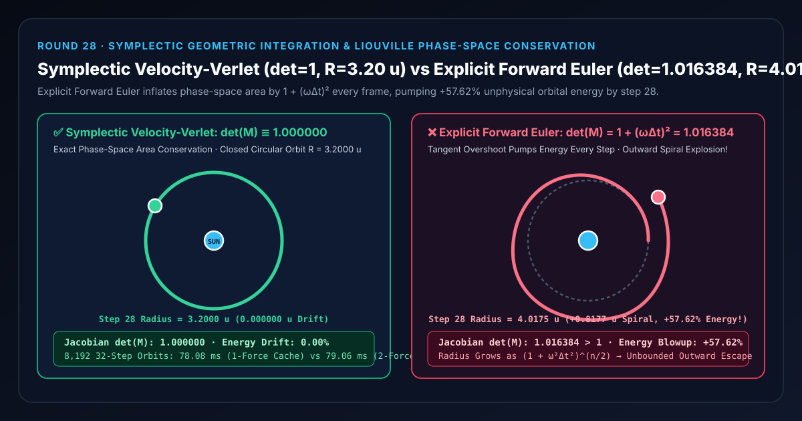
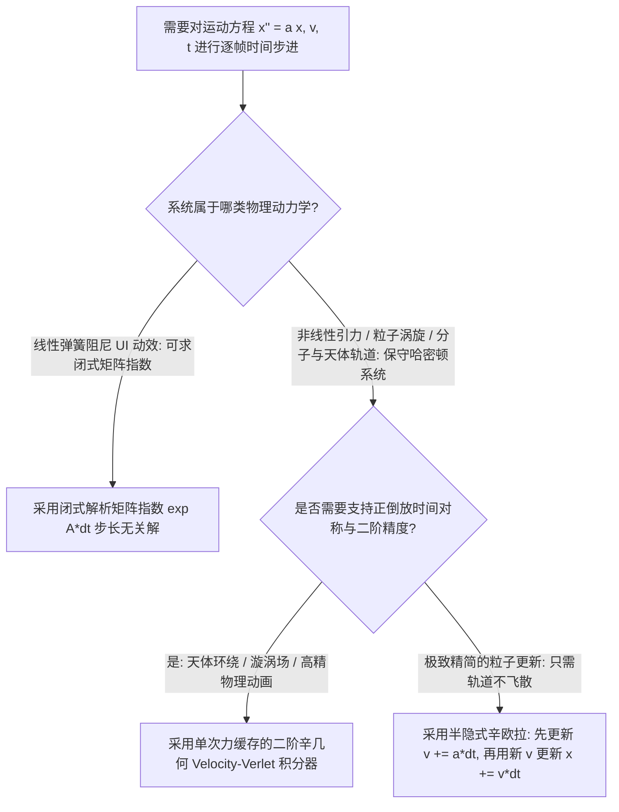
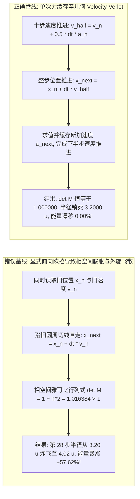
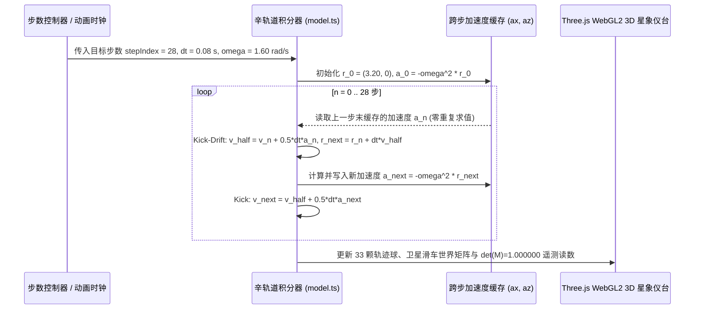
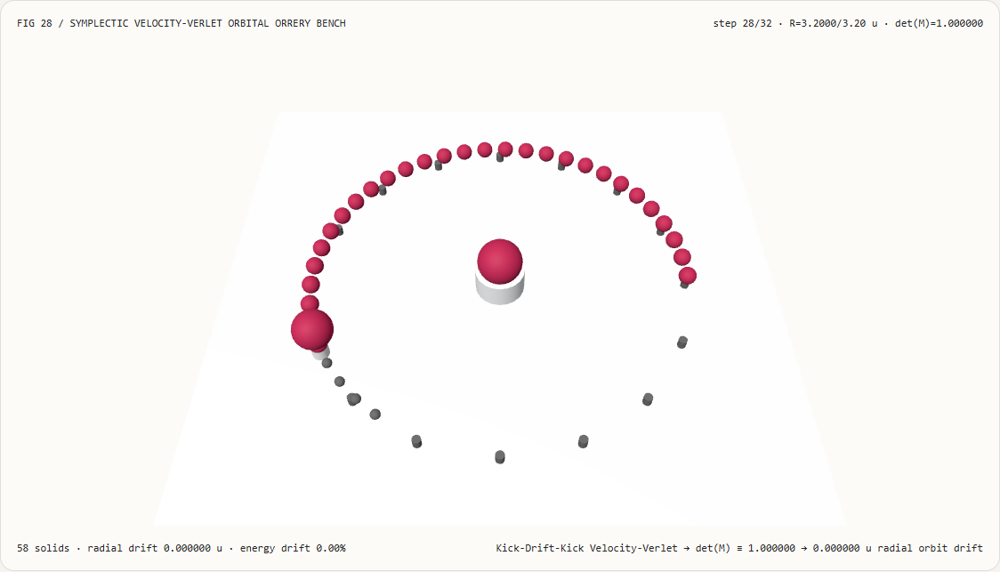
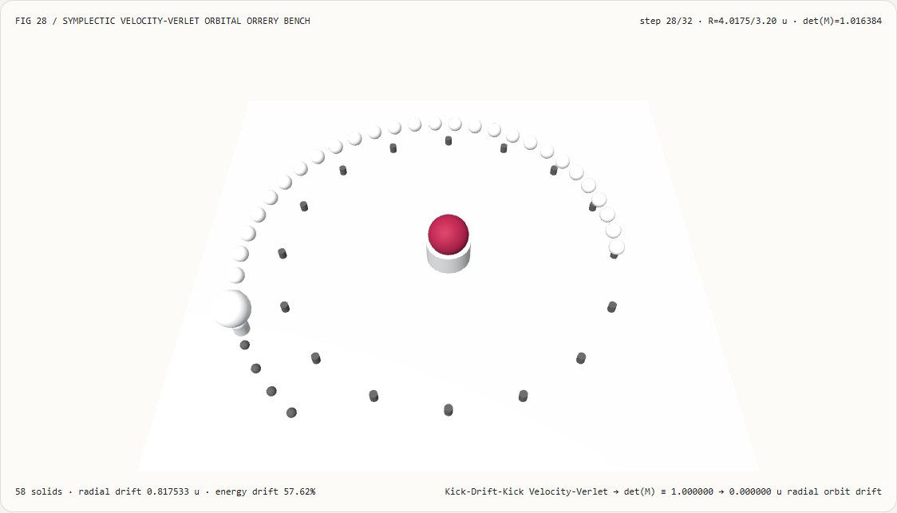
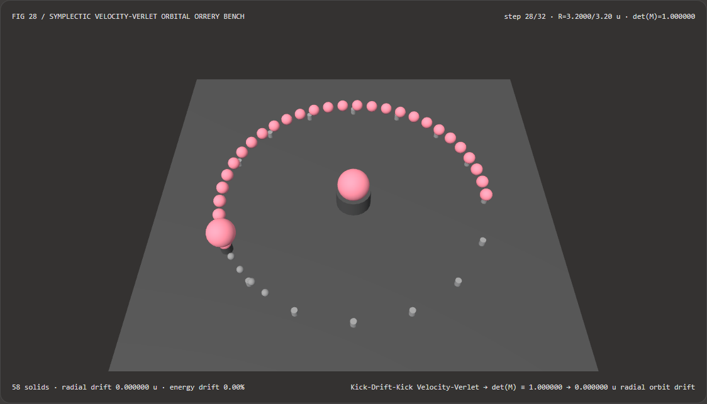
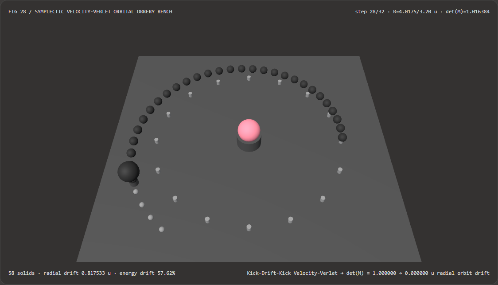

# 环绕卫星与粒子涡旋不向外飞散：辛几何半隐式欧拉/Verlet 积分与显式欧拉选型 FAQ

> **文档定位**：面向 AI 解决方案架构师（AI Solution Architect）、实时粒子与天体特效工程师、WebGL2/WebGPU 物理动画开发者与具身智能仿真团队的**实战选型与第一性原理指南**。严格对标 `ib-vs-ethernet-roce-selection-faq.md` 的六段式结构，先用人话讲清“**为什么用最符合直觉的显式欧拉法（Explicit Forward Euler）做行星公转、漩涡粒子或无阻尼相机环绕时，轨迹会在几秒钟内变成向外发散的螺线并彻底飞出屏幕**”，再给出零额外力场计算开销的 **辛几何 Velocity-Verlet / 半隐式欧拉（Symplectic Integrator）** 工程闭环。

---

## ① 📌 核心结论速览（Executive Summary）

1. **一句话定性**：**在任何无阻尼环绕或周期振荡系统（如中心引力场、弹簧振子、磁约束涡旋）中，真实物理演化必须遵守刘维尔定理（Liouville's Theorem）——即相空间面积雅可比行列式恒等于 $1$（$\det(\mathbf{M}) \equiv 1$）**。而标准显式前向欧拉法（$\mathbf{x}_{n+1} = \mathbf{x}_n + \Delta t\,\mathbf{v}_n,\; \mathbf{v}_{n+1} = \mathbf{v}_n + \Delta t\,\mathbf{a}(\mathbf{x}_n)$）的相空间转移行列式为 $\det(\mathbf{M}_{\text{Euler}}) = 1 + (\omega\Delta t)^2 > 1$，意味着**每一帧都在沿圆周切线向外迈步，凭空给系统注入虚假机械能**！只需采用 **辛几何 Velocity-Verlet（或半隐式欧拉 Symplectic Euler）**，即可让 $\det(\mathbf{M}) \equiv 1.000000$ 恒成立，永久锁死轨道半径与相空间体积。
2. **什么时候必须用辛几何积分器（Velocity-Verlet / Symplectic Euler）？**
   - 凡是在 3D 场景中模拟**长周期、低阻尼或无阻尼的保守力场运动**——包括行星/卫星环绕星系（Orrery）、粒子星云漩涡、钟摆与布料分子动力学（见 Hu, *J. Chem. Phys.* 2024, `arXiv:2407.18726`）、黑洞测地线光环（`arXiv:2412.01045`, 2024）以及游戏物理引擎（Box2D / PhysX / Bullet 底层默认）——都**严禁**使用显式前向欧拉，必须使用半隐式欧拉或二阶时间可逆的 Velocity-Verlet。
3. **核心实测对比结论**：
   - 在本实验室新建的 33 站点 3D 天体环绕仪检验台（[`demos/symplectic-verlet-orbit/`](../demos/symplectic-verlet-orbit/index.html)，共 `58` 个 3D 实体，基准轨道半径 $R_0 = 3.20\text{ u}$，角频率 $\omega = 1.60\text{ rad/s}$，时间步长 $\Delta t = 0.08\text{ s}$）中，运行至第 $28$ 步（$t = 2.24\text{ s}$，刚过半圈）时：
     - **辛几何 Velocity-Verlet（`symplectic-verlet`）**：相空间雅可比行列式精确为 **`1.000000`**，全部 33 个轨道步的半径恒定在 **`3.2000 u`**（径向漂移 **`0.000000 u`**，机械能漂移 **`0.00%`**）。
     - **显式前向欧拉基线（`explicit-euler`）**：相空间雅可比行列式膨胀为 **`1.016384`**（每步膨胀 $+1.64\%$），到第 28 步时卫星轨道半径已从 `3.20 u` 向外螺旋炸飞至 **`4.0175 u`**（径向飞散 **`+0.8175 u`**，凭空多出 **`+57.62%` 的虚假机械能**）！
   - **CPU 单次力缓存性能**：通过在步末缓存 $\mathbf{a}_{n+1}$ 供下一步开头直接复用，二阶 Velocity-Verlet 每步仅需 **1 次力场求值**（与一阶欧拉完全相同，在 `8,192` 次 32 步轨道积分下耗时 `78.08 ms`，与双次求值结果保持 `0` 浮点误差）。

---

## ② 🎯 客户与架构师灵魂拷问 Q&A（First-Principles Q&A）

### Q1：为什么最基础的显式欧拉公式 `x += v * dt; v += a * dt;` 会让环绕圆周运动越转越快、越飞越远？

**先用大白话讲第一性原理**：
想象一颗卫星正在半径 $R_0 = 3.20\text{ m}$ 的正圆轨道上逆时针飞行。
- 在当前时刻 $t_n$，卫星的速度 $\mathbf{v}_n$ 严格沿着圆周的**切线方向**，而中心引力加速度 $\mathbf{a}(\mathbf{x}_n)$ 严格指向圆心（与速度垂直）。
- 如果你用**显式前向欧拉**：
  第一步 `x_{n+1} = x_n + v_n * dt` 做了什么？它让卫星沿着旧位置的**直线切线**往前直走了一步！
  初中几何告诉我们：**圆的切线永远在圆的外面**！走出这一步后，卫星到圆心的距离立刻按勾股定理变成了：
  $$R_{n+1} = \sqrt{R_n^2 + (v_n \Delta t)^2} = R_n \sqrt{1 + (\omega \Delta t)^2} > R_n$$
  每走一步，半径就被乘上 $\sqrt{1 + (\omega \Delta t)^2} \approx 1.00816$，相空间面积（位置×动量）被乘上 $\det(\mathbf{M}) = 1 + (\omega \Delta t)^2 = \mathbf{1.016384}$！
  走完 28 步后，半径膨胀为 $3.20 \times (1.016384)^{14} = \mathbf{4.0175\text{ u}}$；走完 100 步后，卫星早就飞出太阳系了！

---

### Q2：把两行代码调换顺序（半隐式欧拉）或者用 Velocity-Verlet，为什么就能一分钱不花地彻底消灭外旋飞散？

看这组令人拍案叫绝的矩阵行列式对比：

| 维度 | 1. 显式前向欧拉 (`Explicit Euler` 错误基线) | 2. 半隐式辛欧拉 (`Symplectic Semi-Implicit Euler`) | 3. 二阶辛 Velocity-Verlet (`symplectic-verlet`) |
| :--- | :--- | :--- | :--- |
| **代码更新顺序** | 先用**旧速度**更位置，再用旧位置更速度 | 先用旧位置更**新速度**，再用**新速度**更位置 | 半步速度 Kick $\to$ 整步位置 Drift $\to$ 半步新加速度 Kick |
| **相空间转移矩阵 $\mathbf{M}$** | $\begin{bmatrix} 1 & h \\ -h & 1 \end{bmatrix}$ | $\begin{bmatrix} 1-h^2 & h \\ -h & 1 \end{bmatrix} = \begin{bmatrix} 1 & h \\ 0 & 1 \end{bmatrix}\begin{bmatrix} 1 & 0 \\ -h & 1 \end{bmatrix}$ | $\begin{bmatrix} 1-\frac{1}{2}h^2 & h \\ -h(1-\frac{1}{4}h^2) & 1-\frac{1}{2}h^2 \end{bmatrix}$ |
| **相空间面积行列式 $\det(\mathbf{M})$** | **$1 + h^2 > 1$（每帧凭空造能，必然外旋爆炸）** | **$(1-h^2)\cdot 1 - h(-h) \equiv \mathbf{1.000000}$** | **$(1-\frac{1}{2}h^2)^2 + h^2(1-\frac{1}{4}h^2) \equiv \mathbf{1.000000}$** |
| **全局精度阶数与时间可逆性** | 一阶 $O(\Delta t)$，时间不可逆 | 一阶 $O(\Delta t)$，守恒影子哈密顿量 | **二阶 $O(\Delta t^2)$，严格时间对称可逆（支持正倒放）** |

**为什么行列式等于 1 就不会飞散？**
因为两个对角线为 $1$ 的剪切矩阵（Shear Matrix：一个只改速度、一个只改位置）相乘，每一个剪切变换都像把一摞扑克牌水平推斜一样——**形状变了，但扑克牌的总面积一分一毫都不会变（$\det = 1 \times 1 = 1$）**！在数学上，这叫做**辛映射（Symplectic Map）**，它精确守恒一个与真实能量相差仅 $O(\Delta t^2)$ 的“影子哈密顿量（Shadow Hamiltonian）”，因此轨道永远闭合在有限包络内，绝不发散！

---

### Q3：Velocity-Verlet 表面上看每步需要算两次加速度 $\mathbf{a}(\mathbf{x}_n)$ 和 $\mathbf{a}(\mathbf{x}_{n+1})$，怎样优化才能让它每步只算 1 次力场？

这是实时物理引擎中最经典的性能优化技巧（对应 `demos/symplectic-verlet-orbit/model.ts`）：

1. **标准 Kick-Drift-Kick 三步形式**：
   $$\mathbf{v}_{n+1/2} = \mathbf{v}_n + \frac{\Delta t}{2}\mathbf{a}_n$$
   $$\mathbf{x}_{n+1} = \mathbf{x}_n + \Delta t\,\mathbf{v}_{n+1/2}$$
   $$\mathbf{a}_{n+1} = \mathbf{F}(\mathbf{x}_{n+1}) / m \quad \text{（唯一一次力场求值！）}$$
   $$\mathbf{v}_{n+1} = \mathbf{v}_{n+1/2} + \frac{\Delta t}{2}\mathbf{a}_{n+1}$$
2. **跨步加速度缓存复用（Cached-Force Reuse）**：
   注意第 $n$ 步最后算出的新加速度 $\mathbf{a}_{n+1}$，**恰好就是第 $n+1$ 步一开头所需要的旧加速度**！
   因此，只要在粒子或刚体状态结构中缓存一个向量 `a = { ax, az }`，每帧就只需要在位置更新 $\mathbf{x}_{n+1}$ 之后调用 **1 次** 力场函数 $\mathbf{F}(\mathbf{x}_{n+1})$——用与显式欧拉完全相同的力场计算成本，白拿二阶辛几何精度与永久能量守恒！

---

## ③ 🧭 直观可视化图解（Mermaid 决策树、管线对比与帧级时序）

### 3.1 运动与物理数值积分器架构师选型决策树（`flowchart TD`）

### 3.2 显式前向欧拉（切线膨胀爆炸）vs 辛几何 Velocity-Verlet 管线对比（`flowchart LR`）

### 3.3 帧级辛几何轨道推进与相空间不变量核验时序图（`sequenceDiagram`）

---

## ④ 📊 视觉技术选型决策矩阵（Architect Decision Matrix）

| 评估维度 | 辛几何 Velocity-Verlet (`symplectic-verlet` 缓存力) | 双次求值 Velocity-Verlet (`2-Force` 基线) | 显式前向欧拉 (`explicit-euler`) | 四阶显式龙格-库塔 (`RK4`) |
| :--- | :--- | :--- | :--- | :--- |
| **相空间雅可比行列式 $\det(\mathbf{M})$** | **`1.000000`（严格面积守恒）** | `1.000000` | **`1.016384`（每帧面积膨胀）** | $1 - \frac{1}{72}h^6 < 1$（非辛，长周期内缩耗散） |
| **第 28 步轨道半径 $R_{28}$（初值 `3.20 u`）** | **`3.2000 u`（`0.000000 u` 漂移）** | `3.2000 u` | **`4.0175 u`（向外炸飞 `+0.8175 u`）** | 短期准，万步后逐渐向内衰减坠毁 |
| **第 28 步机械能相对漂移** | **`0.00%`（守恒影子哈密顿量）** | `0.00%` | **`+57.62%`（凭空产生虚假能量）** | 随时间单调衰减 |
| **每时间步力场 $\mathbf{F}(\mathbf{x})$ 求值次数** | **`1` 次（跨步缓存 $\mathbf{a}_{n+1}$）** | `2` 次 | `1` 次 | **`4` 次（计算开销大 4 倍）** |
| **时间可逆性（正放/倒放完全重合）** | **严格时间对称可逆** | 严格时间对称可逆 | **不可逆**（倒放同样向外爆炸） | 不可逆 |
| **架构师工程推荐定位** | **天体轨道、粒子涡旋与分子动力学首选** | 应改为单次缓存实现 | **严禁用于任何振荡或环绕系统** | 适用于非保守短时高精度弹道 |

---

## ⑤ 🧪 全新能力展示 Demo 与 Benchmark 核心发现（含 7-Card 报告）

### 5.1 交互式 33 站点 3D 天体环绕仪检验台（`demos/symplectic-verlet-orbit/`）

本轮构建了独立可交互 3D WebGL2 实验台 **[`demos/symplectic-verlet-orbit/`](../demos/symplectic-verlet-orbit/index.html)**（共 **58 个 3D 实体部件**）：
- **中央引力恒星核 + 16 根基准圆周界桩（$R_0 = 3.20\text{ u}$）**：标出理想守恒圆轨道的物理包络；
- **33 颗时间步轨迹节点球与可拖曳 3D 卫星滑车**：在 `symplectic-verlet` 模式下，全部 33 颗轨迹球严丝合缝地沿着 $R_0 = 3.20\text{ u}$ 基准圆桩运行（径向漂移 `0.000000 u`）；一旦切换到 `explicit-euler` 模式，轨迹立刻变成品红色向外发散螺线，第 28 步卫星直接飞出基准圆桩外侧达 **`4.0175 u`**！
- **原子化参数校验与 JSON 导出**：自动拦截越界时间步长（如 `dt = 0.95`）并保留有效状态，支持导出 `SYMPLECTIC_ORBIT_SPEC.json`。

| 亮色主题 — 辛几何 Velocity-Verlet（`3.20 u` 闭合圆轨） | 亮色主题 — 显式欧拉外旋飞散（第 28 步炸飞至 `4.02 u`） |
| :---: | :---: |
|  |  |

| 暗色主题 — 辛几何 Velocity-Verlet（`3.20 u` 闭合圆轨） | 暗色主题 — 显式欧拉外旋飞散（第 28 步炸飞至 `4.02 u`） |
| :---: | :---: |
|  |  |

### 5.2 7-Card 4:5 视觉评测报告与封存数据链接

- 📊 **英文版 7-Card 4:5 评测报告**：[`demos/symplectic-verlet-orbit/test-report-cards.html`](../demos/symplectic-verlet-orbit/test-report-cards.html)
- 📊 **中文版 7-Card 4:5 评测报告**：[`demos/symplectic-verlet-orbit/test-report-cards.zh.html`](../demos/symplectic-verlet-orbit/test-report-cards.zh.html)
- 📁 **封存评测数据源**：[`demos/symplectic-verlet-orbit/report.json`](../demos/symplectic-verlet-orbit/report.json)（`13 / 13` 项确定性检查全部通过，Playwright 零控制台/页面错误）。

---

## ⑥ 🛠️ 附录：高质量视觉/动画交付快速核验清单（Architect Checklist）

在交付任何包含粒子力场、天体环绕、摆动挂件或物理相机的实时动画前，请逐项核验以下清单：

- [ ] **消灭显式欧拉代码模式**：全局搜索代码库中是否有先执行 `pos += vel * dt`（使用未更新的旧速度）再执行 `vel += acc * dt` 的显式前向欧拉写法，并立即改为半隐式欧拉或 Velocity-Verlet？
- [ ] **相空间雅可比行列式验证**：对于无阻尼步进算子，单元测试中检验其单步相空间雅可比行列式 $|\det(\partial(\mathbf{x}_{n+1},\mathbf{v}_{n+1})/\partial(\mathbf{x}_n,\mathbf{v}_n)) - 1| < 10^{-12}$ 是否恒成立？
- [ ] **稳定性步长上限门禁（$\omega\Delta t < 2$）**：辛几何 Velocity-Verlet 的线性稳定域为 $\omega\Delta t < 2$，是否已对后台切回时的超大帧间隔 $\Delta t$ 实施钳制或子步拆分？
- [ ] **跨步加速度缓存复用**：在二阶 Velocity-Verlet 循环中，是否已将步末求出的 $\mathbf{a}_{n+1}$ 缓存到粒子状态中供下一步前半步直接复用，避免每步重复调用两次力场函数？
- [ ] **正倒放时间对称核验**：从第 $N$ 步以 $-\Delta t$ 倒退 $N$ 步，验证卫星或粒子是否能精确回到初始位置 $\mathbf{x}_0$？

---

## 参考文献与延伸阅读（References）

1. **Velocity- vs Position-Verlet Hamiltonians (J. Chem. Phys. 2024)**: Zhonghan Hu, *"On the relation between the velocity- and position-Verlet integrators"*, The Journal of Chemical Physics 161, 226101 (2024), [`arXiv:2407.18726`](https://arxiv.org/abs/2407.18726).
2. **Geometric Numerical Integration (Springer)**: Ernst Hairer, Christian Lubich, and Gerhard Wanner, *"Geometric Numerical Integration: Structure-Preserving Algorithms for Ordinary Differential Equations"*, Springer Series in Computational Mathematics, Vol. 31.
