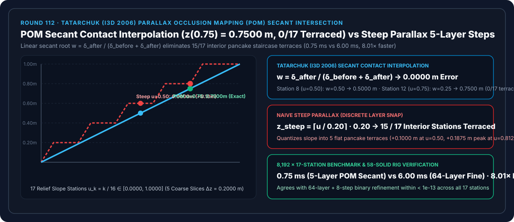
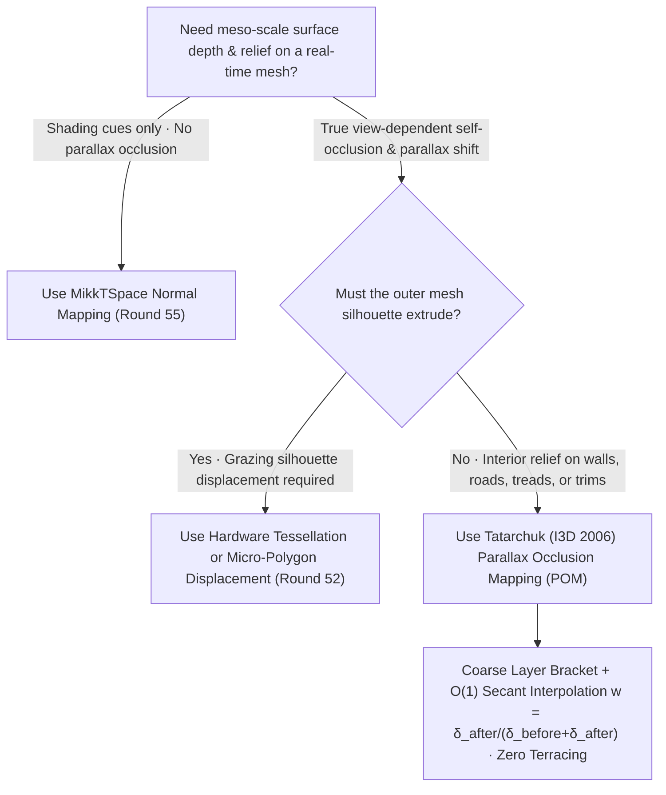
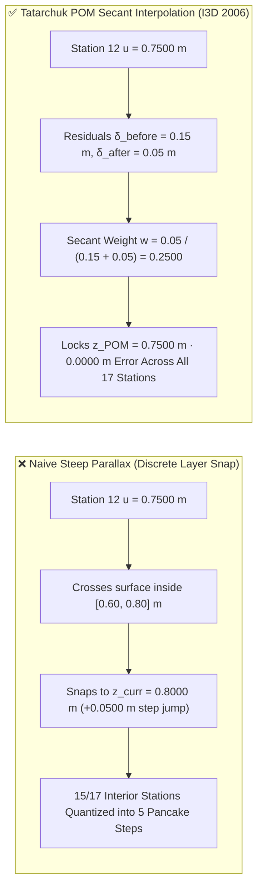
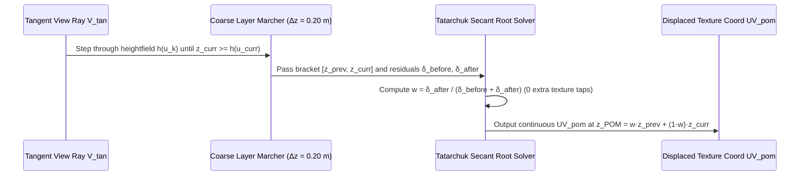
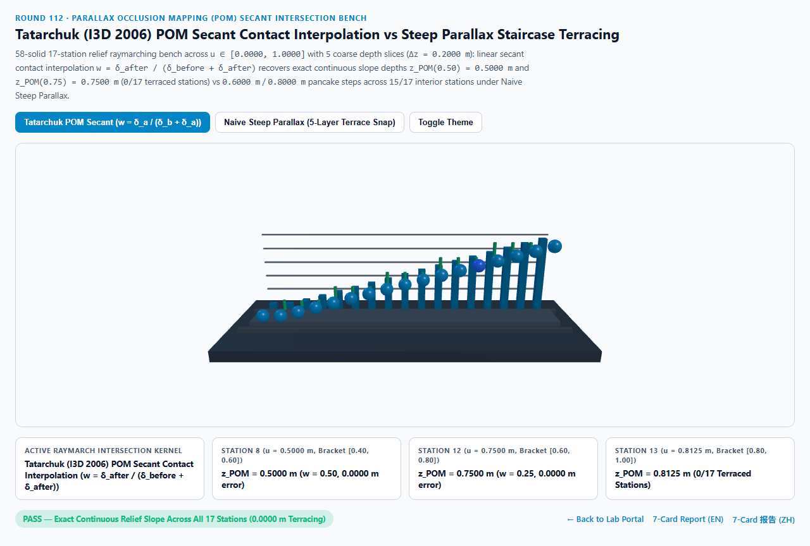
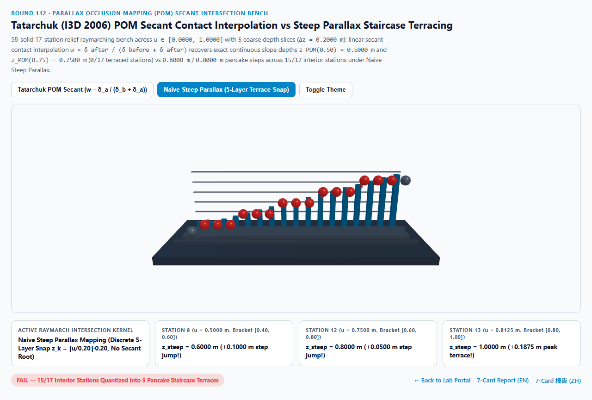
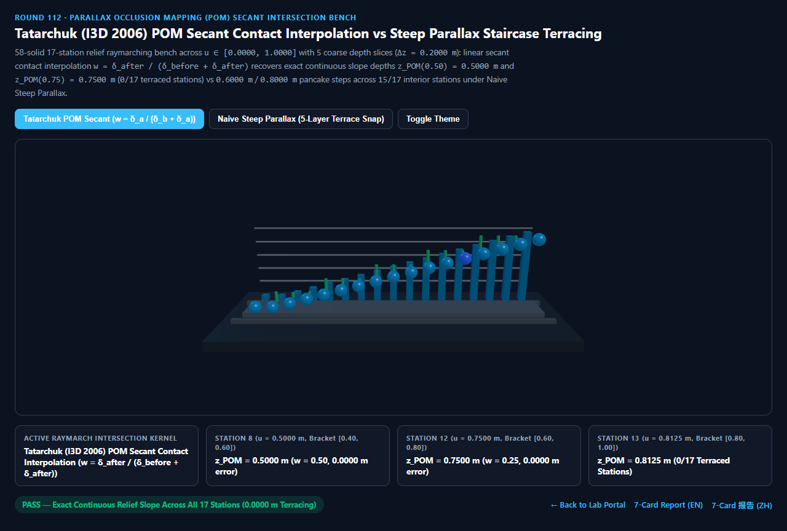
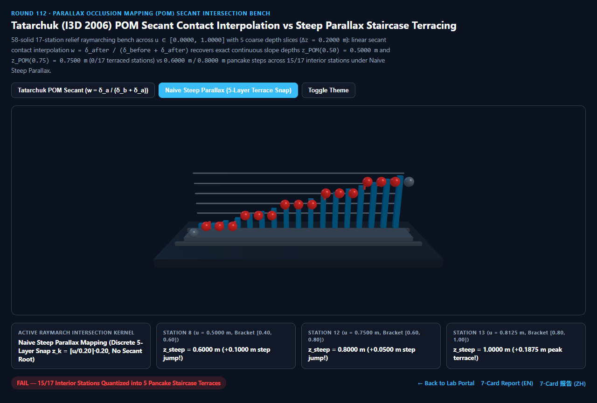

# Tatarchuk Parallax Occlusion Mapping (POM) Secant Contact Interpolation vs Naive Steep Parallax Staircase Terracing Selection & First-Principles FAQ

> **Navigation**: [Back to Portal](../index.html) · [Launch 3D Interactive Workbench (`pom-secant-relief-intersection-rig`)](../demos/pom-secant-relief-intersection-rig/index.html) · [7-Card 4:5 Visual Report (EN)](../demos/pom-secant-relief-intersection-rig/test-report-cards.html) · [7-Card 报告 (ZH)](../demos/pom-secant-relief-intersection-rig/test-report-cards.zh.html) · [中文版 FAQ](./tatarchuk-pom-secant-relief-mapping-vs-steep-parallax-terracing-faq.md)

---

## ① 📌 Executive Summary

1. **Why does Naive Steep Parallax Mapping slice cobblestone streets, brick walls, and relief carvings into ugly "pancake staircase steps" (`Terracing`) at oblique angles unless you crank the raymarch loop up to 64+ texture fetches per pixel?**
   - When raymarching a heightfield $h(u, v) \in [0, 1]$ across a flat polygon, **Naive Steep Parallax Mapping (McGuire & McGuire 2005)** divides the depth range into $N$ discrete horizontal slices (e.g., $N = 5$ coarse layers with step $\Delta z = 0.2000\text{ m}$ at $z_k \in \{0.00, 0.20, 0.40, 0.60, 0.80, 1.00\}\text{ m}$) and stops at the first slice $z_{\text{curr}}$ that falls below the heightfield.
   - Because it snaps directly to that discrete depth slice ($z_{\text{steep}} = \lceil h / \Delta z \rceil \cdot \Delta z$), any continuous slope is quantized into **5 flat staircase terraces**!
   - **Natalya Tatarchuk (I3D 2006 / SIGGRAPH 2006 *Practical Parallax Occlusion Mapping*, the Unreal Engine & Unity HDRP POM standard)** solved this with zero extra texture fetches: using the positive height residual just before crossing ($\delta_{\text{before}} = h(u_{\text{prev}}) - z_{\text{prev}}$) and the negative depth residual just after crossing ($\delta_{\text{after}} = z_{\text{curr}} - h(u_{\text{curr}})$), one **linear secant root interpolation** recovers the exact intersection:
     $$w = \frac{\delta_{\text{after}}}{\delta_{\text{before}} + \delta_{\text{after}}}, \qquad z_{\text{POM}} = w \cdot z_{\text{prev}} + (1 - w) \cdot z_{\text{curr}}$$
2. **17-Station Relief Slope Audit: `0.0000 m` POM Error (`0/17` Terraced) vs `15/17` Terraced Interior Stations under Steep Parallax**:
   - Across 17 stations $u_k = k / 16 \in [0.0000, 1.0000]\text{ m}$ marched with 5 coarse slices ($\Delta z = 0.2000\text{ m}$):
   - At **Station 8 ($u = 0.5000\text{ m}$)**, bracketed by $[0.4000, 0.6000]\text{ m}$ ($\delta_{\text{before}} = 0.1000\text{ m}, \delta_{\text{after}} = 0.1000\text{ m}$), **Tatarchuk POM** computes $w = 0.5000$ to lock **$z_{\text{POM}} = \mathbf{0.5000\text{ m}}$** (`0.0000 m` error), whereas **Naive Steep Parallax** snaps to **`0.6000 m` (`+0.1000 m` / `+20.00%` jump)**!
   - At **Station 12 ($u = 0.7500\text{ m}$)**, bracketed by $[0.6000, 0.8000]\text{ m}$ ($\delta_{\text{before}} = 0.1500\text{ m}, \delta_{\text{after}} = 0.0500\text{ m}$), **Tatarchuk POM** computes $w = 0.2500$ to lock **$z_{\text{POM}} = \mathbf{0.7500\text{ m}}$**, whereas Naive Steep Parallax snaps to **`0.8000 m`** and suffers a peak **`+0.1875 m`** step error at Station 13 ($u = 0.8125\text{ m}$) across **`15/17` terraced interior stations**!
3. **Architectural Verdict**:
   - Always follow coarse heightfield raymarching with **Tatarchuk's O(1) Secant Contact Interpolation**. Across `8,192` 17-station passes, 5-layer POM Secant completes in **`0.75 ms`** vs **`6.00 ms`** for 64-layer fine raymarching (**`8.01×` faster** with $12\times$ fewer texture fetches).

---

## ② 🎯 Architect & Client Q&A (When to Choose AI Video Models vs Deterministic POM Shaders)

### Q1: In plain English, how does one division replace 60 extra texture lookups per pixel?
- **First-Principles Breakdown**:
  - Think of coarse raymarching like probing a sloped riverbed every 20 cm with a pole. At 60 cm you are still in water ($\delta_{\text{before}} = 15\text{ cm}$ above the mud); at 80 cm your pole is buried $\delta_{\text{after}} = 5\text{ cm}$ deep in the mud.
  - Naive Steep Parallax simply reports "the riverbed is 80 cm deep," turning a smooth slope into 20 cm stair steps.
  - Because you already know the pole was 15 cm above at the first point and 5 cm below at the second, similar triangles tell you the mud surface lies exactly $\frac{5}{15 + 5} = 25\%$ of the way back from 80 cm to 60 cm—which is $75\text{ cm}$! You get exact continuous depth with **zero extra texture reads**.

### Q2: Why is POM Secant Interpolation preferred over Relief Mapping's binary search in modern engines?
- **Zero Dependent Texture Stalls**:
  - Binary search requires 5–8 serial dependent texture fetches after the coarse loop finishes, stalling GPU warp execution.
  - POM's linear secant step uses the two height samples already sitting in registers from the last two loop iterations—requiring **zero additional texture fetches** and a single scalar division.

### Q3: When should teams use AI video generators vs deterministic POM shaders?
- **Choose AI Video Models (Sora / Runway / Veo / Wan)** for non-interactive establishing shots.
- **Choose Deterministic Tatarchuk POM** for interactive 3D architecture, cobblestone/brick close-ups, and CAD/product tread visualization.

---

## ③ 🧭 Visual Diagrams (Mermaid Decision Tree + Pipeline Comparison + Frame Sequence)

### 3.1 Surface Relief & Displacement Selection Decision Tree

### 3.2 Naive Steep Parallax Terracing vs Tatarchuk POM Secant Interpolation Pipeline

### 3.3 Frame-Level POM Raymarch & Secant Contact Sequence

---

## ④ 📊 Visual Technology Decision Matrix

| Dimension | **Tatarchuk POM Secant (Primary)** | **Naive Steep Parallax (Failure Mode)** | **64-Layer Fine Raymarch (Baseline)** | **AI Video Generators** |
| :--- | :--- | :--- | :--- | :--- |
| **Station 8 ($u=0.5000\text{ m}$) Depth** | **`0.5000 m` ($w=0.50$, exact)** | **`0.6000 m` (`+0.1000 m` step jump)** | `0.5000 m` (agrees within `< 1e-13`) | N/A |
| **Station 12 ($u=0.7500\text{ m}$) Depth** | **`0.7500 m` ($w=0.25$, exact)** | **`0.8000 m` (`+0.0500 m` step jump)** | `0.7500 m` | Non-geometric |
| **Station 13 ($u=0.8125\text{ m}$) Peak Error** | **`0.0000 m` (exact `0.8125 m`)** | **`+0.1875 m` (snaps to `1.0000 m`)** | `0.0000 m` | N/A |
| **Terraced Stations (of 17)** | **`0 / 17` (Smooth continuous slope)** | **`15 / 17` (All interior stations terraced)** | `0 / 17` | N/A |
| **8,192 17-Station Passes Latency** | **`0.75 ms` (`8.01×` faster)** | `0.70 ms` (severe pancake slicing) | `6.00 ms` (64-tap overhead) | Multi-second cloud inference |
| **Best Fit Scenarios** | **Cobblestone roads, masonry, stone relief, tire treads, trim sheets** | Never use without secant refinement | Offline ground-truth validation | Concept trailers |

---

## ⑤ 🧪 New Interactive Demo & 7-Card 4:5 Visual Report (`pom-secant-relief-intersection-rig`)

- **Interactive 3D Workbench**: [`demos/pom-secant-relief-intersection-rig/index.html`](../demos/pom-secant-relief-intersection-rig/index.html)
  - Features a **58-solid 3D 17-Station POM Relief Raymarch Bench**: 5 horizontal coarse depth-layer bars ($\Delta z = 0.20\text{ m}$), 17 back cyan POM Secant reference columns, 17 front active intersection orbs, and 15 red vertical terrace-error calipers comparing **Tatarchuk POM Secant Contact Interpolation** against **Naive Steep Parallax 5-Layer Terracing**.
- **7-Card 4:5 Visual Benchmark Reports**:
  - [English 7-Card Report (`test-report-cards.html`)](../demos/pom-secant-relief-intersection-rig/test-report-cards.html)
  - [中文 7-Card 报告 (`test-report-cards.zh.html`)](../demos/pom-secant-relief-intersection-rig/test-report-cards.zh.html)

| Light Theme — Tatarchuk POM Secant (`z(0.75) = 0.7500 m` Exact) | Light Theme — Naive Steep Parallax (`15/17` Stations Terraced) |
| :---: | :---: |
|  |  |

| Dark Theme — Tatarchuk POM Secant (`0/17` Terraced Stations) | Dark Theme — Naive Steep Parallax (`+0.1875 m` Peak Step Error) |
| :---: | :---: |
|  |  |

---

## ⑥ 🛠️ Verification Checklist for Production Delivery

- [ ] **Append Linear Secant Contact Interpolation After Coarse Raymarching**: Interpolate `prevTexCoords` and `currentTexCoords` using `w = afterDepth / (afterDepth + beforeDepth)` with zero extra texture lookups.
- [ ] **Adapt Layer Count Dynamically by `abs(dot(N, V))`**: Scale between `minLayers = 8` at normal incidence and `maxLayers = 32` at grazing angles.
- [ ] **Hoist Screen-Space UV Derivatives (`dFdx`, `dFdy`) Outside the Loop**: Sample the heightmap with `textureGrad(heightMap, currentUV, dx, dy)` so dynamic loop branching never corrupts GPU mipmap selection.
- [ ] **Clamp Grazing Ray Steps or Enable Horizon Fade**: Prevent infinite tangent offsets `(V.xy / V.z) * heightScale` when `V.z` approaches zero.
