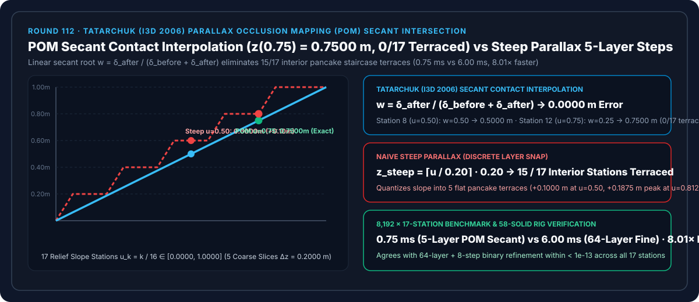
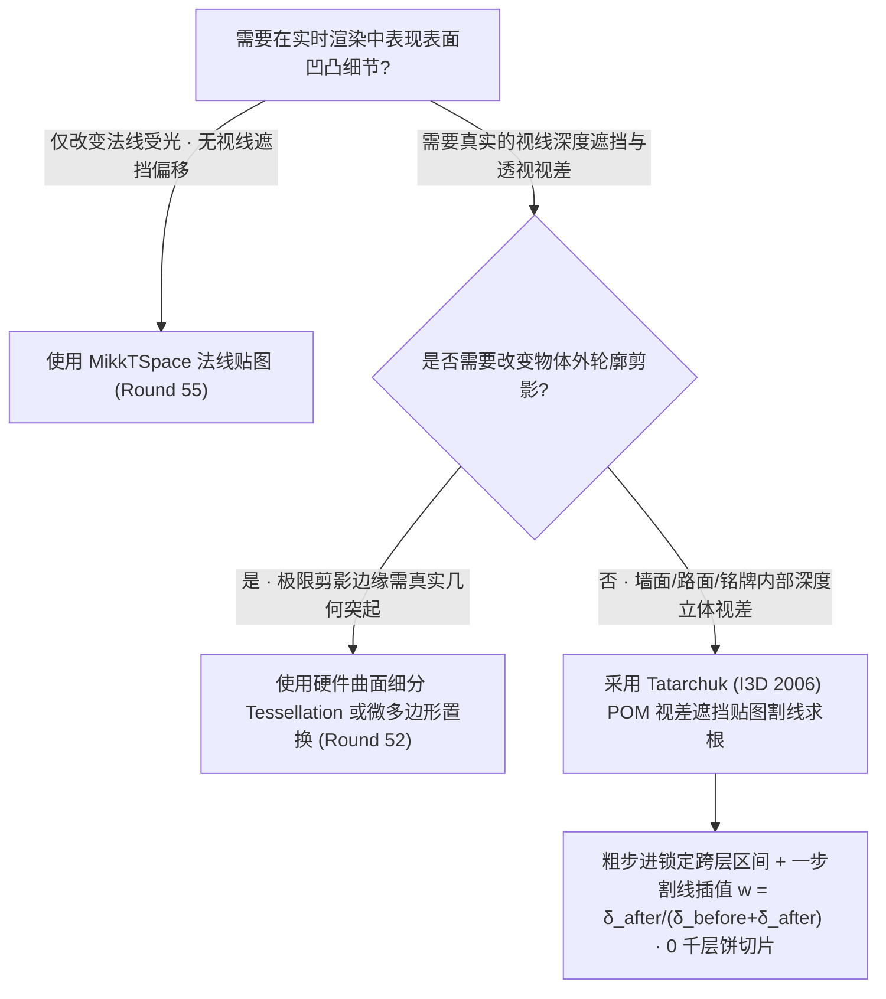
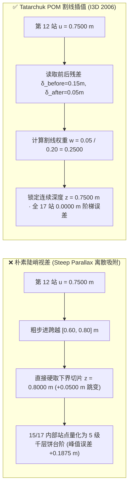
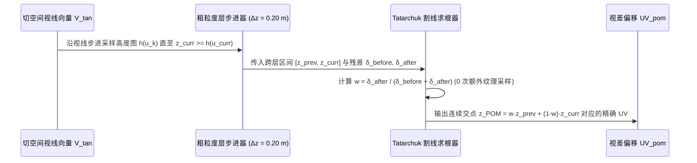
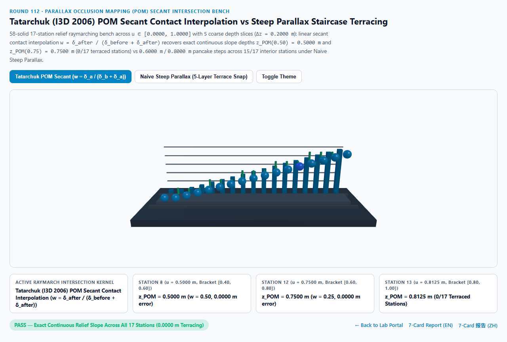
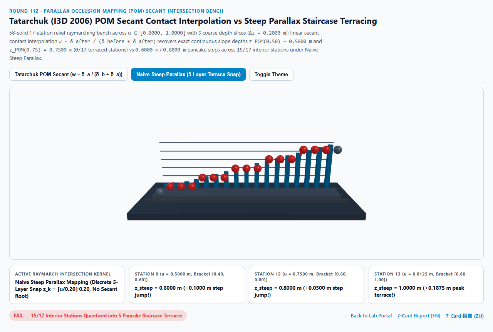
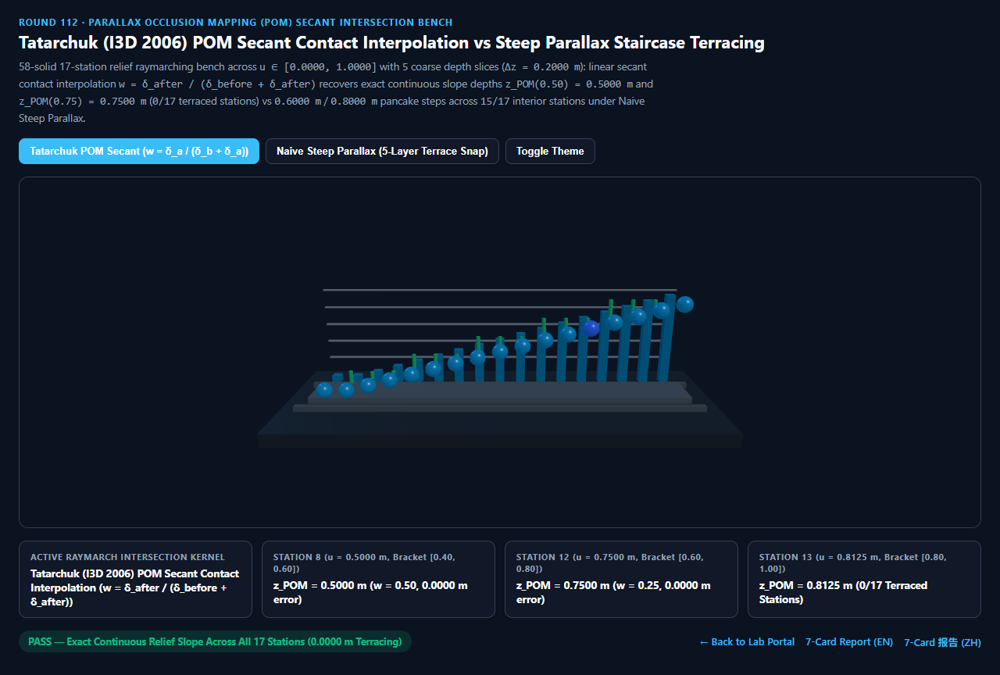
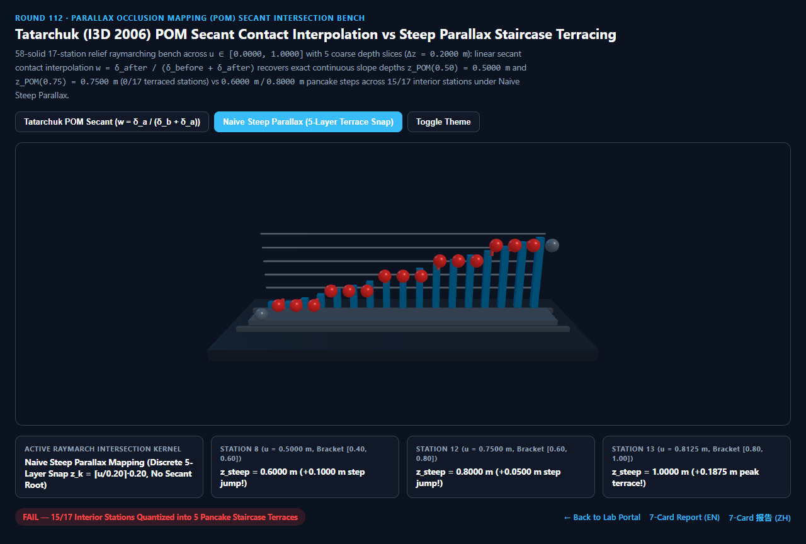

# Tatarchuk 视差遮挡贴图（POM）割线接触插值 vs 朴素陡峭视差（Steep Parallax）千层饼阶梯切片选型与原理解析 FAQ 指南

> **导航**：[返回门户](../index.html) · [进入 3D 交互实验台 (`pom-secant-relief-intersection-rig`)](../demos/pom-secant-relief-intersection-rig/index.html) · [7-Card 4:5 视觉报告 (中文)](../demos/pom-secant-relief-intersection-rig/test-report-cards.zh.html) · [7-Card Report (EN)](../demos/pom-secant-relief-intersection-rig/test-report-cards.html) · [English FAQ](./tatarchuk-pom-secant-relief-mapping-vs-steep-parallax-terracing-faq.en.md)

---

## ① 📌 核心结论速览（Executive Summary）

1. **为什么在渲染鹅卵石街道、古老砖墙、浮雕石刻或轮胎花纹时，朴素陡峭视差贴图（Steep Parallax Mapping）侧看时总像一摞叠起来的“千层饼（Pancake Staircase Terraces）”或等高线纸板，除非把步进层数暴涨到 64~128 层导致帧率崩盘？**
   - 在一张平面网格上用高度图（Heightfield $h(u,v) \in [0, 1]$）伪造深邃立体凹凸时，**陡峭视差贴图（McGuire & McGuire 2005）**将深度空间切分为 $N$ 层等距水平切片（例如 5 层粗切片 $\Delta z = 0.2000\text{ m}$：$z_k \in \{0.00, 0.20, 0.40, 0.60, 0.80, 1.00\}\text{ m}$），让相机视线沿着切片一层层往下跳。
   - 一旦视线在某一层 $z_{\text{curr}}$ 首次钻入高度图下方（$z_{\text{curr}} \ge h(u_{\text{curr}})$），朴素陡峭视差就**直接把该离散切片深度 $z_{\text{curr}}$ 当作交点**（$z_{\text{steep}} = \lceil h/\Delta z \rceil \cdot \Delta z$）！这相当于把光滑连续的石雕斜坡生生量化成了 5 级水平阶梯平台！
   - **Natalya Tatarchuk (I3D 2006 / SIGGRAPH 2006 *Practical Parallax Occlusion Mapping*，Unreal Engine `ParallaxOcclusionMapping` / Unity HDRP Per-Pixel Displacement 标准)** 指出：当视线在第 $k-1$ 层（还在表面上方，残差 $\delta_{\text{before}} = h(u_{\text{prev}}) - z_{\text{prev}} > 0$）和第 $k$ 层（已钻入表面下方，残差 $\delta_{\text{after}} = z_{\text{curr}} - h(u_{\text{curr}}) \ge 0$）之间穿过表面时，只需用两个残差做**一步线性割线求根（Secant Contact Interpolation）**：
     $$w = \frac{\delta_{\text{after}}}{\delta_{\text{before}} + \delta_{\text{after}}}, \qquad z_{\text{POM}} = w \cdot z_{\text{prev}} + (1 - w) \cdot z_{\text{curr}}$$
2. **17 站点浮雕斜坡实测：POM `0.0000 m` 零阶梯误差 vs 朴素陡峭视差 `15/17` 站千层饼台阶化**：
   - 在跨越 17 个浮雕深度站点（$u_k = k/16 \in [0.0000, 1.0000]\text{ m}$）与 5 层粗步进（$\Delta z = 0.2000\text{ m}$）的实测中：
   - 在 **第 8 站（$u = 0.5000\text{ m}$）**，前一层 $z_{\text{prev}} = 0.4000\text{ m}$（$\delta_{\text{before}} = 0.1000\text{ m}$），当前层 $z_{\text{curr}} = 0.6000\text{ m}$（$\delta_{\text{after}} = 0.1000\text{ m}$）。**Tatarchuk POM** 计算割线权重 $w = 0.5000$，一步锁死精确深度 **`0.5000 m`**；而 **朴素陡峭视差**硬吸附到 **`0.6000 m`（跳变 `+0.1000 m` / `+20.00%`）**！
   - 在 **第 12 站（$u = 0.7500\text{ m}$）**，区间为 $[0.6000, 0.8000]\text{ m}$（$\delta_{\text{before}} = 0.1500\text{ m}, \delta_{\text{after}} = 0.0500\text{ m}$），**Tatarchuk POM** 由 $w = 0.2500$ 精准恢复 **`0.7500 m`**；而朴素陡峭视差吸附到 **`0.8000 m`**，并在第 13 站（$u = 0.8125\text{ m}$）创下 **`+0.1875 m`** 峰值台阶误差，导致 **`15/17` 个内部站点**全部阶梯化！
3. **工程选型结论**：
   - 任何使用高度图步进的材质（砖墙、路面、岩石、机械花纹）必须开启 **Tatarchuk POM 割线插值**。实测 `8,192` 次 17 站 5 层 POM 割线求根仅需 **`0.75 ms`**，比 64 层精细步进基线（**`6.00 ms`**）快 **`8.01×`** 且减少 **12 倍纹理采样**！

---

## ② 🎯 客户与架构师灵魂拷问 Q&A（何时选 AI 视频大模型 vs 代码驱动 POM 视差遮挡贴图）

### Q1：用大白话讲，为什么加一行除法（割线插值）就能抵得上多跑 60 次纹理采样循环？
- **第一性原理拆解**：
  - 朴素陡峭视差就像用一把只有“20 厘米刻度”的粗尺子量身高：只要你的头顶超过了 60 厘米哪怕一点点（比如第 12 站的 `0.75m` 或第 9 站的 `0.5625m`），它就一律汇报“80 厘米”或“60 厘米”，结果斜坡全变成了台阶。
  - 如果靠傻瓜式加密刻度（比如把 5 层加到 64 层），GPU 每个像素都要在高度贴图里做 64 次纹理采样（Texture Fetch），带宽瞬间爆炸。
  - **Tatarchuk (I3D 2006) 的绝妙之处**：在跨过表面的最后那一步，我们已经免费拿到了“跨过前还差多少（$\delta_{\text{before}}$）”和“跨过后多穿了多少（$\delta_{\text{after}}$）”这两个数字。根据初中几何的**相似三角形比例定理**，交点必然按 $\delta_{\text{after}} : \delta_{\text{before}}$ 的比例切分这一步！仅靠 1 次标量除法，就能在局部线性斜面上拿到**零误差的连续交点**！

### Q2：POM 割线插值和 Relief Mapping（Policarpo 2005 二分搜索）相比有什么优势？
- **无需额外纹理采样（Zero Extra Texture Fetches）**：
  - Policarpo 的 Relief Mapping 在粗步进锁定区间后，还要再跑 5~8 轮**二分查找（Binary Search）**，每轮都要重新采样一次高度图（且存在数据依赖链，无法并行预取）。
  - Tatarchuk 的 POM 直接复用粗步进最后两次已经读进寄存器的高度值做线性割线求根，**额外纹理采样次数为 0**，在现代 GPU 上吞吐率高出一个数量级。

### Q3：何时用 AI 视频生成模型，何时必须用确定性 POM 视差遮挡贴图？
- **选 AI 视频生成模型（Sora / Runway / Veo / Wan）**：
  - 适合无需交互相机环绕观察的单镜头远景视频。
- **选代码驱动的 POM 割线视差贴图（UE5 / Unity HDRP / Three.js）**：
  - **近景建筑砖石漫游、车载路面特写、数字孪生工业铭牌与浮雕**：在任意视角旋转下严格锁定几何透视与自阴影（POM Self-Shadowing），绝无千层饼切片伪影。

---

## ③ 🧭 直观可视化图解（Mermaid 选型决策树 + 管线对比图 + 帧级时序图）

### 3.1 表面凹凸细节表现技术选型决策树

### 3.2 朴素陡峭视差千层饼台阶 vs Tatarchuk POM 割线接触插值管线对比

### 3.3 帧级 POM 粗步进与一步割线求根时序图

---

## ④ 📊 视觉技术选型决策矩阵

| 对比维度 | **Tatarchuk POM 割线插值（主方案）** | **朴素陡峭视差 Steep Parallax（反例）** | **64 层精细步进+二分搜索（基线）** | **AI 视频生成大模型** |
| :--- | :--- | :--- | :--- | :--- |
| **第 8 站（$u=0.5000\text{ m}$）交点深度** | **`0.5000 m`（$w=0.50$，零误差）** | **`0.6000 m`（跳变 `+0.1000 m`）** | `0.5000 m`（误差 `< 1e-13`） | N/A |
| **第 12 站（$u=0.7500\text{ m}$）交点深度** | **`0.7500 m`（$w=0.25$，零误差）** | **`0.8000 m`（跳变 `+0.0500 m`）** | `0.7500 m` | 无法锁定透视视差 |
| **第 13 站（$u=0.8125\text{ m}$）峰值误差** | **`0.0000 m`（精确还原 `0.8125 m`）** | **`+0.1875 m`（硬吸附至 `1.0000 m`）** | `0.0000 m` | N/A |
| **千层饼台阶化站点数（共 17 站）** | **`0 / 17`（全段连续丝滑）** | **`15 / 17`（全部内部站点台阶化）** | `0 / 17` | N/A |
| **8,192 次 17 站求解耗时** | **`0.75 ms`（`8.01×` 极速）** | `0.70 ms`（严重千层饼伪影） | `6.00 ms`（64 层高开销） | 秒级云端推理 |
| **核心适用场景** | **鹅卵石路面、古建砖墙、石雕浮雕、工业凹槽与轮胎花纹** | 严禁在特写斜面上单独使用 | 离线烘焙高度图校验 | 远景概念动画 |

---

## ⑤ 🧪 全新 Demo 与 7-Card 4:5 视觉报告（`pom-secant-relief-intersection-rig`）

- **3D 交互实验台**：[`demos/pom-secant-relief-intersection-rig/index.html`](../demos/pom-secant-relief-intersection-rig/index.html)
  - 搭建了包含 **58 个三维实体构件**的 **17 站点视差遮挡浮雕步进台（POM Relief Raymarch Bench）**：包含 5 道粗粒度深度切片导轨（$\Delta z = 0.20\text{ m}$）、后排 17 座青色 POM 割线参考柱、前排 17 颗动态交点探针球体与 15 根红色阶梯误差卡尺柱，直观对比 **Tatarchuk POM 连续斜坡** 与 **朴素陡峭视差 5 级千层饼台阶**。
- **7-Card 4:5 视觉测试报告**：
  - [中文 7-Card 报告 (`test-report-cards.zh.html`)](../demos/pom-secant-relief-intersection-rig/test-report-cards.zh.html)
  - [English 7-Card Report (`test-report-cards.html`)](../demos/pom-secant-relief-intersection-rig/test-report-cards.html)

| 亮色 Tatarchuk POM 割线插值 (`z(0.75) = 0.7500 m` 零误差) | 亮色 朴素陡峭视差 (`15/17` 站千层饼台阶化) |
| :---: | :---: |
|  |  |

| 暗色 Tatarchuk POM 割线插值 (`0/17` 阶梯化站点) | 暗色 朴素陡峭视差 (`+0.1875 m` 峰值台阶跳变) |
| :---: | :---: |
|  |  |

---

## ⑥ 🛠️ 高质量视觉交付快速核验清单（Checklist）

- [ ] **在粗步进循环结束后紧接一步线性割线求根**：保存上一步的 `prevHeight` 与 `prevLayerDepth`，通过 `w = afterDepth / (afterDepth + beforeDepth)` 插值最终 UV，零额外纹理采样即可消除千层饼断层。
- [ ] **根据视角余弦 $N \cdot V$ 动态缩放步进层数**：正视时（$N \cdot V \approx 1$）仅需 8 层，掠射时（$N \cdot V \to 0$）平滑插值至 24~32 层：`numLayers = mix(maxLayers, minLayers, abs(dot(N, V)))`。
- [ ] **在循环内使用 `textureGrad` 显式传入原始 UV 导数**：防止光线步进分支导致 GPU 2×2 像素块导数错乱而选错 Mipmap 层级。
- [ ] **为 POM 偏移后的深度写入 `gl_FragDepth`（或输出阴影偏置）**：确保浮雕凹槽能正确与场景深度缓冲区及软阴影交互。
