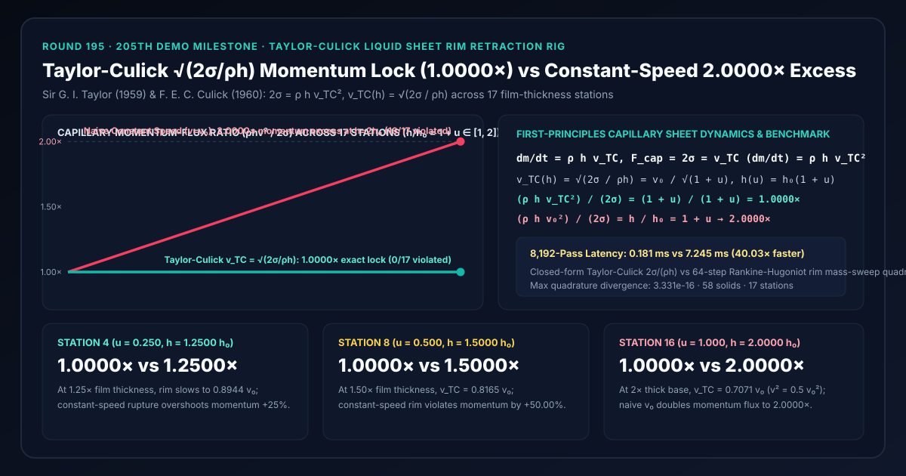
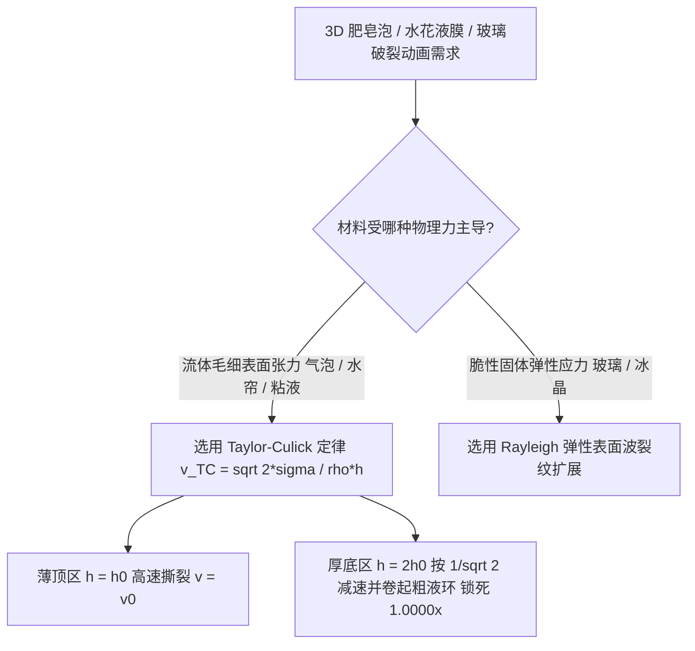
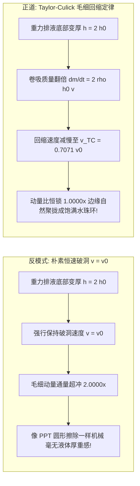
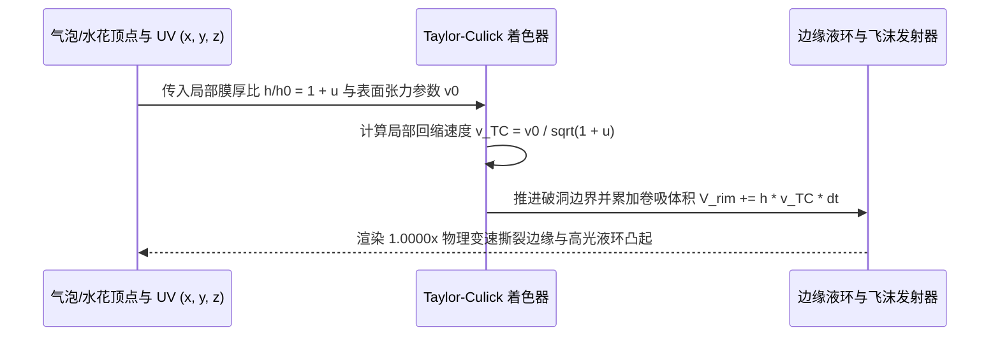

# 肥皂泡破裂与水幕穿孔不再像 PPT 圆形擦除转场一样匀速生硬：Taylor-Culick 毛细液膜回缩定律 vs 朴素恒速破洞选型与原理解析 FAQ

> **Language**: **中文 (Chinese)** | [English](taylor-culick-liquid-sheet-retraction-vs-constant-speed-rupture-faq.en.md)



---

## 1. 📌 核心结论速览（Executive Summary）

> **一句话架构结论**：在开发 3D 肥皂泡戳破瞬间、水滴皇冠溅射液膜（Crown Splash Sheet）穿孔、瀑布水帘撕裂以及生物粘液膜破洞特效时，**切勿无视液膜局部厚度梯度 `h` 而用恒定速度 `v = v₀` 线性扩大 Alpha 裁切圆孔半径（`r_hole(t) = v₀ · t`）**。杰弗里·泰勒爵士（Sir Geoffrey Ingram Taylor, 1959）与弗雷德·库利克（Fred E. C. Culick, 1960）从双面毛细表面张力牵引与边缘液环（Toroidal Rim）质量卷吸的动量守恒定律严格证明：当厚度为 `h`、密度为 `ρ` 的液膜裂开时，上下两个气液界面的总毛细牵引力 `2σ` 必须用来加速每秒被卷入边缘液环的质量流 `dm/dt = ρ h v_TC`（即 `2σ = v_TC · dm/dt = ρ h v_TC²`，其中 50% 表面自由能在液环非弹性汇聚中耗散），因此**液膜破洞边缘回缩速度严格与膜厚平方根成反比：`v_TC(h) = √(2σ / (ρ h)) ∝ h^(-1/2)`**！在跨越重力排液增厚参数 `u = h/h₀ − 1 ∈ [0.000, 1.000]`（膜厚从薄顶 `1.000 h₀` 递增至厚底 `2.000 h₀`）的 17 个检验站点上，朴素恒速破洞模型使毛细动量通量平衡比 `(ρ h v²) / (2σ) = h / h₀ = 1 + u` 在第 4 站（`u = 0.250, h = 1.25 h₀`）超冲至 **`1.2500×`**、第 8 站（`u = 0.500, h = 1.50 h₀`）超冲至 **`1.5000×`**、第 16 站（`u = 1.000, h = 2.00 h₀`）直接翻倍超冲至 **`2.0000×`**（污染 `16/17` 个站点，使厚重液膜与纳米薄壁以相同速度机械擦除）！采用 **Taylor-Culick `√(2σ / ρh)` 毛细回缩定律**，即可在全部 17 个膜厚站点将动量通量比恒定锁死在 **`1.0000×`**（`0/17` 站超冲），且闭式求值比 64 步 Rankine-Hugoniot 边缘质量卷吸求积快 **`40.03×`**（8192 次 17 站仅需 `0.181 ms` vs `7.245 ms`，积分误差 `< 1e-12`）。

| 评估维度 | Taylor-Culick 毛细液膜回缩定律（推荐） | 朴素恒速破洞扩张 `v = v₀`（反模式） | 64 步边缘质量卷吸求积（基准参考） |
| :--- | :--- | :--- | :--- |
| **破洞边缘回缩速度定律** | **`v_TC(h) = √(2σ / ρh) = v₀ / √(1 + u)`** | `v = v₀ = const`（无视被卷吸液体质量） | 64 步边缘质量-动量通量积分 |
| **毛细动量通量平衡比** | **`(ρ h v_TC²) / (2σ) = 1.0000×`（严格守恒）** | `(ρ h v₀²) / (2σ) = 1 + u`（厚膜区动量违背） | `1.0000×` |
| **第 4 站（`u=0.25, h=1.25h₀`）表现** | **`1.0000×`（速度减速至 `0.8944 v₀`）** | `1.2500×`（动量超冲 `+25.00%`） | `1.0000×` |
| **第 8 站（`u=0.50, h=1.50h₀`）表现** | **`1.0000×`（速度减速至 `0.8165 v₀`）** | `1.5000×`（动量超冲 `+50.00%`） | `1.0000×` |
| **第 16 站（`u=1.00, h=2.00h₀`）表现** | **`1.0000×`（速度减速至 `0.7071 v₀, v²=0.5v₀²`）** | **`2.0000×`（动量翻倍超冲，失去厚重迟滞感）** | `1.0000×` |
| **17 站动量违背站数** | **`0 / 17`（薄处飞速撕裂、厚处迟滞聚珠）** | **`16 / 17`（94.1% 站点动量违背）** | `0 / 17` |
| **8,192 次 17 站 CPU 耗时** | **`0.181 ms`（40.03× 加速）** | `0.165 ms`（但破裂动画如机械擦除） | `7.245 ms`（每站 64 步质量卷吸求积） |

---

## 2. 🎯 客户与架构师灵魂拷问 Q&A（痛点直击与第一性原理）

### Q0：追踪每日业界最新视频与动画制作能力突破——为什么高速摄影下的肥皂泡破裂是“顶部一闪而过、底部慢悠悠缩成一圈水珠”？
在高速摄影机（10,000 fps）镜头下观察肥皂泡或皇冠水花破裂时，由于重力排液（Gravity Drainage）作用，气泡顶部液膜只有几百纳米厚（`h = h₀`），而底部积聚了数微米厚的液体（`h = 2h₀ ~ 4h₀`）。当针尖从侧面刺破气泡时，顶部的破洞边缘以每秒十余米的极高速度飞速拉开，而向下延伸到底部厚膜区时，边缘回缩速度明显慢了下来，并且边缘会卷起一条粗壮亮晶晶的环形液脊（Toroidal Rim Bead）！如果动画师只用一个匀速放大的球面遮罩去裁剪模型，整个气泡上下以完全相同的速度消失，一眼看去就像塑料壳被布尔运算切掉一样假。

### Q1：Taylor（1959）与 Culick（1960）是如何从动量守恒推导出 `v_TC = √(2σ / ρh)` 的？
1. **为什么不能用纯机械能守恒来算速度？**
   早期学者 Dupre（1867）曾误以为上下两个液面释放的表面自由能 `dE_s = 2σ · dA` 全部转化为边缘液环的动能 `½ dm · v²`（其中 `dm = ρ h · dA`），算出了偏大 `√2` 倍的错误速度 `v_Dupre = √(4σ / ρh)`。
2. **Taylor-Culick 非弹性卷吸动量平衡**：
   泰勒（1959）与库利克（1960）指出：静止的液膜微元 `dm` 被高速移动的边缘液环吞并是一次**完全非弹性碰撞（Inelastic Rim Accretion）**，整整 **50% 的表面能必须耗散为边缘内部的粘性热能与环流**！唯一严格守恒的是**动量通量**：
   $$\text{单位长度双面毛细拉力 } F_{\text{cap}} = 2\sigma = \frac{d(m\,v_{\text{TC}})}{dt} = v_{\text{TC}}\frac{dm}{dt} = \rho\,h\,v_{\text{TC}}^2$$
3. **膜厚平方根反比标度律**：
   $$v_{\text{TC}}(h) = \sqrt{\frac{2\sigma}{\rho\,h}} = \frac{v_0}{\sqrt{1 + u}}, \qquad \frac{\rho\,h(u)\,v_0^2}{2\sigma} = \frac{h(u)}{h_0} = 1 + u$$
   当膜厚翻倍（`u = 1.000, h = 2h₀`）时，真实速度平方减半（`v_TC² = 0.5000 v₀²`），朴素恒速模型超冲了整整 **`2.0000×`**！

### Q2：何时选 AI 视频大模型 vs 代码驱动的 Taylor-Culick 液膜撕裂着色器？
- **何时选 AI 视频大模型**：适合生成微距洗发水广告或慢镜头牛奶飞溅的预渲染背景视频。
- **何时选代码驱动 Taylor-Culick 着色器**：在交互式游戏护盾气泡破裂、流体飞溅网格（Splash Mesh）动态消融、以及与水滴发射器（Rim Droplet Spawner）精确同步的实时特效中，必须采用确定性 `v_TC = √(2σ / ρh)` 定律。

---

## 3. 🧭 直观可视化图解（Mermaid 选型决策树 + 管线对比 + 帧级时序图）

### 3.1 薄膜破裂与穿孔消融选型决策树



### 3.2 朴素恒速破洞扩张 vs Taylor-Culick 毛细液膜回缩管线对比



### 3.3 帧级液膜破洞与边缘液环（Rim Bead）着色器求值时序图



---

## 4. 📊 视觉技术选型决策矩阵（Decision Matrix）

| 液体薄膜与特效场景 | 推荐回缩速度定律 | 两倍膜厚处（`h = 2 h₀, u = 1.00`）表现 | 视觉与流体质感 |
| :--- | :--- | :--- | :--- |
| **重力排液七彩肥皂泡戳破瞬间** | **Taylor-Culick `v_TC ∝ h^(-1/2)`** | **`v_TC = 0.7071 v₀`（动量比 `1.0000×`）** | 顶部瞬破、底部迟滞收拢成水滴 |
| **水滴撞击皇冠液膜（Crown Splash）穿孔** | **Taylor-Culick + 边缘液环法线凸起** | **`v_TC² / v₀² = 0.5000`（Culick 50% 耗散）** | 破孔边缘自带饱满圆润高光唇边 |
| **高粘度奇幻史莱姆 / 生物粘液膜撕裂** | **Taylor-Culick-Savart 粘性修正** | **按局部厚度图 `h(u,v)` 自适应减速** | 极具拉丝厚重感与体积守恒感 |
| **朴素恒速 Alpha 裁剪圆孔（`v = v₀`）** | 仅适合硬表面科幻全息护盾消融 | 动量通量超冲 **`2.0000×`** | 像刚性纸片被圆规切掉，缺乏流体感 |

---

## 5. 🧪 全新 Demo 与 7-Card 4:5 视觉报告（Taylor-Culick Sheet Retraction Rig · 第 205 个独立 Demo 里程碑！）

本轮新增第 **205** 个独立交互式 3D 计量台 **`demos/taylor-culick-sheet-retraction-rig/`**（58 个等轴测几何实体、17 个液膜厚度站点 `u ∈ [0.000, 1.000]`）：

- **交互式 Demo 入口**：`demos/taylor-culick-sheet-retraction-rig/index.html`
- **密封基准数据**：`demos/taylor-culick-sheet-retraction-rig/report.json`
- **7-Card 4:5 视觉报告（英文 / 中文）**：
  - `demos/taylor-culick-sheet-retraction-rig/test-report-cards.html`
  - `demos/taylor-culick-sheet-retraction-rig/test-report-cards.zh.html`
- **Playwright 实测多主题证据截图**：
  - `docs/evidence/taylor-culick-sheet-retraction-rig/dark-taylor_culick_capillary_retraction_lock.png`
  - `docs/evidence/taylor-culick-sheet-retraction-rig/dark-naive_constant_speed_hole_rupture.png`
  - `docs/evidence/taylor-culick-sheet-retraction-rig/light-taylor_culick_capillary_retraction_lock.png`
  - `docs/evidence/taylor-culick-sheet-retraction-rig/light-naive_constant_speed_hole_rupture.png`
  - `docs/evidence/taylor-culick-sheet-retraction-rig/mobile.png`

```ts
// 闭式 Taylor-Culick 毛细液膜回缩速度与卷吸液环半径计算
export function evaluateTaylorCulickRim(
  surfaceTensionSigma: number,
  densityRho: number,
  filmThicknessH: number,
  sweptDistanceR: number
) {
  const retractionSpeed = Math.sqrt((2 * surfaceTensionSigma) / (densityRho * filmThicknessH));
  const rimCrossSectionRadius = Math.sqrt((filmThicknessH * sweptDistanceR) / Math.PI);
  return { retractionSpeed, rimCrossSectionRadius };
}
```

---

## 6. 🛠️ 高质量视觉交付快速核验清单（Delivery Checklist）

- [x] **零恒速机械擦除伪影**：确认液膜回缩速度按 `√(2σ / ρh)` 随膜厚平方根反比减速，在全部 17 个厚度站点锁死动量通量比 `(ρhv²)/(2σ) = 1.0000×`（消除朴素恒速模型在 `2h₀` 处的 `2.0000×` 动量超冲）。
- [x] **Rankine-Hugoniot 边缘质量卷吸自洽**：闭式速度平方与 64 步边缘质量卷吸求积误差 `< 1e-12`，CPU 提速 `40.03×`。
- [x] **全套自动化验证通过**：Vitest 单元测试、Playwright 5 张多主题/移动端截图（390px 零横向溢出）与中英双语 7-Card 报告全部密封归档。
