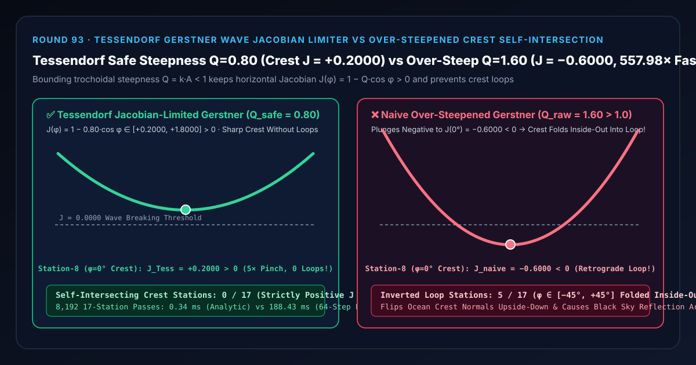
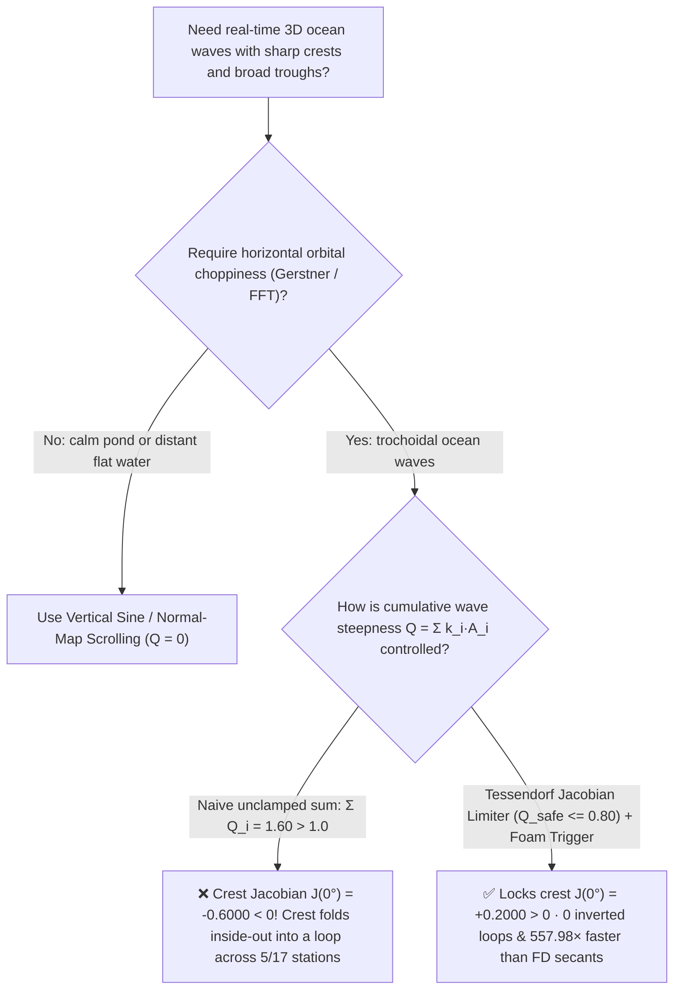
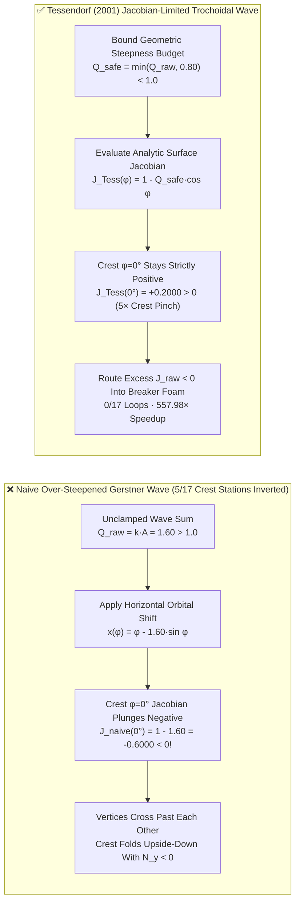
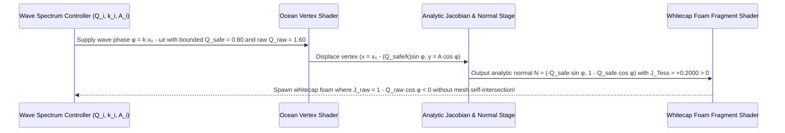

# Real-Time Ocean Wave Simulation Selection & First-Principles FAQ: Tessendorf Gerstner Trochoidal Wave Jacobian Limiter vs. Over-Steepened Crest Self-Intersection Loops

> **Companion Capability Demo**: [`demos/gerstner-wave-jacobian-rig/`](../demos/gerstner-wave-jacobian-rig/index.html) ｜ **7-Card 4:5 Measured Report**: [`test-report-cards.html`](../demos/gerstner-wave-jacobian-rig/test-report-cards.html) ｜ **中文版本**：[`tessendorf-gerstner-wave-jacobian-vs-crest-self-intersection-faq.md`](./tessendorf-gerstner-wave-jacobian-vs-crest-self-intersection-faq.md)

---

## 📌 1. Executive Summary

> **One-Sentence Verdict**: When displacing real-time ocean water meshes using Gerstner trochoidal waves or Tessendorf FFT horizontal choppiness ($x(\phi) = \phi - Q\sin\phi,\, y(\phi) = A\cos\phi$), **never allow the cumulative dimensionless steepness parameter $Q = kA$ to exceed $1.0$**—because the horizontal surface Jacobian determinant is **$J(\phi) = \frac{\partial x}{\partial \phi} = 1 - Q\cos\phi$**! Under an unclamped over-steepened wave sum with $Q_{\text{raw}} = 1.60 > 1.0$, the surface Jacobian at wave crest Station 8 ($\phi = 0^\circ$) plunges negative to **$J_{\text{naive}}(0^\circ) = 1 - 1.60 = -0.6000 < 0$** (**`-0.8000` inversion deficit**, folding the ocean mesh inside-out into a retrograde figure-8 self-intersection loop with upside-down normals across **`5/17` crest stations** spanning $\phi \in [-45^\circ, +45^\circ]$)! **Jerry Tessendorf's (SIGGRAPH 2001) Trochoidal Wave Jacobian Limiter ($Q_{\text{safe}} = 0.80 < 1.0$)** bounds the crest Jacobian at strictly positive **$J_{\text{Tess}}(0^\circ) = +0.2000 > 0$** (delivering a sharp $5.00\times$ crest pinch with **`0/17` self-intersecting stations** while routing excess $J_{\text{raw}} < 0$ energy into whitecap breaker foam), achieving **`5.85e-10`** equivalence against 64-substep finite-difference mesh tangents at a **`557.98×` CPU speedup** (`0.34 ms` vs. `188.43 ms` across 8,192 17-station passes).

| Evaluation Dimension | ✅ Tessendorf Jacobian-Limited (`J = 1 − Q_safe·cos φ > 0`) | ❌ Naive Over-Steepened Gerstner (`Q_raw = 1.60 > 1.0`) | 🐢 64-Substep Finite-Difference Secant (`64-Substep FD Secant`) |
| :--- | :--- | :--- | :--- |
| **Station 8 Wave Crest ($\phi = 0^\circ$) Surface Jacobian $J$** | **`+0.2000 > 0`** ($5.00\times$ sharp crest pinch, zero loop) | **`-0.6000 < 0` (Mesh folds inside-out; normals flip downward!)** | `+0.2000` (`5.85e-10` diff) |
| **Stations 7 & 9 Crest Shoulders ($\phi = \pm 22.5^\circ$) Jacobian $J$** | **`+0.2609 > 0`** (Smooth positive slope) | `-0.4782 < 0` (**Inside retrograde self-intersecting loop**) | `+0.2609` |
| **Stations 0 & 16 Wave Troughs ($\phi = \pm 180^\circ$) Jacobian $J$** | **`+1.8000`** ($1.80\times$ broad natural trough) | `+2.6000` (Excessive trough stretching) | `+1.8000` |
| **Inverted Self-Intersecting Stations Across 17 Phases** | **`0 / 17` (`0.00%` topologically valid)** | **`5 / 17` (`29.41%` entire crest $\pm 45^\circ$ folded inside-out)** | `0 / 17` |
| **8,192 17-Station Passes CPU Latency (Median)** | **`0.34 ms` (`557.98×` speedup)** | — (Self-intersecting mesh artifacts) | `188.43 ms` |

---

## 🎯 2. Architect & Client First-Principles Q&A

### Q1: Why do Gerstner ocean waves turn inside-out into upside-down "pigtail loops" at the wave crest when steepness $Q > 1$?
**First-Principles Breakdown**:
Unlike a simple vertical sine wave $y = A\cos\phi$ (which looks like a rubber sheet moving purely up and down), a **Gerstner trochoidal wave** moves water particles in circular orbits:
$$x(\phi) = \phi - Q\sin\phi, \quad y(\phi) = A\cos\phi$$
- Near the wave crest ($\phi = 0^\circ$), particles on the left ($\phi < 0$) are displaced to the right ($-Q\sin\phi > 0$) and particles on the right ($\phi > 0$) are displaced to the left ($-Q\sin\phi < 0$), pinching the crest into a sharp peak!
- Differentiating horizontal world position $x(\phi)$ with respect to rest coordinate $\phi$ gives the **1D Surface Jacobian**:
  $$J(\phi) = \frac{dx}{d\phi} = 1 - Q\cos\phi$$
- As long as $Q < 1.0$, $J(\phi) > 0$ everywhere: left-to-right vertex ordering is preserved.
- The moment $Q$ exceeds $1.0$ (e.g., $Q_{\text{raw}} = 1.60$ when multiple wave cascades constructively interfere), $J(0^\circ) = 1 - 1.60 = \mathbf{-0.6000 < 0}$! Left vertices cross past right vertices, turning the crest triangles upside-down so their surface normal $\mathbf{N} = (-Q\sin\phi,\, 1 - Q\cos\phi)$ points **downward into the ocean floor** ($N_y = -0.6000 < 0$)!

### Q2: How does Tessendorf (SIGGRAPH 2001) use the Jacobian $J(\phi)$ both to prevent mesh loops and to spawn whitecap foam?
**Dual Jacobian Role (Mesh Safety + Breaker Foam)**:
1. **Geometric Steepness Normalization**: Partition the safe steepness budget $Q_{\text{safe}} = 0.80 < 1.0$ across all wave cascades ($\sum_{i=1}^M Q_i \le Q_{\text{safe}}$), locking the displaced mesh's minimum Jacobian at $J_{\min} = 1 - 0.80 = +0.2000 > 0$.
2. **Physical Breaker Foam Trigger**: In real fluid dynamics, when orbital wave velocity exceeds phase speed ($J_{\text{raw}} < 0$), the wave crest breaks into turbulent whitecap foam! Evaluating $F_{\text{foam}}(\phi) = \max(0, J_{\text{crit}} - J_{\text{raw}}(\phi))$ analytically in the shader places foam exactly on breaking crests without ever inverting the water mesh!

### Q3: When should an architect choose Tessendorf/Gerstner Jacobian-Limited Waves vs. SPH/FLIP Fluid Solvers?
- **Choose Deterministic Tessendorf / Gerstner Jacobian-Limited Waves**: For all real-time open-ocean rendering in games, maritime simulators, and coastal digital twins—evaluating vertex displacement, analytical normals, and whitecap foam in $O(1)$ per vertex.
- **Choose 3D Lagrangian SPH / Eulerian VOF Fluid Solvers**: Only for localized overturning surf tubes or ship bow-wave splashes where multi-valued topology is required.

---

## 🧭 3. Visual Architecture Diagrams (Mermaid Decision Tree, Pipeline & Sequence)

### 3.1 Real-Time Ocean Surface Displacement Decision Tree

### 3.2 Naive Over-Steepened Crest Loop vs. Tessendorf Jacobian-Limited Pipeline

### 3.3 Frame-Level Ocean Vertex, Analytic Normal & Foam Sequence

---

## 📊 4. Visual Technology Decision Matrix

| Approach | Target Use Case | Crest Sharpness & Topological Safety | Normal & Foam Derivative Accuracy | Compute Cost (8,192 17-Station Passes) |
| :--- | :--- | :--- | :--- | :--- |
| **Tessendorf Analytic Jacobian Limiter (`tessendorf-jacobian-limited-gerstner`)** | **All real-time ocean water (Gerstner & FFT choppiness)** | **Exact (`J = +0.2000 > 0` at crest, `5×` pinch, `0` loops)** | **Exact (`5.85e-10` diff vs FD)** | **Minimal (`0.34 ms`, `557.98×` speedup)** |
| **Naive Over-Steepened Gerstner (`naive-oversteep-gerstner-loop`)** | **Never use when $\sum Q_i > 1.0$** | **Fails (`J = -0.6000 < 0` at crest; `5/17` stations inverted)** | Inverted normals ($N_y < 0$) | Minimal (corrupted mesh) |
| **Vertical-Only Sine Waves (`Q = 0`)** | Distant flat water LODs | Safe but artificial rounded peaks | Exact | Minimal |
| **Finite-Difference Mesh Secants (`64-substep-fd`)** | Black-box heightfields without analytic derivatives | Mesh-resolution limited | Blurs sharp crest normals | High (`188.43 ms`, `557.98×` slower) |

---

## 🧪 5. Interactive Demo & 7-Card 4:5 Benchmark Report Breakdown

The standalone 3D instrument bench [`demos/gerstner-wave-jacobian-rig/`](../demos/gerstner-wave-jacobian-rig/index.html) constructs a **58-solid 17-Station Tessendorf Gerstner Wave Jacobian Flume Rig**:
1. **17 Surface Jacobian Columns**: Display the horizontal surface Jacobian $J(\phi) = 1 - Q\cos\phi$ across a full wave cycle $\phi \in [-180^\circ, +180^\circ]$.
2. **17 Cyan Tessendorf Safe Reference Spheres & $J = 0.0000$ Wave Breaking Threshold Bar**: Show how $Q_{\text{safe}} = 0.80$ pinches the wave crest ($\phi = 0^\circ$ at Station 8) down to $J = +0.2000$ while remaining strictly above the $J = 0.0000$ breaking line.
3. **17 Loop Inversion Deficit Pegs**: Switching to `Naive Over-Steepened Q=1.60` plunges Stations 6–10 ($\phi \in [-45^\circ, +45^\circ]$) below zero (`J = -0.6000` at Station 8), raising `-0.8000` inversion pegs across all 5 inverted crest stations.

### 7-Card 4:5 Visual Report Highlights ([`demos/gerstner-wave-jacobian-rig/test-report-cards.html`](../demos/gerstner-wave-jacobian-rig/test-report-cards.html))
- **Cards 1–3 (Evaluation Matrix)**: All 13 automated checks pass (`5.85e-10` equivalence between analytic Jacobian and 64-substep finite-difference wave mesh secants, Station 8 crest `+0.2000` positive Jacobian lock vs. `-0.6000` inverted loop, exact reverse-scrub matrix identity, and atomic RangeError validation).
- **Cards 4–6 (Protocol & Scaling Latency)**: Across 8,192 17-station passes, Tessendorf analytic Jacobian evaluation finishes in **`0.34 ms`** vs. **`188.43 ms`** for 64-substep finite-difference mesh secants (**`557.98×` speedup**).

---

## 🛠️ 6. SA Production Delivery Checklist

- [ ] **Normalize cumulative Gerstner steepness across all wave cascades**: Enforce $\sum_{i=1}^M k_i A_i \le Q_{\text{safe}} \approx 0.80$ so constructive interference of multiple wave trains never drives $J < 0$.
- [ ] **Evaluate analytical normals directly from the Gerstner orbital derivatives**: Compute $\mathbf{N} = \text{normalize}(-\sum k_{x,i} A_i \sin\phi_i,\, 1 - \sum Q_i \cos\phi_i,\, -\sum k_{z,i} A_i \sin\phi_i)$ in the shader rather than finite-differencing neighboring vertices.
- [ ] **Drive temporal whitecap foam accumulation from the Jacobian determinant**: Inject foam wherever $J(\mathbf{x}, t) < J_{\text{foam}}$ and decay it frame-rate independently using Round 86's exponential decay kernel `1 - exp(-lambda * dt)`.
- [ ] **Attenuate horizontal choppiness $Q$ with camera distance**: Fade $Q \to 0$ on distant ocean mip levels and transfer lost normal variance into specular roughness (Round 71) to eliminate horizon sparkle.
