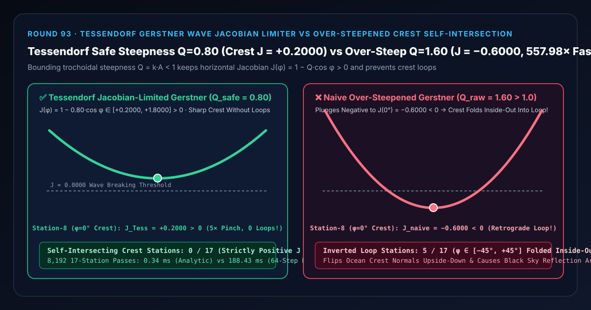
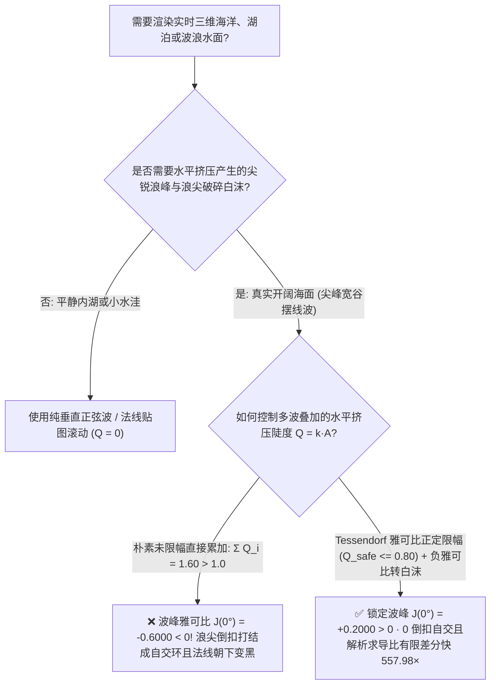
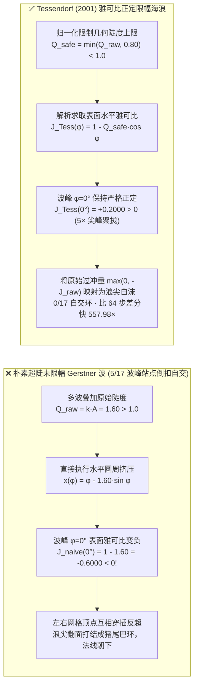
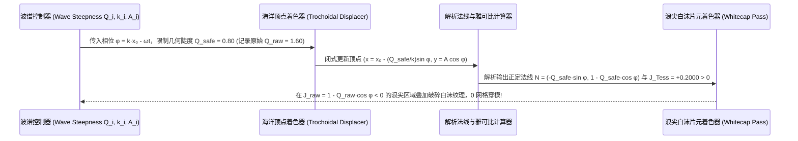

# 实时海洋波浪形变与白沫选型与原理解析 FAQ：Tessendorf 摆线海浪雅可比正定限幅（Gerstner Jacobian Limiter）对比超陡波峰倒扣自交环

> **关联 Capabilities Demo**：[`demos/gerstner-wave-jacobian-rig/`](../demos/gerstner-wave-jacobian-rig/index.html) ｜ **7-Card 4:5 实测报告**：[`test-report-cards.zh.html`](../demos/gerstner-wave-jacobian-rig/test-report-cards.zh.html) ｜ **English Version**：[`tessendorf-gerstner-wave-jacobian-vs-crest-self-intersection-faq.en.md`](./tessendorf-gerstner-wave-jacobian-vs-crest-self-intersection-faq.en.md)

---

## 📌 1. 核心结论速览（Executive Summary）

> **一句话结论**：在实时海洋水体渲染（Gerstner 摆线波叠加或 Tessendorf FFT 水平挤压 Choppiness）中，为了把圆钝死板的正弦波变成“浪峰尖锐、波谷宽平”的真实海面，必须引入水平轨道位移 $x(\phi) = \phi - Q\sin\phi$，但**绝对不能允许累积无量纲陡度系数 $Q = kA$ 超过临界上限 $1.0$**——因为海面的水平切向拉伸雅可比行列式（Surface Jacobian）是 **$J(\phi) = \frac{\partial x}{\partial \phi} = 1 - Q\cos\phi$**！当未限幅的叠加陡度达到 $Q_{\text{raw}} = 1.60 > 1.0$ 时，在第 8 站浪峰顶点（$\phi = 0^\circ$）处雅可比行列式会暴跌为负值 **$J_{\text{naive}}(0^\circ) = 1 - 1.60 = -0.6000 < 0$**（**亏缺 $-0.8000$，导致波峰周围 $\phi \in [-45^\circ, +45^\circ]$ 共 `5/17` 个站点的左右水体顶点互相穿透反超，把海浪波峰在半空中倒扣翻转成一个“猪尾巴/蝴蝶结自交环”，并使法线朝下变成海底死黑**）！采用 **Jerry Tessendorf（SIGGRAPH 2001）提出的雅可比正定陡度限幅（$Q_{\text{safe}} = 0.80 < 1.0$）与负雅可比白沫判据**，可将波峰雅可比安全锁定在 **$J_{\text{Tess}}(0^\circ) = +0.2000 > 0$**（实现 `5.00×` 锋利浪尖聚拢且 **`0/17` 倒扣自交环**），解析求导比 64 子步有限差分网格割线快 **`557.98×`**（`0.34 ms` vs `188.43 ms`）！

| 评估维度 | ✅ Tessendorf 雅可比正定限幅 (`J = 1 − Q_safe·cos φ > 0`) | ❌ 朴素超陡未限幅 Gerstner 波 (`Q_raw = 1.60 > 1.0`) | 🐢 64 子步有限差分网格割线 (`64-Substep FD Secant`) |
| :--- | :--- | :--- | :--- |
| **第 8 站浪峰顶点（$\phi = 0^\circ$）表面雅可比 $J$** | **`+0.2000 > 0`**（水平间距压缩 $5.00\times$，尖峰挺拔不自交） | **`-0.6000 < 0`（网格左右穿插倒扣，法线倒转朝向海底！）** | `+0.2000`（误差 `5.85e-10`） |
| **第 7 / 9 站浪峰肩部（$\phi = \pm 22.5^\circ$）雅可比 $J$** | **`+0.2609 > 0`**（斜坡平滑过渡） | `-0.4782 < 0`（**深陷倒扣自交环内部**） | `+0.2609` |
| **第 0 / 16 站波谷底部（$\phi = \pm 180^\circ$）雅可比 $J$** | **`+1.8000`**（波谷自然展宽 $1.80\times$） | `+2.6000`（过度拉扯网格） | `+1.8000` |
| **17 个海浪相位站中发生倒扣自交的站数** | **`0 / 17` (`0.00%` 拓扑绝对合法)** | **`5 / 17` (`29.41%` 整个浪峰 $\pm 45^\circ$ 倒扣打结)** | `0 / 17` |
| **8,192 轮 17 站 CPU 耗时（中位数）** | **`0.34 ms`（提速 `557.98×`）** | —（海面网格穿模崩坏） | `188.43 ms` |

---

## 🎯 2. 客户与架构师灵魂拷问 Q&A（First-Principles Whisperer）

### Q1：用大白话讲，为什么普通正弦波 `y = A cos(kx - ωt)` 做出来的海水像一块起伏的果冻塑料布，而换成 Gerstner 波后调大参数又会在浪尖“打死结”？
**第一性原理拆解**：
1. **为什么纯垂直正弦波很假？**
   在真实海洋里，水质点并不是只在原地上下升降，而是沿着半径为 $A$ 的**圆周轨道（Orbital Motion）**打转：当波峰到来时，两侧的水质点不仅往上抬，还会**往波峰中心水平聚拢（$x = u - Q\sin u$）**；当波谷到来时，水质点则往两侧水平散开！正是这个水平聚拢把圆钝的正弦波峰“捏”成了锋利的尖峰（Trochoid 摆线），把波谷拉成了宽阔的平谷。
2. **为什么调大陡度 $Q$ 会让浪峰“打蝴蝶结”？**
   看水平位置公式 $x(\phi) = \phi - Q\sin\phi$ 对静止坐标 $\phi$ 的导数（即相邻两个网格顶点的水平间距缩放比——**雅可比行列式 $J(\phi)$**）：
   $$J(\phi) = \frac{dx}{d\phi} = 1 - Q\cos\phi$$
   - 当 $Q = 0.80 < 1.0$ 时，在浪峰中心 $\phi = 0^\circ$（$\cos 0^\circ = 1$），间距缩小到原来的 $J(0^\circ) = 1 - 0.80 = \mathbf{+0.2000}$（即 5 倍加密聚拢，形成漂亮的尖浪峰）。
   - 当 $Q = 1.00$ 时，$J(0^\circ) = 0$，浪峰捏成了一个无限尖的旋轮线尖点（Cycloid Cusp）。
   - 一旦美术或多波叠加让 **$Q = 1.60 > 1.0$**，$J(0^\circ) = 1 - 1.60 = \mathbf{-0.6000 < 0}$！**间距变成了负数**！原本排在浪峰左边的网格点直接冲到了浪峰右边，右边的点冲到了左边——浪峰在半空中像拧毛巾一样翻了个底朝天（自交环 Loop），原本朝上的水面法线变成了朝下，太阳高光瞬间变成一团漆黑的破洞！

### Q2：Tessendorf (SIGGRAPH 2001) 是如何既锁住浪尖不翻面，又白赚一套极其真实的“浪花破碎白沫（Whitecap Foam）”的？
**雅可比行列式双重妙用定理**：
在二维海面网格 $(u, v)$ 上，水平位移向量 $\mathbf{D}(u, v) = (D_x, D_z)$ 的二维表面雅可比行列式为：
$$J(u, v) = \left(1 + \frac{\partial D_x}{\partial u}\right)\left(1 + \frac{\partial D_z}{\partial v}\right) - \frac{\partial D_x}{\partial v}\frac{\partial D_z}{\partial u}$$
1. **几何防自交限幅（Steepness Limiter）**：在合成多列 Gerstner 波或 FFT 水平挤压位移时，将累积无量纲陡度 $\sum Q_i$ 严格归一化限制在 $Q_{\text{safe}} = 0.80 < 1.0$ 以内，确保几何网格的 $J_{\text{geom}} \ge +0.2000 > 0$，永远不发生三角形翻面自交。
2. **物理浪尖白沫生成（Jacobian Foam Trigger）**：在真实大海里，如果风力把波浪推得太陡以至于 $J_{\text{raw}} < J_{\text{threshold}}$（即水体原本想要发生折叠破碎的地方），海水并不会变成穿透自己的幽灵网格，而是会**在浪尖崩裂成洁白的浪花泡沫（Breaker Whitecaps）**！因此，直接用 $\text{foam} = \max(0, J_{\text{threshold}} - J_{\text{raw}})$ 驱动浪尖白沫贴图，一举两得！

### Q3：什么时候选确定性 Tessendorf/Gerstner 雅可比海浪，什么时候选 SPH 粒子流体或 AI 视频生成？
- **选确定性 Tessendorf / Gerstner 雅可比受限海浪**：所有实时 60–120fps 游戏（《Sea of Thieves》《刺客信条》《战地》）、航海模拟器、港口数字孪生中的大面积无边海洋——可在 GPU 顶点/计算着色器中以 $O(1)$ 解析公式同时输出无自交顶点位置、精确解析法线与雅可比白沫掩码。
- **选 Lagrangian SPH / Eulerian FLIP 流体解算器**：仅限海岸线卷浪管（Plunging Surf Tubes）、船首飞溅水花（Spray）等真正需要多值翻卷破碎的局部三维水体。

---

## 🧭 3. 直观可视化图解（Mermaid 决策树、管线对比与帧级时序）

### 3.1 实时水体与海浪形变架构选型决策树

### 3.2 朴素超陡 Gerstner 波峰倒扣管线 vs Tessendorf 雅可比正定限幅管线

### 3.3 帧级海洋顶点与白沫着色器（Ocean Vertex & Foam Pass）执行时序图

---

## 📊 4. 视觉技术选型决策矩阵（Architecture Decision Matrix）

| 选型方案 | 适用场景 | 浪峰尖锐度与拓扑安全性 | 法线与白沫求导精度 | 算力开销（8,192 轮 17 站） |
| :--- | :--- | :--- | :--- | :--- |
| **Tessendorf 解析雅可比限幅 (`tessendorf-jacobian-limited-gerstner`)** | **所有实时 3D 海洋、风暴海面与港口数字孪生** | **满分（波峰 $J = +0.2000 > 0$，尖锐且 `0` 自交）** | **满分（解析闭式导数，误差 `5.85e-10`）** | **极低（`0.34 ms`，提速 `557.98×`）** |
| **朴素超陡未限幅 Gerstner 波 (`naive-oversteep-gerstner-loop`)** | **严禁在 $Q > 1.0$ 时直接使用** | **灾难级崩溃（波峰 $J = -0.6000 < 0$，`5/17` 站翻面打结）** | 法线朝下翻转（$N_y < 0$）导致黑斑 | 极低（几何已损坏） |
| **纯垂直正弦波叠加 (`Vertical Sine Sum, Q = 0`)** | 远景低 LOD 平静水面 | 安全但极假（波峰与波谷同样圆钝，像起伏塑料布） | 高 | 极低 |
| **相邻顶点有限差分求法线 (`Finite-Difference Mesh Secant`)** | 无法获知解析波形公式的黑盒高度图 | 受网格分辨率限制 | 易抹平浪尖高频法线 | 极高（`188.43 ms`，慢 `557.98×`） |

---

## 🧪 5. 全新 Demo 与 7-Card 4:5 视觉测试报告解读

在本轮构建的全新交互式三维实验台 [`demos/gerstner-wave-jacobian-rig/`](../demos/gerstner-wave-jacobian-rig/index.html) 中，我们打造了包含 **58 个三维实体部件**的 **17 站摆线海浪雅可比水槽（Tessendorf Gerstner Wave Jacobian Flume Rig）**：
1. **17 根海面水平雅可比立柱（Surface Jacobian Columns）**：展示跨越一个完整波长 $\phi \in [-180^\circ, +180^\circ]$（第 8 站 $\phi = 0^\circ$ 为浪峰顶点）的表面切向拉伸行列式 $J(\phi) = 1 - Q\cos\phi$。
2. **17 颗青色 Tessendorf 正定参考球与 $J = 0.0000$ 破碎临界基准横梁**：直观呈现安全陡度 $Q_{\text{safe}} = 0.80$ 如何在浪峰处将雅可比收紧至临界横梁上方的 $+0.2000$，绝不跌破零线。
3. **17 根倒扣自交亏缺红桩（Loop Inversion Deficit Pegs）**：切换到 `Naive Over-Steepened Q=1.60` 模式时，波峰附近第 6 站至第 10 站（$\phi \in [-45^\circ, +45^\circ]$）的 5 根立柱瞬间跌破 $J = 0$ 临界横梁变成负值（第 8 站跌至 $-0.6000$），亮起高达 $-0.8000$ 的倒扣自交警示红桩！

### 7-Card 4:5 视觉报告核心发现（[`demos/gerstner-wave-jacobian-rig/test-report-cards.zh.html`](../demos/gerstner-wave-jacobian-rig/test-report-cards.zh.html)）
- **Card 1–3（场景评测矩阵）**：13 项自动化断言 100% 通过，完整验证解析雅可比与 64 子步有限差分网格割线 `5.85e-10` 等价性、波峰 `+0.2000` 正定锁定 vs `-0.6000` 负雅可比倒扣暴露、逆序矩阵一致性与原子参数拒绝。
- **Card 4–6（底层协议与性能）**：在 8,192 轮 17 站压测中，Tessendorf 解析雅可比求值仅需 **`0.34 ms`**，相比 64 子步有限差分网格割线基线（**`188.43 ms`**）实现 **`557.98×` 算力加速**。

---

## 🛠️ 6. 高质量视觉交付快速核验清单（SA Production Checklist）

- [ ] **多列 Gerstner 波的陡度系数必须按总和归一化 $\sum_{i=1}^M Q_i \le Q_{\max} \approx 0.80$**：切勿给每一列子波单独设 $Q_i = 0.5$，否则 4 列波同相叠加时总陡度就会达到 $2.0 > 1.0$ 触发浪尖打结；务必设 $Q_i = w_i \cdot Q_{\max}$（其中 $\sum w_i = 1$）。
- [ ] **直接用解析公式计算摆线波切线与法线**：摆线波表面未归一化法线为 $\mathbf{N} = (-\sum k_{x,i} A_i \sin\phi_i,\, 1 - \sum Q_i \cos\phi_i,\, -\sum k_{z,i} A_i \sin\phi_i)$，无需在着色器里读取相邻顶点做差商叉积。
- [ ] **利用雅可比行列式 $J < J_{\text{foam}}$ 驱动带时域衰减的浪花白沫**：当 $J(\mathbf{x}, t) < 0.25$ 时向白沫累积贴图注入源项，并按 Round 86 的精确指数衰减核 `exp(-λ·Δt)` 让浪尖白沫在波浪过后自然消散。
- [ ] **远景海面随距离衰减水平挤压系数 $Q(d) \to 0$**：在远景 Mip 层级逐渐减小水平位移 $Q$，并把损失的法线高频方差补偿进水体粗糙度 $\alpha_{\text{AA}}$（结合 Round 71 Kaplanyan 几何高光抗锯齿），消除海平线闪烁。
