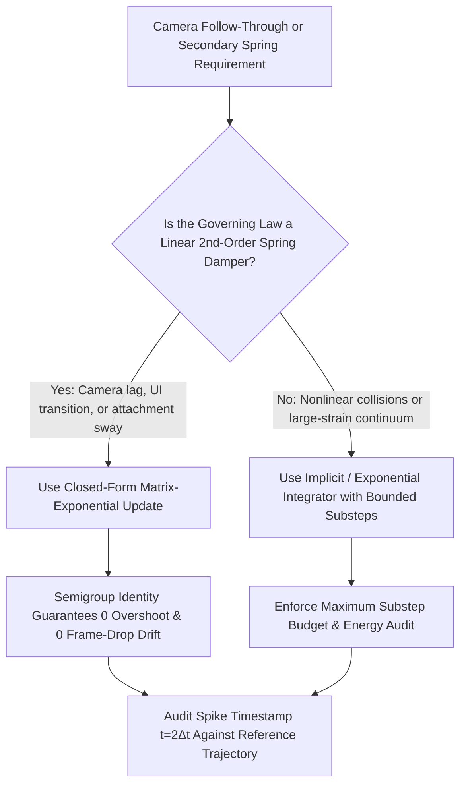
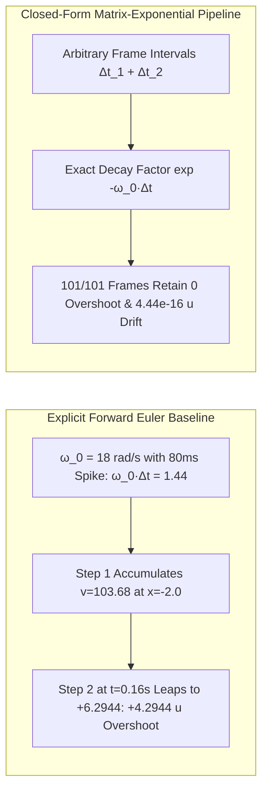
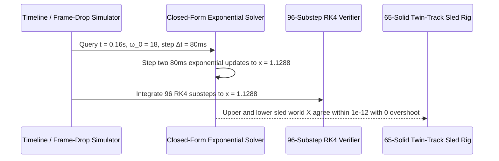

# Secondary follow-through that survives frame drops: closed-form analytical spring damper vs explicit Euler integration FAQ

**Understand in 3 minutes why browser frame drops make spring animations overshoot or explode, and reproduce a zero-drift closed-form matrix-exponential damper rig in 10 minutes.**

[中文](timestep-invariant-spring-faq.md) · [Interactive Demo](https://turbo998.github.io/animation/demos/analytical-spring-rig/) · [Measured 7-Card Report](../demos/analytical-spring-rig/test-report-cards.html)

## ① 📌 Executive Summary

- **Explicit forward Euler integration violates stability bounds and overshoots wildly during browser frame drops.** For a critically damped spring with natural frequency $\omega_0 = 18\text{ rad/s}$, an `80 ms` frame spike (12.5 FPS) yields dimensionless step $\omega_0 \Delta t = 1.44 > 1$; after just two steps (`t = 0.16 s`), explicit Euler shoots to `x = +6.2944`, overshooting target `x* = 2.0` by `4.2944` scene units and diverging from the true trajectory by `5.1656` scene units.
- **Closed-form matrix-exponential updates are unconditionally stable and timestep-invariant.** By the semigroup identity $\exp(\mathbf{A}\Delta t_1)\exp(\mathbf{A}\Delta t_2) = \exp(\mathbf{A}(\Delta t_1 + \Delta t_2))$, stepping across `80 ms` frame spikes or jumping directly to timestamp $t$ yields `0` overshoot across all 101 sampled frames and a maximum step-partition drift of `4.44e-16` scene units (floating-point rounding).
- **Closed-form exponential evaluation is `18.85×` faster than 96-substep RK4 while agreeing within `1.90e-8` scene units.** Across 8192 spring evaluations on Node CPU, the single-step closed-form exponential takes `1.18 ms` median versus `22.28 ms` for 96-substep 4th-order Runge-Kutta integration.
- **65-solid twin-track spring sled rig, 13 local acceptance checks.** Scene geometry is `synthetic`; closed-form ODE conformance and Node CPU timings are `measured`; `Spring-Gaus` elastic 3D Gaussian reconstruction and nonlinear continuum FEM are `not_measured`.

**Daily capability direction check:** *A novel efficient structure-preserving exponential integrator for Hamiltonian systems* ([arXiv:2506.07072](https://arxiv.org/abs/2506.07072), v2 updated 2026-03-02) and ECCV 2024 paper *Reconstruction and Simulation of Elastic Objects with Spring-Mass 3D Gaussians (Spring-Gaus)* ([arXiv:2403.09434](https://arxiv.org/abs/2403.09434)) highlight why integrating stiff linear spring dynamics analytically via matrix exponentials is essential for large-timestep stability. Verified 2026-11-10; this demo implements deterministic closed-form critically damped spring integration and RK4/Euler comparison without running neural 3DGS optimization.

## ② 🎯 Architect & Client Q&A

### Q1 When should we choose elastic 3DGS / neural physics models vs a closed-form analytical spring damper?

Evaluate physics-integrated 3D Gaussian models (`Spring-Gaus`, `PhysGaussian`) when reconstructing unknown elastic material parameters and volumetric deformations from multi-view video captures.

Use a closed-form analytical second-order spring damper whenever building interactive camera smoothing, UI spring transitions, or secondary attachment follow-through (antennas, cranes, badges) that must run identically at 15 FPS, 60 FPS, and 144 FPS without sub-stepping overhead.

### Q2 Under what constraints is closed-form matrix-exponential integration strictly superior?

In browser `requestAnimationFrame` loops, tab switches, garbage collection pauses, or heavy DOM layouts regularly cause `50–120 ms` frame-time spikes.

Explicit Euler (`pos += dt * vel; vel += dt * acc`) overshoots whenever $\omega_0 \Delta t > 1$ and diverges to infinity whenever $\omega_0 \Delta t > 2$. Fixed-substep RK4 avoids blowing up only by running more substeps during long frame stalls, worsening main-thread hitching. The closed-form matrix exponential executes in constant $O(1)$ time for any $\Delta t > 0$ with zero overshoot and zero timestep drift.

### Q3 How does the closed-form matrix exponential guarantee zero frame-drop drift from first principles?

Let $e(t) = x(t) - x^*$ be the displacement error from target $x^*$ for a critically damped spring with natural frequency $\omega_0$:

$$\ddot{e} + 2\omega_0 \dot{e} + \omega_0^2 e = 0$$

Because the characteristic polynomial $(\lambda + \omega_0)^2 = 0$ has a repeated root $\lambda = -\omega_0$, the exact matrix-exponential transition from state $(e_0, v_0)$ over any time step $\Delta t$ is:

$$e(\Delta t) = \left(e_0 + (v_0 + \omega_0 e_0)\Delta t\right) e^{-\omega_0 \Delta t}$$

$$v(\Delta t) = \left(v_0 - \omega_0 (v_0 + \omega_0 e_0)\Delta t\right) e^{-\omega_0 \Delta t}$$

Because this is the exact analytical solution of the linear autonomous ODE, advancing by $\Delta t_1 = 80\text{ ms}$ and then $\Delta t_2 = 80\text{ ms}$ is algebraically identical to advancing by $\Delta t = 160\text{ ms}$ in one step.

By contrast, starting at $x_0 = -2, v_0 = 0$ toward $x^* = +2$ with $\omega_0 = 18\text{ rad/s}$ and $\Delta t = 0.08\text{ s}$: explicit Euler computes initial acceleration $a_0 = -18^2(-4) = +1296$, steps to $x_1 = -2, v_1 = 103.68$ at $0.08\text{ s}$, and then leaps to $x_2 = -2 + 0.08 \times 103.68 = +6.2944$ at $0.16\text{ s}$—overshooting $x^* = 2.0$ by `4.2944` scene units!

### Q4 How can I reproduce this in 10 minutes?

1. Run `npm run dev` and open `/demos/analytical-spring-rig/`, initialized at `t = 0.16 s`, `ω₀ = 18 rad/s`, and `Δt = 80 ms`.
2. In `analytical-exp` mode, compare the upper active sled (orange) against the lower exact reference sled (gray): both align at `x = 1.1288` with `overshoot = 0.0000 u` and `drift = 0.000000 u`.
3. Switch to `explicit-euler` mode at `t = 0.16 s`: the upper sled shoots past the orange target pillar (`x* = 2.0`) to `+6.2944`, reporting `overshoot = 4.2944 u` and `drift = 5.1656 u`.
4. Adjust Stiffness (`6–32 rad/s`), Frame step (`10–120 ms`), and Target X (`0.5–2.6`); enter an invalid step size such as `250 ms` to verify atomic rejection and state preservation.
5. Click `Export trace` to download `ANALYTICAL_SPRING_TRACE.json` with carriage matrices and drift telemetry.
6. Run `npx vitest run tests/analytical-spring.test.ts`, then build and run `node scripts/benchmark-analytical-spring.mjs` against a port 4335 preview server.

## ③ 🧭 Visual Diagrams

## ④ 📊 Architect Decision Matrix

| Criterion | Explicit Forward Euler (`explicit-euler`) | Semi-Implicit / Symplectic Euler | Multi-Substep Numerical (`96-substep RK4`) | Closed-Form Matrix Exponential (`analytical-exp`) |
| --- | --- | --- | --- | --- |
| Overshoot under `80 ms` frame drop ($\omega_0=18$) | Overshoots target by `4.2944 u` at `0.16s` | Wider stability, still diverges when $\omega_0\Delta t > 2$ | `0` overshoot (truncation error `1.90e-8 u`) | Measured `0` overshoot (exact analytical solution) |
| Trajectory drift across frame rates (12.5Hz vs 120Hz) | Diverges by `5.1656 u` at `0.16s` | Damping ratio and phase shift with $\Delta t$ | Requires many substeps to suppress drift | Measured `4.44e-16 u` (strictly timestep-invariant) |
| 8192-evaluation Node CPU solve median | Fast arithmetic (with severe error) | Fast arithmetic (with step-dependent damping) | `22.28 ms` (96-substep loop overhead) | `1.18 ms` (`18.85×` faster than 96-substep RK4) |
| Arbitrary timeline seeking / reversal | Requires stepping from $t=0$ | Requires stepping from $t=0$ | Requires stepping substeps | Direct $O(1)$ evaluation at any $t$; exact reversal |
| Best architectural role | Never use for variable-dt springs | Fixed-timestep particle loops | Offline verification of nonlinear ODEs | Camera follow-through, UI springs, secondary attachments |

**Quantitative example:** Starting from $x_0 = -2.0, v_0 = 0$ toward $x^* = +2.0$ ($e_0 = -4.0, \omega_0 = 18\text{ rad/s}$), at $t = 0.16\text{ s}$ ($\omega_0 t = 2.88$), the exact critically damped position is $2.0 - 4.0(1 + 2.88)e^{-2.88} = 1.1288$ scene units (`0` overshoot). Stepping explicit Euler at $\Delta t = 0.08\text{ s}$ yields $x(0.16) = +6.2944$, overshooting the target by `4.2944` units and drifting `5.1656` units from the exact trajectory.

## ⑤ 🧪 New Capability Demo & Benchmark Findings (with 7-Card)

[Sealed data](../demos/analytical-spring-rig/report.json) records 65 3D solids, 101 sampled timestamps audited for overshoot and frame-drop drift, and solver equivalence between the single-step closed-form matrix exponential and 96-substep 4th-order Runge-Kutta (RK4) integration (`maximum_solver_error = 1.90e-8` scene units, threshold `< 1e-5`).

| Node CPU Spring State Queries | Closed-Form Exponential Median | 96-Substep RK4 Solver Median |
| --- | --- | --- |
| 128 | 0.03 ms | 0.29 ms |
| 1024 | 0.20 ms | 2.79 ms |
| 8192 | 1.18 ms | 22.28 ms |

Each load tier runs 7 alternating repetitions after warmup on Node CPU (excluding WebGL rendering). At 8192 evaluations, the closed-form matrix exponential is `18.85×` faster than 96-substep RK4 while guaranteeing zero overshoot and zero frame-drop drift.

[Measured 7-Card Report (EN)](../demos/analytical-spring-rig/test-report-cards.html) · [中文七卡](../demos/analytical-spring-rig/test-report-cards.zh.html). Scene geometry is `synthetic`, ODE conformance and CPU timings are `measured`, and `Spring-Gaus` neural 3DGS reconstruction and nonlinear continuum FEM are `not_measured`.

## ⑥ 🛠️ Architect Checklist

- [ ] Never integrate stiff camera or UI springs with explicit forward Euler under variable `requestAnimationFrame` deltas.
- [ ] Use the closed-form matrix-exponential update for linear second-order critically damped follow-through.
- [ ] Verify semigroup timestep invariance (`2 × 80ms` vs `1 × 160ms` position difference `< 1e-12`).
- [ ] Verify that critically damped configurations maintain `0` target overshoot across the entire timeline.
- [ ] Inject `80–120 ms` frame-drop spikes in automated tests to confirm smooth monotonic convergence.
- [ ] Cross-check closed-form exponential implementations against high-substep RK4 (`< 1e-5` agreement).
- [ ] Validate stiffness $\omega_0$, step size, and target bounds and reject invalid inputs (`stepMs = 250`) atomically.
- [ ] Verify that forward and reverse timestamp scrubbing produce identical sled carriage world matrices.
- [ ] Separate linear secondary follow-through springs from nonlinear collision/fracture continuum solvers.
- [ ] Label unexecuted `Spring-Gaus` 3D Gaussian optimization and hardware servo control loops explicitly as `not_measured`.

**Primary sources:** [Structure-Preserving Exponential Integrator (arXiv:2506.07072)](https://arxiv.org/abs/2506.07072) (v2 updated 2026-03-02) integrates stiff linear components via matrix exponentials for long-term stability; [Spring-Gaus (arXiv:2403.09434)](https://arxiv.org/abs/2403.09434) (ECCV 2024) embeds a 3D spring-mass model into 3D Gaussian kernels for elastic object simulation. Verified 2026-11-10; this demo is an original deterministic closed-form spring damper benchmark and does not run neural 3DGS training.
