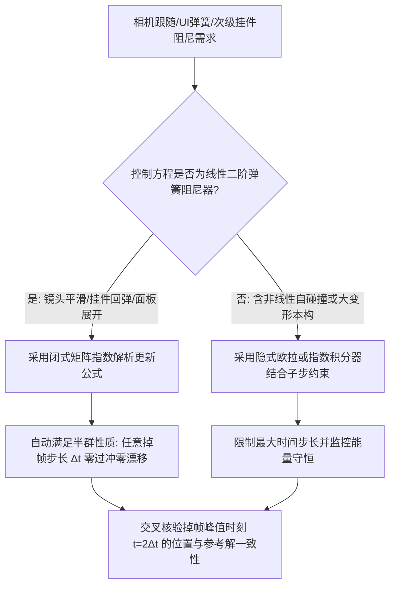
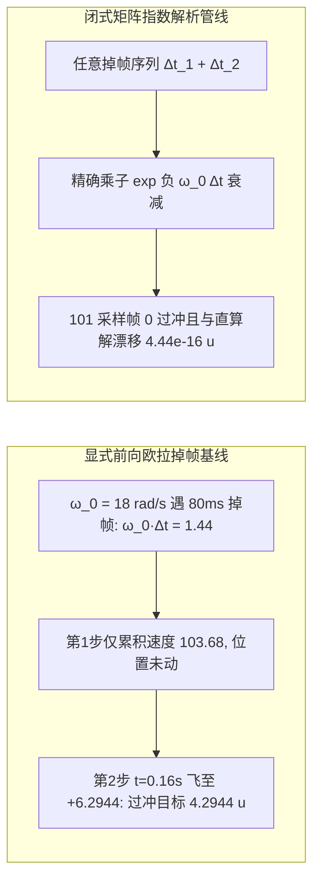
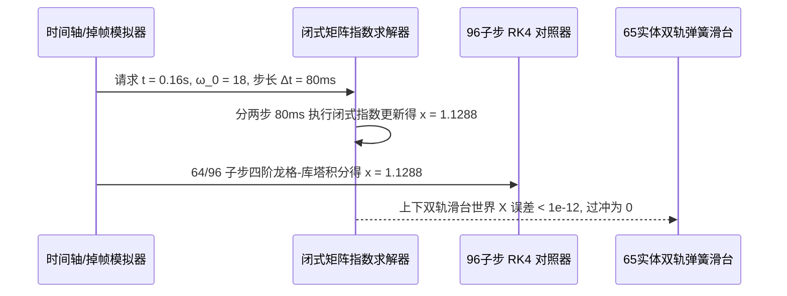

# 掉帧卡顿也不炸飞：时间步长无关解析弹簧跟随与显式欧拉积分选型 FAQ

**3 分钟看懂为什么浏览器掉帧会让弹簧动画炸飞，10 分钟复刻零过冲、零步长漂移的闭式矩阵指数阻尼器。**

[English](timestep-invariant-spring-faq.en.md) · [交互 Demo](https://turbo998.github.io/animation/demos/analytical-spring-rig/) · [中文七卡](../demos/analytical-spring-rig/test-report-cards.zh.html)

## ① 📌 核心结论速览

- **显式前向欧拉积分（Explicit Euler）在浏览器掉帧时会突破稳定域并产生剧烈过冲。** 对固有频率 $\omega_0 = 18\text{ rad/s}$ 的二阶临界阻尼弹簧，当页面遇到 `80 ms`（12.5 FPS）掉帧时，无量纲步长 $\omega_0 \Delta t = 1.44 > 1$；显式欧拉在 `t = 0.16 s`（仅两步后）就冲到 `x = +6.2944`，越过目标 `x* = 2.0` 达 `4.2944` 示意单位，偏离真实轨迹 `5.1656` 示意单位。
- **闭式矩阵指数解满足半群步长无关性（Timestep Invariance）。** 因为 $\exp(\mathbf{A}\Delta t_1)\exp(\mathbf{A}\Delta t_2) = \exp(\mathbf{A}(\Delta t_1 + \Delta t_2))$，无论按 `80 ms` 掉帧步进还是直接一步跳到目标时刻，101 个采样帧的最大过冲为 `0`，分步与直算的最大位置漂移仅 `4.44e-16` 示意单位（浮点舍入级）。
- **闭式指数更新比 96 子步四阶龙格-库塔（RK4）快 `18.85×` 且无需子步切分。** 两种求解器在全部负载下的最大坐标差仅 `1.90e-8` 示意单位（门限 `< 1e-5`），8192 次状态求值中位数为 `1.18 ms` 对比 `22.28 ms`。
- **65 实体双轨精密弹簧滑台，13 项本机实测验收。** 场景为 `synthetic`；常微分方程闭式解与 Node CPU 耗时为 `measured`；`Spring-Gaus` 多视角弹性 3D 高斯重建与非线性碰撞有限元为 `not_measured`。

**每日能力方向核验：** *A novel efficient structure-preserving exponential integrator for Hamiltonian systems*（[arXiv:2506.07072](https://arxiv.org/abs/2506.07072)，2026-03-02 v2）与 ECCV 2024 论文 *Reconstruction and Simulation of Elastic Objects with Spring-Mass 3D Gaussians (Spring-Gaus)*（[arXiv:2403.09434](https://arxiv.org/abs/2403.09434)）凸显了弹簧-质量物理层与指数积分器在刚性动态模拟中的核心价值：将线性刚性部分交给解析指数算子，才能在任意步长下兼顾稳定性与效率。2026-11-10 核验原文；本例仅实现二阶临界阻尼闭式指数算子与 RK4/欧拉对照，未运行 3DGS 训练。

## ② 🎯 客户与架构师灵魂拷问 Q&A

### Q1 何时选三维弹性高斯/神经物理模型，何时选闭式解析弹簧阻尼器？

当需要从多视角真实视频中反演未知软体物体的刚度并合成三维弹性形变时，应评估 `Spring-Gaus`、`PhysGaussian` 等物理融合 3DGS 方案。

当我们在交互式网页、三维相机平滑跟随、机械臂末端缓冲、或 UI 卡片动效中编写次级跟随动画（Secondary Follow-Through）时，直接采用二阶临界阻尼弹簧的闭式矩阵指数公式，就能用不到 10 行代码实现永远不炸飞、在 15Hz 低端机和 144Hz 高刷屏上轨迹完全一致的物理跟随。

### Q2 在什么约束下闭式矩阵指数比显式欧拉或固定子步数值积分严格更优？

在浏览器 `requestAnimationFrame` 环境中，后台标签页切换、GC 停顿或重负载经常造成 `50–120 ms` 的帧间隔抖动。

如果使用显式欧拉（`pos += dt * vel; vel += dt * acc`），只要 $\omega_0 \Delta t > 1$，原本绝不该过冲的临界阻尼弹簧就会反向过冲；当 $\omega_0 \Delta t > 2$ 时系统直接发散爆炸。如果使用固定微步长的 RK4 子步循环，掉帧越久子步越多，反而加剧主线程卡顿（螺旋死亡 Spiral of Death）。闭式矩阵指数单步复杂度为 $O(1)$，且对任意 $\Delta t > 0$ 无条件稳定、精确守恒半群性质。

### Q3 底层管线如何从第一性原理推导出零漂移闭式更新公式？

设当前位置与目标位置的误差为 $e(t) = x(t) - x^*$，固有角频率为 $\omega_0$。二阶临界阻尼弹簧满足线性常微分方程：

$$\ddot{e} + 2\omega_0 \dot{e} + \omega_0^2 e = 0$$

特征方程 $(\lambda + \omega_0)^2 = 0$ 有二重根 $\lambda = -\omega_0$，因此对任意步长 $\Delta t$，状态 $(e_0, v_0)$ 经过 $\Delta t$ 后的精确解（即矩阵指数 $\exp(\mathbf{A}\Delta t)$ 作用结果）为：

$$e(\Delta t) = \left(e_0 + (v_0 + \omega_0 e_0)\Delta t\right) e^{-\omega_0 \Delta t}$$

$$v(\Delta t) = \left(v_0 - \omega_0 (v_0 + \omega_0 e_0)\Delta t\right) e^{-\omega_0 \Delta t}$$

注意这个公式不含任何泰勒截断近似！先走 $\Delta t_1 = 80\text{ ms}$ 再走 $\Delta t_2 = 80\text{ ms}$，代人上式后代数化简的结果，与直接走 $\Delta t = 160\text{ ms}$ **恒等**。

反观显式欧拉：在 $t = 0$ 时 $x_0 = -2, v_0 = 0, a_0 = -18^2 \times (-4) = +1296$；第一步（$0.08\text{ s}$）后 $x_1 = -2, v_1 = 103.68$；第二步（$0.16\text{ s}$）直接飞到 $x_2 = -2 + 0.08 \times 103.68 = +6.2944$，越过目标 `x* = 2.0` 整整 `4.2944` 示意单位！

### Q4 十分钟如何复刻？

1. `npm run dev` 后打开 `/demos/analytical-spring-rig/`，默认停在 `t = 0.16 s`、`ω₀ = 18 rad/s`、`Δt = 80 ms`。
2. 观察双轨滑台：下方灰色参考滑台为直接一步计算的精确解（`x = 1.1288`），上方橙色滑台为当前所选积分器。在解析矩阵指数模式（`analytical-exp`）下，上下两台滑台位置严丝合缝对齐，`overshoot = 0.0000 u`，`drift = 0.000000 u`。
3. 切换到显式欧拉掉帧基线（`explicit-euler`）：在 `t = 0.16 s` 处，上方滑台剧烈冲过右侧目标立柱（`x* = 2.0`），读数显示 `overshoot = 4.2944 u`、`drift = 5.1656 u`。
4. 修改刚度（`6–32 rad/s`）、掉帧步长（`10–120 ms`）与目标位置（`0.5–2.6`）；若输入越界步长 `250 ms`，系统执行原子拒绝并保留原有效状态。
5. 点击导出 `ANALYTICAL_SPRING_TRACE.json`，核验上下两滑台的世界变换矩阵与漂移数据。
6. 运行 `npx vitest run tests\analytical-spring.test.ts`；构建并在 4335 端口预览后执行 `node scripts\benchmark-analytical-spring.mjs`。

## ③ 🧭 直观可视化图解

## ④ 📊 Architect Decision Matrix

| 评估维度 | 显式前向欧拉 (`explicit-euler`) | 半隐式/辛欧拉 (Symplectic Euler) | 多子步数值积分 (`96-substep RK4`) | 本例闭式矩阵指数 (`analytical-exp`) |
| --- | --- | --- | --- | --- |
| `80 ms` 掉帧（$\omega_0=18$）下过冲量 | `t=0.16s` 剧烈过冲 `4.2944 u` | 稳定域更宽，但 $\omega_0\Delta t > 2$ 仍发散 | 精度高（误差 `1.90e-8 u`） | 实测 `0` 过冲（解析精确解） |
| 不同帧率（12.5Hz vs 120Hz）轨迹漂移 | 漂移高达 `5.1656 u` | 步长不同导致阻尼率与相位漂移 | 需足够多子步才能压低漂移 | 实测 `4.44e-16 u`（严格步长无关） |
| 8192 次状态求值 Node CPU 中位数 | 单步乘加（但数值错误） | 单步乘加（大步长精度退化） | `22.28 ms`（96 子步循环开销） | `1.18 ms`（比 96 子步 RK4 快 `18.85×`） |
| 任意时间轴跳转与逆序拖拽 | 需从头重跑步进循环 | 需从头重跑步进循环 | 需重跑子步 | 直接代入 $t$ 一步求值，正逆序完全一致 |
| 适用工程场景 | 严禁用于可变帧率弹簧跟随 | 固定物理步长（如 60Hz FixedUpdate）粒子 | 非线性力场离线基准验证 | 相机平滑跟随、UI 物理动效、次级挂件摆动 |

**定量算例：** 从 $x_0 = -2.0, v_0 = 0$ 向目标 $x^* = +2.0$ 运动（初始误差 $e_0 = -4.0$，$\omega_0 = 18\text{ rad/s}$）。在 $t = 0.16\text{ s}$（即 $\omega_0 t = 2.88$）时，解析精确位置为 $2.0 - 4.0 \times (1 + 2.88) e^{-2.88} = 2.0 - 15.52 \times 0.056135 = 1.1288$ 示意单位（尚未到达 $2.0$，过冲为 `0`）。而按 `80 ms` 步进的显式欧拉在 $t = 0.16\text{ s}$ 算出 $x = +6.2944$，过冲 `4.2944` 示意单位，轨迹误差达 `5.1656` 示意单位。

## ⑤ 🧪 全新 Demo 与 Benchmark 核心发现（含 7-Card）

[封存数据](../demos/analytical-spring-rig/report.json)记录了 65 个三维实体、101 个采样时间点的过冲与掉帧步长漂移核验，以及闭式矩阵指数与 96 子步四阶龙格-库塔（RK4）求解器的等价性与耗时对照。两种求解器在全部负载下的最大位置差仅 `1.90e-8` 示意单位（门限 `< 1e-5`）。

| Node CPU 弹簧状态查询数 | 闭式矩阵指数求解中位数 | 96 子步 RK4 积分中位数 |
| --- | --- | --- |
| 128 | 0.03 ms | 0.29 ms |
| 1024 | 0.20 ms | 2.79 ms |
| 8192 | 1.18 ms | 22.28 ms |

每档负载在预热后按交替顺序重复 7 次，记录 Node CPU 耗时中位数（不含 WebGL 渲染）。在 8192 次弹簧状态评估中，单步闭式矩阵指数比 96 子步 RK4 快约 `18.85×`，同时彻底消除了显式欧拉在 `80 ms` 掉帧下的 `4.2944` 示意单位过冲。

[中文七卡](../demos/analytical-spring-rig/test-report-cards.zh.html) · [English](../demos/analytical-spring-rig/test-report-cards.html)。画面为 `synthetic`，微分方程闭式解与 CPU 计时为 `measured`；`Spring-Gaus` 神经弹性三维高斯重建与非线性碰撞有限元为 `not_measured`。

## ⑥ 🛠️ Architect Checklist

- [ ] 严禁在可变帧率 `requestAnimationFrame` 循环中用显式前向欧拉直接积分刚性弹簧（$\omega_0 \Delta t > 0.5$）。
- [ ] 对相机跟随、UI 动效与次级摆动挂件优先采用二阶临界阻尼弹簧的闭式矩阵指数解析更新公式。
- [ ] 验证任意切分时间步长（如 `2 × 80ms` vs `16 × 10ms` vs `1 × 160ms`）后的位置差 `< 1e-12`（半群步长无关性）。
- [ ] 验证临界阻尼配置下全时间段过冲量严格为 `0`。
- [ ] 在测试套件中注入 `80–120 ms` 模拟掉帧尖峰，检验跟随动画是否保持单调平滑收敛。
- [ ] 用高子步数（如 96 子步）四阶龙格-库塔（RK4）对闭式指数实现做独立交叉验证（误差 `< 1e-5`）。
- [ ] 对固有频率、帧步长与目标位置执行参数边界校验，对非法参数执行原子拒绝。
- [ ] 验证正序与逆序拖拽时间轴到同一时间戳时，导出的滑台世界矩阵完全一致。
- [ ] 区分线性弹簧跟随的闭式指数解与含非线性碰撞/断裂的连续介质仿真，不夸大适用范围。
- [ ] 未执行的 `Spring-Gaus` 多视角弹性重建与硬件伺服控制环统一标注为 `not_measured`。

**一手来源：** [Exponential Integrator (arXiv:2506.07072)](https://arxiv.org/abs/2506.07072)（2026-03-02 v2）利用指数积分器保持刚性线性分量的长期稳定性与几何结构；[Spring-Gaus (arXiv:2403.09434)](https://arxiv.org/abs/2403.09434)（ECCV 2024）将三维弹簧-质量模型嵌入 3D 高斯核以重建弹性动态。2026-11-10 核验；本例为原创确定性二阶闭式弹簧阻尼测试台，未运行上述三维重建模型。
