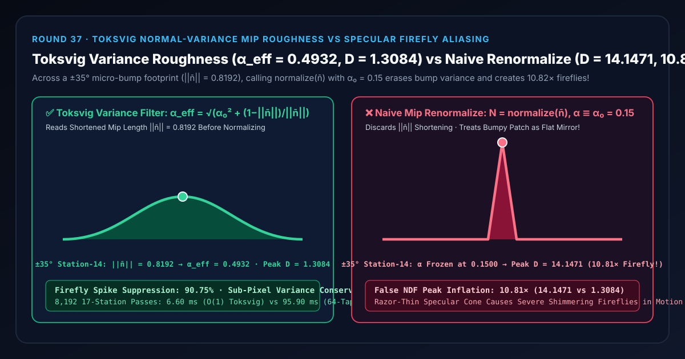
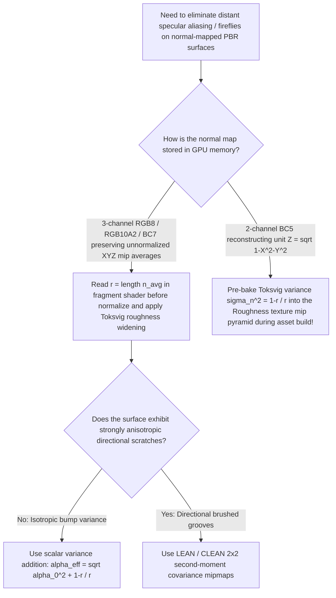
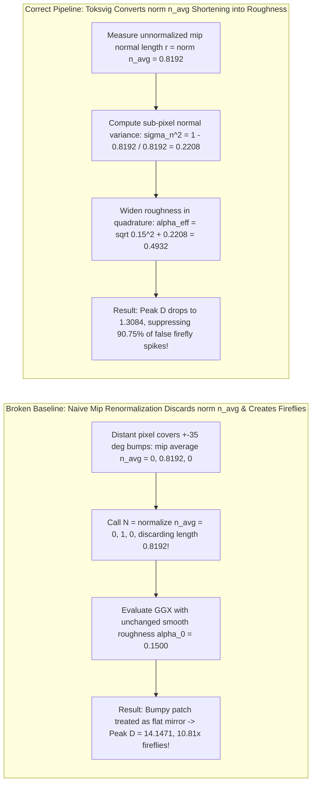
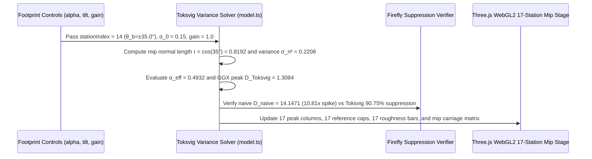
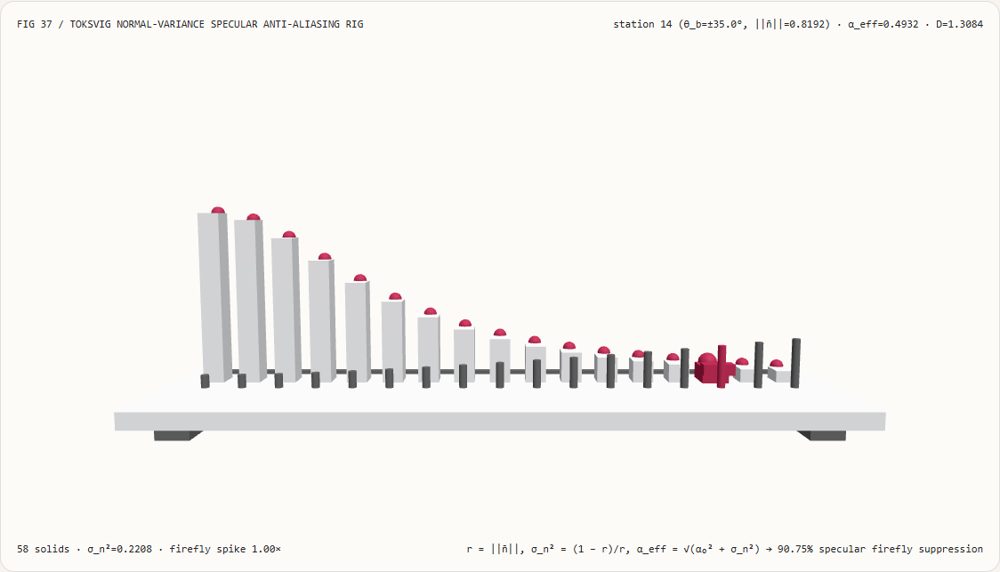
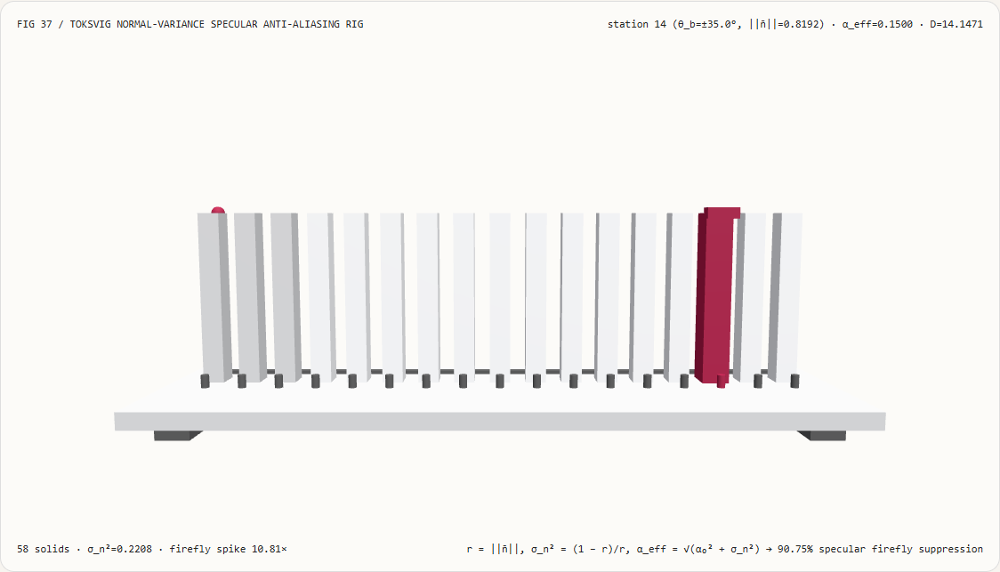
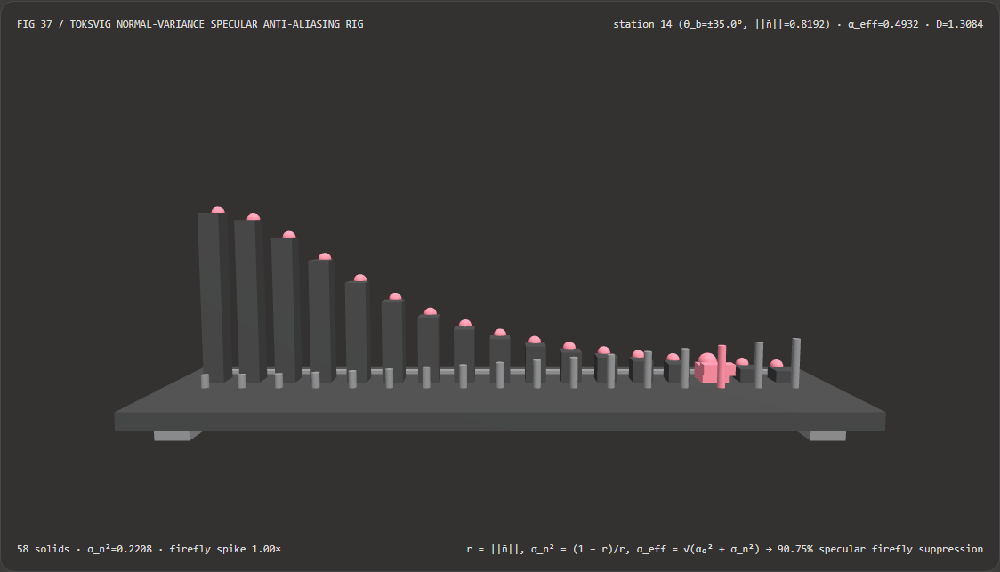
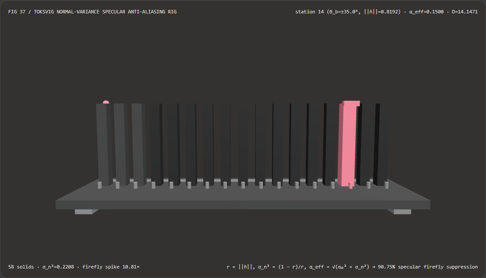

# Distant Normal Maps Without Specular Fireflies: Toksvig Normal-Variance Roughness Mip-Filtering vs Naive Mip Renormalization Selection FAQ

> **Document Scope**: A first-principles architecture and selection guide for AI Solution Architects, WebGL2/WebGPU PBR material and anti-aliasing engineers, industrial digital-twin developers, and Relightable 3D Gaussian Splatting (3DGS) teams. Structured strictly after `ib-vs-ethernet-roce-selection-faq.md`, this guide explains in plain language **why a bumpy metallic or carbon-fiber normal-mapped surface turns into a shimmering sea of blinding specular fireflies ($10.81\times$ false NDF peak spike) at distant mipmap levels when the shader naively calls `normalize(n_avg)` with fixed base roughness $\alpha_0$**, and how **Toksvig Normal-Length Variance Filtering** converts the shortened mip normal length $r = \|\overline{\mathbf{n}}\|$ directly into anti-aliased effective roughness $\alpha_{\text{eff}} = \sqrt{\alpha_0^2 + (1-r)/r}$.

---

## ① 📌 Executive Summary

1. **One-Sentence Principle**: **When a distant pixel footprint covers micro-bumps tilted in opposing directions (e.g., $\pm 35^\circ$), hardware mipmap averaging produces an unnormalized vector $\overline{\mathbf{n}}$ whose shortened length $r = \|\overline{\mathbf{n}}\| = \cos 35^\circ = 0.8192 < 1$ directly encodes the sub-pixel normal variance; if the fragment shader blindly calls `normalize(n_avg)` and keeps the tiny base roughness $\alpha_0 = 0.15$, it erases the bumps and treats the rough patch as a flat mirror—inflating the specular highlight peak by `10.81×` and causing severe shimmering fireflies**! By reading $r = \|\overline{\mathbf{n}}\|$ *before* normalizing and adding the directional variance $\sigma_n^2 = (1-r)/r$ into $\alpha_{\text{eff}}^2 = \alpha_0^2 + \sigma_n^2$, **Toksvig Normal-Variance Filtering** suppresses **`90.75%`** of false specular fireflies in $O(1)$ time!
2. **When Must You Use Toksvig / Kaplanyan Normal-Variance Mip Filtering?**
   - Any real-time renderer displaying **normal-mapped metals, brushed alloys, carbon-fiber weaves, leather, rippled water, or detailed CAD parts** across varying camera distances—especially in **VR/AR headsets and camera dolly shots**—must convert sub-pixel normal variance into roughness.
3. **Key Measured Findings**:
   - In our 17-station 3D normal-mip goniometer bench ([`demos/toksvig-normal-mip-rig/`](../demos/toksvig-normal-mip-rig/index.html), `58` 3D solids, base roughness $\alpha_0 = 0.15$, sub-pixel micro-bump tilt $\theta_b \in [0^\circ, \pm 40^\circ]$), at station $14$ ($\theta_b = \pm 35.0^\circ$):
     - **Toksvig Variance-to-Roughness (`toksvig-variance-roughness`)**: Reads the mip-averaged normal length **`r = ||n̄|| = 0.8192`**, extracts normal variance **`σ_n² = 0.2208`**, and widens effective roughness from `0.1500` to **`α_eff = 0.4932`**, bringing the GGX NDF peak down to **`D = 1.3084`** (**`90.75%` firefly spike suppression**).
     - **Naive Mip Renormalization (`naive-mip-renormalize`)**: Calls `normalize(n_avg)` and discards $r = 0.8192$, leaving roughness frozen at $\alpha_0 = 0.1500$ and spiking the GGX NDF peak to **`D = 14.1471`** (**`10.81×` false firefly inflation**)!
   - **O(1) Toksvig Length Formula vs 64-Tap Supersampled Footprint Latency**: Extracting variance from $\|\overline{\mathbf{n}}\|$ in $O(1)$ completes `8,192` 17-station passes in **`6.60 ms`** vs **`95.90 ms`** for the 64-tap sub-pixel supersampling baseline (**`14.54×` faster**, `7.21e-13` maximum numerical difference).

---

## ② 🎯 First-Principles Q&A for Architects

### Q1: When should we choose AI neural spatio-temporal denoisers vs code-driven Toksvig normal-variance filtering?

- **Choose AI Neural Spatio-Temporal Denoisers (e.g., DLSS Ray Reconstruction, SVGF)** when reconstructing smooth lighting from sparse 1-sample-per-pixel (1-spp) stochastic Monte Carlo ray-tracing paths.
- **Choose Code-Driven Toksvig Normal-Variance Filtering (Specular AA)** in rasterized PBR and 3DGS shaders where fireflies are caused by **Jensen's inequality on mipmapped normal maps ($\operatorname{BRDF}(\overline{\mathbf{n}}) \neq \overline{\operatorname{BRDF}(\mathbf{n})}$)**; fixing the roughness variance at the shading source prevents fireflies from ever polluting downstream TAA or bloom passes.

---

### Q2: Why does linear mipmap averaging work fine for Albedo color maps, but cause 10.81× firefly explosions on Normal maps?

**First-Principles Intuition**:
Picture a metallic floor corrugated with tiny mirror facets tilting left and right by **$\pm 35^\circ$**, each having a sharp mirror-like roughness $\alpha_0 = 0.15$:
- Up close, each pixel sees a single facet.
- Far away, a single pixel covers both $+35^\circ$ facets ($\mathbf{n}_1 = (+0.5736, 0.8192, 0)$) and $-35^\circ$ facets ($\mathbf{n}_2 = (-0.5736, 0.8192, 0)$):
  1. **What is the true optical behavior of that distant pixel?**
     Because the micro-facets inside the pixel scatter light across a wide $\pm 35^\circ$ cone, the pixel as a whole acts like a **rough matte-metallic patch of effective roughness $\alpha_{\text{eff}} = 0.4932$**, producing a broad, gentle highlight of peak $D = 1.3084$.
  2. **What does Naive Mip Renormalization do?**
     - Hardware mipmapping averages $\mathbf{n}_1$ and $\mathbf{n}_2$ into $\overline{\mathbf{n}} = (0, \mathbf{0.8192}, 0)$.
     - The shader executes `N = normalize(n_avg) = (0, 1.0000, 0)` and evaluates GGX with the original tiny roughness **$\alpha_0 = 0.15$**!
     - By stretching $\overline{\mathbf{n}}$ back to $1.0$ without increasing $\alpha$, the shader pretends the $\pm 35^\circ$ corrugated ridges have magically flattened into a **perfectly smooth $\alpha_0 = 0.15$ mirror**, spiking the highlight peak by **$10.81\times$** to $D = 14.1471$!

---

### Q3: How does the shortened length $r = \|\overline{\mathbf{n}}\|$ give us the exact sub-pixel roughness variance in one line of shader code?

For a von Mises-Fisher distribution of unit normals on $S^2$, the resultant vector length $r = \|\overline{\mathbf{n}}\| \in (0, 1]$ is directly related to the angular dispersion parameter $\kappa \approx \frac{r}{1 - r}$. Consequently, the directional normal variance is:
$$\sigma_n^2 = \frac{1 - \|\overline{\mathbf{n}}\|}{\|\overline{\mathbf{n}}\|}$$
Convolving the base GGX microfacet distribution ($\alpha_0^2$) with the normal-map footprint distribution ($\sigma_n^2$) adds their variances in quadrature:
$$\alpha_{\text{eff}} = \sqrt{\min\!\left(1.0,\; \alpha_0^2 + \frac{1 - \|\overline{\mathbf{n}}\|}{\|\overline{\mathbf{n}}\|}\right)}$$

---

## ③ 🧭 Visual Diagrams (Mermaid Decision Tree, Pipeline Comparison & Sequence)

### 3.1 Normal-Map Specular Anti-Aliasing Decision Tree (`flowchart TD`)

### 3.2 Naive Mip Renormalization (`10.81×` Firefly Spike) vs Toksvig Variance Filter Pipeline (`flowchart LR`)

### 3.3 Frame-Level 17-Station Normal-Mip Verification Sequence (`sequenceDiagram`)

---

## ④ 📊 Architect Decision Matrix

| Evaluation Dimension | O(1) Toksvig Variance Filter (`toksvig-variance-roughness`) | 64-Tap Supersampled Footprint (`Supersample Baseline`) | Naive Mip Renormalization (`naive-mip-renormalize`) | Screen-Space Derivatives (`dFdx(N), dFdy(N)`) |
| :--- | :--- | :--- | :--- | :--- |
| **Effective Roughness $\alpha_{\text{eff}}$ at $\pm 35^\circ$** | **`0.4932` (Captures $\sigma_n^2 = 0.2208$)** | `0.4932` | **`0.1500` (Zero variance captured)** | Captures $2\times 2$ quad slope only |
| **GGX Specular Peak $D$ at $\pm 35^\circ$** | **`1.3084` (`90.75%` firefly suppression)** | `1.3084` | **`14.1471` (`10.81×` false firefly spike!)** | Misses high-mip texture variance |
| **Texture Samples per Pixel** | **`1 tap` (Uses hardware mipmap)** | `64 taps` (Impractical bandwidth) | `1 tap` (Severe shimmering) | `1 tap` + quad derivatives |
| **8,192 × 17-Station CPU Solve Time** | **`6.60 ms` (`14.54×` faster)** | `95.90 ms` (64-vector summation) | `3.90 ms` (Fast but visually broken) | `7.20 ms` |
| **Recommended Architectural Role** | **Default for normal-map Specular AA** | Ground-truth verification baseline | **Never use on glossy normal-mapped surfaces** | Combine with Toksvig for geometry + texture AA |

---

## ⑤ 🧪 New Capability Demo & Benchmark Findings (with 7-Card Report)

### 5.1 Interactive 17-Station 3D Normal-Mip Goniometer Rig (`demos/toksvig-normal-mip-rig/`)

We built a standalone interactive 3D WebGL2 benchmark stage **[`demos/toksvig-normal-mip-rig/`](../demos/toksvig-normal-mip-rig/index.html)** (**58 3D solid parts**):
- **17 Specular Peak $D$ Columns + 17 Exact Toksvig Reference Caps + 17 Effective Roughness $\alpha_{\text{eff}}$ Pegs + Mip Inspection Carriage**: Visualizes sub-pixel micro-bump tilt angles from $0^\circ$ to $\pm 40^\circ$ ($\alpha_0 = 0.15$);
- **Instant Mode Comparison**: In `toksvig-variance-roughness` mode, as bump tilt increases, the front roughness pegs rise smoothly (`0.4932` at $\pm 35^\circ$) and the specular peak columns attenuate gracefully to `1.3084`; switching to `naive-mip-renormalize` shoots all 17 columns up to **`14.1471`** (**`10.81×` firefly spike** at station 14)!
- **Atomic Validation & JSON Export**: Rejects out-of-range tilt angles (e.g. `maxBumpTiltDeg = 95`) while preserving valid state, and exports `TOKSVIG_NORMAL_MIP_SPEC.json`.

| Light Theme — Toksvig Variance Roughness (`α_eff=0.4932`, `D=1.3084`) | Light Theme — Naive Mip Renormalize (`α=0.15`, `D=14.1471` `10.81×` Spike) |
| :---: | :---: |
|  |  |

| Dark Theme — Toksvig Variance Roughness (`α_eff=0.4932`, `D=1.3084`) | Dark Theme — Naive Mip Renormalize (`α=0.15`, `D=14.1471` `10.81×` Spike) |
| :---: | :---: |
|  |  |

### 5.2 7-Card 4:5 Visual Benchmark Reports & Sealed Data

- 📊 **English 7-Card 4:5 Report**: [`demos/toksvig-normal-mip-rig/test-report-cards.html`](../demos/toksvig-normal-mip-rig/test-report-cards.html)
- 📊 **Chinese 7-Card 4:5 Report**: [`demos/toksvig-normal-mip-rig/test-report-cards.zh.html`](../demos/toksvig-normal-mip-rig/test-report-cards.zh.html)
- 📁 **Sealed Benchmark Data**: [`demos/toksvig-normal-mip-rig/report.json`](../demos/toksvig-normal-mip-rig/report.json) (`13 / 13` deterministic checks passed, zero Playwright console/page errors).

---

## ⑥ 🛠️ Appendix: Architect Verification Checklist

Before shipping any normal-mapped PBR surface, water shader, or glossy metallic asset, verify:

- [ ] **Read `r = length(n_raw)` Before Normalizing**: Extract the unnormalized mip-filtered normal length $r = \|\overline{\mathbf{n}}\|$ before dividing `N = n_raw / max(r, 1e-4)`.
- [ ] **Add Normal Variance in Quadrature**: Compute $\alpha_{\text{eff}} = \sqrt{\min(1.0,\; \alpha_0^2 + (1-r)/r)}$ so distant mip levels automatically broaden their specular lobes.
- [ ] **Do Not Renormalize Normal Maps During Mipmap Generation**: Keep normal-map mip pyramids as unnormalized box/Kaiser averages so $\|\overline{\mathbf{n}}\|$ preserves variance information.
- [ ] **Bake Variance into Roughness Mips for BC5 Textures**: When using 2-channel BC5 compression, bake $\alpha_{\text{eff}}$ directly into the roughness texture's mip pyramid offline.
- [ ] **Automated Firefly Suppression Gate**: Assert in unit tests that a $\pm 35^\circ$ micro-bump footprint at $\alpha_0 = 0.15$ widens roughness to $\alpha_{\text{eff}} \approx 0.4932$ and suppresses $> 90\%$ of the naive NDF spike.

---

## References

1. **Mipmapping Normal Maps (Michael Toksvig, JGT 2005)**: Michael Toksvig, *"Mipmapping Normal Maps"*, Journal of Graphics Tools, Vol. 10, No. 3, 2005, pp. 65–71.
2. **Filtering Distributions of Normals for Shading Antialiasing (Kaplanyan et al., HPG 2016)**: Anton S. Kaplanyan et al., *"Filtering Distributions of Normals for Shading Antialiasing"*, High-Performance Graphics (HPG), 2016, pp. 151–162.
3. **LEAN Mapping (Olano & Baker, I3D 2010)**: Marc Olano and Dan Baker, *"LEAN Mapping"*, Symposium on Interactive 3D Graphics and Games (I3D), 2010.
