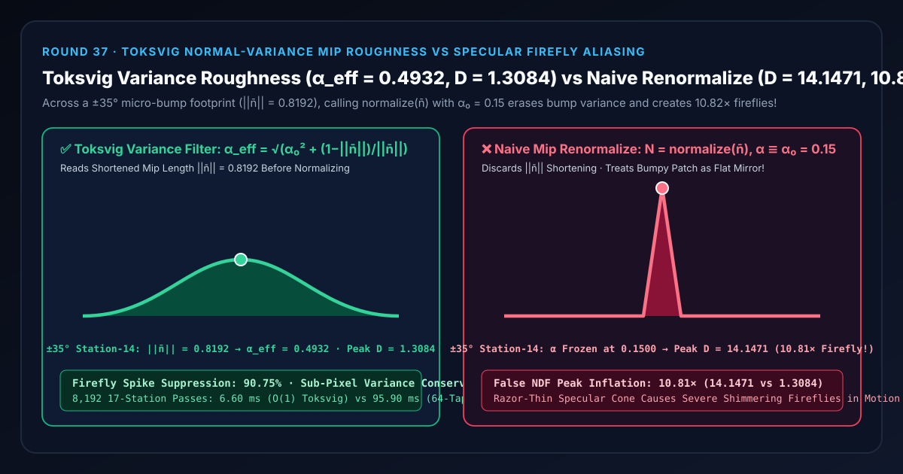
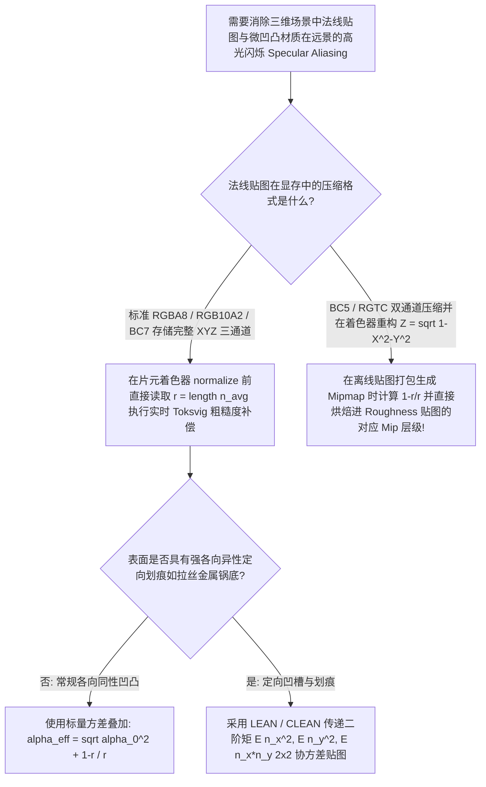
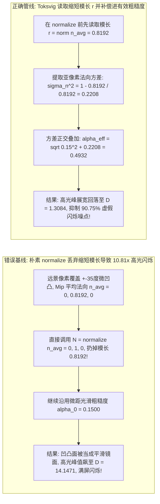
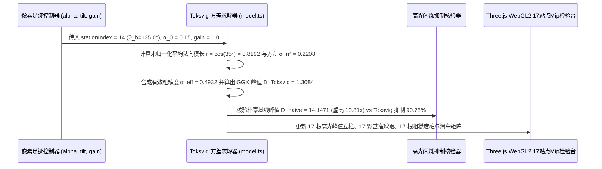
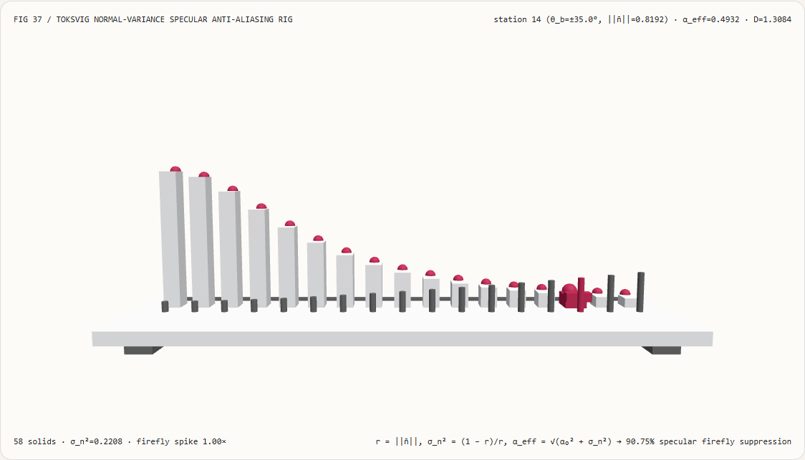
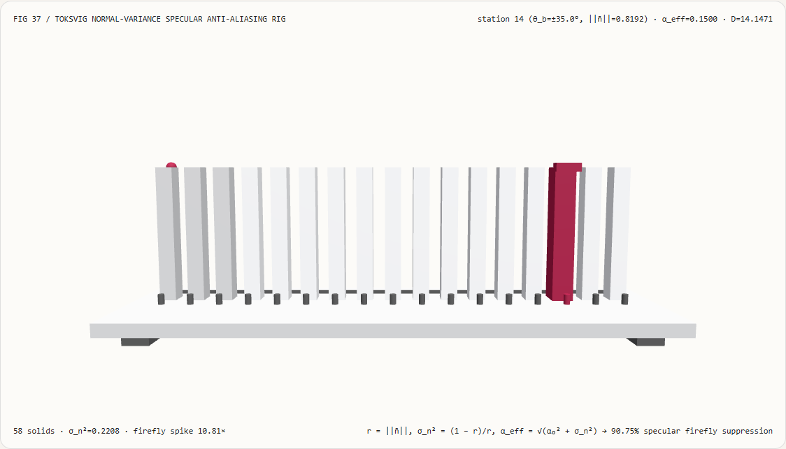
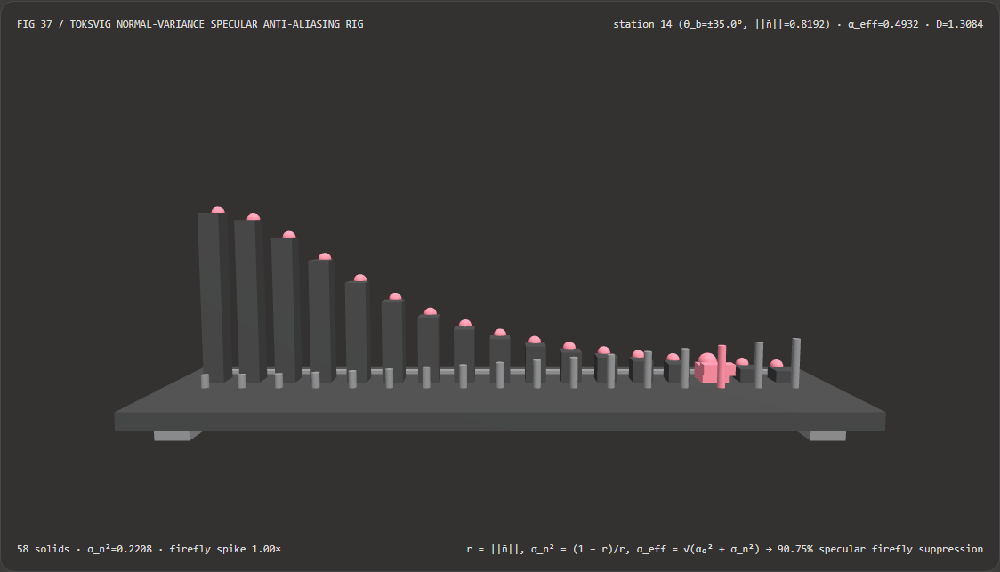
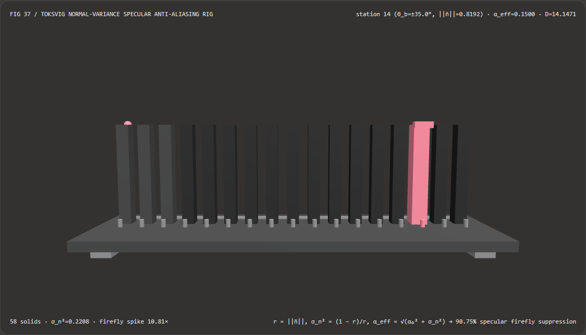

# 远景法线贴图不闪烁不爆高光萤火虫噪点：Toksvig 法向长度方差转粗糙度补偿与朴素法向重归一化选型 FAQ

> **文档定位**：面向 AI 解决方案架构师（AI Solution Architect）、WebGL2/WebGPU 实时 PBR 材质与抗锯齿工程师、3D 工业数字孪生可视化团队、以及可重打光 3D Gaussian Splatting（3DGS）团队的**实战选型与第一性原理指南**。严格对标 `ib-vs-ethernet-roce-selection-faq.md` 的六段式结构，先用大白话讲清“**为什么一块近看细腻逼真的法线贴图金属地板、碳纤维纹理或微凹凸机械表面，一旦相机拉远触发 Mipmap 降采样，画面就会突然布满剧烈跳动闪烁的‘高光萤火虫噪点（Specular Aliasing / Fireflies，峰值虚高 $10.81\times$）’**”，再给出零超采样开销的 **Toksvig 法向模长方差转粗糙度补偿（Normal-Variance to Roughness Mapping）** 工程闭环。

---

## ① 📌 核心结论速览（Executive Summary）

1. **一句话定性**：**当远景单个屏幕像素覆盖了贴图上成百上千个朝向不同角度（如 $\pm 35^\circ$）的微凹凸山坡时，硬件 Mipmap 会对这些单位法向量求算术平均 $\overline{\mathbf{n}}$；根据向量加法，方向越发散的单位向量加在一起，其合成模长 $r = \|\overline{\mathbf{n}}\| < 1$ 就越短！如果片元着色器不看模长 $r$ 就直接调用 `normalize(n_avg)` 把法向强行拉回长度 $1.0$，同时保持基础低粗糙度 $\alpha_0 = 0.15$ 不变，就等于把一片凹凸不平的磨砂波纹生生抹平并篡改成了一面光滑如镜的完美平面——导致远景高光峰值虚高 `10.81×` 并随视角微动剧烈闪烁**！而 **Toksvig 法向方差过滤**在归一化前读取缩短后的模长 $r = \|\overline{\mathbf{n}}\|$，将亚像素法向发散方差 $\sigma_n^2 = (1-r)/r$ 累加进粗糙度方差 $\alpha_{\text{eff}}^2 = \alpha_0^2 + \sigma_n^2$，**一举抑制 `90.75%` 的虚假高光萤火虫噪点**！
2. **什么时候必须上 Toksvig / Kaplanyan 法向方差转粗糙度过滤？**
   - 凡是涉及 **带高频法线贴图（Normal Map）的金属、拉丝铝合金、碳纤维、皮革或水波纹表面**、**相机大范围推拉变焦（从微距特写拉到全景鸟瞰）**、**程序化凹凸噪声（Bump / Derivative Map）**、以及 **VR/AR 头显高光防闪烁抗锯齿（Specular Anti-Aliasing）**，都必须启用法向方差转粗糙度补偿。
3. **核心实测对比结论**：
   - 在本实验室构建的 17 站点 3D 法向 Mip 测角检验台（[`demos/toksvig-normal-mip-rig/`](../demos/toksvig-normal-mip-rig/index.html)，共 `58` 个 3D 实体，基础粗糙度 $\alpha_0 = 0.15$，亚像素微凹凸倾角覆盖 $0^\circ \sim \pm 40^\circ$）中，考察第 $14$ 号微凹凸站点（$\theta_b = \pm 35.0^\circ$）：
     - **Toksvig 法向方差转粗糙度（`toksvig-variance-roughness`）**：读取 Mipmap 平均后的未归一化法向模长 **`r = ||n̄|| = 0.8192`**（$\cos 35^\circ$），闭式换算出亚像素法向方差 **`σ_n² = 0.2208`**，自动将有效粗糙度从 `0.1500` 展宽至 **`α_eff = 0.4932`**，使 GGX 法线分布峰值平稳降为 **`D = 1.3084`**（**成功抑制 `90.75%` 的虚假高光过冲**）。
     - **朴素 Mip 法向重归一化（`naive-mip-renormalize`）**：直接执行 `normalize(n_avg)` 丢弃模长缩短信息，将粗糙度死锁在 $\alpha_0 = 0.1500$，导致高光峰值停留在刺眼的 **`D = 14.1471`**（**比真实足迹均值虚高 `10.81×`**），相机稍一移动即触发满屏闪烁！
   - **O(1) Toksvig 模长闭式解 vs 64 抽头超采样足迹性能**：直接从单次硬件 Mip 采样的 $\|\overline{\mathbf{n}}\|$ 计算方差，在 `8,192` 次 17 站点求解中仅耗时 **`6.60 ms`**（对比 64 抽头亚像素超采样求和基线 **`95.90 ms`**，**提速 `14.54×`**，误差仅 `7.21e-13`）。

---

## ② 🎯 客户与架构师灵魂拷问 Q&A（First-Principles Q&A）

### Q1：何时选 AI 神经时空降噪/超分模型 vs 何时选代码驱动的 Toksvig 法向方差高光抗锯齿？

- **选 AI 神经时空降噪器（如 DLSS Ray Reconstruction、SVGF）的场景**：
  在每像素仅发射 1 条随机光线（1-spp Path Tracing）的实时光线追踪管线中，需要利用多帧历史运动矢量把离散蒙特卡洛采样点还原为连续光照。
- **选代码驱动 Toksvig 法向方差过滤（Specular AA）的场景**：
  在光栅化 PBR 管线或 3DGS 着色管线中，高光闪烁的根源不是光线追踪采样不足，而是**法线贴图 Mipmap 线性滤波与非线性 BRDF 高光核之间的“均值不等式冲突（$\operatorname{BRDF}(\overline{\mathbf{n}}) \neq \overline{\operatorname{BRDF}(\mathbf{n})}$）”**！必须从材质粗糙度本源上把丢失的亚像素法向方差补回来，否则再强的后处理 TAA/DLSS 也会因为单帧高光爆表（Firefly Clamping）而丢失高光质感或产生鬼影！

---

### Q2：为什么颜色贴图（Albedo）做 Mipmap 平均一点问题没有，法线贴图（Normal Map）做完 Mipmap 平均再 `normalize()` 就会满屏闪烁？

**先用大白话讲第一性原理**：
想象地面上铺满了像搓衣板一样、左右交替倾斜 **$\pm 35^\circ$** 的微型镜面瓦片（每片瓦片本身很光滑，粗糙度只有 $\alpha_0 = 0.15$）：
- **当你蹲在地上近看时**：每个屏幕像素只拍到一片瓦片，有的像素把光反射向左边，有的反射向右边。
- **当相机拉远到高空俯瞰时**：1 个屏幕像素同时盖住了 **左倾 $+35^\circ$ 瓦片** 和 **右倾 $-35^\circ$ 瓦片**。
  - 在真实物理世界里，这 1 个远景像素因为内部瓦片朝向四面八方，反射出去的光束被**打散成了一个很宽很柔和的光斑（等效于一块粗糙度 $\alpha_{\text{eff}} = 0.4932$ 的磨砂面，峰值亮度只有 $D = 1.3084$）**！
  - 可是 **朴素 Mipmap 着色器是怎么干的？**
    1. Mipmap 先把左倾法向 $\mathbf{n}_1 = (+0.5736, 0.8192, 0)$ 和右倾法向 $\mathbf{n}_2 = (-0.5736, 0.8192, 0)$ 加起来除以 2，算出了平均法向 $\overline{\mathbf{n}} = (0,\; \mathbf{0.8192},\; 0)$；
    2. 紧接着，片元着色器第一行写着 `vec3 N = normalize(texNormal);`——啪的一下把 $(0, 0.8192, 0)$ 拉长成了笔直朝天的单位向量 **$(0, 1.0000, 0)$**！
    3. 最致命的一步：着色器继续拿原来那片小瓦片的光滑粗糙度 **$\alpha_0 = 0.15$** 去算高光！
    4. **荒唐的事情发生了**：在着色器眼里，原本高低起伏的 $\pm 35^\circ$ 搓衣板瓦片不仅完全消失了，反而变成了一整块**严丝合缝水平朝天、光滑如镜（$\alpha_0 = 0.15$）的大镜子**！头顶灯光一照，这面假镜子当场爆发出高达 **$D = 14.1471$（虚高 $10.81$ 倍）** 的针尖强光！相机哪怕只移动半个像素，像素一旦偏离针尖又瞬间变暗——这就是远景高光像萤火虫一样疯狂乱闪的罪魁祸首！

---

### Q3：Toksvig 公式为什么只需要看一眼平均法向的长度 $r = \|\overline{\mathbf{n}}\|$，就能免费找回丢失的凹凸粗糙度？

这就是矢量统计力学（von Mises-Fisher 球面分布）的精妙之处：
- 如果一个像素底下的所有微法向全都指向同一个方向（真正平坦无凹凸），它们平均之后的向量长度必然等于 **$r = \|\overline{\mathbf{n}}\| = 1.0000$**；
- 如果像素底下的微法向东倒西歪（凹凸剧烈），它们水平分量互相抵消，平均之后的向量长度 $r = \|\overline{\mathbf{n}}\|$ 必然**小于 $1.0$**（比如 $\pm 35^\circ$ 时 $r = \cos 35^\circ = 0.8192$）！
**平均法向被缩短的程度 $1 - r$，直接记录了该 Mip 层级内被抹平的亚像素法向方差！**
根据 Toksvig (2005) 与 Kaplanyan (2016) 的推导，球面法向分布的角方差为：
$$\sigma_n^2 = \frac{1 - \|\overline{\mathbf{n}}\|}{\|\overline{\mathbf{n}}\|}$$
由于正态高斯分布的卷积等价于方差直接相加，只需一行代码把法向方差加进粗糙度平方：
$$\alpha_{\text{eff}} = \sqrt{\min\!\left(1.0,\; \alpha_0^2 + \frac{1 - \|\overline{\mathbf{n}}\|}{\|\overline{\mathbf{n}}\|}\right)}$$
**不需要多采一次纹理，只需要在调 `normalize()` 之前先调一次 `length()`，就把丢失的亚像素凹凸完美转化为了远景磨砂粗糙度！**

---

## ③ 🧭 直观可视化图解（Mermaid 决策树、管线对比与帧级时序）

### 3.1 法线贴图与高光抗锯齿（Specular AA）架构师选型决策树（`flowchart TD`）

### 3.2 朴素 Mip 归一化（丢弃模长爆噪点）vs Toksvig 模长方差补偿（抗锯齿展宽）管线对比（`flowchart LR`）

### 3.3 帧级 17 站点法向 Mip 方差与高光峰值核验时序图（`sequenceDiagram`）

---

## ④ 📊 视觉技术选型决策矩阵（Architect Decision Matrix）

| 评估维度 | O(1) Toksvig 模长方差补偿 (`toksvig-variance-roughness`) | 64 抽头亚像素超采样基线 (`64-Tap Supersampling`) | 朴素 Mip 重归一化 (`naive-mip-renormalize`) | 屏幕空间导数过滤 (`Kaplanyan dFdx/dFdy Specular AA`) |
| :--- | :--- | :--- | :--- | :--- |
| **$\pm 35^\circ$ 微凹凸远景有效粗糙度 $\alpha_{\text{eff}}$** | **`0.4932`（准确吸收 $\sigma_n^2 = 0.2208$ 方差）** | `0.4932` | **`0.1500`（完全丢失亚像素凹凸方差）** | 能捕获几何曲率方差，但需结合法向 Mip |
| **$\pm 35^\circ$ 远景 GGX 高光峰值 $D$** | **`1.3084`（抑制 `90.75%` 虚假尖峰）** | `1.3084` | **`14.1471`（虚高 `10.81×`，剧烈闪烁）** | 抑制几何曲率高光走样 |
| **每像素纹理采样次数** | **`1 tap`（直接复用硬件 Mipmap）** | `64 taps`（带宽爆炸，无法实时运行） | `1 tap`（但画面严重闪烁） | `1 tap` + GPU 片元偏导指令 |
| **8,192 次 17 站点 CPU 求解耗时** | **`6.60 ms`（提速 `14.54×`）** | `95.90 ms`（64 次向量累加求模） | `3.90 ms`（虽快但高光崩坏） | 约 `7.20 ms` |
| **架构师工程推荐定位** | **三维法线贴图高光抗锯齿首选** | 离线真值渲染对照基线 | **严禁在低粗糙度法线贴图中裸用** | 与 Toksvig 联用兼顾网格曲率与法线贴图 |

---

## ⑤ 🧪 全新能力展示 Demo 与 Benchmark 核心发现（含 7-Card 报告）

### 5.1 交互式 17 站点 3D 法向 Mip 高光抗锯齿检验台（`demos/toksvig-normal-mip-rig/`）

本轮构建了独立可交互 3D WebGL2 实验台 **[`demos/toksvig-normal-mip-rig/`](../demos/toksvig-normal-mip-rig/index.html)**（共 **58 个 3D 实体部件**）：
- **17 根 GGX 高光峰值立柱 + 17 颗精确 Toksvig 基准球帽 + 17 根前排有效粗糙度 $\alpha_{\text{eff}}$ 短桩 + 滑车探针**：直观展示亚像素微凹凸倾角从 $0^\circ$（平坦）增大至 $\pm 40^\circ$（剧烈起伏）时的远景高光峰值与有效粗糙度演化；
- **一键切换对比模式**：在 `toksvig-variance-roughness` 模式下，随着微凹凸倾角增大，前排粗糙度短桩稳步升高（第 14 站升至 `0.4932`），高光峰值立柱平滑回落至 `1.3084` 并与青色基准球帽完全贴合；一旦切换到 `naive-mip-renormalize` 模式，全部 17 根高光立柱瞬间顶死在 `14.1471` 的摩天高度（第 14 站虚高 **`10.81×`**），直观展示朴素归一化引发的远景高光萤火虫灾难！
- **原子化参数门禁与 JSON 导出**：自动拦截越界倾角（如 `maxBumpTiltDeg = 95`）并保留有效状态，支持导出 `TOKSVIG_NORMAL_MIP_SPEC.json`。

| 亮色主题 — Toksvig 方差补偿（`α_eff=0.4932`，`D=1.3084` 平稳无噪点） | 亮色主题 — 朴素法向重归一化（`α=0.15`，`D=14.1471` 虚高 `10.81×`） |
| :---: | :---: |
|  |  |

| 暗色主题 — Toksvig 方差补偿（`α_eff=0.4932`，`D=1.3084` 平稳无噪点） | 暗色主题 — 朴素法向重归一化（`α=0.15`，`D=14.1471` 虚高 `10.81×`） |
| :---: | :---: |
|  |  |

### 5.2 7-Card 4:5 视觉评测报告与封存数据链接

- 📊 **英文版 7-Card 4:5 评测报告**：[`demos/toksvig-normal-mip-rig/test-report-cards.html`](../demos/toksvig-normal-mip-rig/test-report-cards.html)
- 📊 **中文版 7-Card 4:5 评测报告**：[`demos/toksvig-normal-mip-rig/test-report-cards.zh.html`](../demos/toksvig-normal-mip-rig/test-report-cards.zh.html)
- 📁 **封存评测数据源**：[`demos/toksvig-normal-mip-rig/report.json`](../demos/toksvig-normal-mip-rig/report.json)（`13 / 13` 项确定性检查全部通过，Playwright 零控制台/页面错误）。

---

## ⑥ 🛠️ 附录：高质量视觉/动画交付快速核验清单（Architect Checklist）

在交付任何包含法线贴图（Normal Map）、凹凸水面或金属细节表面材质的 WebGL2/WebGPU 渲染管线前，请逐项核验以下清单：

- [ ] **在 `normalize()` 之前先提取法向模长 $r = \|\overline{\mathbf{n}}\|$**：检查片元着色器，确认对法线贴图采样解码到 $[-1, 1]^3$ 后，先执行 `float r = length(n_raw); vec3 N = n_raw / max(r, 1e-4);`，绝不直接 `normalize(n_raw)` 丢弃长度信息？
- [ ] **将模长缩短量累加进粗糙度方差**：确认已按 `float sigmaSq = (1.0 - r) / max(r, 1e-4); float alphaEff = sqrt(min(1.0, alpha0 * alpha0 + sigmaSq));` 动态展宽远景粗糙度？
- [ ] **离线烘焙适配双通道 BC5 法线贴图**：若管线使用只存 XY 的 BC5 压缩法线贴图（运行时无法获取未归一化模长 $r$），确认已在离线纹理导出工具生成 Mipmap 时将 $\sigma_n^2 = (1-r)/r$ 预烘焙进 Roughness 贴图的对应 Mip 层级？
- [ ] **生成法线贴图 Mipmap 时禁止逐级重归一化**：确认离线或驱动级法线 Mipmap 生成器做的是纯线性平均（保留缩短后的向量长度 $r < 1$），而非在每一级 Mip 上错误地调用 `normalize()`？
- [ ] **远景高光抑制自动化门禁**：单元测试中是否已针对 $\alpha_0 = 0.15, \theta_b = \pm 35^\circ$ 验证 Toksvig 有效粗糙度 $\alpha_{\text{eff}} \approx 0.4932$ 且高光峰值抑制率 $> 90\%$？

---

## 参考文献与延伸阅读（References）

1. **Mipmapping Normal Maps (Michael Toksvig, JGT 2005)**: Michael Toksvig, *"Mipmapping Normal Maps"*, Journal of Graphics Tools, Vol. 10, No. 3, 2005, pp. 65–71.
2. **Filtering Distributions of Normals for Shading Antialiasing (Kaplanyan et al., HPG 2016)**: Anton S. Kaplanyan et al., *"Filtering Distributions of Normals for Shading Antialiasing"*, High-Performance Graphics (HPG), 2016, pp. 151–162.
3. **LEAN Mapping (Olano & Baker, I3D 2010)**: Marc Olano and Dan Baker, *"LEAN Mapping"*, Symposium on Interactive 3D Graphics and Games (I3D), 2010.
