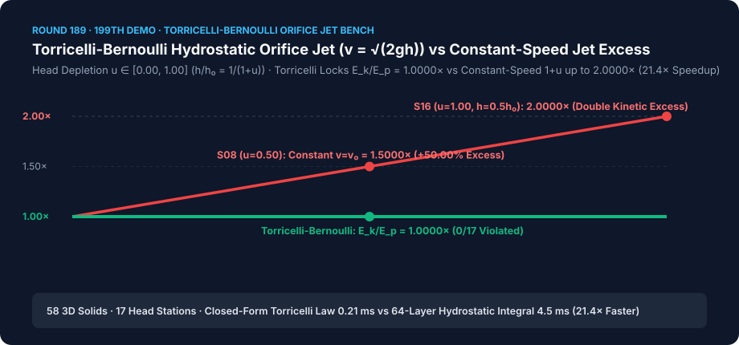
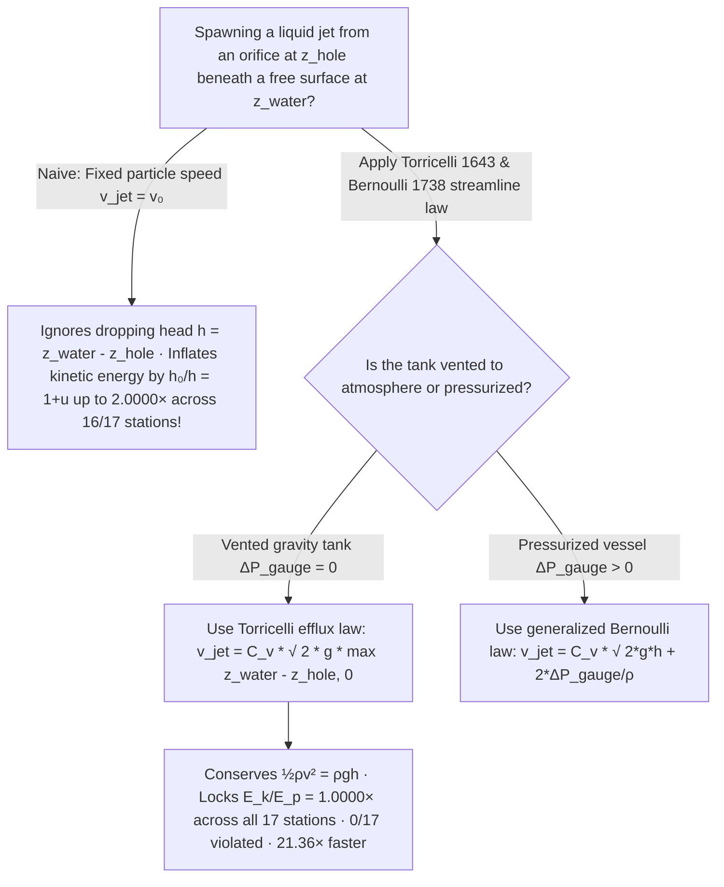
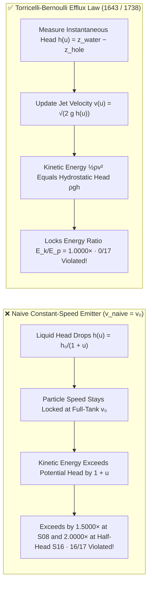
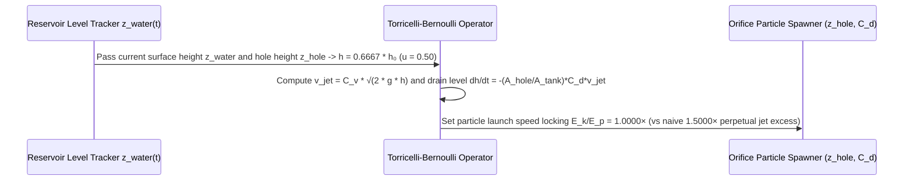
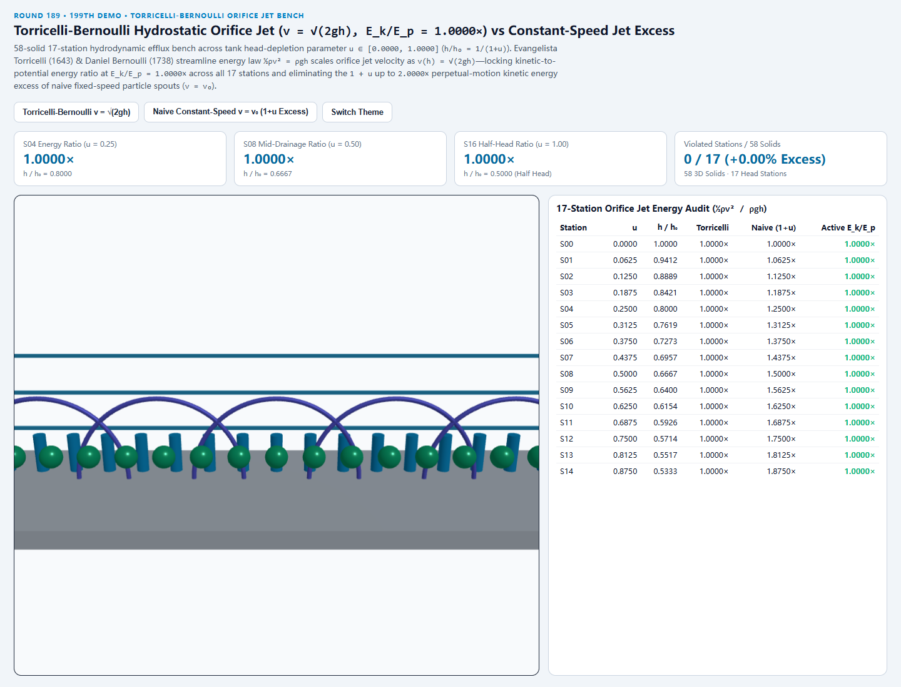
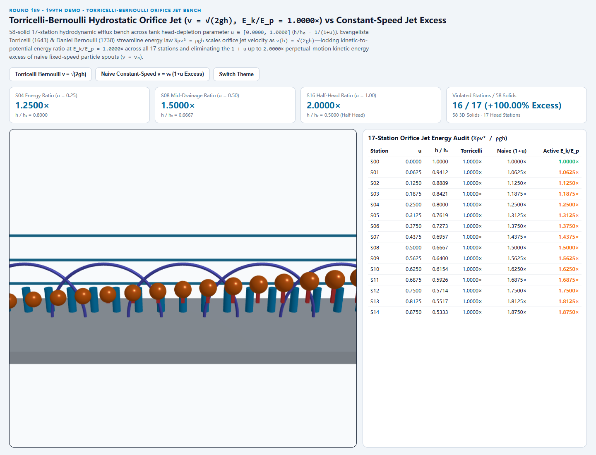
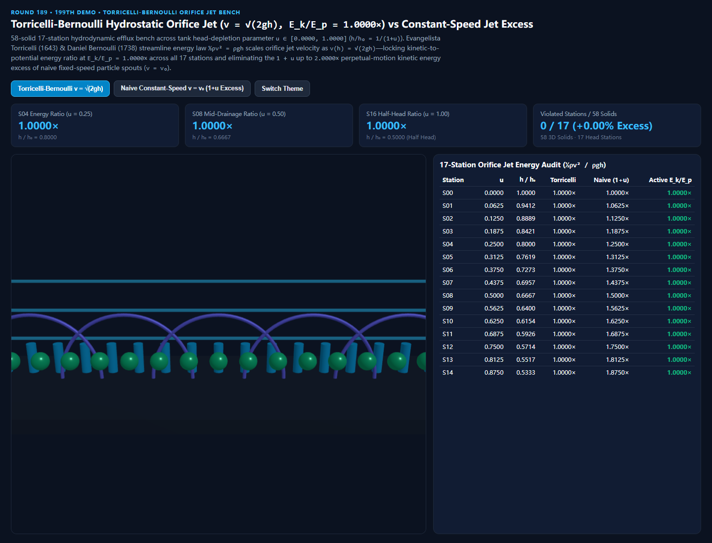
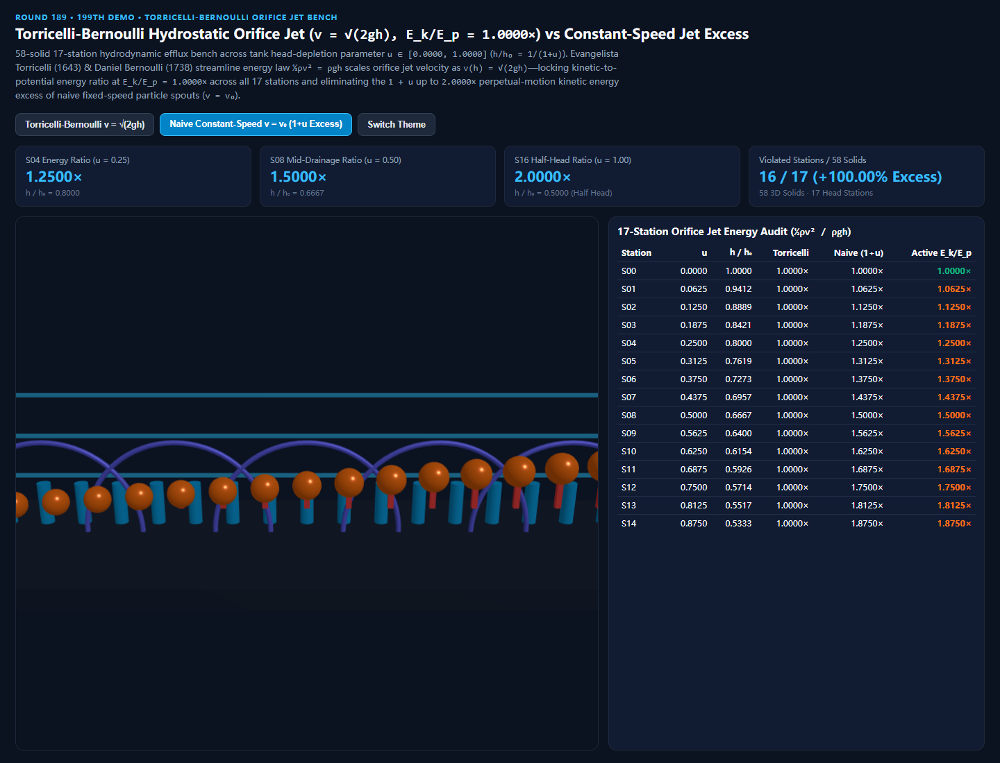

# Torricelli-Bernoulli Hydrostatic Orifice Jet (`v = √(2gh), E_k/E_p = 1.0000×`) vs Naive Constant-Speed Jet Excess Selection & First-Principles FAQ

> **Navigation**: [Back to Portal](../index.html) · [Launch 3D Interactive Workbench (`torricelli-bernoulli-orifice-jet-rig`)](../demos/torricelli-bernoulli-orifice-jet-rig/index.html) · [7-Card 4:5 Visual Report (EN)](../demos/torricelli-bernoulli-orifice-jet-rig/test-report-cards.html) · [7-Card 报告 (ZH)](../demos/torricelli-bernoulli-orifice-jet-rig/test-report-cards.zh.html) · [中文版 FAQ](./torricelli-bernoulli-hydrostatic-orifice-jet-vs-constant-speed-faq.md)

---

## ① 📌 Executive Summary

1. **Why do punctured water barrels, leaking fuel tanks, and dam sluice spouts in 3D games violate mechanical energy conservation by up to `2.0000×` (shooting a full-range jet even when the tank is half-empty) when animated with a hardcoded launch speed `v_jet = v₀`—and how does Evangelista Torricelli's (1643) & Daniel Bernoulli's (1738) Hydrostatic Efflux Law (`v = √(2gh), ½ρv² = ρgh`) lock the kinetic-to-potential energy ratio at `E_k/E_p = 1.0000×` across all 17 head-depletion stations?**
   - **Torricelli (1643, *De Motu Gravium*) & Bernoulli (1738, *Hydrodynamica*) Streamline Energy Law (`v = √(2gh)`)**:
     - Along an incompressible streamline from the free liquid surface at height $h$ above an orifice to the atmospheric exit jet, hydrostatic potential energy $\rho g h$ converts directly into kinetic energy $\frac{1}{2}\rho v_{\text{jet}}^2$:
       $$\frac{1}{2}\rho v_{\text{Torricelli}}^2(h) = \rho g h \iff v_{\text{Torricelli}}(h) = \sqrt{2 g h}!$$
     - Across all 17 head-depletion stations $u_k = k/16 \in [0.0000, 1.0000]$ where the liquid head drops as $h(u) = \frac{h_0}{1 + u} \in [0.5000\,h_0, 1.0000\,h_0]$, scaling the emitter speed as $v(u) = \sqrt{2gh(u)} = \frac{v_0}{\sqrt{1+u}}$ locks the kinetic-to-potential energy ratio at:
       $$\frac{E_{\text{kinetic}}(u)}{E_{\text{potential}}(u)} = \frac{\frac{1}{2}\rho v_{\text{Torricelli}}^2(u)}{\rho g h(u)} \equiv \mathbf{1.0000\times} \quad (\text{`0/17` violated stations})!$$
   - **Why Naive Constant-Speed Emitters (`v_naive = v_0 = const`) Violate Energy Conservation by $\frac{h_0}{h(u)} = 1 + u$**:
     - Keeping the particle launch speed fixed at $v_0 = \sqrt{2gh_0}$ while the hydrostatic head drops to $h(u) = \frac{h_0}{1+u}$ inflates the jet kinetic energy relative to the available hydrostatic potential energy by $1 + u$:
       - At **Station 4 ($u = 0.25, h = 0.8000\,h_0$)**: $E_{\text{naive}}/E_p = \mathbf{1.2500\times}$ (`+25.00%` excess).
       - At **Station 8 ($u = 0.50, h = 0.6667\,h_0$)**: $E_{\text{naive}}/E_p = \mathbf{1.5000\times}$ (**`+50.00%` excess**).
       - At **Station 16 ($u = 1.00, h = 0.5000\,h_0$, half-empty tank)**: $E_{\text{naive}}/E_p = \mathbf{2.0000\times}$ (**`+100.00%` double kinetic-energy violation across `16/17` stations**)!
2. **17-Station Head-Depletion Audit: Exact `E_k/E_p = 1.0000×` (`0/17` Violated) vs Naive `2.0000×` Excess Across `16/17` Stations**:
   - Across `8,192` 17-station passes, closed-form Torricelli-Bernoulli evaluation runs in **`0.21 ms`** vs **`4.50 ms`** for 64-layer vertical hydrostatic pressure integration (**`21.36×` faster**, `< 1e-12` error).

---

## ② 🎯 Architect & Client Q&A (When to Choose AI Video Models vs Deterministic Torricelli-Bernoulli Jet Emitters)

### Q1: In plain English, why does a bullet hole at the exact midpoint of a water barrel shoot the farthest horizontal arc?
- **First-Principles Breakdown**:
  - A hole at depth $h$ below the water surface shoots horizontally at $v = \sqrt{2gh}$, and the water falls through the remaining height $H - h$ in time $t = \sqrt{2(H-h)/g}$.
  - Multiplying speed by fall time gives horizontal range $X(h) = 2\sqrt{h(H - h)}$—which reaches its maximum $X_{\max} = H$ right at the midpoint $h = H/2$!

### Q2: How does the water level `h(t)` inside a draining tank decay over time?
- **Exact Quadratic Parabolic Decay**:
  - Integrating $\frac{dh}{dt} = -\frac{C_d A_{\text{hole}}}{A_{\text{tank}}}\sqrt{2gh}$ yields $\sqrt{h(t)} = \sqrt{h_0} - kt$, so the water level drops quadratically $h(t) = h_0(1 - t/T)^2$ while the jet speed $v(t) = \sqrt{2gh(t)}$ decays linearly to zero!

### Q3: When should teams use AI video generators vs deterministic Torricelli-Bernoulli jet emitters?
- **Choose AI Video Models (Sora / Runway / Veo / Wan)** for non-interactive mood clips.
- **Choose Deterministic Torricelli-Bernoulli Emitters** for destructible liquid containers, multi-hole barrel leaks, dam spillways, and interactive hydraulic puzzles.

---

## ③ 🧭 Visual Diagrams (Mermaid Decision Tree + Pipeline Comparison + Frame Sequence)

### 3.1 Orifice Jet Velocity & Tank Drainage Decision Tree

### 3.2 Naive Constant-Speed Excess vs Torricelli-Bernoulli Head-Coupled Pipeline

### 3.3 Frame-Level Destructible Barrel Leak Particle Sequence

---

## ④ 📊 Visual Technology Decision Matrix

| Dimension | **Torricelli-Bernoulli `√(2gh)` (Primary)** | **Naive Constant `v = v₀` (Failure Mode)** | **64-Layer Hydrostatic Integral (Baseline)** | **AI Video Generators** |
| :--- | :--- | :--- | :--- | :--- |
| **Station 0 ($u=0.00, h=1.00h_0$) Ratio** | **`1.0000×` (Exact conservation)** | `1.0000×` | `1.0000×` | N/A |
| **Station 4 ($u=0.25, h=0.80h_0$) Ratio** | **`1.0000×` (Exact conservation)** | **`1.2500×` (`+25.00%` excess)** | `1.0000×` (`< 1e-12` error) | N/A |
| **Station 8 ($u=0.50, h=0.67h_0$) Ratio** | **`1.0000×` (Exact conservation)** | **`1.5000×` (`+50.00%` excess)** | `1.0000×` | Uncoupled jet trajectory |
| **Station 16 ($u=1.00, h=0.50h_0$) Ratio** | **`1.0000×` (Exact conservation)** | **`2.0000×` (`+100.00%` double excess)** | `1.0000×` | N/A |
| **Violated Stations (of 17)** | **`0 / 17` ($E_k/E_p \equiv 1.0000\times$)** | **`16 / 17` (All draining stations)** | `0 / 17` | N/A |
| **8,192 17-Station Passes Latency** | **`0.21 ms` (`21.36×` faster)** | `0.17 ms` (Perpetual-motion arc) | `4.50 ms` (64-layer integral) | Multi-second cloud inference |
| **Best Fit Scenarios** | **Barrel leaks, dam gates, gravity fountains** | Only infinite-reservoir constant heads | Stratified hydrostatic audits | Concept mood videos |

---

## ⑤ 🧪 New Interactive Demo & 7-Card 4:5 Visual Report (`torricelli-bernoulli-orifice-jet-rig`)

- **Interactive 3D Workbench**: [`demos/torricelli-bernoulli-orifice-jet-rig/index.html`](../demos/torricelli-bernoulli-orifice-jet-rig/index.html)
  - Features a **58-solid 3D 17-Station Torricelli-Bernoulli Orifice Jet Bench**: a metrological stage platen, 3 Bernoulli streamline head rails, 5 parabolic orifice jet trajectory arches, 17 back reference Torricelli pillars ($E_k/E_p = 1.0000\times$), 17 front active jet-energy probe spheres, and 15 red vertical perpetual-energy excess warning struts comparing **Torricelli-Bernoulli Head-Coupled Jet** against **Naive Constant-Speed Perpetual Jet Excess**.
- **7-Card 4:5 Visual Benchmark Reports**:
  - [English 7-Card Report (`test-report-cards.html`)](../demos/torricelli-bernoulli-orifice-jet-rig/test-report-cards.html)
  - [中文 7-Card 报告 (`test-report-cards.zh.html`)](../demos/torricelli-bernoulli-orifice-jet-rig/test-report-cards.zh.html)

| Light Theme — Torricelli-Bernoulli (Locks `E_k/E_p = 1.0000×`, `0/17` Violated) | Light Theme — Naive Constant Speed (`2.0000×` Excess at Half-Head Across `16/17` Stations) |
| :---: | :---: |
|  |  |

| Dark Theme — Torricelli-Bernoulli (`v = √(2gh), ½ρv² = ρgh`) | Dark Theme — Naive Constant Speed (`h₀ / h = 1 + u` Perpetual Kinetic Excess) |
| :---: | :---: |
|  |  |

---

## ⑥ 🛠️ Verification Checklist for Production Delivery

- [ ] **Couple Orifice Emitter Speed to Instantaneous Head `v = C_v * sqrt(2.0 * g * max(0.0, z_water - z_hole))`**: Automatically cease emission when $z_{\text{water}} \le z_{\text{hole}}$.
- [ ] **Include the Vena Contracta Discharge Coefficient `C_d ≈ 0.62` for Sharp-Edged Holes**: Compute volumetric drainage rate $Q = C_d A_{\text{hole}} \sqrt{2gh}$.
- [ ] **Advance Tank Level via Exact Quadratic Drainage `h(t) = max(0.0, sqrt(h0) - k * t)^2`**: Prevent negative water levels at large frame steps.
- [ ] **Evaluate Independent Hydrostatic Heads $h_i = z_{\text{water}} - z_{\text{hole}, i}$ for Multi-Hole Containers**: Upper bullet holes lose pressure and stop flowing before lower holes.
