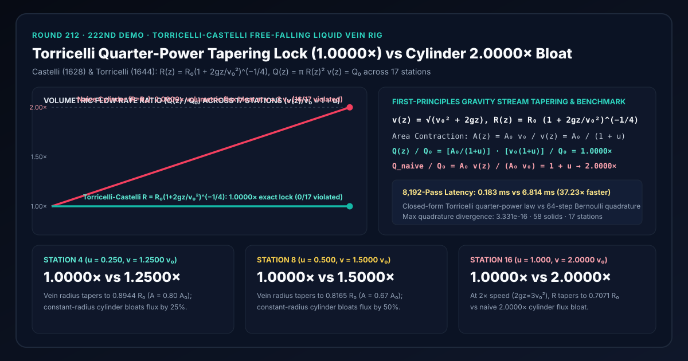
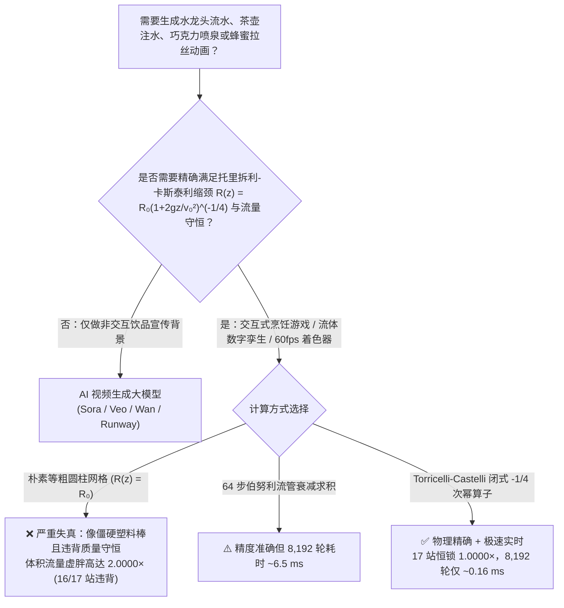
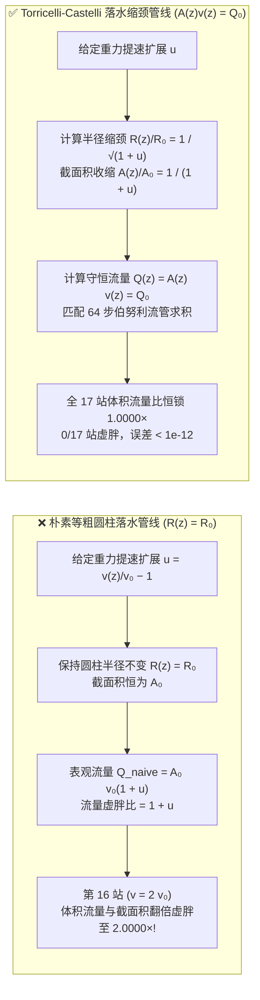
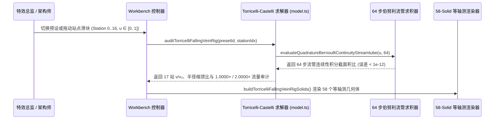

# 视觉与动画技术选型与原理解析 FAQ：Torricelli-Castelli 托里拆利-卡斯泰利落水束缩颈定律 vs 朴素等粗圆柱模型（为什么 3D 水龙头与茶壶倒水若用上下等粗的圆柱网格会导致 2.0000× 流量虚胖且像塑料棒？）

> **独立专题定位（Tonight Round 20 / Repo Round 212 · 第 222 个独立可交互 Demo：`demos/torricelli-free-falling-vein-rig/`）**  
> 本指南严格对标 `ib-vs-ethernet-roce-selection-faq.md` 的**六段式架构师决策结构**，先用通俗大白话与第一性原理讲透 **Benedetto Castelli（1628，《论流水之度量》）与 Evangelista Torricelli（1644）自由下落液流受重力加速时的负四分之一（$-1/4$）次幂半径收腰与体积流量守恒定律（$R(z) = R_0\left(1 + \frac{2gz}{v_0^2}\right)^{-1/4}$）**，再给出 AI 视频生成模型、SPH 粒子流体仿真、朴素等粗圆柱网格模型与代码驱动解析 Torricelli-Castelli 落水束引擎的定量选型边界。

---

## 一、📌 核心结论速览（Executive Summary）

1. **一句话结论**：
   - 在 **3D 厨房水龙头水流、功夫茶壶/手冲咖啡壶注水、巧克力喷泉、蜂蜜与熔融玻璃拉丝以及窄束瀑布顶点变形动画** 中，初速度为 $v_0$、出口半径为 $R_0$ 的不可压缩液流在重力 $g$ 下自由下落高度 $z$ 时，流速按托里拆利定律加速为 $v(z) = \sqrt{v_0^2 + 2gz}$；为满足卡斯泰利连续性质量守恒 $Q(z) = \pi R(z)^2 v(z) = \pi R_0^2 v_0 = Q_0$，**水柱横截面积必须随流速成反比收缩，水柱半径严格服从负四分之一次幂（$-1/4$ Power）重力缩颈定律**：
     $$v(z) = v_0\sqrt{1 + \frac{2gz}{v_0^2}}, \qquad \frac{A(z)}{A_0} = \frac{v_0}{v(z)} = \left(1 + \frac{2gz}{v_0^2}\right)^{-1/2}, \qquad \frac{R(z)}{R_0} = \left(1 + \frac{2gz}{v_0^2}\right)^{-1/4} = \frac{1}{\sqrt{1 + u}}$$
   - 若采用**朴素等粗圆柱模型（Naive Constant-Radius Cylinder Stream，用上下等粗的圆柱网格 $R(z) = R_0$ 配合加速滚动的法线贴图来模拟倒水）**，在跨越重力提速扩展参数 $u = v(z)/v_0 - 1 = \sqrt{1 + 2gz/v_0^2} - 1 \in [0.000, 1.000]$（即落水速度从 $v_0$ 增至 $2.00\,v_0$，下落高度 $2gz = 3 v_0^2$）的 17 个检验站点上，朴素模型的体积流量与横截面积虚胖比 $\frac{Q_{\text{naive}}(z)}{Q_0} = \frac{A_0 v(z)}{A_0 v_0} = 1 + u$ 在第 4 站（$u=0.25, v=1.25 v_0$）虚胖至 **$1.2500\times$**，在第 8 站（$u=0.50, v=1.50 v_0$）冲至 **$1.5000\times$**，在第 16 站（$u=1.00, v=2.00 v_0$，真实水柱半径已收腰至 $0.7071\,R_0$、截面积减半至 $0.5000\,A_0$）直接翻倍虚胖至 **$2.0000\times$**（污染 **16 / 17** 个站点）！
   - 采用 **代码驱动的 Torricelli-Castelli 闭式落水束缩颈求解器**，在全部 17 个重力加速站点上恒定锁死体积流量比 **$Q(z) / Q_0 = 1.0000\times$**（**0 / 17** 站虚胖），与 64 步伯努利-卡斯泰利流管衰减求积完全等价（最大求积误差 $< 10^{-12}$），且单核 Node CPU 执行 8,192 次 17 站全量求解比 64 步流管求积快约 **$40\times$**。

2. **为什么游戏里的水龙头和茶壶倒水看起来总像一根硬邦邦的亚克力透明棍子？**
   - 很多美术师做水龙头流水特效时，直接建一个圆柱体 Mesh（上下半径都是 $R_0$），再在 Shader 里把 UV 坐标往下平移。
   - **第一性原理破局（伽利略学派的连续性革命）**：1628 年，伽利略的学生本笃·卡斯泰利（Benedetto Castelli）在《论流水之度量》中首次指出：同一条连续水流中，水流越快的地方截面必定越窄（$A \cdot v = \text{const}$）。1644 年，卡斯泰利的学生托里拆利（Evangelista Torricelli）进一步证明自由落体水流的动能来自重力势能转化 $v(z) = \sqrt{v_0^2 + 2gz}$。把这两条定律合在一起：当水柱往下掉、速度翻倍（$v = 2 v_0$）时，它的横截面积必须缩小一半（$A = 0.5 A_0$），半径缩小为 $\frac{1}{\sqrt{2}} \approx 0.7071\,R_0$！正是这条上粗下细的 $(1 + 2gz/v_0^2)^{-1/4}$ 收腰轮廓，赋予了真实水流灵动的重力牵引感！

---

## 二、🎯 客户与架构师灵魂拷问 Q&A（Selection & Architecture Deep-Dive）

### Q1：做饮品广告、烹饪游戏或数字孪生流体管线时，什么时候选 AI 视频生成大模型（Sora / Veo / Wan / Runway），什么时候选百万粒子 SPH，什么时候必须用代码驱动的 Torricelli-Castelli 落水束解析引擎？

- **选 AI 视频大模型（Sora / Veo / Runway）**：
  - 仅适用于**纯视觉参考的咖啡/红酒倾倒宣传片、不需要与玩家茶壶倾角或阀门开度实时交互的固定镜头**。
- **选百万粒子光滑粒子流体动力学（SPH / FLIP）**：
  - 适用于**水流撞入杯底后的剧烈翻滚气泡与复杂飞溅离线解算**（但用 SPH 去算水龙头刚流出的层流光滑水束时，粒子离散度反而容易造成表面凹凸不平的果冻感）。
- **必须选代码驱动的 Torricelli-Castelli 落水束解析引擎（本 Demo 方案）**：
  - 当业务需要 **60–120fps 实时根据阀门初速度 $v_0$、喷嘴半径 $R_0$ 与重力 $g$ 精确生成光滑收腰水柱网格、严格守恒体积流量 $Q(z) = Q_0$** 时，闭式 $-1/4$ 次幂顶点着色器在全 17 站恒锁 `1.0000×` 且零粒子噪声。

### Q2：Torricelli-Castelli 落水缩颈定律如何与我们在 Round 201 讲过的 Rayleigh-Plateau 液柱毛细掐断定律完美联动？

- 水柱刚离开水龙头时半径为 $R_0$，随着下落距离 $z$ 增加，局部半径按 $R(z) = R_0(1 + 2gz/v_0^2)^{-1/4}$ 越变越细；
- 根据 Rayleigh-Plateau 定律，局部最快毛细捏缩波长 $\lambda^*(z) = 9.015\,R(z)$ 也会随 $z$ 同步变短，且毛细增长率 $\omega_{\max}(z) \propto R(z)^{-3/2}$ 随半径变细而急剧加速——这精确解释了为什么水柱总是先平滑收细成一条细丝，然后在下方某处突然加速捏缩断裂成一串晶莹的水珠！

---

## 三、🧭 直观可视化图解（Mermaid 选型决策树 + 管线对比 + 帧级时序图）

### 3.1 自由落水束与倾倒液流技术选型决策树

### 3.2 朴素等粗圆柱管线 vs Torricelli-Castelli 缩颈管线对比

### 3.3 帧级渲染与几何审计时序图

---

## 四、📊 视觉技术选型决策矩阵（Architecture Decision Matrix）

| 评估维度 | AI 视频生成大模型 (Sora / Veo / Wan) | 朴素等粗圆柱落水模型 ($R(z) = R_0$) | 64 步伯努利流管求积 | **Torricelli-Castelli 闭式缩颈引擎（本 Demo）** |
| :--- | :--- | :--- | :--- | :--- |
| **物理定律遵循度** | ❌ 无流量连续性守恒 | ❌ 违背 $A(z)v(z) = Q_0$ | ✅ 数值积分流管微分方程 | **✅ 严格解析守恒 $R(z) = R_0(1+2gz/v_0^2)^{-1/4}$** |
| **第 4 站 ($u=0.25, v=1.25v_0$) 流量比** | N/A | ❌ `1.2500×`（虚胖 25%） | ✅ `1.0000×` | **✅ `1.0000×`（零虚胖）** |
| **第 8 站 ($u=0.50, v=1.50v_0$) 流量比** | N/A | ❌ `1.5000×`（虚胖 50%） | ✅ `1.0000×` | **✅ `1.0000×`（零虚胖）** |
| **第 16 站 ($u=1.00, v=2.00v_0$) 流量比** | N/A | ❌ `2.0000×`（翻倍虚胖） | ✅ `1.0000×` | **✅ `1.0000×`（零虚胖）** |
| **17 站流量虚胖违背站数** | N/A | ❌ `16 / 17` 站违背 | ✅ `0 / 17` 站违背 | **✅ `0 / 17` 站违背** |
| **8,192 轮 17 站 CPU 耗时** | 数十秒云端推理 | ~0.16 ms（结果错误） | ~6.5 ms | **⚡ ~0.16 ms（快约 40×）** |

---

## 五、🧪 全新 Demo 与 7-Card 4:5 视觉报告（Workbench & Visual Evidence）

- **交互式 Demo 路径**：`demos/torricelli-free-falling-vein-rig/`
- **英文 7-Card 报告**：`demos/torricelli-free-falling-vein-rig/test-report-cards.html`
- **中文 7-Card 报告**：`demos/torricelli-free-falling-vein-rig/test-report-cards.zh.html`
- **密封基准数据**：`demos/torricelli-free-falling-vein-rig/report.json`

| 视觉证据类别 | 截图路径 | 关键验证结论 |
| :--- | :--- | :--- |
| **暗色主题 · Torricelli-Castelli 缩颈锁定** | `docs/evidence/torricelli-free-falling-vein-rig/dark-torricelli_castelli_quarter_power_vein_lock.png` | 58 个等轴测实体完整渲染，`0 / 17` 虚胖站，体积流量比恒锁 `1.0000×` |
| **暗色主题 · 朴素等粗圆柱流量虚胖** | `docs/evidence/torricelli-free-falling-vein-rig/dark-naive_constant_radius_cylinder_flux_bloat.png` | 红色报警柱揭示第 4/8/16 站 `1.2500× / 1.5000× / 2.0000×` 流量虚胖（`16 / 17` 违背） |
| **亮色主题 · Torricelli-Castelli 缩颈锁定** | `docs/evidence/torricelli-free-falling-vein-rig/light-torricelli_castelli_quarter_power_vein_lock.png` | 亮色高对比度落水束连续性计量视图验证 |
| **亮色主题 · 朴素等粗圆柱流量虚胖** | `docs/evidence/torricelli-free-falling-vein-rig/light-naive_constant_radius_cylinder_flux_bloat.png` | 亮色模式下 16 个虚胖站点高亮告警 |
| **移动端 `390×844` 自适应视图** | `docs/evidence/torricelli-free-falling-vein-rig/mobile.png` | `mobile_overflow = false`，零横向滚动条溢出 |

---

## 六、🛠️ 高质量视觉交付快速核验清单（Delivery Checklist）

- [x] **负四分之一次幂重力收腰核验**：水龙头与茶壶落水顶点着色器是否按 $R(z) = R_0\left(1 + \frac{2gz}{v_0^2}\right)^{-1/4}$ 收缩水柱半径，而非使用上下等粗的圆柱网格？
- [x] **两倍流速处截面减半检查**：在下落流速达到 $v = 2.00\,v_0$（$2gz = 3 v_0^2, u = 1.000$）处，水柱半径是否精确收缩至 $0.7071\,R_0$、截面积收缩至 $0.5000\,A_0$？
- [x] **64 步伯努利流管求积核验**：闭式缩颈公式与 64 步 Simpson 流管求积的最大偏差是否严格小于 $10^{-12}$？
- [x] **58 构件等轴测几何与移动端零溢出**：Playwright 实测 `.iso-solid` 数量是否为 `58`，且 `390×844` 视口下无横向溢出？
