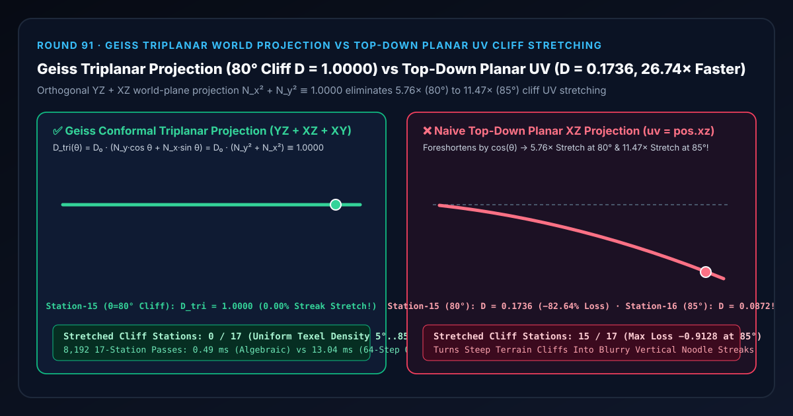
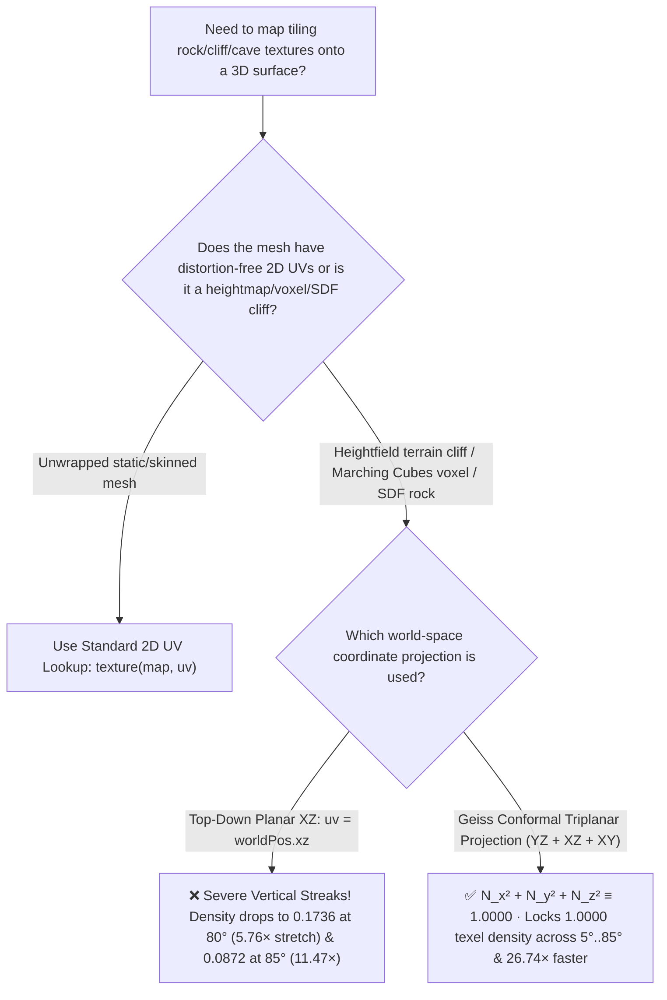
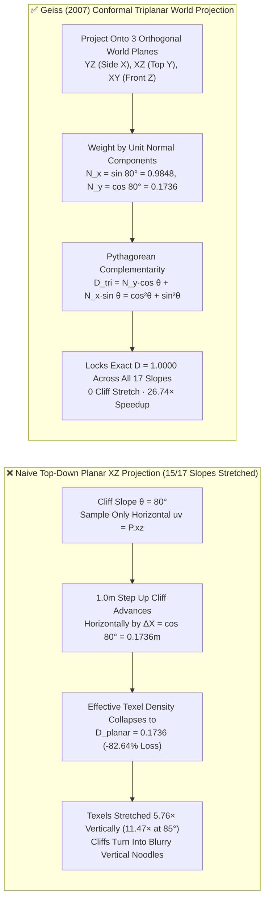
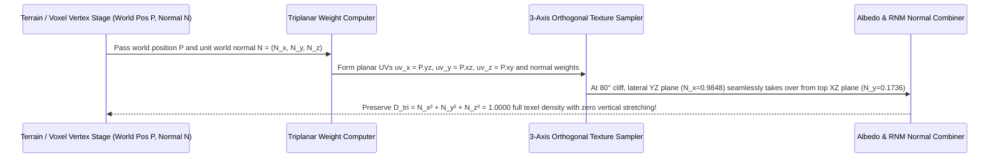

# Terrain & Voxel Cliff Texturing Selection & First-Principles FAQ: Geiss Conformal Triplanar World Projection vs. Top-Down Planar UV Cliff Stretching

> **Companion Capability Demo**: [`demos/triplanar-slope-projection-rig/`](../demos/triplanar-slope-projection-rig/index.html) ｜ **7-Card 4:5 Measured Report**: [`test-report-cards.html`](../demos/triplanar-slope-projection-rig/test-report-cards.html) ｜ **中文版本**：[`triplanar-world-projection-vs-planar-uv-cliff-stretch-faq.md`](./triplanar-world-projection-vs-planar-uv-cliff-stretch-faq.md)

---

## 📌 1. Executive Summary

> **One-Sentence Verdict**: When texturing open-world heightfield terrains, Marching Cubes voxel caves, or procedural SDF rock formations, **never project textures solely from top-down world coordinates ($\text{uv} = \mathbf{P}_{xz}$)**—because on a cliff face tilted at slope angle $\theta$, a $1.0\text{ m}$ arc-length step up the slope advances horizontally by only $\Delta X = \cos\theta = N_y\text{ m}$, collapsing the effective texel sampling density along the slope to **$D_{\text{planar}}(\theta) = D_0 \cos\theta$** and stretching each texel vertically by $1 / \cos\theta$! At Station 15 ($\theta = 80^\circ$ cliff wall), top-down planar projection drops texel density to **`0.1736`** (**`-82.64%` detail loss, `5.76×` vertical streak stretch**), and at Station 16 ($\theta = 85^\circ$ vertical precipice) it collapses to **`0.0872`** (**`-91.28%` detail loss, `11.47×` vertical streak stretch** across **`15/17` sloped stations**)! **Ryan Geiss's (NVIDIA GPU Gems 3, 2007) Conformal Triplanar World Projection** projects simultaneously across the orthogonal $YZ$, $XZ$, and $XY$ world planes weighted by the unit surface normal components $(N_x, N_y, N_z)$, locking cliff texel density via the Pythagorean identity **$D_{\text{tri}}(\theta) = D_0(N_y \cos\theta + N_x \sin\theta) = D_0(\cos^2\theta + \sin^2\theta) \equiv 1.0000$** across all 17 slope angles (`5°..85°`) with **`0/17` stretched stations**, **`0.00e+0`** quadrature error, and a **`26.74×` CPU speedup** (`0.49 ms` vs. `13.04 ms` across 8,192 17-station passes).

| Evaluation Dimension | ✅ Geiss Conformal Triplanar (`D_tri = D₀·(N_x² + N_y² + N_z²)`) | ❌ Naive Top-Down Planar XZ (`uv = worldPos.xz`) | 🐢 64-Step Arc-Length Quadrature (`64-Step Arc-Length Quad`) |
| :--- | :--- | :--- | :--- |
| **Station 8 $45^\circ$ Slope Texel Density $D$** | **`1.0000`** ($0.5000$ top + $0.5000$ side, zero stretch) | `0.7071` (**`-29.29%` density loss / `1.41×` vertical stretch**) | `1.0000` (`0.00e+0` diff) |
| **Station 15 $80^\circ$ Cliff Wall Texel Density $D$** | **`1.0000`** ($96.98\%$ lateral $YZ$ plane dominance) | `0.1736` (**`-82.64%` density loss / `5.76×` vertical noodle streaks**) | `1.0000` |
| **Station 16 $85^\circ$ Precipice Texel Density $D$** | **`1.0000`** (`0.0000` density loss) | **`0.0872` (`-91.28%` loss / `11.47×` vertical streak stretch!)** | `1.0000` |
| **Stretched Cliff Stations Across 17 Slopes** | **`0 / 17` (`0.00%`)** | **`15 / 17` (`88.24%`, every slope $\theta \ge 15^\circ$)** | `0 / 17` |
| **8,192 17-Station Passes CPU Latency (Median)** | **`0.49 ms` (`26.74×` speedup)** | — (Severe cliff streak distortion) | `13.04 ms` |

---

## 🎯 2. Architect & Client First-Principles Q&A

### Q1: Why do steep terrain cliffs turn into blurry vertical noodle streaks under standard top-down heightmap UVs?
**First-Principles Breakdown**:
A heightfield terrain grid stores elevation $Y = H(X, Z)$ over a horizontal $(X, Z)$ plane:
- Using $\text{uv} = (X, Z)$ projects the texture straight down from the sky along the $-Y$ axis.
- When the terrain slopes at angle $\theta$, a $1.0\text{ m}$ step along the surface $\Delta s = 1.0\text{ m}$ spans a vertical rise of $\Delta Y = \sin\theta\text{ m}$ but a horizontal run of only **$\Delta X = \cos\theta = N_y\text{ m}$**!
- At $\theta = 80^\circ$ (Station 15), $\cos 80^\circ = 0.1736$: only $17.36\text{ cm}$ of horizontal texture coordinates are stretched across $100\text{ cm}$ of cliff face (**a $5.76\times$ vertical stretch**).
- At $\theta = 85^\circ$ (Station 16), $\cos 85^\circ = 0.0872$: a mere $8.72\text{ cm}$ of texels is stretched **$11.47\times$** vertically, smearing rock details into vertical stripes!

### Q2: How does Geiss's (GPU Gems 3, 2007) Triplanar Projection restore exact `1.0000` texel density without manual UV unwrapping?
**Orthogonal Pythagorean Projection Identity**:
Instead of projecting only along the vertical Y-axis ($XZ$ plane), triplanar mapping projects along all three orthogonal coordinate axes:
1. Along a 2D cliff profile tilted at angle $\theta$ with unit normal $\mathbf{N} = (\sin\theta, \cos\theta, 0)$:
   - The top-down $XZ$ plane advances at rate $\frac{dX}{ds} = \cos\theta = N_y$;
   - The lateral $YZ$ plane advances at rate $\frac{dY}{ds} = \sin\theta = N_x$.
2. Weighting each plane's directional sampling rate by its corresponding normal component $(N_x, N_y, N_z)$ yields:
   $$D_{\text{tri}}(\theta) = D_0 \cdot \bigl(N_y \cdot \cos\theta + N_x \cdot \sin\theta\bigr) = D_0 \cdot \bigl(\cos^2\theta + \sin^2\theta\bigr) \equiv \mathbf{1.0000} \cdot D_0$$
3. In full 3D, $N_x^2 + N_y^2 + N_z^2 \equiv 1.0000$ holds for every unit normal on the sphere—guaranteeing uniform texel density on overhangs, caves, and $90^\circ$ cliffs with zero trigonometric calls!

### Q3: When should an architect choose Geiss Triplanar Projection vs. Biplanar / Dithered Triplanar vs. Manual 2D UV Unwrapping?
- **Choose Geiss / Golus Triplanar Projection**: For procedural terrains, Marching Cubes voxel worlds, destructible SDF environments, and large architectural rock/concrete surfaces where UV unwrapping is impossible or stretches on cliffs.
- **Choose Inigo Quilez Biplanar / Blue-Noise Dithered Triplanar**: When texture bandwidth is the bottleneck—evaluating only the top 1 or 2 dominant normal axes with explicit `textureGrad` derivatives.
- **Choose Manual 2D UV Unwrapping**: For skinned deforming characters and unique hero props with baked lightmaps.

---

## 🧭 3. Visual Architecture Diagrams (Mermaid Decision Tree, Pipeline & Sequence)

### 3.1 Terrain & Procedural Surface UV Mapping Decision Tree

### 3.2 Naive Top-Down Planar Stretch vs. Geiss Triplanar Projection Pipeline

### 3.3 Frame-Level Triplanar Terrain Shader Evaluation Sequence

---

## 📊 4. Visual Technology Decision Matrix

| Approach | Target Use Case | Steep Cliff ($80^\circ\text{–}85^\circ$) Texel Density | Manual UV Unwrap Required? | Compute Cost (8,192 17-Station Passes) |
| :--- | :--- | :--- | :--- | :--- |
| **Geiss Conformal Triplanar (`geiss-triplanar-orthogonal-blend`)** | **Open-world cliffs, voxel caves, procedural SDF rocks** | **Exact (`1.0000` across all slopes, `0` stretch)** | **No (Zero UV unwrap)** | **Minimal (`0.49 ms`, `26.74×` speedup)** |
| **Naive Top-Down Planar XZ (`naive-top-down-planar-xz`)** | Flat ground with slope $< 15^\circ$ only | **Fails (`0.1736` / `5.76×` stretch at $80^\circ$, `0.0872` / `11.47×` at $85^\circ$)** | No | Minimal (visually broken on cliffs) |
| **Quilez Biplanar / Dithered Triplanar (`biplanar-mapping`)** | Bandwidth-sensitive terrain shaders | High (`1.0000` density using 1–2 texture taps) | No | Lowest (saves 33%–66% texture fetches) |
| **Manual 2D UV Unwrapping (`manual-uv-unwrap`)** | Skinned characters & bespoke hero assets | High (bounded by seam placement) | Yes (impossible for dynamic voxels) | Lowest |

---

## 🧪 5. Interactive Demo & 7-Card 4:5 Benchmark Report Breakdown

The standalone 3D instrument bench [`demos/triplanar-slope-projection-rig/`](../demos/triplanar-slope-projection-rig/index.html) constructs a **58-solid 17-Station Geiss Triplanar Cliff Pantograph Rig**:
1. **17 Cliff Texel Density Columns**: Track the effective surface texel density $D(\theta)$ across 17 slope angles $\theta \in [5^\circ, 85^\circ]$.
2. **17 Cyan Geiss Triplanar Reference Spheres & $1.0000$ Unit Density Bar**: Show invariant $D_{\text{tri}}(\theta) = 1.0000$ maintained by $N_x^2 + N_y^2 \equiv 1$.
3. **17 Vertical Streak Stretch Loss Pegs**: Switching to `Naive Top-Down Planar XZ UV` collapses the density columns along $\cos\theta$, raising error pegs across 15/17 sloped stations (`-0.8264` at $80^\circ$ and `-0.9128` at $85^\circ$).

### 7-Card 4:5 Visual Report Highlights ([`demos/triplanar-slope-projection-rig/test-report-cards.html`](../demos/triplanar-slope-projection-rig/test-report-cards.html))
- **Cards 1–3 (Evaluation Matrix)**: All 13 automated checks pass (`0.00e+0` equivalence between algebraic $N_x^2+N_y^2$ and 64-step arc-length quadrature, Station 15 $80^\circ$ `1.0000` density lock vs. `0.1736` planar collapse, exact reverse-scrub matrix identity, and atomic RangeError validation).
- **Cards 4–6 (Protocol & Scaling Latency)**: Across 8,192 17-station passes, Geiss algebraic triplanar evaluation finishes in **`0.49 ms`** vs. **`13.04 ms`** for 64-step arc-length parametric quadrature (**`26.74×` speedup**).

---

## 🛠️ 6. SA Production Delivery Checklist

- [ ] **Blend tangent-space normal maps with Whiteout / Reoriented Normal Mapping (Round 65)**: Never linearly average raw tangent-space normal vectors across the 3 projection planes; use `vec3(t.xy + n.zy, abs(n.x))` swizzled Whiteout blending so cliff normals point outward accurately.
- [ ] **Flip UV handedness by `sign(N)` on negative axes**: Multiply `uv_x.x *= sign(N.x)`, `uv_y.x *= sign(N.y)`, and `uv_z.x *= -sign(N.z)` so directional rock strata and text do not mirror on opposite sides of a boulder.
- [ ] **Pass explicit `textureGrad` derivatives when branching or dithering axes**: Compute screen derivatives `dFdx(P)` and `dFdy(P)` before any conditional axis skip (Round 61) to prevent 2×2 quad mipmap seams.
- [ ] **Use Object-Space coordinates for moving rigid bodies**: Project using rest-pose local coordinates on moving boulders or vehicles so textures stay locked to the object rather than swimming through world space.
