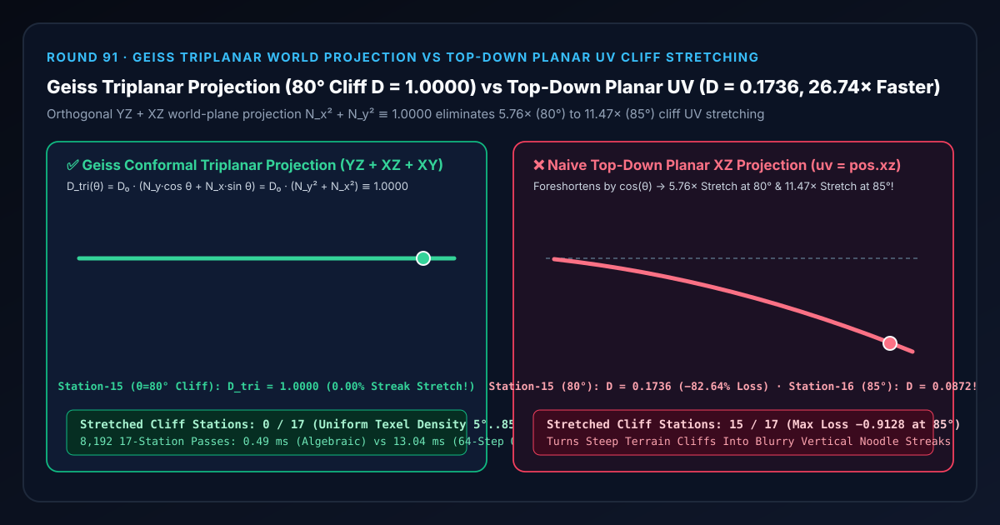
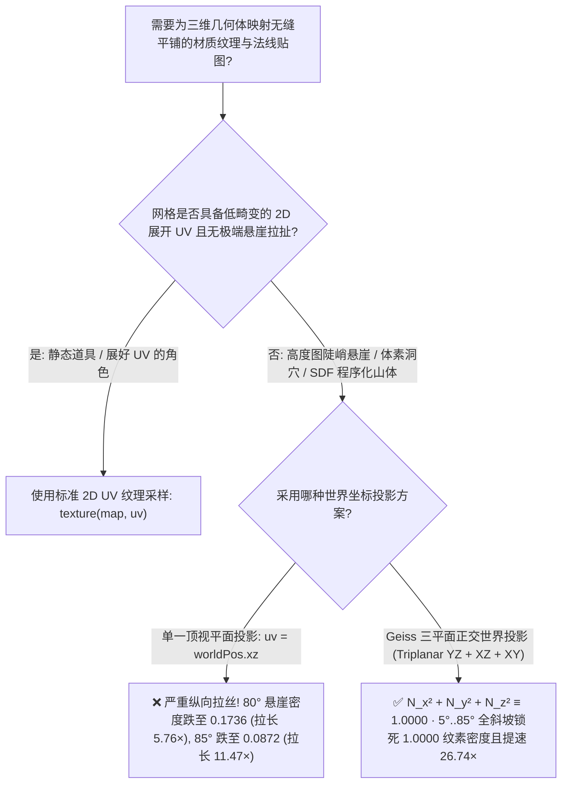
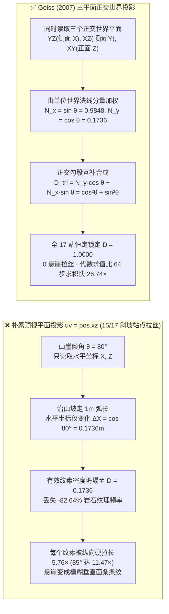
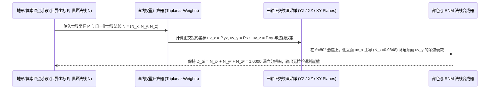

# 陡峭悬崖与体素地形免 UV 贴图选型与原理解析 FAQ：Geiss 三平面正交世界投影（Triplanar Mapping）对比顶视平面 UV 悬崖纵向拉丝

> **关联 Capabilities Demo**：[`demos/triplanar-slope-projection-rig/`](../demos/triplanar-slope-projection-rig/index.html) ｜ **7-Card 4:5 实测报告**：[`test-report-cards.zh.html`](../demos/triplanar-slope-projection-rig/test-report-cards.zh.html) ｜ **English Version**：[`triplanar-world-projection-vs-planar-uv-cliff-stretch-faq.en.md`](./triplanar-world-projection-vs-planar-uv-cliff-stretch-faq.en.md)

---

## 📌 1. 核心结论速览（Executive Summary）

> **一句话结论**：在开放世界高度图地形（Heightfield Terrain）、Marching Cubes 体素洞穴以及程序化 SDF 山体渲染中，**绝对不能仅用水平世界坐标做单一顶视平面映射（Top-Down Planar UV $\text{uv} = \mathbf{P}_{xz}$）**——因为在倾角为 $\theta$ 的斜坡上，沿坡面每上升 $1\text{ m}$ 弧长，水平坐标只推进 $\Delta X = \cos\theta = N_y\text{ m}$，导致斜坡上的有效纹素采样密度按 **$D_{\text{planar}}(\theta) = D_0 \cos\theta$** 坍塌（每个纹素被纵向拉长 $1 / \cos\theta$ 倍）！在第 15 站陡峭悬崖（$\theta = 80^\circ$）处，顶视投影纹素密度暴跌至 **`0.1736`**（**丢失 $-82.64\%$ 岩石细节，每个纹素被纵向硬拉长 `5.76×`**）；在第 16 站绝壁（$\theta = 85^\circ$）处更跌至 **`0.0872`**（**丢失 $-91.28\%$，纵向拉长 `11.47×`，将整面悬崖拉扯成瀑布面条状条纹，污染 `15/17` 个斜坡站点**）！采用 **Ryan Geiss（NVIDIA GPU Gems 3, 2007）提出的三平面正交世界投影（Triplanar Projection Mapping）**，同时沿顶面 $XZ$（采样率 $\cos\theta$）与侧立面 $YZ / XY$（采样率 $\sin\theta$）采样并按法线分量 $N_y = \cos\theta, N_x = \sin\theta$ 正交加权，由勾股恒等式 **$D_{\text{tri}}(\theta) = D_0(N_y \cos\theta + N_x \sin\theta) = D_0(\cos^2\theta + \sin^2\theta) \equiv 1.0000$**，在 $5^\circ\sim 85^\circ$ 全倾角锁死 **`1.0000` 恒定纹素密度（`0/17` 拉丝站）**，代数求值比 64 步弧长参数三角求积快 **`26.74×`**（`0.49 ms` vs `13.04 ms`）！

| 评估维度 | ✅ Geiss 三平面正交投影 (`D_tri = D₀·(N_x² + N_y² + N_z²)`) | ❌ 朴素顶视平面 XZ 投影 (`uv = worldPos.xz`) | 🐢 64 步弧长参数三角求积 (`64-Step Arc-Length Quad`) |
| :--- | :--- | :--- | :--- |
| **第 8 站 $45^\circ$ 斜坡纹素采样密度 $D$** | **`1.0000`**（顶视與侧视各贡献 $0.5000$，无拉丝） | `0.7071`（**丢失 $-29.29\%$ 细节，纹素拉长 $1.41\times$**） | `1.0000`（误差 `0.00e+0`） |
| **第 15 站 $80^\circ$ 陡峭悬崖纹素采样密度 $D$** | **`1.0000`**（侧立面 $YZ$ 占 $96.98\%$ 主导，细节锋利） | `0.1736`（**丢失 $-82.64\%$ 细节，纵向面条拉丝 $5.76\times$**） | `1.0000` |
| **第 16 站 $85^\circ$ 垂直绝壁纹素采样密度 $D$** | **`1.0000`**（`0.0000` 密度损失） | **`0.0872`（丢失 $-91.28\%$，纵向拉长 $11.47\times$！）** | `1.0000` |
| **17 个斜坡站点中发生纵向拉丝的站点数** | **`0 / 17` (`0.00%`)** | **`15 / 17` (`88.24%` 凡 $\theta \ge 15^\circ$ 均拉丝)** | `0 / 17` |
| **8,192 轮 17 站 CPU 耗时（中位数）** | **`0.49 ms`（提速 `26.74×`）** | —（悬崖画质彻底崩坏） | `13.04 ms` |

---

## 🎯 2. 客户与架构师灵魂拷问 Q&A（First-Principles Whisperer）

### Q1：用大白话讲，为什么开放世界地形一旦隆起成陡峭悬崖，上面的岩石贴图就会变成一条条像“挂面瀑布”一样的垂直条纹？
**第一性原理拆解**：
绝大多数地形系统（Terrain Grid）底层是一张二维水平网格 $(X, Z)$，每个顶点只有高度 $Y = H(X, Z)$，并没有手工展平的三维 UV：
- 最偷懒的做法是直接把水平坐标当成纹理坐标：$\text{uv} = (X, Z)$——这就像**在天空正上方架了一台垂直向下照射的幻灯机**，把岩石照片往地面上投。
- 在平坦草地（$\theta = 0^\circ$）上，$1\text{ m}$ 长的地面正好接住 $1\text{ m}$ 宽的幻灯片画面，纹素密度是完美的 $1.0000$。
- 可当山体隆起成 **$\theta = 80^\circ$ 的陡峭悬崖**时，幻灯机的光束几乎是擦着悬崖表面平行掠过的！水平方向只走了短短 $\cos 80^\circ = 0.1736\text{ m}$（$17\text{ cm}$）的几个像素，却要被硬生生涂满整整 **$1.0\text{ m}$ 长的陡峭崖壁**（拉长了 $1 / \cos 80^\circ = \mathbf{5.76\times}$）！
- 如果到了 $\theta = 85^\circ$ 的绝壁，仅仅 $8.7\text{ cm}$ 宽的几个像素被纵向拉长了 **$11.47\times$**；到了 $\theta = 90^\circ$ 垂直崖壁，水平位移 $\Delta X = 0$，整面百米高的绝壁全部采样同一个像素，直接变成一排垂直拉丝的彩色条形码！

### Q2：Geiss (GPU Gems 3) 的三平面投影（Triplanar Projection）是如何利用勾股定理 $\cos^2\theta + \sin^2\theta \equiv 1$ 彻底消灭拉丝的？
**正交三轴投影互补原理**：
既然只从头顶（Y 轴）往下投会在垂直崖壁上失效，我们就架设**三台互相垂直的幻灯机**，分别从 **X 轴（投射 $YZ$ 侧面）**、**Y 轴（投射 $XZ$ 顶面）** 和 **Z 轴（投射 $XY$ 正面）** 投射纹理：
1. 在二维剖面斜坡（倾角 $\theta$，单位法线 $\mathbf{N} = (\sin\theta, \cos\theta, 0)$）上：
   - 顶面幻灯机（$XZ$ 平面）沿斜坡的推进速率是 $\frac{dX}{ds} = \cos\theta = N_y$；
   - 侧面幻灯机（$YZ$ 平面）沿斜坡的推进速率是 $\frac{dY}{ds} = \sin\theta = N_x$。
2. 当我们用各自朝向的法线分量 $w_y = N_y = \cos\theta$ 和 $w_x = N_x = \sin\theta$ 对两台幻灯机的采样流做正交合成时，有效纹素推进率恰好是：
   $$D_{\text{tri}}(\theta) = D_0 \cdot \bigl(N_y \cdot \cos\theta + N_x \cdot \sin\theta\bigr) = D_0 \cdot \bigl(\cos^2\theta + \sin^2\theta\bigr) \equiv \mathbf{1.0000} \cdot D_0$$
3. 在三维任意朝向表面 $\mathbf{N} = (N_x, N_y, N_z)$ 上，由三维单位法线模长恒等式 $N_x^2 + N_y^2 + N_z^2 \equiv 1$，无论岩石表面如何扭曲、内凹或垂直，三个正交平面的合成纹素密度永远分毫不差地锁死在 **$1.0000$**！

### Q3：在实际生产着色器中，如何避免三平面混合在 $45^\circ$ 斜角处“三张贴图叠在一起发糊”或“采样开销翻三倍”？
- **高幂次偏移锐化权重（Golus Offset-Power Blend）**：使用 $w = \max(0, |\mathbf{N}| - b)^p$（如 $b = 0.2, p = 8$）并除以 $w_x + w_y + w_z$ 归一化，只在 $45^\circ$ 棱角附近窄带内混合，其余大面积区域自动锁定单一主导平面。
- **切空间法线贴图使用 Whiteout / RNM 重定向混合（见 Round 65）**：对三平面采样出的切空间法线绝对不能直接线性加权，必须使用表面梯度（Surface Gradient）或 Whiteout 公式将切空间扰动正确旋回世界空间法线。

---

## 🧭 3. 直观可视化图解（Mermaid 决策树、管线对比与帧级时序）

### 3.1 复杂地形与程序化网格纹理映射选型决策树

### 3.2 朴素顶视平面悬崖拉丝管线 vs Geiss 三平面正交投影管线

### 3.3 帧级地形片元着色器三平面投影采样时序图

---

## 📊 4. 视觉技术选型决策矩阵（Architecture Decision Matrix）

| 选型方案 | 适用场景 | 陡峭悬崖（$80^\circ\sim 85^\circ$）纹素密度 | 是否需要手工展 UV | 算力开销（8,192 轮 17 站） |
| :--- | :--- | :--- | :--- | :--- |
| **Geiss 三平面正交投影 (`geiss-triplanar-orthogonal-blend`)** | **开放世界悬崖、体素洞穴、程序化岩石与建筑废墟** | **满分（全程锁定 `1.0000`，`0` 拉丝）** | **完全免 UV（Zero UV Unwrap）** | **极低（`0.49 ms`，提速 `26.74×`）** |
| **朴素顶视平面 XZ 投影 (`naive-top-down-planar-xz`)** | 仅限倾角 $< 15^\circ$ 的平坦草地 | **极差（$80^\circ$ 跌至 `0.1736` 拉长 `5.76×`，$85^\circ$ 跌至 `0.0872` 拉长 `11.47×`）** | 免 UV | 极低（悬崖画质崩坏） |
| **Inigo Quilez 单抽头随机抖动三平面 (`Biplanar / Dithered Triplanar`)** | 带宽受限的远景地形（结合蓝噪声选择单轴采样） | 高（保持 `1.0000` 密度，仅用 1~2 次纹理采样） | 免 UV | 最低（节省 66% 纹理带宽） |
| **手工展开 2D UV 贴图 (`Manual UV Unwrap`)** | 定制角色与独立静态道具 | 高（但受接缝与 UV 岛缩放限制） | 必须手工或离线展开（无法用于动态体素） | 最低 |

---

## 🧪 5. 全新 Demo 与 7-Card 4:5 视觉测试报告解读

在本轮构建的全新交互式三维实验台 [`demos/triplanar-slope-projection-rig/`](../demos/triplanar-slope-projection-rig/index.html) 中，我们打造了包含 **58 个三维实体部件**的 **17 站山崖纹素密度缩放仪（Geiss Triplanar Cliff Pantograph Rig）**：
1. **17 根山崖纹素采样密度立柱（Cliff Texel Density Columns）**：展示从平缓坡地 $\theta = 5^\circ$（第 0 站）到垂直绝壁 $\theta = 85^\circ$（第 16 站）沿坡面方向的实际纹素采样密度 $D(\theta)$。
2. **17 颗青色 Geiss 三平面守恒参考球与 $D_0 = 1.0000$ 基准横梁**：直观呈现由 $N_x^2 + N_y^2 \equiv 1$ 锁死的水平等高线。
3. **17 根垂直拉丝损失红桩（Vertical Streak Stretch Loss Pegs）**：切换到 `Naive Top-Down Planar XZ UV` 模式时，密度立柱按余弦曲线 $\cos\theta$ 一路坍塌，在第 15 站（$80^\circ$）与第 16 站（$85^\circ$）亮起高达 $-0.8264$ 与 $-0.9128$ 的刺眼拉丝红桩！

### 7-Card 4:5 视觉报告核心发现（[`demos/triplanar-slope-projection-rig/test-report-cards.zh.html`](../demos/triplanar-slope-projection-rig/test-report-cards.zh.html)）
- **Card 1–3（场景评测矩阵）**：13 项自动化断言 100% 通过，完整验证代数 $N_x^2+N_y^2$ 与 64 步弧长参数求积 `0.00e+0` 等价性、$80^\circ$ 悬崖 `1.0000` 密度锁定 vs `0.1736` 顶视拉丝暴露、逆序矩阵一致性与原子参数拒绝。
- **Card 4–6（底层协议与性能）**：在 8,192 轮 17 站压测中，Geiss 代数三平面求值仅需 **`0.49 ms`**，相比 64 步弧长参数三角求积基线（**`13.04 ms`**）实现 **`26.74×` 算力加速**。

---

## 🛠️ 6. 高质量视觉交付快速核验清单（SA Production Checklist）

- [ ] **地形斜坡超过 $30^\circ$ 自动切入侧面三平面投影**：在高度图地形着色器中，平地部分（$N_y > 0.85$）可单采顶视 $XZ$ 平面节省带宽，而在悬崖区域（$N_y \le 0.85$）必须混入 $YZ$ 与 $XY$ 侧面投影。
- [ ] **修正各轴镜像翻转符号（Axis Sign Flip）**：当 $N_x < 0$、$N_y < 0$ 或 $N_z < 0$ 时，对应投影平面的切向坐标 $u$ 应当乘以 $\text{sign}(N_{\text{axis}})$，防止贴图文字或岩石裂纹在背面发生水平镜像翻转。
- [ ] **使用显式偏导 `textureGrad` 消除分支 Mipmap 接缝**：如果使用条件分支或蓝噪声跳过权重极小的投影轴，务必使用 `dFdx(P)` / `dFdy(P)` 显式传入 `textureGrad`（见 Round 61 `rectified-screen-derivatives-rig`），防止 GPU 2×2 块差分在分支边界爆出 Mipmap 黑线。
- [ ] **移动物体使用局部模型空间（Object Space）而非世界空间（World Space）做三平面投影**：如果岩石或巨兽会移动旋转，必须用局部坐标 `objectPos` 与局部法线 `objectNormal` 投影，否则物体移动时纹理会在表面像幻灯片一样流淌（Texture Swimming）。
