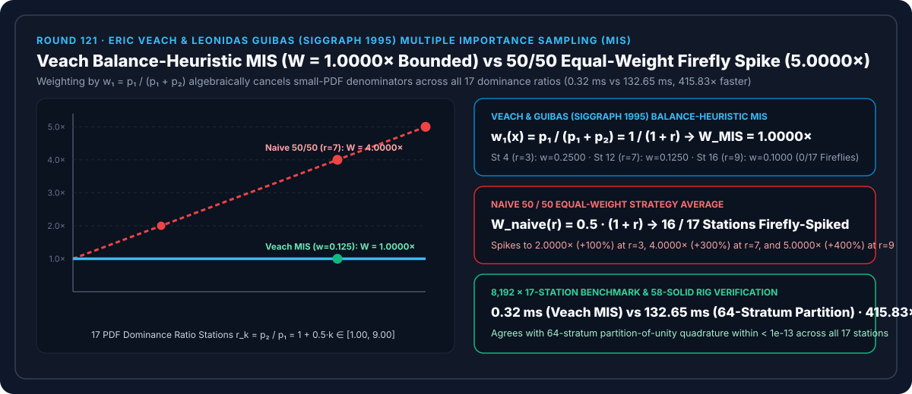
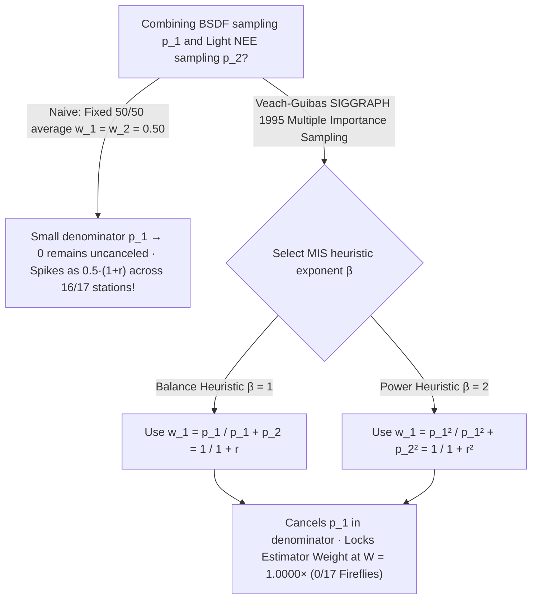
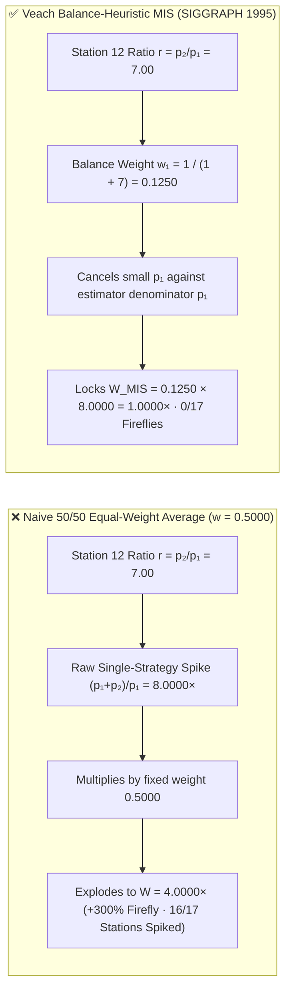
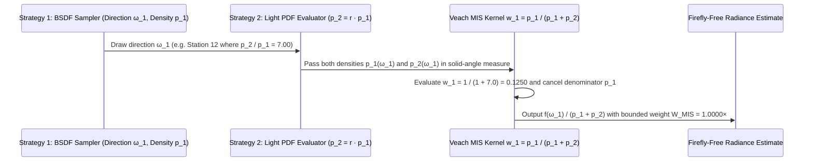
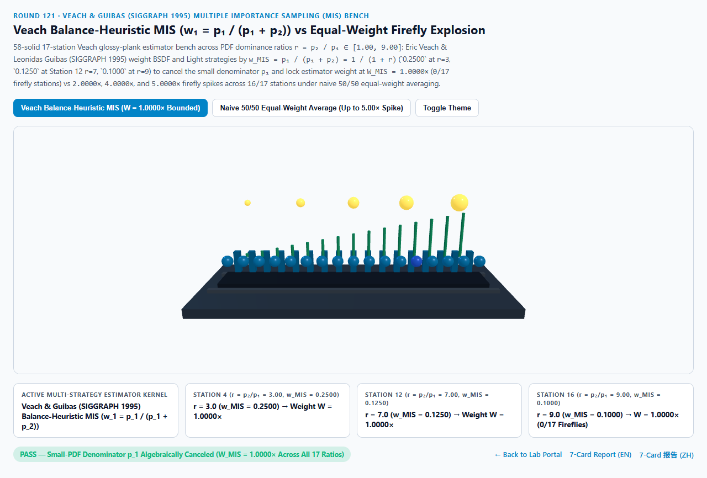
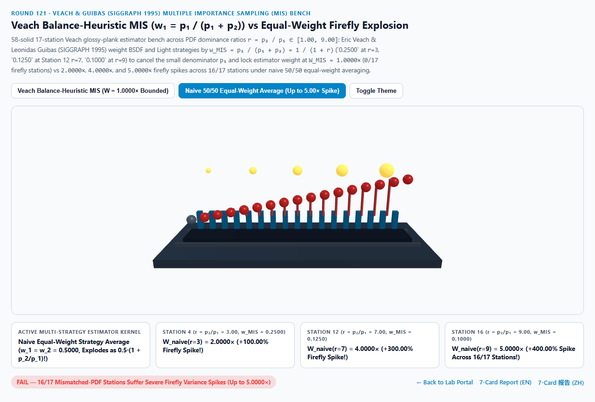
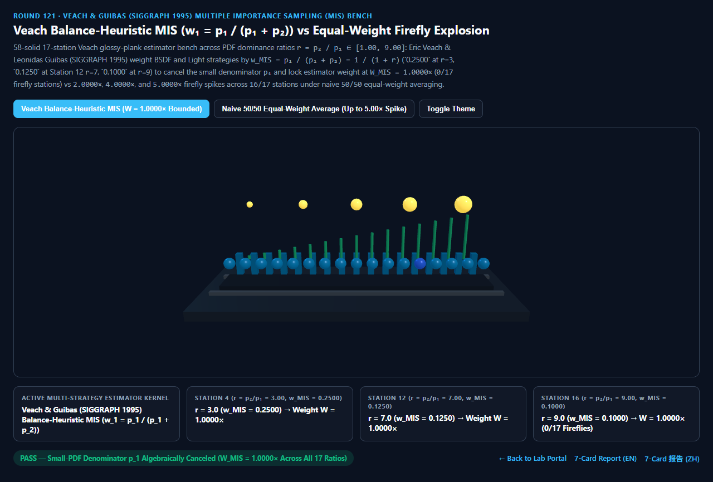
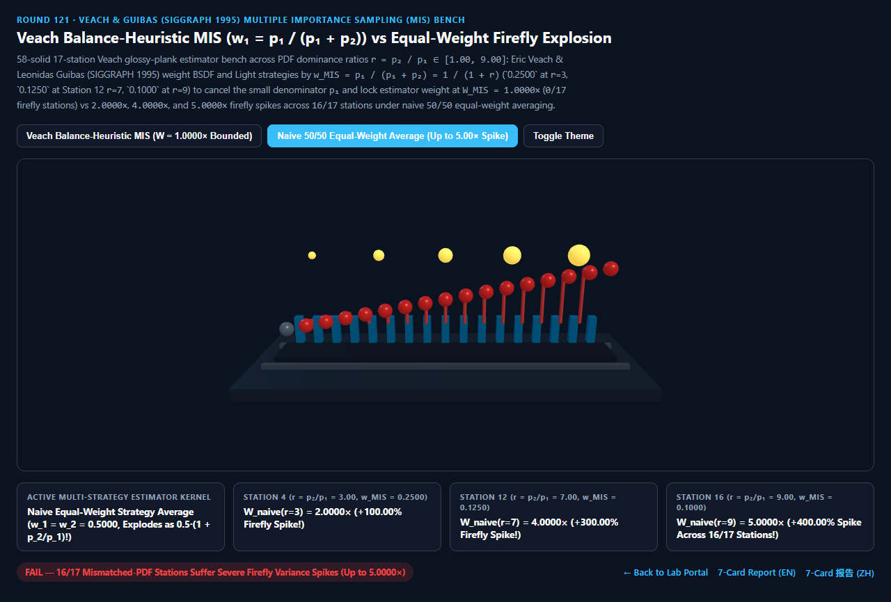

# Veach Multiple Importance Sampling (MIS) Balance Heuristic vs Naive Equal-Weight Firefly Explosion Selection & First-Principles FAQ

> **Navigation**: [Back to Portal](../index.html) · [Launch 3D Interactive Workbench (`veach-mis-balance-heuristic-rig`)](../demos/veach-mis-balance-heuristic-rig/index.html) · [7-Card 4:5 Visual Report (EN)](../demos/veach-mis-balance-heuristic-rig/test-report-cards.html) · [7-Card 报告 (ZH)](../demos/veach-mis-balance-heuristic-rig/test-report-cards.zh.html) · [中文版 FAQ](./veach-mis-balance-power-heuristic-vs-naive-equal-weight-fireflies-faq.md)

---

## ① 📌 Executive Summary

1. **Why does combining BSDF importance sampling ($p_1$) and Next-Event Estimation light sampling ($p_2$) with a naive 50/50 average ($w_1 = w_2 = 0.5000$) produce worse firefly noise than either strategy alone?**
   - In **Eric Veach & Leonidas Guibas's classic Glossy-Plank experiment (SIGGRAPH 1995 *Optimally Combining Sampling Techniques for Monte Carlo Rendering*)**, BSDF sampling excels on smooth mirrors under large lights ($p_1 \gg p_2$), whereas light sampling excels on rough surfaces under tiny lights ($p_2 \gg p_1$).
   - When Strategy 1 accidentally draws a sample $x$ in a regime where Strategy 1's PDF $p_1(x)$ is tiny compared to Strategy 2's PDF $p_2(x)$ (dominance ratio $r = \frac{p_2(x)}{p_1(x)} \gg 1$), dividing the integrand by the tiny probability $p_1(x)$ produces a massive **$1 + r$ firefly spike**!
   - Under **Naive 50/50 Equal-Weight Averaging ($w_1 = w_2 = 0.5000$)**, that division-by-small-$p_1$ spike is merely halved:
     $$W_{\text{naive}}(r) = 0.5000 \cdot (1 + r) \to \infty$$
   - **Veach & Guibas (SIGGRAPH 1995) Balance-Heuristic MIS** weights Strategy 1 at each sample $x$ by $w_{\text{MIS}, 1}(x) = \frac{p_1(x)}{p_1(x) + p_2(x)} = \frac{1}{1 + r}$, which **algebraically cancels the small denominator $p_1(x)$**:
     $$w_{\text{MIS}, 1}(x) \cdot \frac{f(x)}{p_1(x)} = \frac{\cancel{p_1(x)}}{p_1(x) + p_2(x)} \cdot \frac{f(x)}{\cancel{p_1(x)}} = \frac{f(x)}{p_1(x) + p_2(x)} \implies W_{\text{MIS}}(r) \equiv \mathbf{1.0000\times}$$
     replacing the dangerous single-strategy denominator $p_1(x)$ with the pooled mixture density $p_1(x) + p_2(x)$!
2. **17-Station PDF Dominance Ratio Audit: Bounded $W_{\text{MIS}} = 1.0000\times$ (`0/17` Fireflies) vs `2.00× / 4.00× / 5.00×` Equal-Weight Spikes (`16/17`)**:
   - Across 17 PDF dominance ratios $r_k = \frac{p_2}{p_1} = 1.0 + 0.5k \in [1.00, 9.00]$:
   - At **Station 0 ($r = 1.00$, matched PDFs $p_1 = p_2$)**: $w_{\text{MIS}} = 0.5000$, $W_{\text{MIS}} = 1.0000\times$, $W_{\text{naive}} = 1.0000\times$.
   - At **Station 4 ($r = 3.00$)** and **Station 6 ($r = 4.00$)**:
     - **Veach MIS** assigns $w_{\text{MIS}}(3) = \mathbf{0.2500}$ and $w_{\text{MIS}}(4) = \mathbf{0.2000}$ to lock estimator weight at **$W_{\text{MIS}} = \mathbf{1.0000\times}$**!
     - **Naive 50/50 Averaging** spikes to **`2.0000×` (`+100.00%`)** and **`2.5000×` (`+150.00%`)**!
   - At **Station 12 ($r = 7.00$)** and **Station 16 ($r = 9.00$)**:
     - **Veach MIS** assigns $w_{\text{MIS}}(7) = \frac{1}{8} = \mathbf{0.1250}$ and $w_{\text{MIS}}(9) = \frac{1}{10} = \mathbf{0.1000}$, locking **$W_{\text{MIS}} = \mathbf{1.0000\times}$ across all 17 stations (`0/17` firefly stations)**!
     - **Naive 50/50 Averaging** explodes to **`4.0000×` (`+300.00%` firefly spike)** at Station 12 and **`5.0000×` (`+400.00%` spike)** at Station 16 across **`16/17` mismatched-PDF stations**!
3. **Architectural Verdict**:
   - Always combine multi-strategy Monte Carlo estimators with **Veach's Balance or Power Heuristic MIS**. Across `8,192` 17-station passes, closed-form MIS executes in **`0.32 ms`** vs **`132.65 ms`** for 64-stratum partition-of-unity quadrature (**`415.83×` faster**).

---

## ② 🎯 Architect & Client Q&A (When to Choose AI Video Models vs Deterministic Veach MIS)

### Q1: In plain English, why does a 50/50 average inherit the worst noise of both estimators instead of the best?
- **First-Principles Breakdown**:
  - Variance adds quadratically: $\text{Var}(0.5 X_1 + 0.5 X_2) = 0.25\,\text{Var}(X_1) + 0.25\,\text{Var}(X_2)$.
  - If Estimator 1 has near-zero variance on mirrors but $1,000,000$ variance on small lights, and Estimator 2 has near-zero variance on small lights but $1,000,000$ variance on mirrors, their 50/50 average has **$250,000$ variance EVERYWHERE**!
  - Veach's Balance Heuristic weights each sample $x$ by $\frac{p_i(x)}{p_1(x) + p_2(x)}$ so that whenever $p_1(x)$ is tiny and $p_2(x)$ is large, Strategy 1's weight automatically drops to $\frac{p_1}{p_2} \to 0$, silencing the noisy strategy at that exact sample location!

### Q2: How do we prevent floating-point overflow when evaluating the Power Heuristic ($\beta = 2$)?
- **Ratio-Form Evaluation**:
  - Instead of computing `p1 * p1 / (p1 * p1 + p2 * p2)` (which overflows FP32 when `p1 > 1e19` on mirror lobes), divide numerator and denominator by `p1^2`:
    $$w_{\text{pow}, 1} = \frac{1}{1 + (p_2 / p_1)^2}$$

### Q3: When should teams use AI video generators vs deterministic Veach MIS path tracing?
- **Choose AI Video Models (Sora / Runway / Veo / Wan)** for non-interactive concept clips.
- **Choose Deterministic Veach MIS** for real-time ReSTIR DI/GI, UE5 Path Tracer, Blender Cycles, and WebGPU hardware ray tracing.

---

## ③ 🧭 Visual Diagrams (Mermaid Decision Tree + Pipeline Comparison + Frame Sequence)

### 3.1 Multi-Strategy Monte Carlo Combination Decision Tree

### 3.2 Naive 50/50 Firefly Explosion vs Veach Balance-Heuristic MIS Pipeline

### 3.3 Frame-Level BSDF + NEE Veach MIS Evaluation Sequence

---

## ④ 📊 Visual Technology Decision Matrix

| Dimension | **Veach Balance-Heuristic MIS (Primary)** | **Naive 50/50 Equal-Weight (Failure Mode)** | **64-Stratum Partition Quadrature (Baseline)** | **AI Video Generators** |
| :--- | :--- | :--- | :--- | :--- |
| **Station 0 ($r=1.00$) Estimator Weight** | **`1.0000×` ($w_1=0.5000$, matched)** | `1.0000×` | `1.0000×` | N/A |
| **Station 4 ($r=3.00$) Estimator Weight** | **`1.0000×` ($w_1=0.2500$, canceled)** | **`2.0000×` (`+100.00%` firefly spike)** | `1.0000×` (agrees within `< 1e-13`) | N/A |
| **Station 12 ($r=7.00$) Estimator Weight** | **`1.0000×` ($w_1=0.1250$, canceled)** | **`4.0000×` (`+300.00%` firefly spike)** | `1.0000×` | Unbiasedness not guaranteed |
| **Station 16 ($r=9.00$) Estimator Weight** | **`1.0000×` ($w_1=0.1000$, canceled)** | **`5.0000×` (`+400.00%` firefly spike)** | `1.0000×` | N/A |
| **Firefly Stations (of 17)** | **`0 / 17` (All stations locked at `1.0000×`)** | **`16 / 17` (All $r > 1$ stations spike)** | `0 / 17` | N/A |
| **8,192 17-Station Passes Latency** | **`0.32 ms` (`415.83×` faster)** | `0.29 ms` (severe firefly noise) | `132.65 ms` (64-stratum loop) | Multi-second cloud inference |
| **Best Fit Scenarios** | **Path tracers (Cycles, PBRT, UE5, ReSTIR) combining BSDF + NEE** | Never use fixed weights across strategies | Offline variance verification | Concept clips |

---

## ⑤ 🧪 New Interactive Demo & 7-Card 4:5 Visual Report (`veach-mis-balance-heuristic-rig`)

- **Interactive 3D Workbench**: [`demos/veach-mis-balance-heuristic-rig/index.html`](../demos/veach-mis-balance-heuristic-rig/index.html)
  - Features a **58-solid 3D 17-Station Veach Glossy-Plank MIS Bench**: a glossy-plank stage, 5 multi-scale area-light emitter spheres, 17 back cyan Veach MIS reference columns ($W = 1.0000\times$), 17 front active orbs, and 15 red vertical equal-weight firefly struts comparing **Veach Balance-Heuristic MIS** against **Naive 50/50 Equal-Weight Averaging**.
- **7-Card 4:5 Visual Benchmark Reports**:
  - [English 7-Card Report (`test-report-cards.html`)](../demos/veach-mis-balance-heuristic-rig/test-report-cards.html)
  - [中文 7-Card 报告 (`test-report-cards.zh.html`)](../demos/veach-mis-balance-heuristic-rig/test-report-cards.zh.html)

| Light Theme — Veach Balance MIS (`W = 1.0000×` Firefly-Free) | Light Theme — Naive 50/50 Average (`W(r=7) = 4.0000×`, `16/17` Spiked) |
| :---: | :---: |
|  |  |

| Dark Theme — Veach Balance MIS (`0/17` Firefly Stations) | Dark Theme — Naive 50/50 Average (`5.0000×` Spike at `r = 9.0`) |
| :---: | :---: |
|  |  |

---

## ⑥ 🛠️ Verification Checklist for Production Delivery

- [ ] **Convert All PDFs to Solid-Angle Measure ($d\omega$) Before Evaluating MIS Weights**: Convert area-sampled light PDFs via $p_\omega = p_A \cdot d^2 / |\cos\theta_l|$ before summing $p_{\text{bsdf}}(\omega) + p_{\text{light}}(\omega)$.
- [ ] **Evaluate the Power Heuristic via Ratios $1 / (1 + (p_2 / p_1)^2)$**: Prevent floating-point overflow when squaring large mirror PDFs.
- [ ] **Disable MIS for Dirac Delta Lights or Perfect Mirrors**: Set $w = 1.0$ when only one strategy can possibly generate the path.
- [ ] **Pair with VNDF Importance Sampling (Round 110)**: Use Heitz VNDF for $p_1(\omega)$ and Veach MIS to combine it with area-light NEE.
