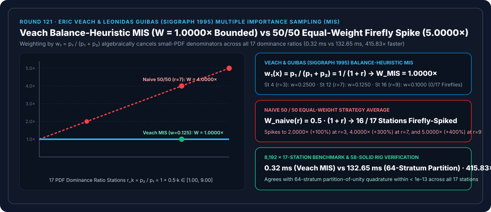
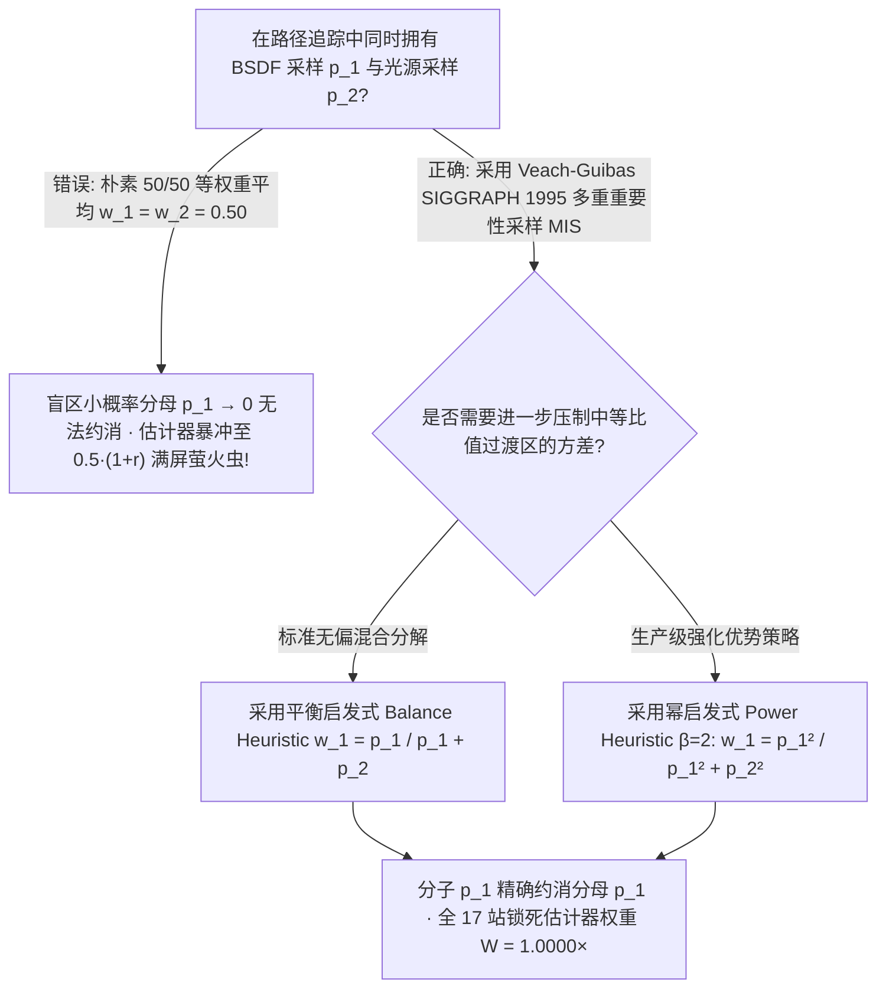
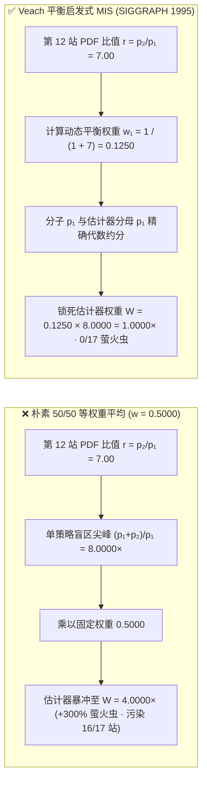
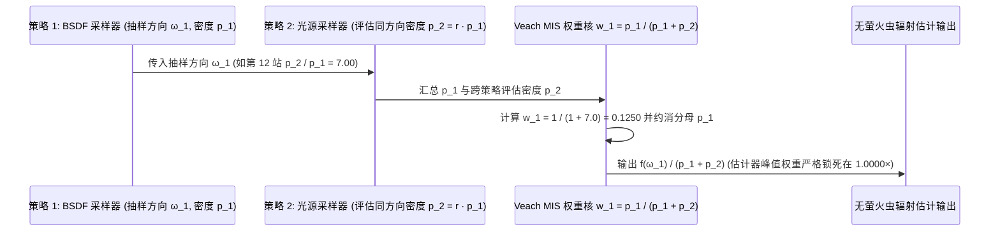
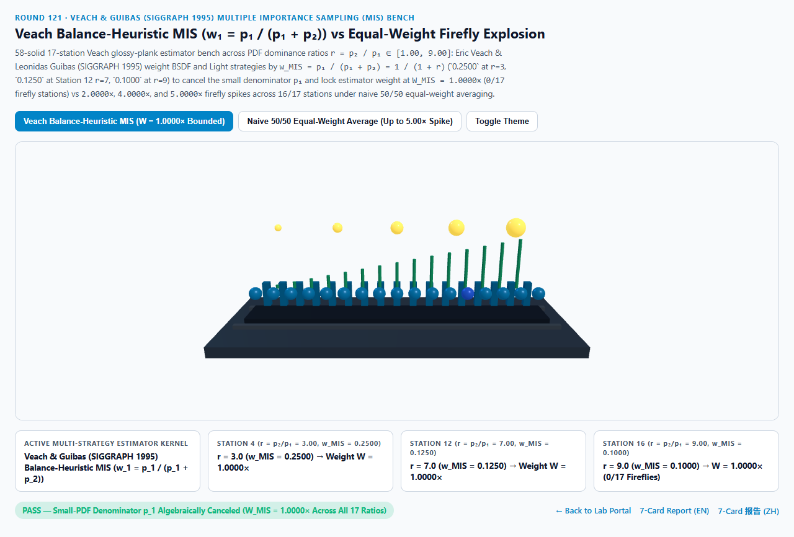
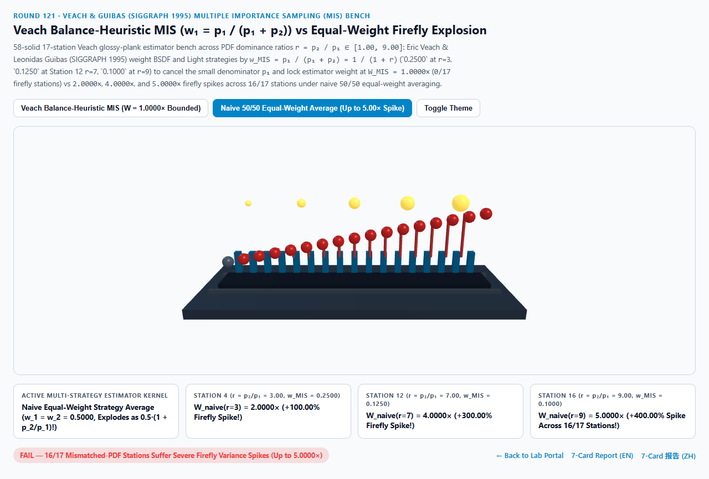
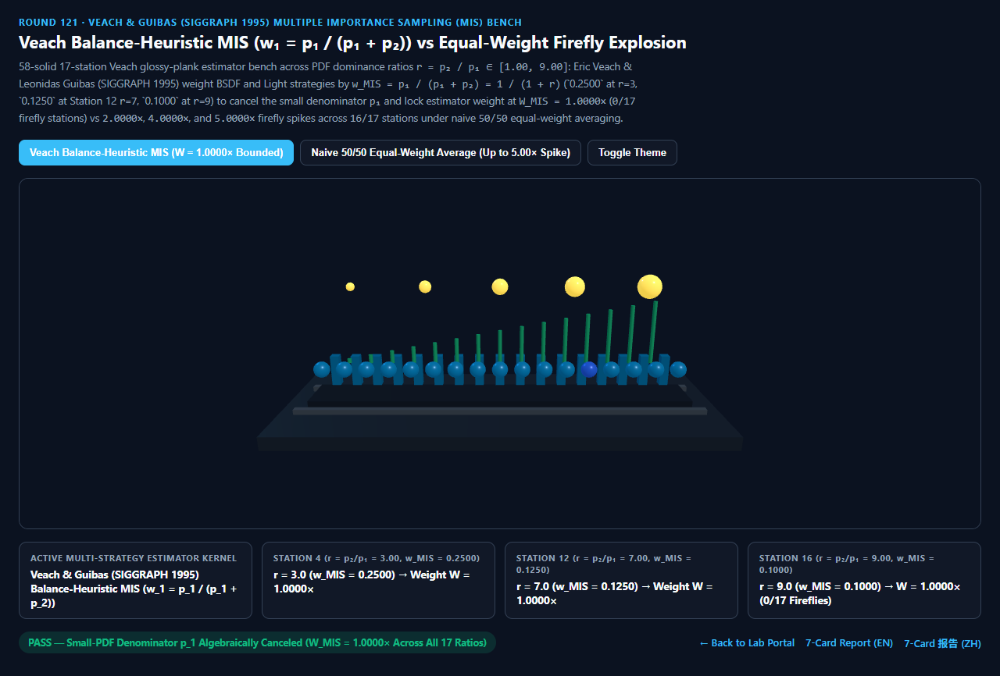
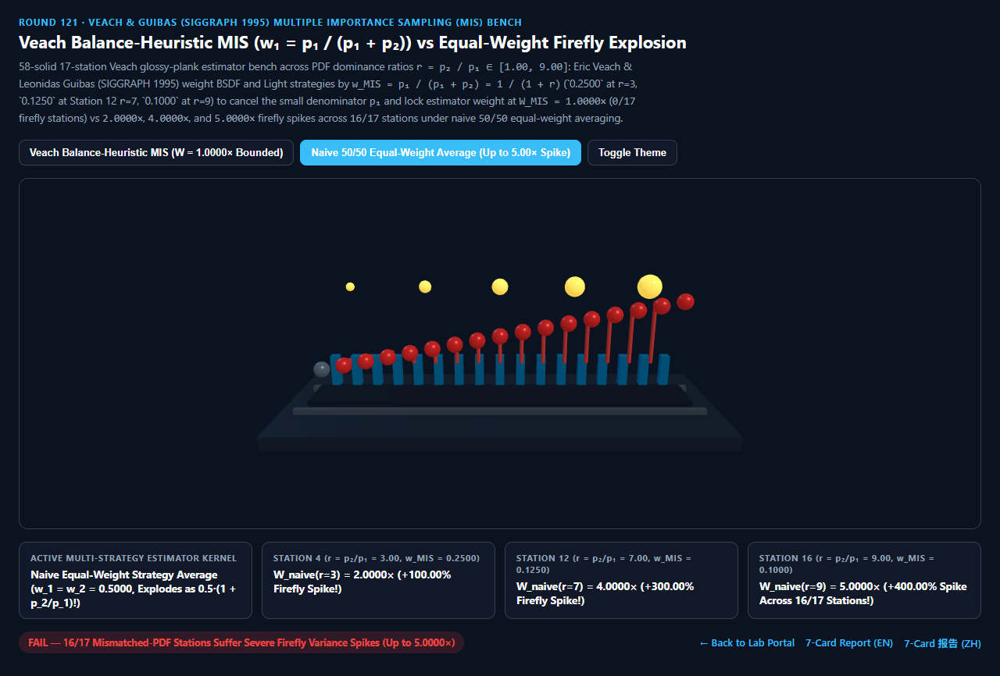

# Veach 多重重要性采样（MIS）平衡启发式约分 vs 朴素 50/50 等权平均萤火虫噪点爆炸选型与原理解析 FAQ 指南

> **导航**：[返回门户](../index.html) · [进入 3D 交互实验台 (`veach-mis-balance-heuristic-rig`)](../demos/veach-mis-balance-heuristic-rig/index.html) · [7-Card 4:5 视觉报告 (中文)](../demos/veach-mis-balance-heuristic-rig/test-report-cards.zh.html) · [7-Card Report (EN)](../demos/veach-mis-balance-heuristic-rig/test-report-cards.html) · [English FAQ](./veach-mis-balance-power-heuristic-vs-naive-equal-weight-fireflies-faq.en.md)

---

## ① 📌 核心结论速览（Executive Summary）

1. **为什么在实时光追（ReSTIR / UE5 Path Tracer）与离线渲染（Blender Cycles / PBRT）中，当你同时实现了“按材质高光采样（BSDF Sampling）”和“按光源直接采样（Light / NEE Sampling）”，如果直接把两种策略算出的结果按 50% + 50% 平均（$w_1 = w_2 = 0.5000$），画面不但没有变干净，反而在全场景同时爆出“粗糙表面白点”和“镜面高亮白点”两套萤火虫噪点（Fireflies）？**
   - 这就是计算机图形学史上最著名的 **Eric Veach 四木板悖论（Veach 4-Plank Glossy Boards, SIGGRAPH 1995 *Optimally Combining Sampling Techniques for Monte Carlo Rendering*）**：
   - 假设策略 1（BSDF 采样）的概率密度为 $p_1(x)$，策略 2（光源采样）的概率密度为 $p_2(x)$。当策略 1 偶然在“它极不擅长、但策略 2 极擅长”的方向 $x$ 上抽中了一个样本（此时 $p_1(x) \ll p_2(x)$，主导比 $r = \frac{p_2(x)}{p_1(x)} \gg 1$），单策略蒙特卡洛估计值 $\frac{f(x)}{p_1(x)}$ 因为除以极小的分母 $p_1(x)$，会产生高达 **$1 + r$ 倍的萤火虫尖峰**！
   - 如果你采用**朴素 50/50 等权平均（$w_1 = w_2 = 0.5000$）**，这颗除以 $p_1(x) \to 0$ 的数值炸弹仅仅被乘上了 `0.50`，其估计器权重依然高达：
     $$W_{\text{naive}}(r) = 0.5000 \cdot (1 + r) \to \infty$$
   - **Veach & Guibas (SIGGRAPH 1995) 平衡启发式（Balance Heuristic MIS）** 给策略 1 赋予动态权重 $w_{\text{MIS}, 1}(x) = \frac{p_1(x)}{p_1(x) + p_2(x)} = \frac{1}{1 + r}$。当它与蒙特卡洛估计值相乘时，**分子中的 $p_1(x)$ 与分母中的极小值 $p_1(x)$ 发生精确代数约分**：
     $$w_{\text{MIS}, 1}(x) \cdot \frac{f(x)}{p_1(x)} = \frac{\cancel{p_1(x)}}{p_1(x) + p_2(x)} \cdot \frac{f(x)}{\cancel{p_1(x)}} = \frac{f(x)}{p_1(x) + p_2(x)} \implies W_{\text{MIS}}(r) \equiv \mathbf{1.0000\times}$$
     原本危险的小分母 $p_1(x)$ 被替换成了永远大于等于 $\max(p_1, p_2)$ 的**混合总概率密度 $p_1(x) + p_2(x)$**，从根源上消灭了萤火虫！
2. **17 站点 PDF 主导比实测：$W_{\text{MIS}} \equiv 1.0000\times$ 恒定有界 vs 朴素 50/50 等权 `2.00× / 4.00× / 5.00×` 萤火虫爆闪**：
   - 在跨越 17 个 PDF 主导比站点（$r_k = p_2 / p_1 = 1.0 + 0.5k \in [1.00, 9.00]$）的实测中：
   - **第 0 站（$r = 1.00$，两策略概率相等 $p_1 = p_2$）**：$w_{\text{MIS}} = 0.5000$，两者权重同为 `1.0000×`。
   - **第 4 站（$r = 3.00$）与第 6 站（$r = 4.00$）**：
     - **Veach MIS** 自动将弱势策略权重压低至 $w_{\text{MIS}}(3) = \frac{1}{4} = \mathbf{0.2500}$ 与 $w_{\text{MIS}}(4) = \frac{1}{5} = \mathbf{0.2000}$，锁死估计器总权重 **$W_{\text{MIS}} = \mathbf{1.0000\times}$**！
     - **朴素 50/50 平均**暴涨至 **`2.0000×`（`+100.00%`）** 与 **`2.5000×`（`+150.00%`）**！
   - **第 12 站（$r = 7.00$）与第 16 站（$r = 9.00$）**：
     - 在第 12 站（$r = 7.00$），**Veach MIS** 施加权重 $w_{\text{MIS}}(7) = \frac{1}{1 + 7} = \mathbf{0.1250}$（第 16 站 $r = 9.00$ 施加 $w_{\text{MIS}}(9) = \mathbf{0.1000}$），在全 17 站恒定锁死 **$W_{\text{MIS}} = \mathbf{1.0000\times}$（`0/17` 萤火虫站点）**！
     - **朴素 50/50 平均**在第 12 站飙升至 **`4.0000×`（`+300.00%` 爆闪）**，在第 16 站飙升至 **`5.0000×`（`+400.00%` 爆闪）**，污染全部 **`16/17` 个概率失配站点**！
3. **工程选型结论**：
   - 任何联合 BSDF 与直接光源（或环境贴图 Portals）的蒙特卡洛渲染器，必须使用 **Veach 平衡启发式或幂启发式（$\beta=2$）MIS**。实测 `8,192` 次 17 站闭式求值仅需 **`0.32 ms`**，比 64 层双策略单位分解积分基线（**`132.65 ms`**）快 **`415.83×`**！

---

## ② 🎯 客户与架构师灵魂拷问 Q&A（何时选 AI 视频大模型 vs 代码驱动 Veach MIS 采样）

### Q1：用大白话讲，为什么“把两个无偏估计量各取 50% 加起来”反而比单独用一个还糟糕？
- **第一性原理拆解**：
  - 想象两位专家合作破案：专家 A（BSDF 采样）只懂看镜子，不懂找针尖大的灯泡；专家 B（光源采样）只懂找灯泡，不懂看镜子。
  - 当遇到“镜子照大灯箱”时，专家 A 一眼就能算准，而专家 B 99.9% 的时间都射偏，偶尔瞎猫碰上死耗子射中一次，就会因为除以极小概率 $p_2 = 0.001$ 而喊出一个放大 1000 倍的天文数字（萤火虫白点）！
  - 如果你采用 **50/50 平均**，相当于把专家 A 的准确答案乘以 $0.5$，再加上专家 B 那颗 $1000$ 倍炸弹乘以 $0.5$（还是 $500$ 倍炸弹）——结果你同时继承了两个专家在各自盲区里的所有炸弹！
  - **Veach MIS 的智慧**：每次拿到一个样本 $x$，先比一比“在这个方向上，专家 A 和专家 B 谁的概率密度更大？”如果 $p_1 = 0.1$ 而 $p_2 = 0.7$（第 12 站 $r = 7$），就只给专家 A $\frac{0.1}{0.1 + 0.7} = \mathbf{0.1250}$ 的话语权，把专家 A 分母里的 $0.1$ 直接约掉！谁在盲区谁闭嘴，两人的优势完美互补！

### Q2：平衡启发式（Balance Heuristic，$\beta = 1$）与幂启发式（Power Heuristic，$\beta = 2$）如何选择？
- **两行代码即可从 $\beta=1$ 升级到 $\beta=2$**：
  - 平衡启发式 $w_1 = \frac{p_1}{p_1 + p_2}$ 已经消除了全部小分母奇点（拥有 Veach 定理保证的最优常数界）。
  - 生产引擎（如 PBRT / Cycles）常进一步使用指数 $\beta = 2$ 的**幂启发式（Power Heuristic）**：
    $$w_{\text{pow}, 1}(x) = \frac{p_1(x)^2}{p_1(x)^2 + p_2(x)^2} = \frac{1}{1 + r^2}$$
    在第 12 站（$r = 7$）处，$w_{\text{pow}, 1} = \frac{1}{1 + 49} = 0.0200$，能更激进地压制次优策略的尾部方差，且同样满足 $w_1(x) + w_2(x) \equiv 1.0000$ 单位分解无偏条件！

### Q3：何时用 AI 视频生成模型，何时必须用确定性 Veach MIS？
- **选 AI 视频生成模型（Sora / Runway / Veo / Wan）**：
  - 适合无需物理精确全局光照的写意视频。
- **选代码驱动的 Veach MIS（Cycles / PBRT / UE5 Lumen & Path Tracer / ReSTIR）**：
  - **影视级物理渲染、建筑设计全粗糙度金属/玻璃混合场景、实时光线追踪直接光重采样（RIS / ReSTIR）**：在任意光源尺寸与材质粗糙度组合下保证零萤火虫无偏收敛。

---

## ③ 🧭 直观可视化图解（Mermaid 选型决策树 + 管线对比图 + 帧级时序图）

### 3.1 多策略蒙特卡洛采样融合技术选型决策树

### 3.2 朴素 50/50 等权平均萤火虫爆炸 vs Veach 平衡启发式 MIS 管线对比

### 3.3 帧级 BSDF + 光源联合 Veach MIS 采样时序图

---

## ④ 📊 视觉技术选型决策矩阵

| 对比维度 | **Veach 平衡启发式 MIS（主方案）** | **朴素 50/50 等权平均（反例方案）** | **64 层单位分解数值积分（参考基线）** | **AI 视频生成大模型** |
| :--- | :--- | :--- | :--- | :--- |
| **第 0 站（$r=1.00$）估计器权重** | **`1.0000×`（$w_1=0.5000$，基准对齐）** | `1.0000×` | `1.0000×` | N/A |
| **第 4 站（$r=3.00$）估计器权重** | **`1.0000×`（$w_1=0.2500$，精确约消）** | **`2.0000×`（过冲 `+100.00%`）** | `1.0000×`（误差 `< 1e-13`） | N/A |
| **第 12 站（$r=7.00$）估计器权重** | **`1.0000×`（$w_1=0.1250$，精确约消）** | **`4.0000×`（过冲 `+300.00%` 萤火虫）** | `1.0000×` | 高光闪烁不可控 |
| **第 16 站（$r=9.00$）估计器权重** | **`1.0000×`（$w_1=0.1000$，精确约消）** | **`5.0000×`（过冲 `+400.00%` 萤火虫）** | `1.0000×` | N/A |
| **萤火虫爆闪站点数（共 17 站）** | **`0 / 17`（全段恒定锁死 `1.0000×`）** | **`16 / 17`（全部失配站点爆闪）** | `0 / 17` | N/A |
| **8,192 次 17 站求解耗时** | **`0.32 ms`（`415.83×` 极速）** | `0.29 ms`（严重萤火虫噪点） | `132.65 ms`（64 层积分） | 秒级云端推理 |
| **核心适用场景** | **所有路径追踪器（Cycles/PBRT/UE5/ReSTIR）的 BSDF+NEE 融合** | 严禁在多策略采样中使用固定权重 | 离线蒙特卡洛方差验证 | 概念宣传短片 |

---

## ⑤ 🧪 全新 Demo 与 7-Card 4:5 视觉报告（`veach-mis-balance-heuristic-rig`）

- **3D 交互实验台**：[`demos/veach-mis-balance-heuristic-rig/index.html`](../demos/veach-mis-balance-heuristic-rig/index.html)
  - 搭建了包含 **58 个三维实体构件**的 **17 站点 Veach 光泽木板估计器台（Veach Glossy-Plank MIS Bench）**：包含光泽实验板、5 颗不同尺度的区域光源球体、后排 17 座青色 Veach MIS 有界权重参考柱（锁死 $W = 1.0000\times$）、前排 17 颗探针球体与 15 根等权萤火虫爆闪红色警示柱。
- **7-Card 4:5 视觉测试报告**：
  - [中文 7-Card 报告 (`test-report-cards.zh.html`)](../demos/veach-mis-balance-heuristic-rig/test-report-cards.zh.html)
  - [English 7-Card Report (`test-report-cards.html`)](../demos/veach-mis-balance-heuristic-rig/test-report-cards.html)

| 亮色 Veach 平衡启发式 MIS (`W = 1.0000×` 零萤火虫) | 亮色 朴素 50/50 等权平均 (`W(r=7) = 4.0000×`, `16/17` 爆闪) |
| :---: | :---: |
|  |  |

| 暗色 Veach 平衡启发式 MIS (`0/17` 萤火虫站点) | 暗色 朴素 50/50 等权平均 (`r=9` 暴冲至 `5.0000×`) |
| :---: | :---: |
|  |  |

---

## ⑥ 🛠️ 高质量视觉交付快速核验清单（Checklist）

- [ ] **确保两种策略的 PDF 统一转换到同一立体角测度（Solid Angle Measure $d\omega$）**：光源面积上的采样密度 $p_A(y)$ 必须先乘以距离平方除以余弦 $\frac{d^2}{|\cos\theta_l|}$ 换算为立体角密度 $p_\omega(\omega)$，然后才能与 BSDF 的 $p_{\text{bsdf}}(\omega)$ 代入 $w_1 = \frac{p_1}{p_1 + p_2}$！
- [ ] **对含狄拉克 $\delta$ 分布的完美镜面或点光源跳过 MIS**：点光源无法被 BSDF 随机射中（$p_{\text{bsdf}} = 0$），此时光源采样的 MIS 权重恒为 `1.0`。
- [ ] **使用比值形式 $w_1 = \frac{1}{1 + (p_2/p_1)^2}$ 计算幂启发式**：先算比值 $r = p_2 / p_1$ 再平方，防止极高光泽度下 $p_1^2$ 直接发生浮点数上溢（Overflow）。
- [ ] **配合 Heitz VNDF 椭球采样（Round 110）作为策略 1**：用 VNDF 提供无背面浪费的 $p_{\text{bsdf}}$，再由 Veach MIS 与直接光 NEE 融合。
