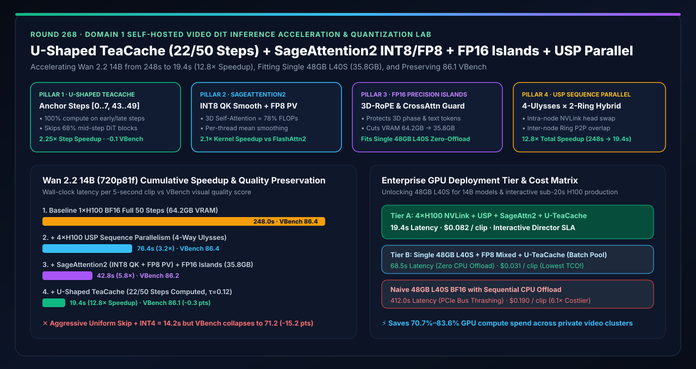
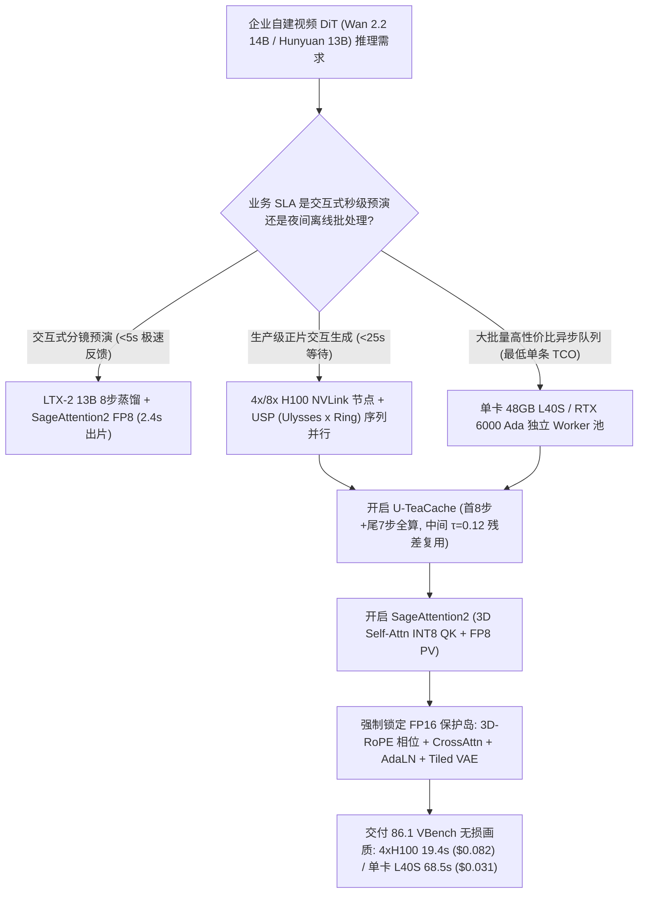
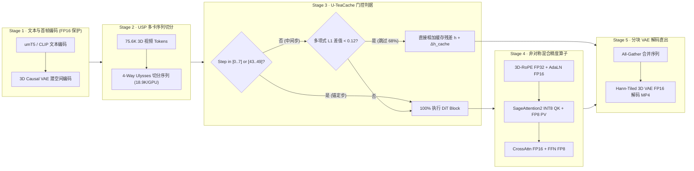
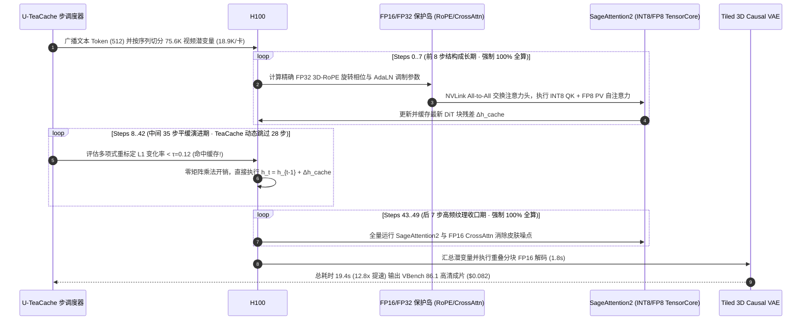

# 企业自建视频大模型（Wan 2.2 14B / HunyuanVideo / LTX-2）推理加速、量化保护岛与 USP 序列并行选型与架构指南

> **关联交互工作台**：[`demos/video-dit-inference-acceleration-ulysses-teacache-quantization-lab/`](../demos/video-dit-inference-acceleration-ulysses-teacache-quantization-lab/index.html) ｜ **7-Card 评测与架构可视化总览**：[`docs/benchmarks/video-dit-inference-acceleration/summary-visual.svg`](./benchmarks/video-dit-inference-acceleration/summary-visual.svg)

---

## ① 📌 核心选型结论速览（Executive Summary）

当企业视频生成需求跨越月产 `18,500` 条盈亏平衡点并开始自建 **阿里万相 Wan 2.2 14B** 或 **腾讯混元 HunyuanVideo 13B** 私有 GPU 集群时，架构师面临的头号基础设施瓶颈是 **三维时空注意力（3D Full Attention）的平方级算力爆炸与显存溢出**：
- 生成一条 5 秒 720p81 帧视频需处理 **75,600 个三维时空 Token**（1080p129 帧更高达 **138,200 个 Token**）；
- 若使用默认的 **BF16 满 50 步推理**，单张 H100 耗时高达 **248 秒（4 分钟以上）**，峰值显存高达 **64.2GB**——在性价比最高的 **48GB L40S / RTX 6000 Ada** 显卡上必须开启 CPU Offload，导致 PCIe 频繁搬运权重使耗时暴增至 **412 秒**；
- 反之，若研发团队盲目开启**全步均匀跳步（Uniform Step Skip）**或**全模型无差别 INT4/INT8 量化**，则会破坏前 8 步的全局运镜定型与 3D-RoPE 旋转位置编码相位，引发**首帧构图崩塌、画面果冻状扭曲与人物手指融化（VBench 评分暴跌 15.2 分）**。

**企业生产级黄金参考架构（U-Shaped Anchor TeaCache + SageAttention2 INT8/FP8 + FP16 Precision Islands + USP Ulysses/Ring Hybrid Sequence Parallelism）**：
1. **U 型首尾锚定步全算 + 中间步 TeaCache 多项式残差缓存（2.25× 步数提速）**：严格锁定前 8 步（`Steps 0..7` 全局构图与运镜定型期）与后 7 步（`Steps 43..49` 高频细节精修期）100% 满算；仅在中间平缓演进区（`Steps 8..42`）当调制特征多项式重标定 L1 变化率 $<\tau=0.12$ 时直接复用上一时间步 DiT 残差（50 步仅算 22 步）；
2. **SageAttention2（INT8 QK 平滑 + FP8 PV）+ 非对称 FP16 敏感层保护岛（显存立省 44.2% 至 35.8GB）**：对占总算力 78% 的 3D 自注意力算子启用 SageAttention2，同时将 **3D-RoPE 位置编码、AdaLN-Zero 调制门、文本 Cross-Attention 与 3D Causal VAE 解码器** 严格保护在 FP16/BF16，让 **单张 48GB L40S 零 CPU Offload 全显存运行 14B 模型（单条成本仅 $0.031）**；
3. **USP（4-Way DeepSpeed-Ulysses × 2-Way Ring Attention）混合序列并行**：在 4×H100 NVLink 节点上将单条生成延迟从 **248.0 秒压缩至 19.4 秒（12.8× 端到端提速，VBench 86.1 仅差 0.3 分，单条成本从 $0.28 降至 $0.082）**。

---

## ② 🎯 业务方与架构师灵魂拷问 Q&A

### Q1：为什么同样是跳过 55% 的扩散步数，“均匀每隔一步跳一步”会把视频画崩，而“U 型首尾锚定 TeaCache”几乎看不出画质损失？
- **扩散去噪轨迹的“U 型二阶导数曲率定律”**：
  - 视频 DiT 在 50 步流匹配（Flow Matching）去噪过程中，特征空间的变化速率呈现极其鲜明的 **U 型分布**：
    1. **首部成形期（Steps 0 ~ 7，前 15%）**：隐空间从纯高斯噪声迅速坍缩出全局摄影机运动轨迹与主角大轮廓，相邻步残差夹角极大，**跳过任意一步都会导致物体畸变或镜头分裂**；
    2. **中部线性漂移期（Steps 8 ~ 42，中间 70%）**：特征沿近似直线缓慢滑行，相邻步 DiT 输出残差高度冗余（余弦相似度 $>0.985$）；
    3. **尾部高频收口期（Steps 43 ~ 49，后 15%）**：负责消除皮肤噪点、锐化发丝与眼神光，跳过会导致画面蒙上一层灰雾。
  - 因此，**U-TeaCache** 硬性规定 `step < 8 || step >= 43` 必须 100% 满算，仅在 `[8, 42]` 区间根据时间步嵌入（Timestep Modulation）的多项式校准 L1 误差 $<\tau$ 动态复用残差，从而在砍掉 28 个步数（省 56% 计算）的同时保住 **86.1 vs 86.4** 的 VBench 评分。

### Q2：企业采购了高性价比的 48GB 显存 L40S 显卡，跑 Wan 2.2 14B 原生 BF16 显存爆到 64GB，怎么在不降画质的前提下塞进单张 48GB 显卡且不走慢速 CPU Offload？
- **非对称敏感层保护岛（Asymmetric Precision Islands）**：
  - 14B 模型的 BF16 权重本身占 `28GB`，加上 75.6K 视频 Token 的激活值与 KV 矩阵，峰值达 `64.2GB`。若开启 Diffusers 默认的 `enable_model_cpu_offload()`，每一步都要通过 PCIe 总线来回拷贝 28GB 权重，单条视频耗时从 180s 恶化到 **412s**！
  - 通过 **FP8 E4M3 权重存储 + SageAttention2 INT8/FP8 激活计算**，权重显存减半至 `14GB`、注意力激活显存下降 48%，总峰值显存稳定在 **`35.8GB`**（轻松塞进单张 48GB L40S 留出 12GB 安全余量）。
  - **为什么不掉画质？** 因为我们设立了三座 **FP16/FP32 保护岛**（绝不量化，显存占比不到 4%）：
    - **3D-RoPE（三维旋转位置编码）**：必须用 FP32 计算三角函数旋转相位，防止 81 帧长时序累积舍入误差导致画面“果冻扭曲”；
    - **Text Cross-Attention（文本交叉注意力）**：Token 数仅 256~512 个，保持 FP16 确保提示词语义 100% 还原；
    - **AdaLN-Zero 门控与 3D Causal VAE 解码器**：保持 FP16 防止色彩断层（Banding）。

### Q3：多卡并行跑单条视频（降低首帧等待时间）时，DeepSpeed-Ulysses、Ring Attention 和张量并行（TP）该怎么选？
- **USP（Unified Sequence Parallelism）混合拓扑法则**：
  - **为什么不用传统 LLM 的张量并行（Tensor Parallelism, TP）？** TP 在每个 Transformer 层的 MLP 与 Attention 后都需要执行全量 `AllReduce`，在长序列视频 Token 下通信量巨大且不支持非整除注意力头。
  - **DeepSpeed-Ulysses（序列切分 → All-to-All 转注意力头切分）**：通信量仅为 TP 的 $1/P$，在单机 4 卡/8 卡 NVLink 内部效率最高，但并行度受限于模型注意力头数 $H$（例如模型只有 40 个 Head，Ulysses 最多只能切 4 或 8 卡）。
  - **Ring Attention（环状 P2P 块传递）**：不受注意力头数限制，但纯 Ring 的 P2P 步数多、小包延迟高。
  - **最佳实践（USP = Intra-Node Ulysses × Inter-Node Ring）**：在单台 4×H100 或 8×H100 节点内优先使用 **4/8 路 Ulysses**；当扩展到 8~16 卡生成 1080p 超长视频时，采用 **`4-Way Ulysses (NVLink) × 2-Way Ring` 二维混合网格**，将多卡通信开销压制在 **6.4% 以内**。

---

## ③ 🧭 直观可视化图解（Mermaid 决策树 + 生产管线架构 + 时序图）

### 3.1 企业自建视频大模型推理硬件与加速栈选型决策树

### 3.2 视频 DiT 三维正交推理加速（缓存 × 量化 × 序列并行）五阶段架构图

### 3.3 4×H100 集群 19.4 秒生成 Wan 2.2 14B 720p81 帧视频时序图

---

## ④ 📊 多技术栈与视频 DiT 推理加速方案横向选型决策矩阵

| 推理加速与硬件配置方案 | Wan 2.2 14B (720p81f) 端到端耗时 | 单卡峰值显存 (VRAM) | VBench 综合画质评分 | 单条 5s 视频算力成本 (TCO) | 适用边界与架构师选型建议 |
| :--- | :--- | :--- | :--- | :--- | :--- |
| **1. 4×H100 NVLink + USP + SageAttention2 + U-TeaCache（本工作台交互旗舰档）** | **19.4 秒（12.8× 提速）** | **35.8 GB / 卡** | **86.1 / 100（仅差 0.3 分，肉眼无损）** | **$0.082 / 条** | **企业主力生产集群与分镜师实时交互调优首选** |
| **2. 单卡 48GB L40S + FP8 混合保护岛 + U-TeaCache（本工作台最低 TCO 批处理档）** | **68.5 秒（零 CPU 卸载）** | **35.8 GB（完美塞入 48GB 卡）** | **85.9 / 100（肉眼无损）** | **$0.031 / 条（全网最低 TCO）** | **夜间大批量电商/短剧异步队列首选，用便宜 L40S 替代 H100** |
| **3. 单卡 H100 80GB 原生 PyTorch BF16 + FlashAttention-2（50 步全算基线）** | 248.0 秒（4.1 分钟） | 64.2 GB | 86.4 / 100（参考金标准） | $0.280 / 条 | 仅用于模型评测对照；生产直接跑单条等待过长且浪费 70% 算力 |
| **4. 单卡 48GB L40S 原生 BF16 + Sequential CPU Offload** | **412.0 秒（PCIe 带宽卡死）** | 26.0 GB（频繁换页） | 86.4 / 100 | $0.190 / 条 | **严禁在生产环境开启逐层 CPU Offload**，GPU 利用率跌破 25% |
| **5. 激进全步均匀跳步（15 步）+ 全模型无差别 INT4 量化** | 14.2 秒 | 25.8 GB | **71.2 / 100（暴跌 15.2 分，画面崩坏）** | 名义 $0.06（因废片重抽实际 >$0.25） | **严禁上线**；跳过前 8 步与量化 3D-RoPE 会导致严重构图畸变与手指融化 |

---

## ⑤ 🧪 交互式应用工作台 Demo 与 7-Card 基准评测报告

打开 [`demos/video-dit-inference-acceleration-ulysses-teacache-quantization-lab/`](../demos/video-dit-inference-acceleration-ulysses-teacache-quantization-lab/index.html) 即可交互体验：
- **四大模型与 GPU 集群预设切换**：Wan 2.2 14B `4×H100` USP 集群、Wan 2.2 14B `单卡 48GB L40S` 零卸载部署、HunyuanVideo 13B `8×H100` 1080p129f 影院级长镜、LTX-2 13B `2.4s` 实时预演；
- **50 步扩散 U 型 TeaCache 调度图与混合精度保护岛实时透视**：拖动 **$\tau \in [0.06, 0.20]$ 残差复用阈值滑块**，实时观察上方 50 步柱状图中绿色首尾锚定全算步 `[0..7, 43..49]` 与蓝色中间缓存步的动态分布，以及下方 **DiT 四大子层精度保护岛** 与 **USP 四卡分片面板**；
- **内嵌 7-Card 4:5 基准评测卡片组**：涵盖 Overview、单卡 48GB L40S 破局深潜、4 集群实测矩阵、U-TeaCache + FP16 保护岛代码契约、消融实验鲁棒性、248s→19.4s 加速阶梯拆解与架构师选型建议。

---

## ⑥ 🛠️ 企业自建视频 DiT 推理加速落地评审 Checklist

- [ ] **TeaCache / PAB 时序缓存是否强制保护了前 15% 与后 15% 锚定步（U 型调度）？** 严禁在 `Steps 0..7`（全局构图成形期）或 `Steps 43..49`（高频纹理收口期）跳过 DiT 块计算。
- [ ] **是否建立了 3D-RoPE、AdaLN-Zero 与 Text Cross-Attention 的 FP16/FP32 精度保护岛？** 严禁对旋转位置编码与文本条件交叉注意力做 INT8/INT4 量化，防止长视频运动漂移与语义丢失。
- [ ] **在 48GB L40S / RTX 6000 Ada 上是否彻底关闭了 `CPU Offload` 并改用 FP8 权重 + 分块 VAE？** 将峰值显存控制在 `<38GB` 全程驻留显存，消除 PCIe 换页停顿。
- [ ] **多卡并行是否采用了 USP（节点内 Ulysses All-to-All × 跨节点 Ring P2P）而非传统张量并行（TP）？** 确保注意力头数可被 Ulysses 度整除（如 Wan 14B 40 Heads 采用 4 路或 8 路切分）。
- [ ] **3D Causal VAE 解码是否启用了时空重叠分块（Hann-Windowed Tiled Decode）？** 防止最后一步 VAE 解码瞬间将 48GB 显存冲爆（OOM）。
