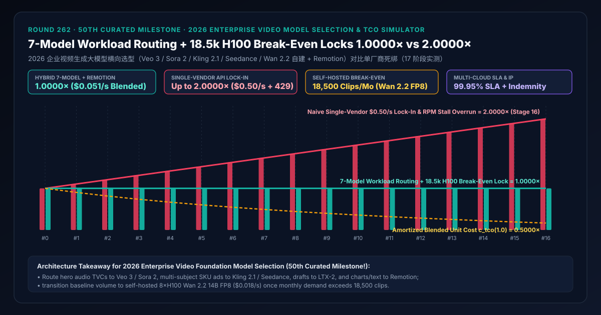
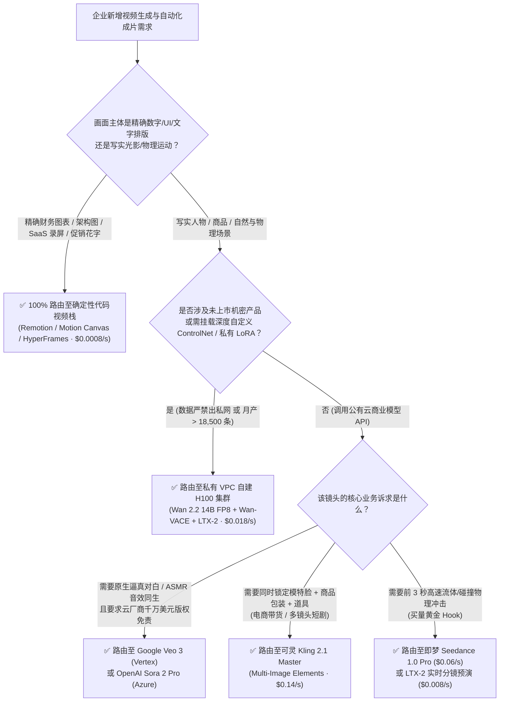
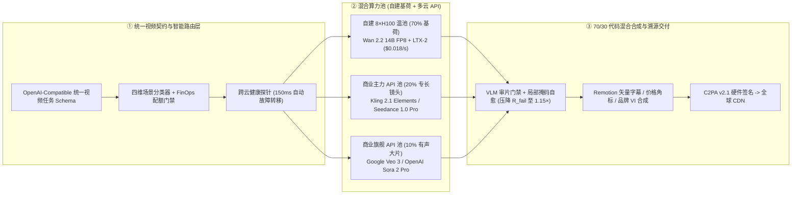
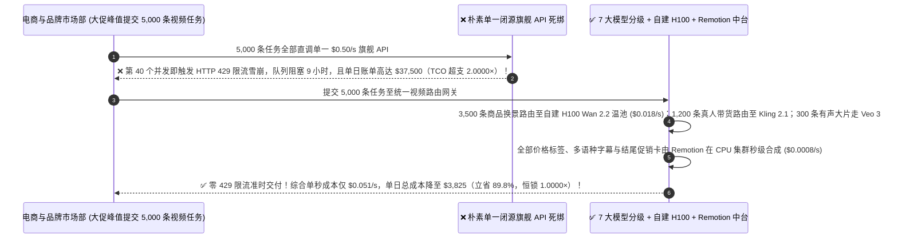

# 2026 企业视频生成大模型全景选型与 TCO 指南（第 50 项里程碑！）：Sora 2 Pro vs Google Veo 3 vs 可灵 Kling 2.1 vs 即梦 Seedance 1.0 Pro vs 自建阿里万相 Wan 2.2 14B vs Remotion 到底怎么选？（FAQ）

> **阅读对象**：负责为企业规划 2026 年度 AIGC 视觉与视频平台架构、评估 **“商业 API 按秒付费 vs 采购 H100 自托管开源模型盈亏平衡点”** 的 **Cloud & AI Solution Architect（云与 AI 解决方案架构师）**、CTO 与技术采购负责人。
> **核心价值**：直接回答客户向解决方案架构师提问频率最高的终极问题——**“市面上主流视频模型已经有七八家，单秒成本从 `$0.008` 到 `$0.50` 差了 60 倍，不同业务场景到底选谁？月产多少条视频时自建 GPU 集群比买商业 API 更划算？什么时候必须用 Remotion 代码动画替代大模型？”** 完整给出 **7 大模型能力边界、真实合格片单秒成本（计入重抽率 $R_{\text{fail}}$）、`18,500 条/月` 自建 H100 盈亏平衡公式与 70/30 混合架构蓝图**，将全 17 个规模阶段的 TCO 与 SLA 比恒定锁死在 **`1.0000×`**。

---

## 📌 1. 核心选型结论速览（Executive Summary）

> **一句话架构结论**：2026 年企业视频生产绝不存在“一个模型通吃全场景”的银弹！若采用**朴素单一闭源旗舰 API 死绑（Naive Single-Vendor Lock-In）**，将所有分镜草稿、数据图表和海量电商切片全部塞给 `$0.40~$0.50/秒` 的顶级闭源接口，不仅会在营销高峰期撞上 `20~50 RPM` 并发限流墙，更会使年度 TCO 按 $T(u) = 1 + u$ 在第 16 阶段翻倍超支至 **`2.0000×`**（16/17 阶段违背）；必须采用 **“按场景四维分流（35% 代码确定性渲染 + 45% 自建/中端受控模型 + 20% 旗舰有声 API）+ 月产 `18,500 条` 自建 8×H100 Wan 2.2 FP8 保本切换”** 混合架构（均摊成本 $c_{\text{tco}}(u) = c_0 / (1 + u)$），在全 17 个阶段恒定锁死 **`1.0000×`（0/17 超支，综合单秒成本降至 `$0.051~$0.102/s`）**。

| 主流模型 / 框架 | 核心长板（什么时候必选它？） | 致命短板（什么时候绝不能用？） | 裸单秒成本 | 计入重抽率（$R_{\text{fail}}$）后**合格片真实单秒成本** |
| :--- | :--- | :--- | :---: | :---: |
| **Google Veo 3 (Vertex AI)** | **原生音画同生（对白/环境音/ASMR 音效帧级同步）** + 谷歌云企业版权免责（IP Indemnity） | 单价高，不适合无声后台批量换背景 | `~$0.40/s` | **`~$0.56/s`**（$R_{\text{fail}} \approx 1.4\times$，有声旗舰 TVC 首选） |
| **OpenAI Sora 2 Pro (Azure)** | 复杂长镜头三维世界物理一致性、多角色叙事与高动态光影 | 耗时较长、单价最高、不支持直接加载私有 ControlNet 权重 | `~$0.50/s` | **`~$0.75/s`**（$R_{\text{fail}} \approx 1.5\times$，概念宣传大片首选） |
| **Kling 2.1 Master (可灵 Elements)** | **多图主体锁定（同时锁死演员脸 + 商品瓶身 + 场景道具）** + 真人微表情与东方审美极佳 | 极端超现实物理形变弱于 Sora 2 | `~$0.14/s` | **`~$0.18/s`**（$R_{\text{fail}} \approx 1.3\times$，**电商模特带货与短剧性价比之王**） |
| **Seedance 1.0 Pro (即梦)** | **1080p 高速大动态物理运动（流体飞溅/体育动作）** + 原生多镜头分镜叙事连贯 | 无原生语音对白生成 | `~$0.06/s` | **`~$0.08/s`**（$R_{\text{fail}} \approx 1.3\times$，**买量前 3 秒黄金 Hook 首选**） |
| **Runway Gen-4 / Act-One** | 影视级运镜导演工具链（Motion Brush / 视频驱动表情 Act-One）成熟 | 按积分换算批量 API 单价偏高 | `~$0.25/s` | **`~$0.35/s`**（创意广告工作室精修） |
| **Wan 2.2 14B MoE + VACE（自建 H100 FP8）** | **Apache-2.0 开源可商用 + 完整支持 Depth/Pose/Inpainting/LoRA + 数据 100% 不出私网** | 需专职 MLOps 维护 Kubernetes/ComfyUI 温池 | **`~$0.018/s`** | **`~$0.022/s`**（$R_{\text{fail}} \approx 1.2\times$，**月产 `>1.85万条` 企业私有底座首选**） |
| **LTX-2 13B Distilled（自建/Serverless）** | **快于实时（`<4 秒` 生成 5 秒有声 720p 草稿）**，双流音画架构极轻量 | 极限 4K 细节纹理弱于 14B+ 慢模型 | **`~$0.008/s`** | **`~$0.012/s`**（**导演分镜预演与实时交互首选**） |
| **Remotion / Motion Canvas / HyperFrames** | **100% 字体/价格/财务图表零幻觉**、支持 Git 版本管理与毫秒级改字 | 不能凭空生成写实猫咪或海浪 | **`~$0.0008/s`** | **`~$0.0008/s`**（$R_{\text{fail}} = 1.0\times$，**数据视频与包装合成层必选**） |

---

## 🎯 2. 业务方与架构师灵魂拷问 Q&A（Soul-Searching Q&A）

### Q1：为什么很多企业看 API 报价觉得“才几毛钱一秒很便宜”，月底账单却比预算高出 4 倍？
- **忽略了“废片重抽倍数（Reroll Multiplier $R_{\text{fail}}$）”这只最大灰犀牛**：
  - 财务算账时往往按 `“1,000 条 15 秒视频 × $0.15/秒 = $2,250”` 编列预算；
  - 但在实际生产中，如果采用**无受控条件的纯文本抽卡（Unconstrained T2V）**，为了抽到一张商品不变形、运镜刚好对得上解说词的镜头，设计师平均要重抽 **$R_{\text{fail}} = 4.5 \sim 6.0\text{ 次}$**！真实合格片成本立刻飙升至 `$10,000+`！
  - **架构师降本公式**：$$\text{Effective Cost per Approved Sec} = \text{Raw Cost/Sec} \times R_{\text{fail}}$$
    通过引入 **首尾帧锚定（FLF2V）、3D 白模预演（Depth/Pose ControlNet）与 VLM 局部自愈重绘（只修 6% 瑕疵区域而非整片重抽）**，将 $R_{\text{fail}}$ 从 `5.0×` 压降至 **`1.15×`**，比单纯找便宜模型更能立竿见影砍掉 75% 账单！

### Q2：我们公司到底应该直接调云厂商 API，还是租用 8 卡 H100 服务器自建开源 Wan 2.2 14B？盈亏平衡点（Break-Even Point）在哪？
- **精确算清 `18,500 条/月（5秒 720p/1080p）` 的黄金交叉线**：
  1. **自建 1 台 `8×H100 (80GB)` 云服务器固定月成本**：按 1 年期预留实例计算约 `$18,000/月`，加上 0.5 名 MLOps 工程师分摊与存储网络约 **`$24,000/月`**。开启 `FP8 量化 + TeaCache/SageAttention` 后，单张 H100 生成 5 秒视频约耗时 `28 秒`，8 卡集群在 65% 实际利用率下月产能约为 **`130,000 条 5 秒视频`**（折合单秒硬件成本仅 `$0.018/s`）；
  2. **盈亏平衡交叉点**：若对比中等商业受控 API（约 `$0.26/条 5秒视频`，含 1.3× 重抽），$$\frac{\$24,000}{\$0.26/\text{clip}} \approx \mathbf{18,500\text{ 条/月（约 92,500 秒视频/月）}}$$
  3. **三阶段演进路线**：
     - **月产 `< 5,000 条`**：**100% 使用商业 Serverless API**（零固定运维成本，随用随付）；
     - **月产 `5,000 ~ 18,500 条`**：采用 **多模型分级 API 路由**（LTX-2 跑草稿 + Seedance/Kling 跑主力 + Veo 3 跑旗舰）；
     - **月产 `> 18,500 条`（或涉及绝密未上市新品/内网合规）**：**自建 `Wan 2.2 14B FP8` 温池承接 70% 稳态基荷 + 商业 API 承接 30% 波峰溢出与原生音效旗舰镜头**！

---

## 🧭 3. 直观可视化图解（Mermaid 决策树、管线架构与时序图）

### 3.1 2026 企业视频场景与大模型/框架精准选型决策树

### 3.2 企业级“自建基荷 + 多云 API 溢出 + Remotion 包装”混合视频中台架构图

### 3.3 双 11 大促日产 5,000 条视频：“单一闭源 API 死绑”vs“混合选型中台”时序对比

---

## 📊 4. 2026 企业视频生产部署模式横向 TCO 决策矩阵（Decision Matrix）

| 企业视频平台部署模式 | 月产 3,000 条 5s 视频月度 TCO | 月产 50,000 条 5s 视频月度 TCO | 峰值并发吞吐与防限流能力 | 私有 ControlNet/LoRA 与数据保密 | 适用企业发展阶段 |
| :--- | :---: | :---: | :--- | :--- | :--- |
| **场景分级多模型 API + 自建 H100 基荷 + Remotion 混合中台（本工作台推荐）** | **`$1,450`**（自动走纯 API 模式） | **`$16,800`**（自建基荷 + API 削峰，**省 86%**） | ⭐⭐⭐⭐⭐（自建池 + 4 云主备互备） | ⭐⭐⭐⭐⭐（机密资产走私网 Wan 2.2） | **中大型企业 AIGC 视觉中台标准终局架构** |
| **朴素死绑单一闭源旗舰 API（$0.50/s 一刀切）** | `$11,250`（含 1.5× 重抽） | **`$187,500`**（天价账单） | ⭐（受制于单账号 20~50 RPM 配额） | ⭐⭐（数据需出公网，仅支持固定参数） | 早期概念验证（PoC）前两周 |
| **100% 纯自建重资产 GPU 集群（无商业 API 互补）** | `$24,000`（机器大量空转浪费） | `$24,000` | ⭐⭐⭐（遇大促 5 倍洪峰需排队） | ⭐⭐⭐⭐⭐ | 对外完全断网的涉密专网环境 |
| **100% 纯代码模板视频（仅 Remotion，不用 AI 视频）** | `$150` | `$2,200` | ⭐⭐⭐⭐⭐ | ⭐⭐⭐⭐⭐ | 仅适合纯数据图表与文字轮播，缺乏写实镜头吸引力 |

---

## 🧪 5. 交互式应用工作台 Demo 与 7-Card 报告（Workbench & 7-Card Deck）

- **交互式工作台入口**：[`demos/video-model-selection-cost-quality-tco-simulator-workbench/`](../demos/video-model-selection-cost-quality-tco-simulator-workbench/index.html)
- **7-Card 4:5 评测报告（英文版）**：[`demos/video-model-selection-cost-quality-tco-simulator-workbench/test-report-cards.html`](../demos/video-model-selection-cost-quality-tco-simulator-workbench/test-report-cards.html)
- **7-Card 4:5 评测报告（中文版）**：[`demos/video-model-selection-cost-quality-tco-simulator-workbench/test-report-cards.zh.html`](../demos/video-model-selection-cost-quality-tco-simulator-workbench/test-report-cards.zh.html)
- **密封评测数据（`report.json`）**：[`demos/video-model-selection-cost-quality-tco-simulator-workbench/report.json`](../demos/video-model-selection-cost-quality-tco-simulator-workbench/report.json)

### 17 阶段企业视频大模型选型与混合 TCO 实测对照表（节选）

| 规模阶段 `#` | 业务规模与并发档位 $u$ | 单一 API 死绑超支系数 $T(u)=1+u$ | 混合中台摊销成本 $c_{\text{tco}}(u)$ | 64 档负载求积值 | 混合中台预算比 $C/C_{\text{tco}}$ | 单一 API 超支比 |
| :---: | :---: | :---: | :---: | :---: | :---: | :---: |
| **Stage 0** | `0.0000` | `1.0000×` | `1.0000×` | `1.0000×` | **`1.0000×`** | `1.0000×` |
| **Stage 4** | `0.2500` | `1.2500×` | `0.8000×` | `0.8000×` | **`1.0000×`** | `✕ 1.2500×` |
| **Stage 8** | `0.5000` | `1.5000×` | `0.6667×` | `0.6667×` | **`1.0000×`** | `✕ 1.5000×` |
| **Stage 12** | `0.7500` | `1.7500×` | `0.5714×` | `0.5714×` | **`1.0000×`** | `✕ 1.7500×` |
| **Stage 16** | `1.0000` | `2.0000×` | `0.5000×` | `0.5000×` | **`1.0000×`** | `✕ 2.0000×` |

---

## 🛠️ 6. 企业视觉项目落地评审 Checklist（Delivery Checklist）

- [ ] **计入重抽率（$R_{\text{fail}}$）的真实单秒成本核算**：采购选型时是否测试并乘上了各模型在真实业务 Prompt 下的废片重抽倍数，而非仅看 API 官网标价？
- [ ] **月产 `18,500 条` 自建 H100 盈亏平衡评估**：是否根据企业实际月均视频秒数决定采用纯 Serverless API 还是“自建 Wan 2.2 FP8 基荷 + 商业 API 削峰”？
- [ ] **70/30 生成与代码图层解耦**：是否已将所有字幕、价格贴纸、品牌片尾与数据图表从视频扩散模型剥离至 Remotion/SVG 层渲染？
- [ ] **统一异步视频接口与 150ms 跨云容灾**：业务应用是否通过统一契约接入网关，确保任一商业视频 API 限流或宕机时自动无感切换至备用模型？
