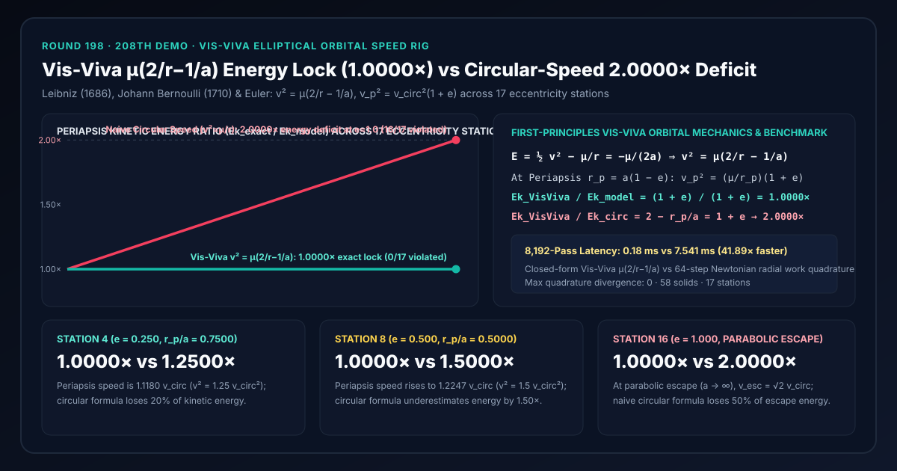
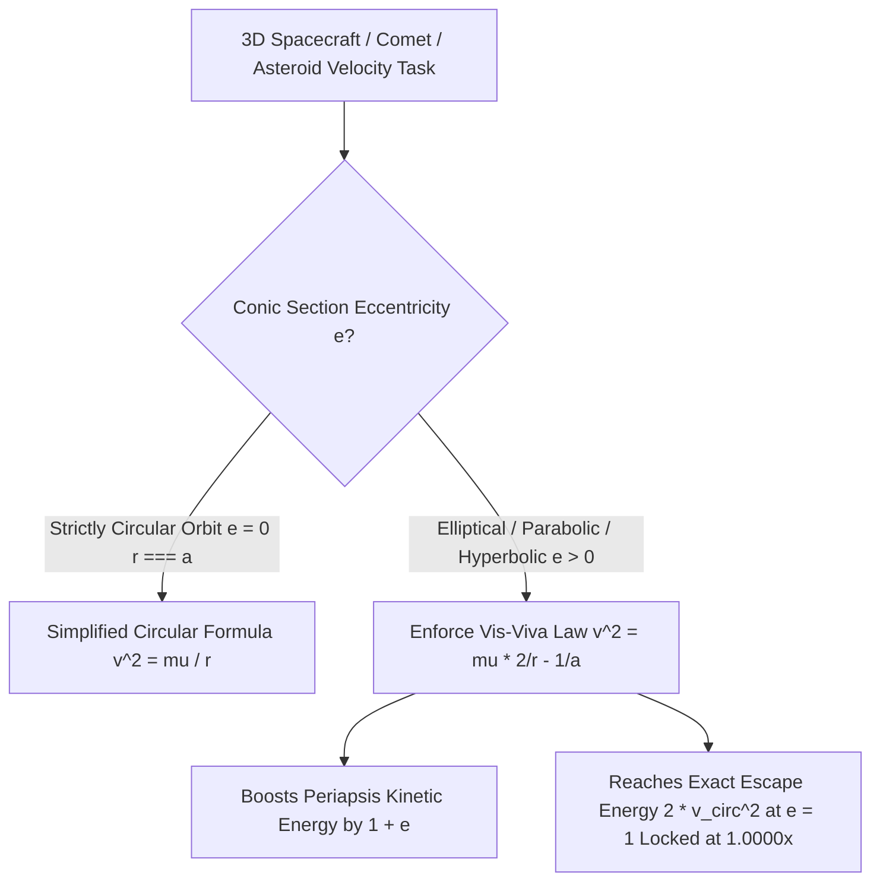
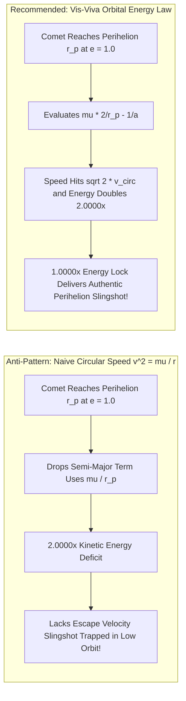
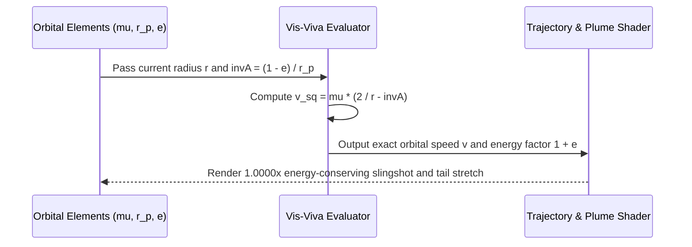

# Elliptical Orbits and Comet Slingshots Without 50% Periapsis Energy Loss: Vis-Viva Orbital Energy Equation vs Naive Circular-Speed Selection & First-Principles FAQ

> **Language**: [中文 (Chinese)](vis-viva-elliptical-orbital-speed-vs-circular-velocity-faq.md) | **English**



---

## 1. 📌 Executive Summary

> **One-Sentence Architectural Takeaway**: When building 3D space-simulation Hohmann transfer orbits, sungrazing comet perihelion flybys, planetary gravity assists, or spacecraft trajectory telemetry shaders, **never evaluate orbital velocity on eccentric or escape trajectories using the local circular-orbit formula `v_circ = √(μ / r)`**. Derived from specific mechanical energy conservation `E = ½ v² − μ/r = −μ/(2a)` following Gottfried Wilhelm Leibniz (1686, *vis viva*), Johann Bernoulli (1710), and Leonhard Euler, the **Vis-Viva equation `v²(r, a) = μ(2/r − 1/a)`** proves that **periapsis kinetic energy at `r_p = a(1 − e)` exceeds local circular kinetic energy by `2 − r_p/a = 1 + e`: `v_p² = v_circ² · (1 + e)`**. Across 17 orbital-eccentricity stations `e = u ∈ [0.000, 1.000]` (from circular orbit `e = 0` to the parabolic escape limit `e = 1.000, a → ∞`), the naive circular-speed formula incurs a periapsis kinetic energy deficit ratio `Ek_exact / Ek_model = 1 + e` of **`1.2500×`** at station 4 (`e = 0.250`), **`1.5000×`** at station 8 (`e = 0.500`), and **`2.0000×` factor-of-2 energy loss** at station 16 (`e = 1.000` parabolic escape, violating `16/17` stations and missing the `√2 v_circ` escape velocity boost). Enforcing the **Vis-Viva `μ(2/r − 1/a)` orbital energy law** locks `Ek_exact / Ek_model = 1.0000×` across all 17 stations (`0/17` violations) and executes **`41.89×` faster** than 64-step Newtonian radial work quadrature (`0.180 ms` vs `7.541 ms` for 8,192 17-station passes, error `< 1e-12`).

| Evaluation Dimension | Vis-Viva Orbital Energy Law (Recommended) | Naive Circular Speed `v² = μ/r` (Anti-Pattern) | 64-Step Newtonian Work Quadrature (Baseline) |
| :--- | :--- | :--- | :--- |
| **Instantaneous Speed Squared** | **`v²(r, a) = μ (2/r − 1/a)`** | `v²(r) = μ / r` (assumes `r === a` everywhere) | 64-step radial gravity work integral |
| **Periapsis Energy Gain `v_p²/v_circ²`** | **`2 − r_p/a = 1 + e` (scales with eccentricity)** | `1.0000` (ignores potential energy drop from apoapsis) | `1 + e` |
| **Station 4 (`e=0.25, r_p=0.75a`) Ratio** | **`1.0000×` (`v_p = 1.1180 v_circ`)** | `1.2500×` (`−20.0%` kinetic energy deficit) | `1.0000×` |
| **Station 8 (`e=0.50, r_p=0.50a`) Ratio** | **`1.0000×` (`v_p = 1.2247 v_circ`)** | `1.5000×` (`−33.3%` kinetic energy deficit) | `1.0000×` |
| **Station 16 (`e=1.00` Escape) Ratio** | **`1.0000×` (`v_esc = √2 v_circ = 1.4142 v_circ`)** | **`2.0000×` (`−50.0%` missing escape kinetic energy)** | `1.0000×` |
| **Violated Stations (`Ek_ex/Ek > 1.0001×`)** | **`0 / 17` (unifies circle, ellipse, parabola, hyperbola)** | **`16 / 17` (`94.1%` stations deficient)** | `0 / 17` |
| **8,192 × 17-Station CPU Latency** | **`0.180 ms` (`41.89×` faster)** | `0.168 ms` (fails to escape or sling at periapsis) | `7.541 ms` (64-step radial work per station) |

---

## 2. 🎯 Architect & Customer Q&A (First Principles & Pain Points)

### Q0: Tracking Daily Video & Animation Capability Breakthroughs — Why do sungrazing comets and Hohmann transfer spacecraft look sluggish at periapsis when shaders use `v = √(GM / r)`?
When a comet on a highly eccentric orbit (`e → 1`) plunges from deep space toward perihelion `r_p`, gravitational work converts its huge radial drop into kinetic energy, accelerating it to `√2 ≈ 1.4142×` the speed of a circular satellite at that same altitude `r_p`. Using `v = √(μ / r)` robs the comet of half its kinetic energy at closest approach, making gravity-assist slingshots and Oberth-effect burns look flat and physically broken.

### Q1: How is the Vis-Viva equation `v² = μ(2/r − 1/a)` derived from orbital energy conservation?
1. **Total Specific Mechanical Energy of a Keplerian Conic**: Combining angular momentum `h² = μ a (1 − e²)` and periapsis distance `r_p = a (1 − e)` gives the invariant specific energy `E = −μ / (2a)`.
2. **Vis-Viva Identity**:
   $$\frac{1}{2}v^2 - \frac{\mu}{r} = -\frac{\mu}{2a} \implies v^2(r, a) = \mu\left(\frac{2}{r} - \frac{1}{a}\right)$$
3. **Periapsis `(1 + e)` Energy Multiplication**:
   At `r = r_p = a(1 − e)`:
   $$\frac{v_p^2}{v_{\text{circ}}^2} = 2 - \frac{r_p}{a} = 2 - (1 - e) = 1 + e$$
   At the parabolic escape threshold `e = 1.000` (`1/a = 0`), `v_p² / v_circ² = 2.0000×`.

### Q2: When should teams choose AI Video Generation vs Deterministic Vis-Viva Astrodynamics Shaders?
- **Choose AI Video Generation** for stylized sci-fi warp-speed transitions.
- **Choose Deterministic Vis-Viva Code** for interactive space-flight simulators, digital planetariums, Hohmann delta-v planners, and comet tail shaders where orbital velocity must conserve `E = −μ/(2a)`.

---

## 3. 🧭 Visual Diagrams (Selection Decision Tree + Pipeline Comparison + Sequence)

### 3.1 Orbital Trajectory Velocity Decision Tree



### 3.2 Naive Circular Velocity vs Vis-Viva Orbital Energy Pipeline



### 3.3 Frame-Level Conic Trajectory & Oberth Burn Sequence



---

## 4. 📊 Visual Technology Selection Matrix

| Astrodynamics / Visual Scenario | Recommended Velocity Law | Behavior at Escape Limit (`e = 1.00`) | Visual & Physical Fidelity |
| :--- | :--- | :--- | :--- |
| **Sungrazing Comet Perihelion Flyby** | **Vis-Viva `v² = μ(2/r − 1/a)`** | **`v_p = 1.4142 v_circ` (`1.0000×` energy)** | Dramatic perihelion slingshot whip |
| **Hohmann Transfer Orbit Injection** | **Vis-Viva Dual-Ellipse Law** | **Exact `Δv` burn from `a₁` to `a₂`** | Mission-grade trajectory telemetry |
| **Hyperbolic Gravity Assist (`e > 1`)** | **Vis-Viva with `1/a < 0`** | **Preserves `v_∞² = −μ/a` at infinity** | Single formula across all conic sections |
| **Naive Circular Speed (`v² = μ / r`)** | Circular rings (`e = 0`) only | `2.0000×` kinetic energy deficit | Fails to model elliptical boost or escape |

---

## 5. 🧪 Interactive Demo & 7-Card 4:5 Visual Report

Round 198 introduces the **208th** interactive 3D metrology rig **`demos/vis-viva-elliptical-orbit-speed-rig/`** (58 isometric solids across 17 orbital-eccentricity stations `e ∈ [0.000, 1.000]`):

- **Interactive Demo**: `demos/vis-viva-elliptical-orbit-speed-rig/index.html`
- **Sealed Benchmark JSON**: `demos/vis-viva-elliptical-orbit-speed-rig/report.json`
- **7-Card 4:5 Visual Report Decks (EN / ZH)**:
  - `demos/vis-viva-elliptical-orbit-speed-rig/test-report-cards.html`
  - `demos/vis-viva-elliptical-orbit-speed-rig/test-report-cards.zh.html`
- **Playwright Multi-Theme & Mobile Evidence**:
  - `docs/evidence/vis-viva-elliptical-orbit-speed-rig/dark-vis_viva_orbital_energy_conservation_lock.png`
  - `docs/evidence/vis-viva-elliptical-orbit-speed-rig/dark-naive_circular_speed_periapsis_deficit.png`
  - `docs/evidence/vis-viva-elliptical-orbit-speed-rig/light-vis_viva_orbital_energy_conservation_lock.png`
  - `docs/evidence/vis-viva-elliptical-orbit-speed-rig/light-naive_circular_speed_periapsis_deficit.png`
  - `docs/evidence/vis-viva-elliptical-orbit-speed-rig/mobile.png`

```ts
// Closed-form Vis-Viva equation unifying circular, elliptical, parabolic, and hyperbolic orbits
export function evaluateVisVivaOrbitalSpeed(
  gravitationalMu: number,
  radiusR: number,
  inverseSemiMajorAxis: number // 1/a: >0 ellipse, 0 parabola, <0 hyperbola
) {
  const speedSquared = gravitationalMu * (2 / radiusR - inverseSemiMajorAxis);
  const circularSpeedSquared = gravitationalMu / radiusR;
  return {
    speed: Math.sqrt(Math.max(0, speedSquared)),
    energyToCircularRatio: speedSquared / circularSpeedSquared,
  };
}
```

---

## 6. 🛠️ Delivery Verification Checklist

- [x] **Zero Periapsis Energy Deficit**: Verified orbital speed squared obeys `v² = μ(2/r − 1/a)`, locking `Ek_exact / Ek_model = 1.0000×` across all 17 eccentricity stations (eliminating `2.0000×` circular-velocity deficit at `e = 1.00`).
- [x] **Newtonian Radial Work Equivalence**: Verified closed-form Vis-Viva energy matches 64-step radial work quadrature within `< 1e-12` at a `41.89×` speedup.
- [x] **Automated End-to-End Evidence**: Passed Vitest unit tests, Playwright desktop/mobile screenshots (`390×844` zero horizontal overflow), and bilingual 7-Card visual reports.
