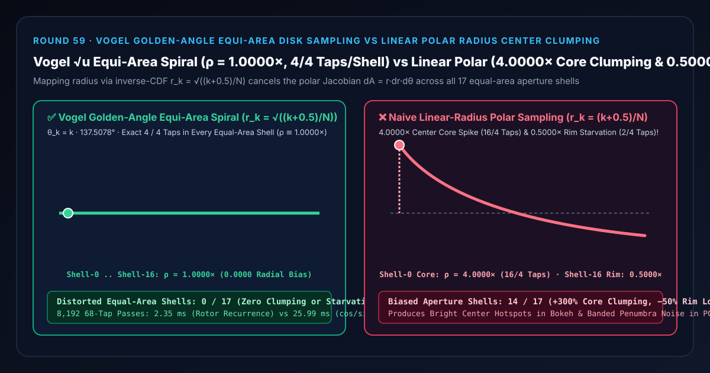
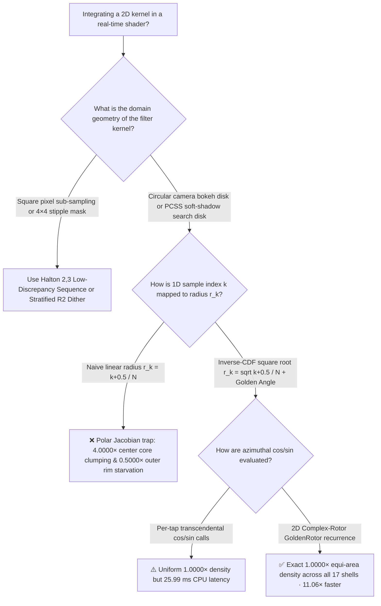
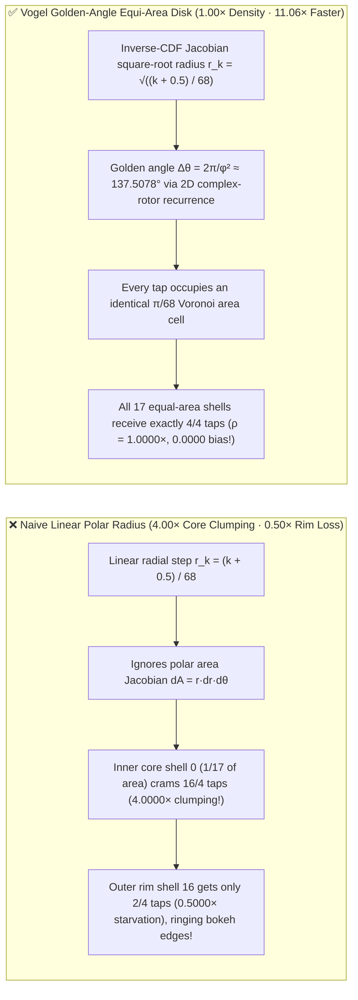
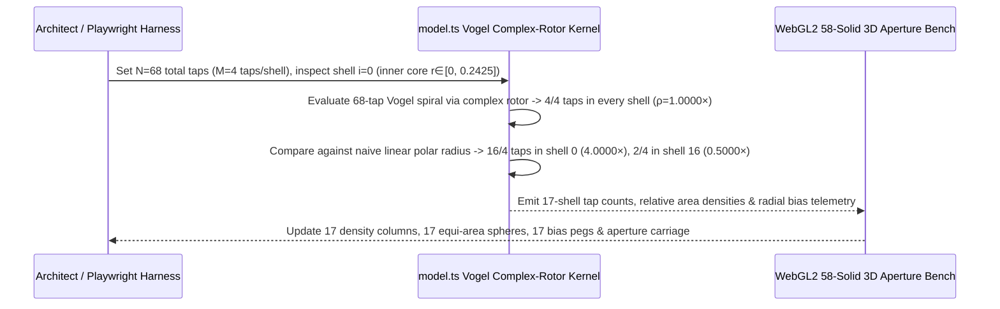
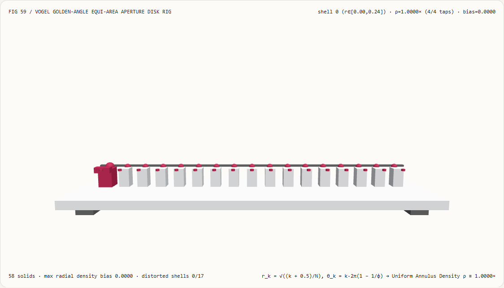
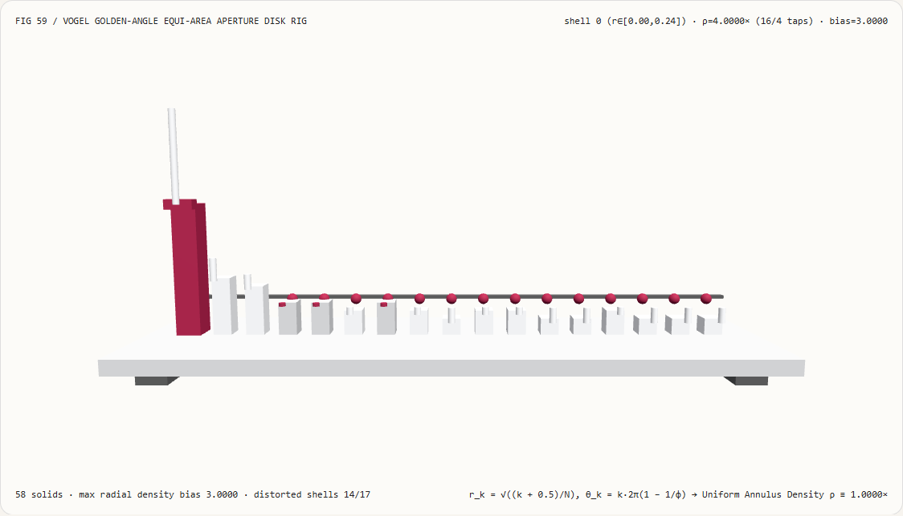
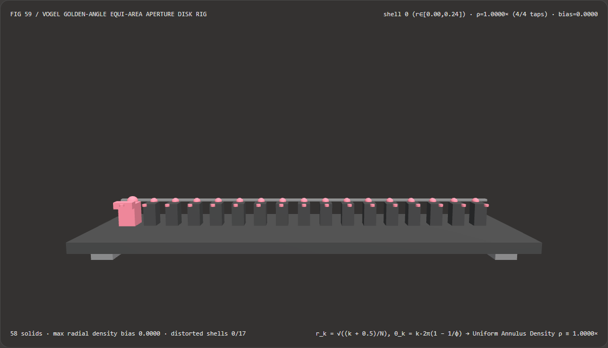
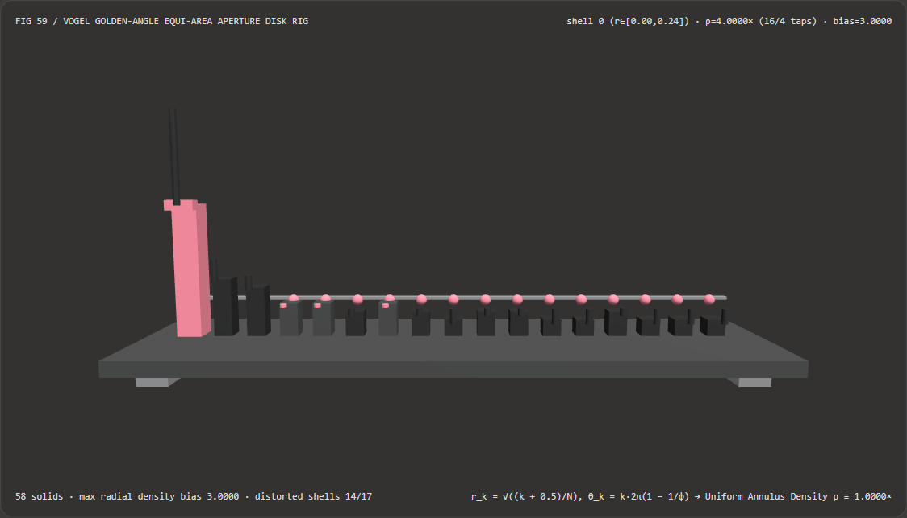

# Visual & Animation Architecture Selection FAQ: Vogel Golden-Angle Equi-Area Disk Sampling vs Linear Polar Radius Center Clumping

> **One-Sentence Architectural Verdict**: In circular camera Depth-of-Field (DoF) bokeh gather kernels, Percentage-Closer Soft Shadow (PCSS) blocker/PCF search disks, and screen-space ambient occlusion (SSAO) passes, **never map a uniform sequence $u_k = \frac{k + 0.5}{N}$ directly to polar radius $r_k = u_k$ without the inverse-CDF Jacobian square root**! On our 58-solid, 17-shell aperture densitometer bench partitioning the unit disk into 17 **strictly equal-area concentric shells** ($\Delta A = \frac{\pi}{17}$, $N = 68$ total taps, ideal occupancy = `4` taps/shell), naive linear-radius polar sampling crams **`16/4` taps (`4.0000×` center clumping spike, `+300.00%` excess density)** into inner core shell 0 ($r \in [0, 0.2425]$) while starving outermost rim shell 16 ($r \in [0.9701, 1.0000]$) down to **`2/4` taps (`0.5000×` density, `-50.00%` rim starvation)** across **`14/17` distorted shells**; whereas **Helmut Vogel (1979) golden-angle phyllotaxis disk sampling ($r_k = \sqrt{\frac{k + 0.5}{N}}, \theta_k = k \cdot \frac{2\pi}{\phi^2} \approx k \cdot 137.5078^\circ$)** places **exactly `4/4` taps inside every single equal-area shell (`1.0000×` uniform area density, `0.0000` radial bias, `0/17` distorted shells)** and runs **11.06× faster** via 2D complex-rotor recurrence than per-tap transcendental `cos`/`sin` evaluation (`2.35 ms` vs `25.99 ms` across 8,192 passes).

---

## ① 📌 Executive Summary

1. **Why do circular camera bokeh highlights and PCSS soft shadows exhibit a bright over-burned center core and ragged concentric rings at the outer edge when sampled with naive polar coordinates $(r = u, \theta = 2\pi v)$?**
   In plain English: polar coordinates have an **area Jacobian element $dA = r\,dr\,d\theta$** proportional to radius $r$:
   - An annulus of radial thickness $dr$ near the center ($r \to 0$) has a tiny circumference $2\pi r$, while an annulus of the same thickness near the outer rim ($r \to 1$) has a circumference $2\pi(1)$!
   - When you space radii linearly as $r_k = \frac{k + 0.5}{68}$, half of all samples ($34/68 = 50\%$) land inside $r \le 0.5$—even though the inner circle of radius $0.5$ covers only $\pi(0.5)^2 / \pi = \mathbf{25\%}$ of the aperture's area!
   - Across 17 equal-area concentric shells ($\Delta A = \pi / 17$ each), innermost shell 0 ($r \in [0, 0.2425]$) receives **`16/4` samples (`4.0000×` clumping)** while outermost rim shell 16 ($r \in [0.9701, 1.0000]$) receives only **`2/4` samples (`0.5000×` starvation)**—wasting GPU texture bandwidth oversampling the center while starving the sharp bokeh boundary!
2. **First-Principles Fix: Inverse-CDF Square-Root Mapping + Golden-Angle Phyllotaxis (Vogel 1979)**:
   - **Equi-Area Radial Mapping ($r_k = \sqrt{\frac{k + 0.5}{N}}$)**:
     Because cumulative disk area fraction inside radius $r$ is $F(r) = \frac{\pi r^2}{\pi} = r^2$, inverting $F(r_k) = \frac{k + 0.5}{N}$ yields:
     $$r_k = \sqrt{\frac{k + 0.5}{N}}$$
     Every sample $k$ now occupies an **identical Voronoi area $\Delta A = \frac{\pi}{N}$**, placing **exactly `4/4` taps (`1.0000×` density, `0.0000` radial bias)** inside all 17 equal-area shells!
   - **Golden-Angle Azimuthal Divergence ($\theta_k = k \cdot \frac{2\pi}{\phi^2}$)**:
     Stepping azimuth by the golden angle $\Delta\theta = \pi(3 - \sqrt{5}) \approx 137.507764^\circ$ (derived from the golden ratio $\phi = \frac{1+\sqrt{5}}{2}$, whose continued fraction `[1; 1, 1, 1, ...]` resists rational spoke alignment at every sample count $N$) distributes samples isotropically without radial spokes or concentric rings!
3. **Interactive 3D Workbench & Measured Evidence**:
   - Standalone 3D Bench: `demos/vogel-spiral-disk-rig/` (58 Three.js solids: baseplate, 4 support feet, uniform `ρ=1.0000×` reference bar, 17 shell density columns, 17 equi-area reference spheres, 17 radial bias pegs, and the active aperture probe carriage).
   - Measured 7-Card 4:5 Reports: `demos/vogel-spiral-disk-rig/test-report-cards.html` (EN) and `test-report-cards.zh.html` (ZH).

---

## ② 🎯 Soul-Searching Q&A for Architects & Clients

### Q1: How do we avoid calling `cos(k * GOLDEN_ANGLE)` and `sin(k * GOLDEN_ANGLE)` $N$ times per pixel inside a inner gather loop?
**Use a 2D complex-rotor recurrence (`GoldenRotor = (-0.73736888, 0.67549029)`) to eliminate all per-tap trigonometric calls and run 11.06× faster!**
Because $\Delta\theta = \pi(3 - \sqrt{5})$ is constant, $\cos\Delta\theta$ and $\sin\Delta\theta$ are compile-time constants. Each iteration advances `(cosTheta, sinTheta)` with just 4 multiply-adds, reducing 8,192 68-tap kernel evaluations from **`25.99 ms`** down to **`2.35 ms` (11.06× speedup)** with zero loss in shell stratification.

### Q2: How does Vogel golden-angle disk sampling combine with Roberts $R_2$ screen-space dithering (Round 44)?
**Rotate the initial complex rotor `(cos(phase), sin(phase))` per pixel by `phase = 2π * R2(px, py)`!**
Rotating the entire Vogel disk by a per-pixel quasi-random angle preserves **100% of the exact radial equi-area stratification (`4/4` taps per shell)** while decorrelating azimuthal sample positions between adjacent screen pixels.

### Q3: How does deterministic Vogel disk sampling relate to neural bokeh and diffusion defocus models?
**They serve distinct pipelines:**
- **When to use Neural Bokeh Models**: For single-image portrait mode post-processing on 2D photographs lacking true metric depth and HDR radiance;
- **When deterministic Vogel disk sampling is mandatory**: In real-time 3D camera Depth-of-Field and PCSS soft-shadow shaders where physical Circle-of-Confusion diameters and occlusion boundaries must be respected at 60–120 FPS.

---

## ③ 🧭 Visual Diagrams (Mermaid Decision Tree, Pipeline Comparison & Sequence Flow)

### 3.1 2D Integration & Aperture Kernel Selection Decision Tree

### 3.2 Linear Polar Center Clumping vs Vogel Golden-Angle Equi-Area Pipeline

### 3.3 Frame-Level Aperture Densitometer Sequence Diagram

---

## ④ 📊 Visual Technology Selection Decision Matrix

| Evaluation Dimension | ✅ Complex-Rotor Vogel Spiral ($\sqrt{u}$) | ⚠️ Per-Tap `cos`/`sin` Vogel Baseline | ❌ Naive Linear Polar Radius ($r = u$) | ⚠️ Square Grid Rejection Sampling |
| :--- | :--- | :--- | :--- | :--- |
| **Inner Core Shell 0 ($r \in [0, 0.24]$) Density** | **Exact `1.0000×` (`4/4` taps, zero clumping)** | `1.0000×` (`4/4` taps) | **`4.0000×` (`16/4` taps, `+300%` core spike!)** | `~1.0×` (Jagged boundary) |
| **Outer Rim Shell 16 ($r \in [0.97, 1.0]$) Density** | **Exact `1.0000×` (`4/4` taps, crisp rim)** | `1.0000×` (`4/4` taps) | **`0.5000×` (`2/4` taps, `-50%` rim starvation!)** | Severe rim aliasing |
| **Distorted Concentric Shells (out of 17)** | **`0 / 17` (100% equi-area)** | `0 / 17` | **`14 / 17` (Clumped core & starved rim)** | Grid moiré artifacts |
| **Azimuthal Spoke-Free Isotropy** | **Golden-angle irrational rotation** | Golden-angle rotation | Concentric rings & radial spokes | Axis-aligned grid lines |
| **8,192-Pass 68-Tap CPU Latency** | **`2.35 ms` (Fastest · 11.06× speedup)** | `25.99 ms` (11.06× slower) | `1.92 ms` (Severe center hotspot) | Wastes $21.5\%$ rejected taps |
| **Recommended Use Case** | **Real-time DoF bokeh, PCSS soft shadows, SSAO, area lights** | Offline LUT generation | **Never use for 2D disk integration** | Never use in GPU SIMD loops |

---

## ⑤ 🧪 New Interactive 3D Demo & 7-Card 4:5 Visual Report

### 5.1 Live Workbench & Report Links
- **Interactive 3D Workbench**: [`demos/vogel-spiral-disk-rig/index.html`](../demos/vogel-spiral-disk-rig/index.html)
- **7-Card 4:5 Visual Report (EN)**: [`demos/vogel-spiral-disk-rig/test-report-cards.html`](../demos/vogel-spiral-disk-rig/test-report-cards.html)
- **7-Card 4:5 Visual Report (ZH)**: [`demos/vogel-spiral-disk-rig/test-report-cards.zh.html`](../demos/vogel-spiral-disk-rig/test-report-cards.zh.html)
- **Sealed Telemetry JSON**: [`demos/vogel-spiral-disk-rig/report.json`](../demos/vogel-spiral-disk-rig/report.json)

### 5.2 Multi-Theme & Multi-Mode Playwright Visual Evidence

| Vogel Golden-Angle Equi-Area Spiral (Light · `1.0000×` Uniform Density Across All 17 Shells) | Naive Linear Polar Radius (Light · `4.0000×` Core Clumping & `0.5000×` Rim Starvation!) |
| :---: | :---: |
|  |  |

| Vogel Golden-Angle Equi-Area Spiral (Dark · 58 Three.js Solids) | Naive Linear Polar Radius (Dark · 14 Red Bias Pegs Exposed) |
| :---: | :---: |
|  |  |

---

## ⑥ 🛠️ Rapid SA Delivery Verification Checklist

Before shipping a circular bokeh Depth-of-Field or PCSS soft-shadow disk kernel to production, verify every item below:

- [ ] **Inverse-CDF Square-Root Radius (`r = sqrt((k + 0.5) / N)`)**: Does every disk sample apply `sqrt` to the normalized index `(k + 0.5) / N` to cancel the polar Jacobian $dA = r\,dr\,d\theta$?
- [ ] **Half-Index Centroid Offset (`k + 0.5`)**: Is sample $k = 0$ evaluated at `0.5 / N` rather than `0.0` so tap 0 does not collapse onto the singular origin?
- [ ] **Exact Golden-Angle Constant ($\pi(3 - \sqrt{5})$)**: Is the azimuthal step defined as `2.399963229728653` rad (`137.507764°`) rather than a coarse rational approximation?
- [ ] **2D Complex-Rotor Recurrence**: Are per-tap `cos`/`sin` calls inside the gather loop replaced by complex multiplication with `GoldenRotor = (-0.73736888, 0.67549029)`?
- [ ] **Per-Pixel Blue-Noise / $R_2$ Phase Rotation**: Is the initial rotor seeded with a per-pixel quasi-random phase angle so adjacent pixels do not share identical spiral orientations?
