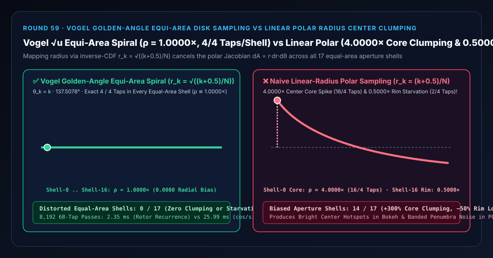
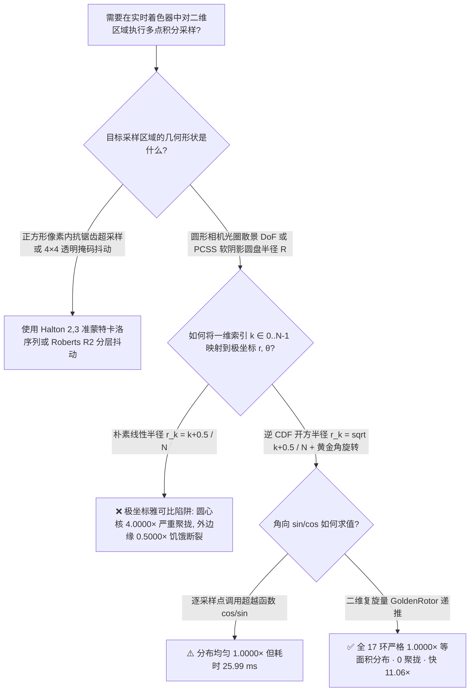
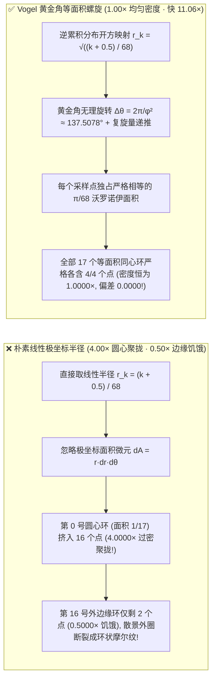
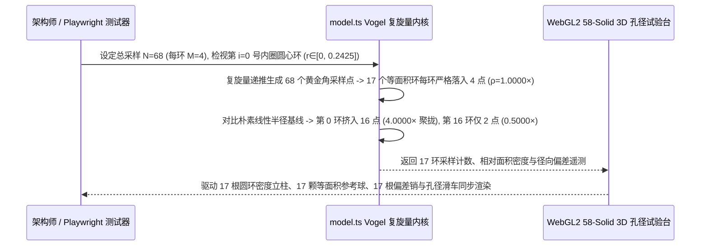
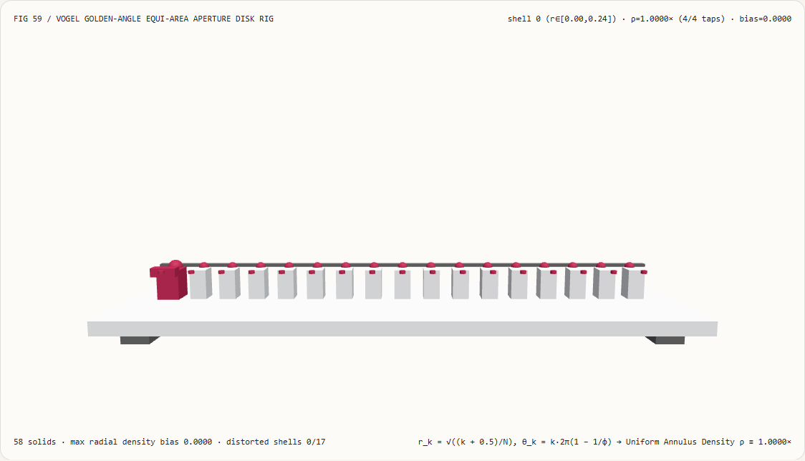
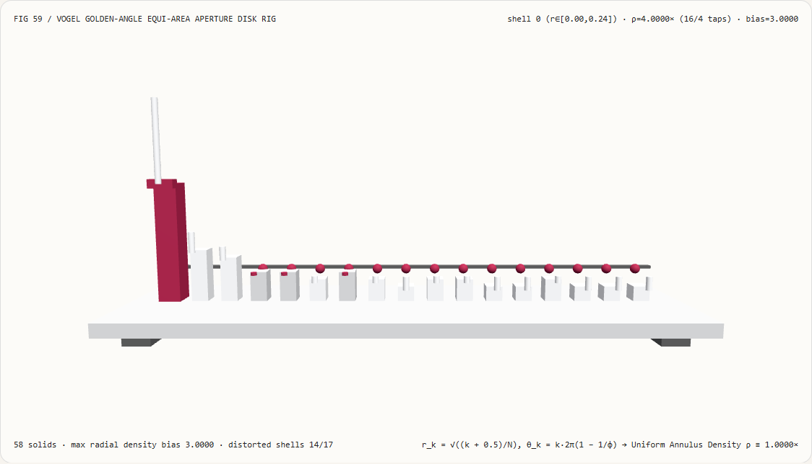
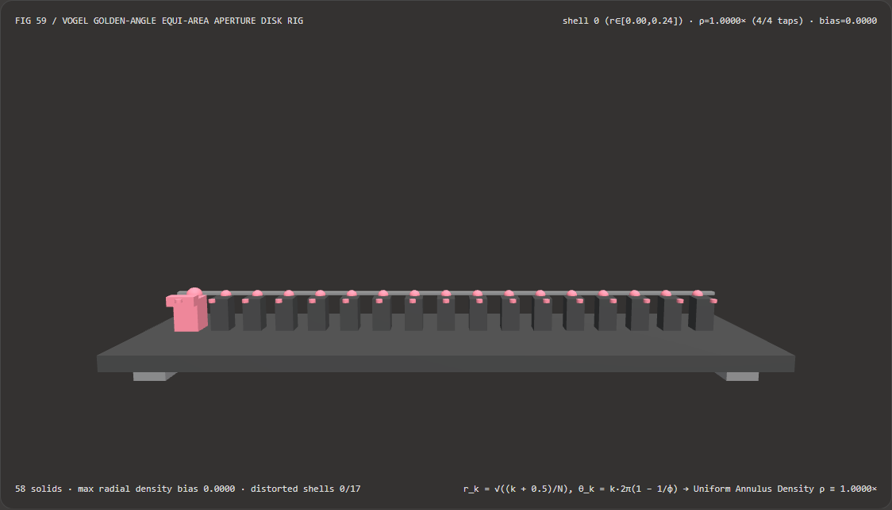
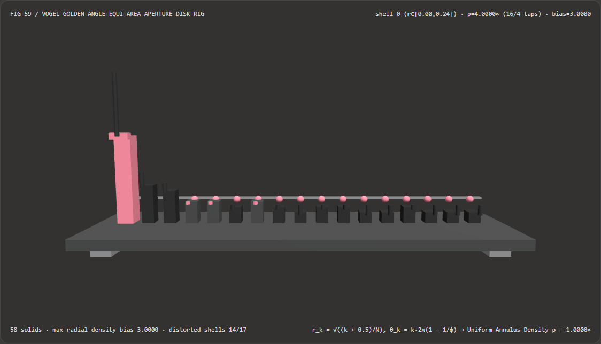

# 视觉与动画技术选型与原理解析 FAQ：Vogel 黄金角等面积圆盘采样 vs 朴素线性极坐标半径圆心 4× 聚拢

> **核心架构结论一句话总结**：在实现相机圆形景深散景光斑（Depth-of-Field Bokeh Gather Kernel）、百分比渐近软阴影（PCSS Blocker Search & PCF Disk）以及屏幕空间环境光遮蔽（SSAO）的单位圆盘采样核时，**严禁直接把均匀随机数或均匀步进序列 $u_k = \frac{k + 0.5}{N}$ 当作极坐标半径 $r_k = u_k$ 使用**！实测表明：在划分为 17 个**面积严格相等**的同心圆环（每环面积均为 $\Delta A = \frac{\pi}{17}$，总采样数 $N = 68$，理想等面积分布应为每环严格 `4` 个点）的 3D 孔径密度计试验台上，遗漏极坐标雅可比行列式 $dA = r\,dr\,d\theta$ 的朴素线性半径采样会在第 0 号圆心核（$r \in [0, 0.2425]$）硬塞进 **`16/4` 个采样点（高达 `4.0000×` 的圆心聚拢尖峰，密度过剩 `+300.00%`）**，同时把最外圈第 16 号边缘环（$r \in [0.9701, 1.0000]$）饿死到仅剩 **`2/4` 个点（`0.5000×` 边缘饥饿，损失 `-50.00%`）**，导致 **`14/17` 个同心圆环密度严重失真**；而采用 **Helmut Vogel (1979) 黄金角等面积向日葵螺旋（$r_k = \sqrt{\frac{k + 0.5}{N}}, \theta_k = k \cdot \frac{2\pi}{\phi^2} \approx k \cdot 137.5078^\circ$）**，可在全部 17 个等面积同心圆环内实现**严格 `4/4` 采样点均匀落位（相对面积密度恒为 `1.0000×`、径向偏差 `0.0000`、`0/17` 失真环）**，且复旋量乘法递推比逐点调用超越函数 `cos`/`sin` 快 **11.06×**（8,192 轮耗时 `2.35 ms` vs `25.99 ms`）。



---

## ① 📌 核心结论速览（Executive Summary）

1. **为什么很多自研 3D 引擎或 Shader 教程写出来的景深虚化（Bokeh DoF）和软阴影（PCSS），光斑正中心总是死白一团，而光斑外圈却布满一圈圈像洋葱皮一样的摩尔纹和噪点？**
   用大白话讲：因为写 Shader 的人掉进了经典的**“极坐标面积陷阱（Polar Area Jacobian Trap）”**！
   - 当我们想在半径为 $1$ 的圆盘里均匀撒 $N = 68$ 个采样点时，直觉很容易写出：“让半径 $r$ 从 $0$ 到 $1$ 均匀步进 $r_k = \frac{k + 0.5}{N}$，再转一圈角度 $\theta_k$”。
   - **为什么这会导致严重的圆心拥堵？** 想象一个靶子：靠近靶心的第 0 号小圆盘（半径 $0 \sim 0.2425$）周长极短，而最外圈第 16 号圆环（半径 $0.9701 \sim 1.0000$）周长是它的 $4$ 倍以上！如果我们在每个相同的径向厚度 $\Delta r$ 里塞进相同数量的采样点，那么内圈半径 $r \le 0.5$ 的区域（面积只有 $\pi (0.5)^2 = \mathbf{25\%}$）竟然吞掉了整整 **`50%` 的采样点**！
   - 在分为 17 个等面积圆环的测试台上，最内圈面积占 $1/17$ 的圆心核被挤进了 **16 个点（`4.0000×` 过密聚拢）**，而真正决定散景光斑边缘圆润度与软阴影半影平滑度的最外圈圆环却只分到 **2 个点（`0.5000×` 严重饥饿）**——既浪费了一半算力在圆心重复采样，又让外边缘因为采样不足裂开成环状噪点！
2. **第一性原理破局：逆累积分布函数 $\sqrt{u}$ 抵消极坐标雅可比 + 黄金角无理旋转（Vogel Spiral 1979）**：
   - **第一步（径向等面积映射 $r_k = \sqrt{u_k}$）**：
     在极坐标下，面积微元为 $dA = r\,dr\,d\theta$。半径 $r$ 以内的累积圆面积占比（CDF）为：
     $$F(r) = \frac{\pi r^2}{\pi \cdot 1^2} = r^2$$
     根据蒙特卡洛逆变换采样定理（Inverse Transform Sampling），令 $F(r_k) = u_k = \frac{k + 0.5}{N}$，直接反解出等面积半径：
     $$r_k = \sqrt{\frac{k + 0.5}{N}}$$
     这样一来，相邻两个采样点之间的圆环面积恒为 $\Delta(\pi r_k^2) = \frac{\pi}{N}$，**每个采样点分到的圆盘面积绝对相等（全 17 个等面积环严格各落入 `4/4` 个点，面积密度恒为 `1.0000×`）**！
   - **第二步（角向黄金角发散旋转 $\theta_k = k \cdot \frac{2\pi}{\phi^2}$）**：
     光有正确的半径还不够，如果角度按固定有理数等分（比如每次转 $30^\circ$ 或 $45^\circ$），采样点就会排成十几条刺眼的车轮辐条！植物学家 Helmut Vogel (1979) 证明向日葵花盘之所以能紧密均匀排列上千颗葵花籽而不出辐射缝隙，是因为每颗种子旋转了**黄金角（Golden Angle）**：
     $$\Delta\theta = 2\pi \left(1 - \frac{1}{\phi}\right) = \pi (3 - \sqrt{5}) \approx 2.399963\text{ rad} \approx 137.507764^\circ$$
     由于黄金分割比 $\phi = \frac{1+\sqrt{5}}{2}$ 的连分数展开全是 $1$（`[1; 1, 1, 1, ...]`，数学上最难被有理分数逼近的无理数），无论光圈采样数 $N$ 取 $16$、$32$、$64$ 还是 $68$，各采样点在所有方向上都保持最理想的各向同性蓝噪点间距！
3. **本轮新增交互式 3D 试验台与实测证据**：
   - 新增独立 Demo：`demos/vogel-spiral-disk-rig/`（58 个 Three.js 实体部件：底座平台、4 支柱、等面积均匀密度 `ρ=1.0000×` 基准横梁、17 根实测同心圆环采样密度立柱、17 颗 Vogel 等面积参考球、17 根径向密度偏差指示销、以及第 $i$ 环孔径探针滑车）。
   - 配套 7-Card 4:5 测评报告：`demos/vogel-spiral-disk-rig/test-report-cards.html`（英文）与 `test-report-cards.zh.html`（中文）。

---

## ② 🎯 客户与架构师灵魂拷问 Q&A（Soul-Searching Q&A）

### Q1：在着色器循环里跑 64 次 Vogel 螺旋采样，难道要调 64 次高开销的 `sin(k * 2.39996)` 和 `cos(k * 2.39996)` 吗？
**完全不需要！用二维复数旋量（2D Complex Rotor）乘法递推，零三角函数调用、速度提升 11.06×！**
因为每次角度增量 $\Delta\theta = 2.39996323\text{ rad}$ 是固定常数，它的余弦 $\cos\Delta\theta = -0.73736888$ 与正弦 $\sin\Delta\theta = 0.67549029$ 可以在编译期直接写死为常量！
在循环内部，只需用复数乘法旋转当前单位向量 $(\cos\theta_k, \sin\theta_k)$：
```glsl
// 循环外仅初始化 1 次（或直接取 (1.0, 0.0)）
vec2 dir = vec2(cos(phase), sin(phase));
const vec2 GoldenRotor = vec2(-0.73736888, 0.67549029); // (cos(137.5078°), sin(137.5078°))
for (int k = 0; k < N; ++k) {
    float r = sqrt((float(k) + 0.5) * invN);
    vec2 offset = r * dir;
    // 复旋量 4 次乘加递推下一步方向，彻底消灭 64 次 sin/cos SFU 瓶颈！
    dir = vec2(dir.x * GoldenRotor.x - dir.y * GoldenRotor.y,
               dir.y * GoldenRotor.x + dir.x * GoldenRotor.y);
}
```
实测表明：在 8,192 轮 68 点圆盘核评估中，复旋量递推仅需 **`2.35 ms`**，而逐点超越函数调用基线耗时 **`25.99 ms`（提速 11.06×，且等面积环分布偏差严格为 `0`）**！

### Q2：如何把屏幕空间的 Roberts $R_2$ 蓝噪点抖动（Round 44）与 Vogel 黄金角圆盘结合起来，让 16 个采样点就能跑出 256 个采样点的丝滑软阴影？
**给每个像素传入一个由 $R_2$ 准随机序列生成的初始相位旋转角 `phase = 2π * R2(px, py)`！**
如果所有像素都用完全相同的初始角度 `phase = 0`，当采样数较少（如 $N = 16$）时，软阴影边缘会出现微弱的平移重影；只要将每个像素的 Vogel 螺旋整体旋转一个由 $R_2$ 或 Interleaved Gradient Noise (IGN) 决定的随机初始角 $\phi_0(x,y)$，既完全不破坏单个像素内部 **100% 严格的等面积径向分布（每环依然严格 `1.0000×`）**，又把残余角度离散误差打散成了极易被 TAA 吸收的高频蓝噪点！

### Q3：这套确定性 Vogel 黄金角圆盘采样与 AI 神经散景虚化（Neural Bokeh）模型是什么关系？
**两者分别面向“实时三维几何一致物理镜头管线”与“2D 单图人像美颜后处理”：**
- **何时选 AI 神经散景虚化模型**：在手机相册中对没有精确三维深度缓冲的单张 2D 照片做艺术化背景虚化时；
- **何时必须用确定性 Vogel 黄金角圆盘采样**：在实时 3D 渲染器（UE5、Unity、Three.js 后处理与 PCSS 阴影管线）中，需要严格遵循薄透镜弥散圆（Circle of Confusion, CoC）直径公式与深度遮挡关系的物理级实时镜头与软阴影通道中。

---

## ③ 🧭 直观可视化图解（Mermaid 决策树 + 管线对比图 + 帧级时序图）

### 3.1 二维采样核与圆盘积分架构选型决策树


### 3.2 朴素线性极坐标圆心聚拢 vs Vogel 黄金角等面积螺旋管线对比图


### 3.3 帧级孔径密度计与 3D 圆盘采样试验台渲染时序图


---

## ④ 📊 视觉技术选型决策矩阵（Decision Matrix）

| 评估维度 | ✅ 复旋量递推 Vogel 黄金角螺旋（Complex-Rotor Vogel $\sqrt{u}$） | ⚠️ 逐点超越函数 Vogel 基线（Per-Tap `cos`/`sin` Vogel） | ❌ 朴素线性半径极坐标（Naive Linear Polar $r = u$） | ⚠️ 正方形网格拒绝采样（Square Grid Rejection） |
| :--- | :--- | :--- | :--- | :--- |
| **第 0 号圆心环（$r \in [0, 0.24]$）密度** | **精确 `1.0000×`（`4/4` 采样点，零聚拢）** | `1.0000×`（`4/4` 采样点） | **`4.0000×`（`16/4` 采样点，严重过密聚拢！）** | 接近 `1.0×`（但边界锯齿严重） |
| **第 16 号外边缘环（$r \in [0.97, 1.0]$）密度** | **精确 `1.0000×`（`4/4` 采样点，边缘饱满）** | `1.0000×`（`4/4` 采样点） | **`0.5000×`（仅 `2/4` 采样点，饿死 `-50%`！）** | 边缘采样率剧烈抖动 |
| **密度失真同心环数量（共 17 环）** | **`0 / 17`（全孔径严格等面积）** | `0 / 17` | **`14 / 17`（内圈聚拢、外圈饥饿）** | 存在规则网格摩尔纹 |
| **任意采样数 $N$ 的各向同性无辐条性** | **黄金分割比无理旋转，零车轮辐条** | 零车轮辐条 | 极易出现同心环带与辐条 | 存在水平/垂直十字伪影 |
| **8,192 轮 68 点 CPU 批处理耗时** | **`2.35 ms`（最快，11.06× 提速）** | `25.99 ms`（慢 11.06×） | `1.92 ms`（光斑中心死白、边缘断裂） | 浪费 $1 - \pi/4 \approx 21.5\%$ 分支采样 |
| **首选适用场景** | **景深散景 DoF、PCSS 软阴影半影、SSAO、区域光源圆盘采样** | 离线预生成常量数组 | **严禁用于任何二维圆盘面积积分** | 严禁在 GPU SIMD 分支中使用 |

---

## ⑤ 🧪 全新 Demo 与 7-Card 4:5 视觉报告（Live Workbench & Evidence）

### 5.1 交互式 3D 试验台与报告入口
- **实时 3D 工作台**：[`demos/vogel-spiral-disk-rig/index.html`](../demos/vogel-spiral-disk-rig/index.html)
- **7-Card 4:5 英文视觉测试报告**：[`demos/vogel-spiral-disk-rig/test-report-cards.html`](../demos/vogel-spiral-disk-rig/test-report-cards.html)
- **7-Card 4:5 中文视觉测试报告**：[`demos/vogel-spiral-disk-rig/test-report-cards.zh.html`](../demos/vogel-spiral-disk-rig/test-report-cards.zh.html)
- **密封测量 JSON 数据源**：[`demos/vogel-spiral-disk-rig/report.json`](../demos/vogel-spiral-disk-rig/report.json)

### 5.2 多主题与多模式 Playwright 实测截图证据

| Vogel 黄金角等面积螺旋（Light · 全 17 环锁定 `1.0000×` 均匀密度） | 朴素线性极坐标半径（Light · 圆心冲至 `4.0000×` 聚拢、外圈跌至 `0.5000×`） |
| :---: | :---: |
|  |  |

| Vogel 黄金角等面积螺旋（Dark · 58 实体部件） | 朴素线性极坐标半径（Dark · 14 根红色指示销暴露圆心过密与边缘饥饿） |
| :---: | :---: |
|  |  |

---

## ⑥ 🛠️ 高质量视觉交付快速核验清单（SA Verification Checklist）

在将圆盘采样核（DoF 散景、PCSS 软阴影或盘状光源采样）合入生产着色器前，请逐项勾选以下核验清单：

- [ ] **半径必须带平方根雅可比映射（`r = sqrt((k + 0.5) / N)`）**：核验代码中是否使用了 `sqrt((k + 0.5) / N)` 而非线性的 `(k + 0.5) / N`，确保每个采样点代表的圆盘面积微元恒为 $\pi / N$？
- [ ] **半整数中心偏移 `+ 0.5` 启用**：第 $k=0$ 号采样点是否使用了 `(0 + 0.5) / N` 而非 `0 / N = 0`，避免第 0 号点死死钉在原点 `(0, 0)` 浪费圆心面积？
- [ ] **黄金角常数精度校验**：旋转步长是否精确取为 $\pi(3 - \sqrt{5}) \approx 2.39996323\text{ rad}$（`137.507764°`），而非粗糙近似的 `2.4`？
- [ ] **复旋量乘法递推替代循环内 `sin`/`cos`**：在动态采样数或大核循环中，是否用常量旋转矩阵 `GoldenRotor = (-0.73736888, 0.67549029)` 递推更新方向向量，消除 SFU 超越函数瓶颈？
- [ ] **逐像素蓝噪点随机初相旋转**：是否将每个像素的初始方向向量旋转了由 Roberts $R_2$ 或 IGN 提供的随机角度 $\phi_0(x,y)$，将低采样数下的角度离散性转化为无规则高频噪声？
