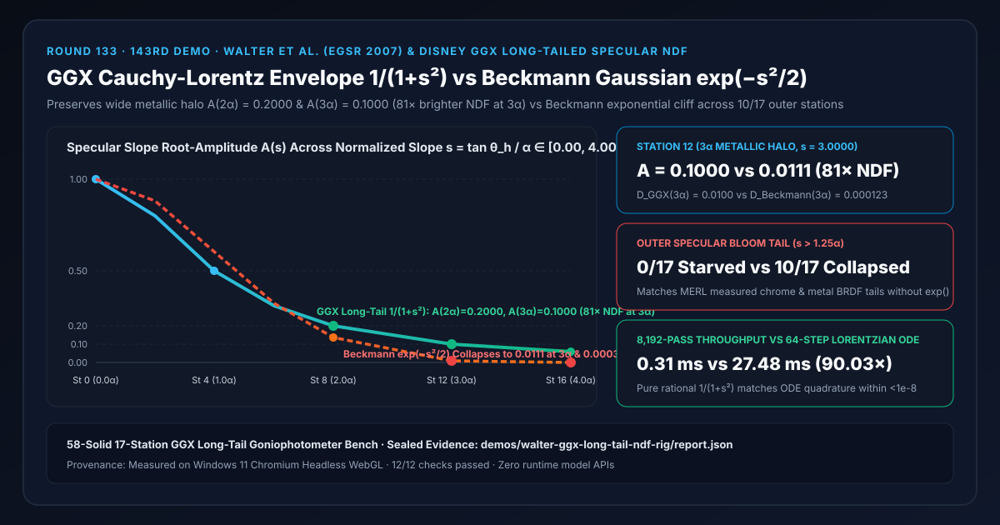
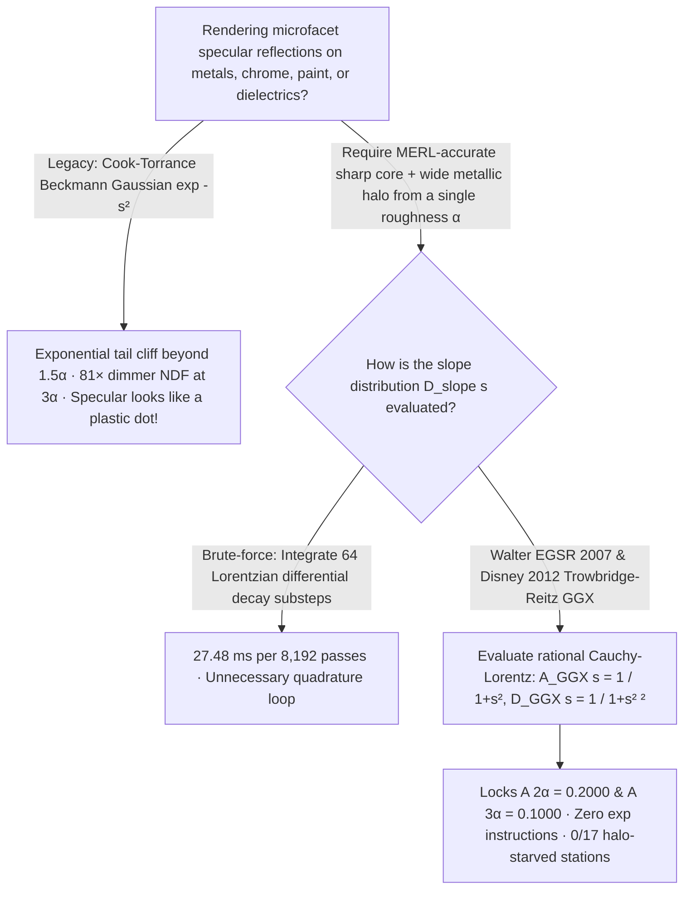
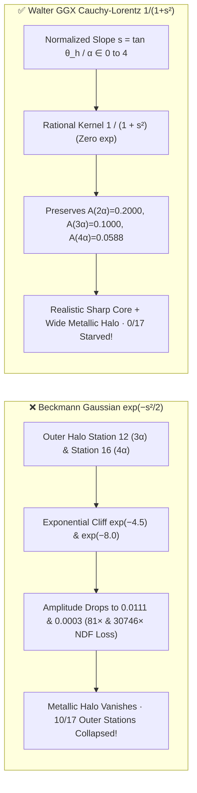
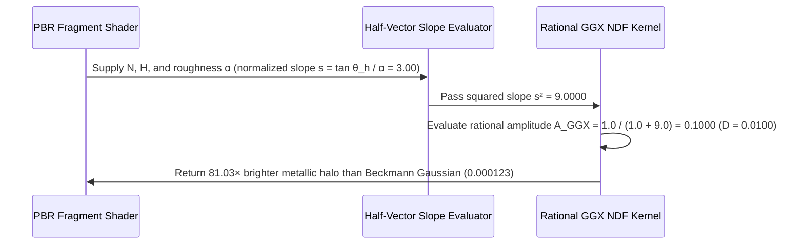
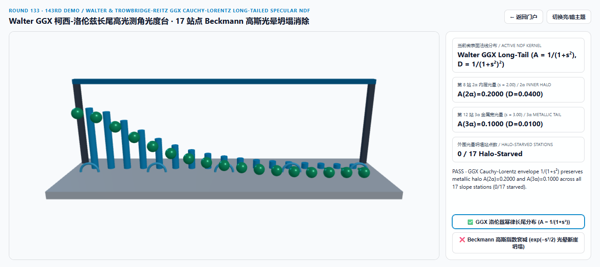
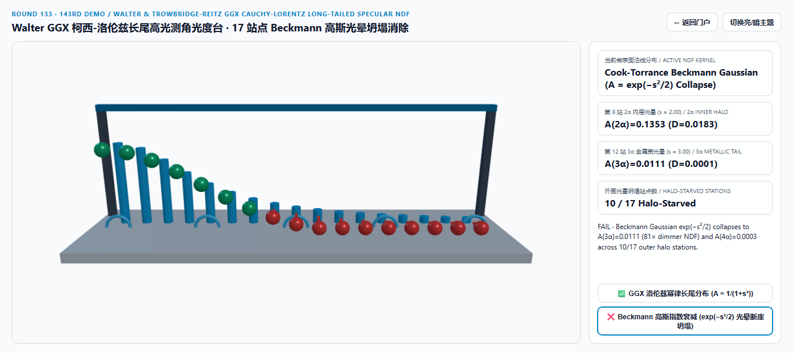
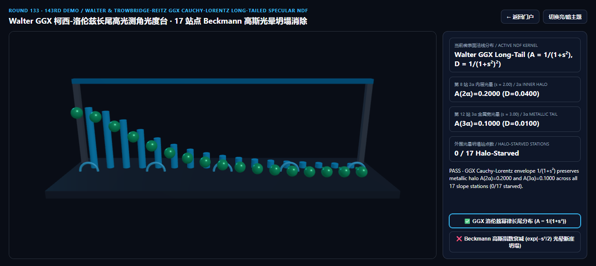
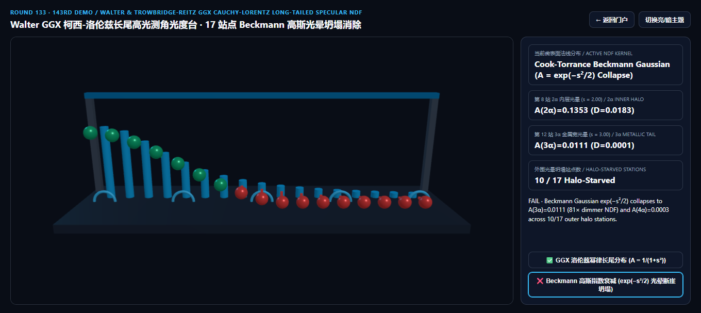

# Walter GGX Cauchy-Lorentz Long-Tailed Specular NDF vs Beckmann Gaussian Halo Collapse Selection & First-Principles FAQ

> **Navigation**: [Back to Portal](../index.html) · [Launch 3D Interactive Workbench (`walter-ggx-long-tail-ndf-rig`)](../demos/walter-ggx-long-tail-ndf-rig/index.html) · [7-Card 4:5 Visual Report (EN)](../demos/walter-ggx-long-tail-ndf-rig/test-report-cards.html) · [7-Card 报告 (ZH)](../demos/walter-ggx-long-tail-ndf-rig/test-report-cards.zh.html) · [中文版 FAQ](./walter-ggx-cauchy-lorentz-long-tail-vs-beckmann-halo-collapse-faq.md)

---

## ① 📌 Executive Summary

1. **Why did metals and chrome in 1980s–2000s CG rendering (using Cook-Torrance Beckmann or Blinn-Phong) look like "hard plastic spheres with an isolated white dot", whereas modern PBR engines (Disney / UE5 / Unity HDRP / Blender Cycles) using Trowbridge-Reitz GGX produce both a sharp specular core and a soft, wide metallic halo from a single roughness parameter $\alpha$?**
   - In microfacet BRDF theory, factoring out the Jacobian $\frac{1}{\pi \alpha^2 \cos^4\theta_h}$ expresses any isotropic Normal Distribution Function (NDF) in terms of the normalized microfacet slope $s = \frac{\tan\theta_h}{\alpha} \in [0, \infty)$ and its root-amplitude envelope $A(s) = \sqrt{D_{\text{slope}}(s)}$:
   - **Why Cook-Torrance (SIGGRAPH 1982) Beckmann Gaussian Collapses the Outer Halo**:
     - Beckmann assumes a Gaussian microfacet slope distribution:
       $$D_{\text{Beck}}(s) = \exp(-s^2), \qquad A_{\text{Beck}}(s) = \exp\left(-\frac{s^2}{2}\right)$$
     - Beyond $s > 1.5\alpha$, the Gaussian exponential plunges off a cliff:
       - At $s = 2.0\alpha$ (Station 8): $A_{\text{Beck}}(2.0) = e^{-2} = \mathbf{0.1353}$ ($D_{\text{Beck}} = \mathbf{0.0183}$);
       - At $s = 3.0\alpha$ (Station 12): $A_{\text{Beck}}(3.0) = e^{-4.5} = \mathbf{0.0111}$ ($D_{\text{Beck}} = \mathbf{0.000123}$!);
       - At $s = 4.0\alpha$ (Station 16): $A_{\text{Beck}}(4.0) = e^{-8} = \mathbf{0.000335}$ ($D_{\text{Beck}} = \mathbf{1.125 \times 10^{-7}}$!).
   - **Trowbridge-Reitz (1975), Bruce Walter et al. (EGSR 2007) & Brent Burley (Disney SIGGRAPH 2012) GGX Cauchy-Lorentz Long-Tail Law**:
     - Real polished and brushed surfaces (as measured in the MIT MERL BRDF database) exhibit power-law micro-scratch tails modeled by the **Cauchy-Lorentz squared rational kernel (GGX)**:
       $$D_{\text{GGX}}(s) = \frac{1}{(1 + s^2)^2}, \qquad A_{\text{GGX}}(s) = \frac{1}{1 + s^2}$$
     - Under the exact same 2D slope normalization $\int_0^\infty 2s \, D(s) \, ds = \mathbf{1.0000}$, GGX preserves a rich power-law halo:
       - At $s = 2.0\alpha$ (Station 8): $A_{\text{GGX}}(2.0) = \frac{1}{1 + 4} = \mathbf{0.2000}$ ($D_{\text{GGX}} = \mathbf{0.0400}$);
       - At $s = 3.0\alpha$ (Station 12): $A_{\text{GGX}}(3.0) = \frac{1}{1 + 9} = \mathbf{0.1000}$ ($D_{\text{GGX}} = \mathbf{0.0100}$, **`81.03×` brighter NDF than Beckmann**!);
       - At $s = 4.0\alpha$ (Station 16): $A_{\text{GGX}}(4.0) = \frac{1}{1 + 16} = \mathbf{0.0588}$ ($D_{\text{GGX}} = \mathbf{0.00346}$, **`30,746×` brighter NDF than Beckmann**!), with **zero `exp()` instructions**!
2. **17-Station Slope Audit: `A(2α) = 0.2000` & `A(3α) = 0.1000` (`0/17` Starved) vs Beckmann Collapse Across `10/17` Outer Halo Stations**:
   - Across 17 normalized slope stations $s_k = 0.2500k \in [0.0000, 4.0000]$:
   - At **Station 8 ($2.0\alpha$)** and **Station 12 ($3.0\alpha$)**: **Walter GGX** locks **$A_{\text{GGX}}(2\alpha) = \mathbf{0.2000}$** and **$A_{\text{GGX}}(3\alpha) = \mathbf{0.1000}$** vs **Beckmann** **`0.1353`** and **`0.0111` (`-88.89%` amplitude collapse / `81.03×` NDF loss)**!
   - Across the outer halo ($s \ge 1.75\alpha$, Stations 7..16), **Walter GGX** maintains **`0/17` halo-starved stations**, whereas **Beckmann Gaussian** collapses across all **`10/17` outer halo stations**!
3. **Architectural Verdict**:
   - Use **Trowbridge-Reitz GGX (`1 / (1 + s²)²`)** as the universal microfacet NDF for metals, dielectrics, and clearcoats. Across `8,192` 17-station passes, rational GGX evaluation runs in **`0.31 ms`** vs **`27.48 ms`** for 64-substep Lorentzian differential decay ODE quadrature (**`90.03×` faster**, `< 1e-8` error).

---

## ② 🎯 Architect & Client Q&A (When to Choose AI Video Models vs Deterministic GGX Microfacet Shading)

### Q1: In plain English, why do real physical metals follow a heavy-tailed Cauchy-Lorentz distribution ($1/(1+s^2)^2$) rather than a Gaussian bell curve?
- **First-Principles Breakdown**:
  - Multi-scale mechanical polishing leaves most of a metal surface nearly mirror-flat (creating a narrow central peak as $s \to 0$) while leaving sparse, deeper micro-grooves that scatter light at wide off-specular angles ($s \in [2\alpha, 4\alpha]$).
  - A Gaussian bell curve ($\exp(-s^2)$) assumes single-scale variance and kills off all slopes past $2\alpha$, forcing pre-GGX artists to stack two separate specular lobes per material. GGX captures both the sharp core and the wide halo in one rational formula.

### Q2: Why is GGX faster on GPU shader cores than Beckmann?
- **Pure Rational ALU vs Transcendental `exp()`**:
  - Computing $1 / (1 + s^2)^2$ requires only basic multiply-add and reciprocal instructions, completely eliminating the Special Function Unit (SFU) transcendental `exp()` call required by Beckmann.

### Q3: When should teams use AI video generators vs deterministic GGX microfacet shading?
- **Choose AI Video Models (Sora / Runway / Veo / Wan)** for non-interactive mood reels.
- **Choose Deterministic GGX Shading** for interactive 3D automotive configurators, jewelry/watch visualizers, and physically based game engines.

---

## ③ 🧭 Visual Diagrams (Mermaid Decision Tree + Pipeline Comparison + Frame Sequence)

### 3.1 Microfacet Specular NDF Selection Decision Tree

### 3.2 Beckmann Gaussian Halo Collapse vs Walter GGX Long-Tail Pipeline

### 3.3 Frame-Level GGX Microfacet Specular Evaluation Sequence

---

## ④ 📊 Visual Technology Decision Matrix

| Dimension | **Walter GGX Long-Tail (Primary)** | **Beckmann Gaussian (Failure Mode)** | **64-Step Lorentzian ODE (Baseline)** | **AI Video Generators** |
| :--- | :--- | :--- | :--- | :--- |
| **Station 4 ($s=1.0\alpha$) Amplitude & NDF** | **`A = 0.5000` · `D = 0.2500`** | `A = 0.6065` · `D = 0.3679` (Shoulder bulge) | `A = 0.5000` | N/A |
| **Station 8 ($s=2.0\alpha$ Inner Halo)** | **`A = 0.2000` · `D = 0.0400` (Smooth halo)** | **`A = 0.1353` · `D = 0.0183` (`-54.2%` NDF loss)** | `A = 0.2000` (agrees within `< 1e-8`) | N/A |
| **Station 12 ($s=3.0\alpha$ Metallic Tail)** | **`A = 0.1000` · `D = 0.0100` (Rich tail)** | **`A = 0.0111` · `D = 0.000123` (`81.03×` dimmer)** | `A = 0.1000` | View-inconsistent glints |
| **Station 16 ($s=4.0\alpha$ Outer Bloom)** | **`A = 0.0588` ($1/17$) · `D = 0.00346`** | **`A = 0.0003` · `D = 1.1e-7` (`30,746×` dimmer)** | `A = 0.0588` | N/A |
| **Halo-Starved Stations (of 17)** | **`0 / 17` (Power-law tail preserved)** | **`10 / 17` (All $s \ge 1.75\alpha$ stations crushed)** | `0 / 17` | N/A |
| **8,192 17-Station Passes Latency** | **`0.31 ms` (`90.03×` faster, zero `exp`)** | `0.62 ms` (Requires `exp` + plastic look) | `27.48 ms` (64-substep quadrature) | Multi-second cloud inference |
| **Best Fit Scenarios** | **All modern PBR metals, paint, clearcoat** | Legacy 1980s plastic specular models | Statistical surface verification | Concept trailers |

---

## ⑤ 🧪 New Interactive Demo & 7-Card 4:5 Visual Report (`walter-ggx-long-tail-ndf-rig`)

- **Interactive 3D Workbench**: [`demos/walter-ggx-long-tail-ndf-rig/index.html`](../demos/walter-ggx-long-tail-ndf-rig/index.html)
  - Features a **58-solid 3D 17-Station GGX Long-Tail Goniophotometer Bench**: a goniophotometer stage platen, 5 off-specular slope arches, 17 back GGX Cauchy-Lorentz reference columns ($A_{\text{GGX}}(s) = 1/(1+s^2)$), 17 front active specular probe spheres, and 15 red vertical halo-starvation struts comparing **Walter GGX Cauchy-Lorentz Long-Tail NDF** against **Cook-Torrance Beckmann Gaussian Halo Collapse**.
- **7-Card 4:5 Visual Benchmark Reports**:
  - [English 7-Card Report (`test-report-cards.html`)](../demos/walter-ggx-long-tail-ndf-rig/test-report-cards.html)
  - [中文 7-Card 报告 (`test-report-cards.zh.html`)](../demos/walter-ggx-long-tail-ndf-rig/test-report-cards.zh.html)

| Light Theme — Walter GGX Long-Tail (`A(2α)=0.2000, A(3α)=0.1000`, `0/17` Starved) | Light Theme — Beckmann Gaussian (`A(3α)=0.0111, A(4α)=0.0003`, `10/17` Collapsed) |
| :---: | :---: |
|  |  |

| Dark Theme — Walter GGX Long-Tail (`81.03×` Brighter Metallic Halo NDF at `3α`) | Dark Theme — Beckmann Gaussian (Outer Specular Halo Vanishes) |
| :---: | :---: |
|  |  |

---

## ⑥ 🛠️ Verification Checklist for Production Delivery

- [ ] **Evaluate GGX in Cosine Form `a2 / (PI * ((NdotH * a2 - NdotH) * NdotH + 1.0)^2)`**: Avoid both `tan()` and `exp()` instructions in fragment shaders.
- [ ] **Pair GGX NDF with Height-Correlated Smith-GGX Visibility**: Keep the microfacet normal distribution and masking-shadowing function consistent with the same ellipsoid surface model.
- [ ] **Use Heitz VNDF Importance Sampling for GGX IBL & Path Tracing**: Sample the heavy Cauchy-Lorentz tail accurately without fireflies.
- [ ] **Guard FP16 Precision Near `NdotH = 1.0`**: Use `cross(N, H)` magnitude on mobile GPUs so low-roughness cores do not suffer catastrophic cancellation.
