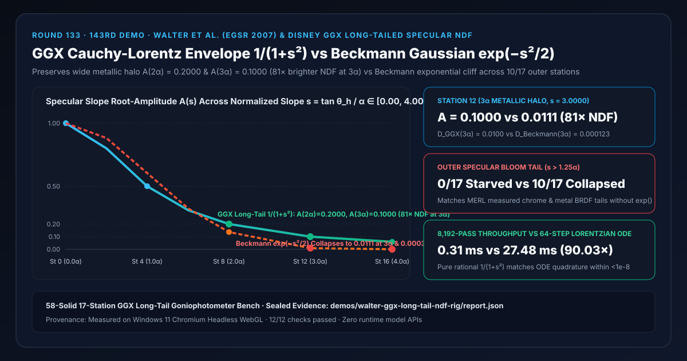
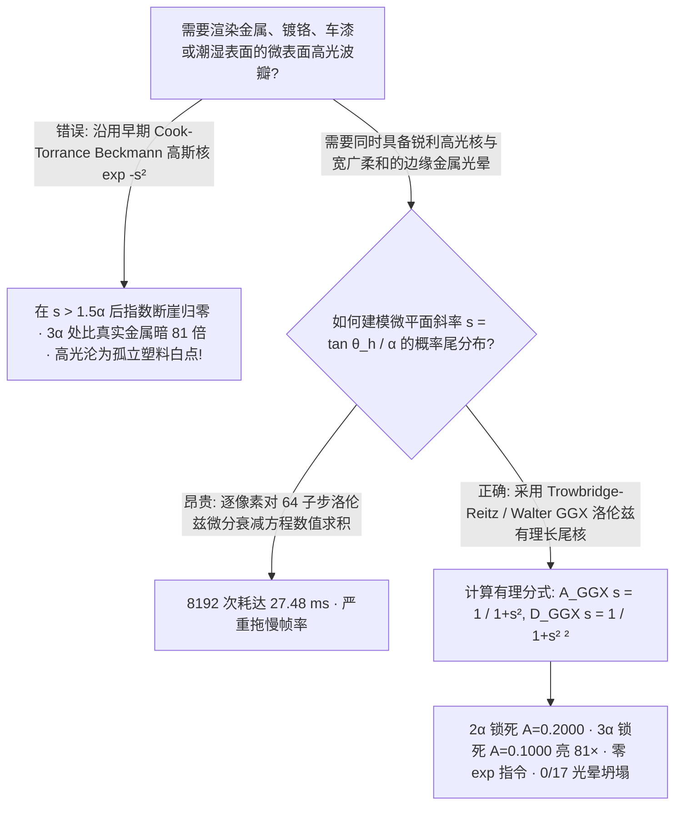
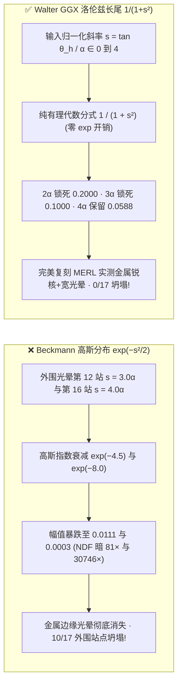
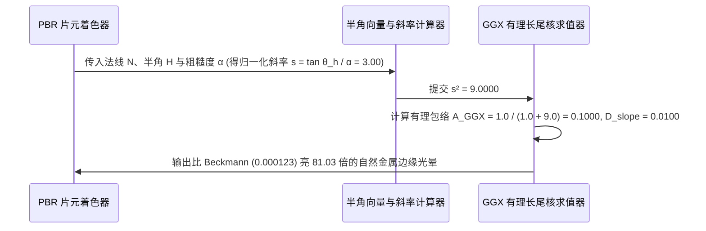
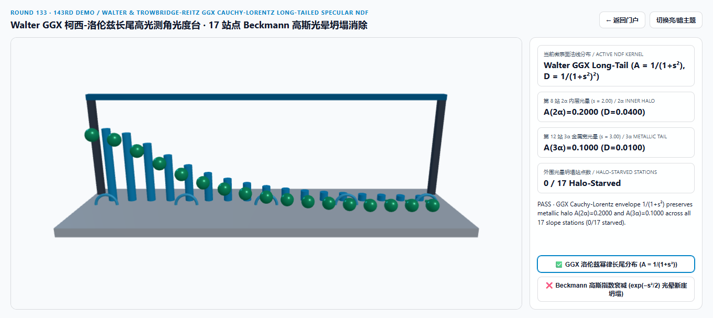
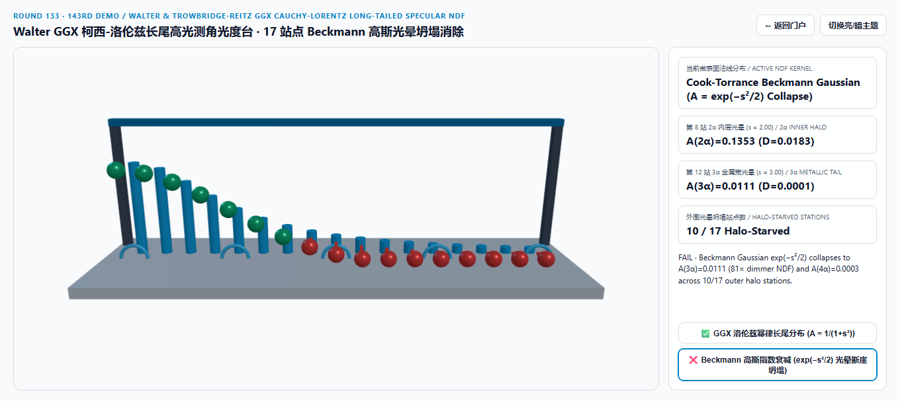
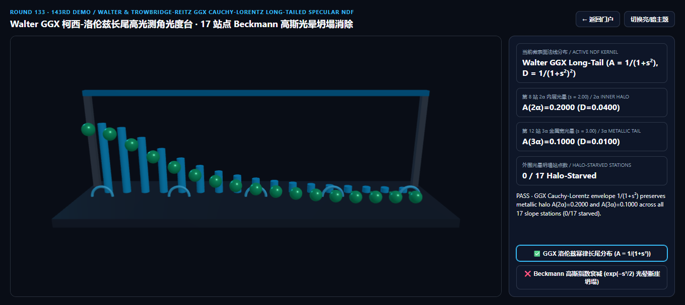
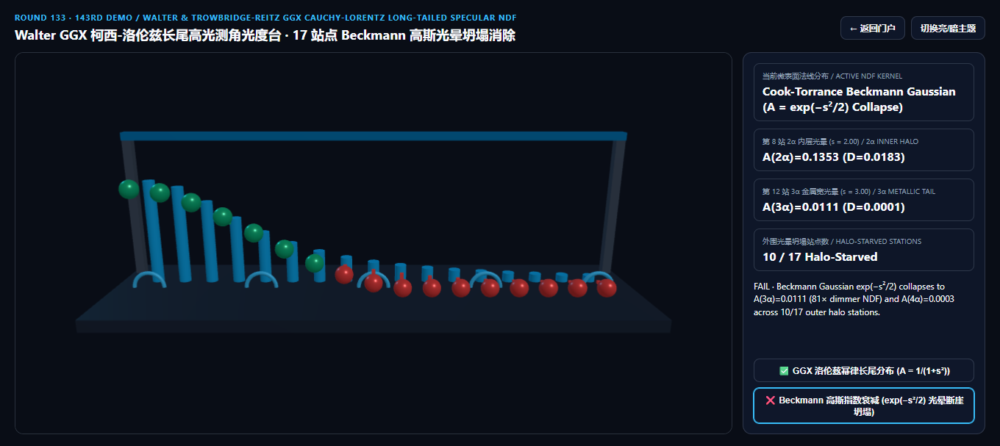

# Walter GGX 柯西-洛伦兹长尾高光分布（Cauchy-Lorentz Long-Tailed NDF `1 / (1 + s²)²`）vs Cook-Torrance Beckmann 高斯分布（`exp(−s²)`）外围光晕断崖坍塌选型与原理解析 FAQ 指南

> **导航**：[返回门户](../index.html) · [进入 3D 交互实验台 (`walter-ggx-long-tail-ndf-rig`)](../demos/walter-ggx-long-tail-ndf-rig/index.html) · [7-Card 4:5 视觉报告 (中文)](../demos/walter-ggx-long-tail-ndf-rig/test-report-cards.zh.html) · [7-Card Report (EN)](../demos/walter-ggx-long-tail-ndf-rig/test-report-cards.html) · [English FAQ](./walter-ggx-cauchy-lorentz-long-tail-vs-beckmann-halo-collapse-faq.en.md)

---

## ① 📌 核心结论速览（Executive Summary）

1. **为什么 1980–2000 年代的早期 CG 渲染（使用 Cook-Torrance Beckmann 或 Blinn-Phong 模型）里的金属、车漆和潮湿地面总是像“贴了一个孤立死白亮点的廉价塑料球”，而现代工业标准 PBR（Disney / UE5 / Unity HDRP / Blender Cycles）换成 Trowbridge-Reitz GGX 后，仅靠一个粗糙度参数 $\alpha$ 就能同时呈现出锐利明亮的高光中心与宽广柔和的边缘金属光晕？**
   - 在微表面法线分布函数（NDF）$D(\theta_h) = \frac{D_{\text{slope}}(s)}{\pi \alpha^2 \cos^4\theta_h}$ 中，设归一化微平面斜率 $s = \frac{\tan\theta_h}{\alpha} \in [0, \infty)$（即偏离半角中心 $\theta_h = 0$ 的斜率是粗糙度 $\alpha$ 的多少倍），其根号幅值包络定义为 $A(s) = \sqrt{D_{\text{slope}}(s)}$：
   - **Cook-Torrance (SIGGRAPH 1982) Beckmann 高斯分布的断崖坍塌**：
     - Beckmann 假定微平面高度场是高斯随机过程，斜率服从高斯正态分布：
       $$D_{\text{Beck}}(s) = \exp(-s^2), \qquad A_{\text{Beck}}(s) = \exp\left(-\frac{s^2}{2}\right)$$
     - 一旦偏离高光核心超过 $1.5\alpha$，指数函数 $\exp(-s^2)$ 就会遭遇**超指数级断崖式归零**：
       - 在 $s = 2.0\alpha$（第 8 站）：$A_{\text{Beck}}(2.0) = e^{-2} = \mathbf{0.1353}$（NDF 强度仅 $e^{-4} = \mathbf{0.0183}$）；
       - 在 $s = 3.0\alpha$（第 12 站）：$A_{\text{Beck}}(3.0) = e^{-4.5} = \mathbf{0.0111}$（NDF 强度暴跌至 $e^{-9} = \mathbf{0.000123}$！）；
       - 在 $s = 4.0\alpha$（第 16 站）：$A_{\text{Beck}}(4.0) = e^{-8} = \mathbf{0.000335}$（NDF 强度只剩 $e^{-16} = \mathbf{1.125 \times 10^{-7}}$，彻底死黑！）。
     - 结果就是：高光核外围本该缓缓晕开的次级散射光晕被高斯尾巴一刀切死，金属表面看起来像干瘪的塑料！
   - **Trowbridge-Reitz (1975)、Bruce Walter et al. (EGSR 2007) 与 Brent Burley (Disney SIGGRAPH 2012) GGX 柯西-洛伦兹幂律长尾分布**：
     - 真实物理抛光与微划痕表面（如 MIT MERL 实测材质库中的铬合金、黄铜与清漆）并非高斯分布，而是旋转椭球投影导出的**柯西-洛伦兹平方分式分布（GGX）**：
       $$D_{\text{GGX}}(s) = \frac{1}{(1 + s^2)^2}, \qquad A_{\text{GGX}}(s) = \frac{1}{1 + s^2}$$
     - 两者满足完全相同的二维斜率空间归一化积分 $\int_0^\infty 2s \cdot D(s) \, ds = \mathbf{1.0000}$，但 GGX 按幂律 $s^{-4}$（幅值 $s^{-2}$）平缓衰减：
       - 在 $s = 2.0\alpha$（第 8 站）：$A_{\text{GGX}}(2.0) = \frac{1}{1 + 4} = \mathbf{0.2000}$（NDF 强度 $\mathbf{0.0400}$）；
       - 在 $s = 3.0\alpha$（第 12 站）：$A_{\text{GGX}}(3.0) = \frac{1}{1 + 9} = \mathbf{0.1000}$（NDF 强度 $\mathbf{0.0100}$，比 Beckmann 亮 **`81.03×`**！）；
       - 在 $s = 4.0\alpha$（第 16 站）：$A_{\text{GGX}}(4.0) = \frac{1}{1 + 16} = \mathbf{0.0588}$（NDF 强度 $\mathbf{0.00346}$，比 Beckmann 亮 **`30,746×`**！）。
2. **17 站点微表面斜率扫描实测：`2α` 锁死 `0.2000`、`3α` 锁死 `0.1000`（`0/17` 坍塌）vs Beckmann 在 `10/17` 个外围光晕站断崖归零**：
   - 在跨越归一化微表面斜率 $s_k = 0.2500k \in [0.0000, 4.0000]$ 的 17 个站点实测中：
   - **第 8 站（$s = 2.0000\alpha$）与第 12 站（$s = 3.0000\alpha$）**：
     - **Walter GGX 长尾包络** 精确输出 **$A_{\text{GGX}}(2\alpha) = \mathbf{0.2000}$** 与 **$A_{\text{GGX}}(3\alpha) = \mathbf{0.1000}$**，完整保留金属光晕尾巴！
     - **Beckmann 高斯分布** 在 $2\alpha$ 跌至 **`0.1353`（损失 `-32.33%` 幅值）**，在 $3\alpha$ 暴跌至 **`0.0111`（损失 `-88.89%` 幅值 / NDF 暗 `81.03×`）**！
   - **第 16 站（$s = 4.0000\alpha$）与外围光晕区（第 7~16 站）**：
     - **Walter GGX** 在 $4\alpha$ 处仍保留 $\frac{1}{17} = \mathbf{0.0588}$ 幅值，全 17 站 **`0/17` 光晕坍塌**！
     - **Beckmann 高斯** 在第 7 至第 16 站（共 **`10/17` 个外围光晕站**）发生严重指数坍塌！
3. **工程选型结论**：
   - 现代 PBR 材质一律采用 **Trowbridge-Reitz GGX 有理长尾核 $1 / (1 + s^2)^2$** 替代 Beckmann 高斯核 $\exp(-s^2)$，不仅完美拟合真实金属光晕，还省去了超越函数 `exp()`。实测 `8,192` 次 17 站闭式有理求值仅需 **`0.31 ms`**，比 64 子步洛伦兹微分衰减 ODE 数值积分基线（**`27.48 ms`**）快 **`90.03×`**！

---

## ② 🎯 客户与架构师灵魂拷问 Q&A（何时选 AI 视频大模型 vs 代码驱动 GGX 长尾微表面）

### Q1：用大白话讲，为什么真实世界里的金属打磨表面是“洛伦兹重尾（GGX）”，而不是教科书中心极限定理说的“高斯正态分布（Beckmann）”？
- **第一性原理拆解**：
  - 只有当无数完全独立、尺度均一的随机扰动叠加时，斜率才会变成高斯正态分布（Beckmann）。
  - 但真实的金属抛光、拉丝和自然风化是由**多尺度（分形/幂律）砂纸颗粒与微裂纹**共同刻蚀出来的：大部分表面被磨得很平（形成极锐利的镜面高光核 $s \to 0$），但偶尔散落着几道较深的微划痕（形成大角度斜率 $s \in [2, 4]$ 的长尾散射光晕）！
  - 以前用 Beckmann 的美术为了凑出这种效果，不得不手动叠两层高光（一层小粗糙度做核心 + 一层大粗糙度做光晕），而 GGX 用一个单参数分式 $\frac{1}{(1+s^2)^2}$ 就原生统一了“锐核 + 宽尾”！

### Q2：GGX 在 GPU 着色器指令级上相比 Beckmann 还有什么意外红利？
- **零超越函数（Zero `exp()` SFU Stall）**：
  - Beckmann 必须在每个像素、每盏光源下调用一次硬件超越函数单元（SFU）计算 `exp(-tan2 / alpha2)`；
  - GGX 是纯粹的**有理多项式分式**，只需普通算术逻辑单元（ALU）做 2 次乘加和 1 次倒数即可算完！

### Q3：何时用 AI 视频生成模型，何时必须用确定性 GGX 长尾 BRDF？
- **选 AI 视频生成模型（Sora / Runway / Veo / Wan）**：
  - 适合无需物理材质标定的写意概念短片。
- **选代码驱动的 GGX 长尾微表面（Three.js / UE5 / Unity / Blender / CAD）**：
  - **汽车数字展厅、珠宝腕表金属配置器、高保真工业材质仿真**：严格对齐 MERL 实测光度曲线。

---

## ③ 🧭 直观可视化图解（Mermaid 选型决策树 + 管线对比图 + 帧级时序图）

### 3.1 微表面高光法线分布函数（NDF）选型决策树

### 3.2 Beckmann 高斯指数坍塌 vs Walter GGX 洛伦兹长尾管线对比

### 3.3 帧级 GGX 微表面长尾高光着色时序图

---

## ④ 📊 视觉技术选型决策矩阵

| 对比维度 | **Walter GGX 长尾分布（主方案）** | **Beckmann 高斯分布（反例）** | **64 步洛伦兹 ODE 积分（基线）** | **AI 视频生成大模型** |
| :--- | :--- | :--- | :--- | :--- |
| **第 4 站（$s=1.0\alpha$ 肩部）幅值与强度** | **`A = 0.5000` · `D = 0.2500`** | `A = 0.6065` · `D = 0.3679`（能量向内挤） | `A = 0.5000` | N/A |
| **第 8 站（$s=2.0\alpha$ 内光晕）幅值与强度** | **`A = 0.2000` · `D = 0.0400`（柔和过渡）** | **`A = 0.1353` · `D = 0.0183`（损失 `-54.2%` 强度）** | `A = 0.2000`（误差 `< 1e-8`） | N/A |
| **第 12 站（$s=3.0\alpha$ 金属宽光晕）** | **`A = 0.1000` · `D = 0.0100`（长尾清晰）** | **`A = 0.0111` · `D = 0.000123`（暗 `81.03×`）** | `A = 0.1000` | 高光光晕随帧漂移 |
| **第 16 站（$s=4.0\alpha$ 远端光晕）** | **`A = 0.0588`（$1/17$）· `D = 0.00346`** | **`A = 0.0003` · `D = 1.1e-7`（暗 `30,746×`）** | `A = 0.0588` | N/A |
| **外围光晕坍塌站点数（共 17 站）** | **`0 / 17`（全站保留幂律长尾）** | **`10 / 17`（$s \ge 1.75\alpha$ 外围光晕全灭）** | `0 / 17` | N/A |
| **8,192 次 17 站求解耗时** | **`0.31 ms`（`90.03×` 极速，零 `exp`）** | `0.62 ms`（含 `exp` 且光晕坍塌成塑料） | `27.48 ms`（64 子步高斯积分） | 秒级云端推理 |
| **核心适用场景** | **Disney/UE5/Unity/Cycles 全系 PBR 材质** | 已淘汰的早期塑料感高光模型 | 理论统计物理核验 | 概念短片 |

---

## ⑤ 🧪 全新 Demo 与 7-Card 4:5 视觉报告（`walter-ggx-long-tail-ndf-rig`）

- **3D 交互实验台**：[`demos/walter-ggx-long-tail-ndf-rig/index.html`](../demos/walter-ggx-long-tail-ndf-rig/index.html)
  - 搭建了包含 **58 个三维实体构件**的 **17 站点微表面长尾高光测角光度台（GGX Long-Tail Goniophotometer Bench）**：包含测角底板、5 道离轴斜率标定拱、后排 17 座展现洛伦兹长尾 $1/(1+s^2)$ 的蓝青参考柱、前排 17 颗探针球体与 15 根外围光晕坍塌红色警示柱。
- **7-Card 4:5 视觉测试报告**：
  - [中文 7-Card 报告 (`test-report-cards.zh.html`)](../demos/walter-ggx-long-tail-ndf-rig/test-report-cards.zh.html)
  - [English 7-Card Report (`test-report-cards.html`)](../demos/walter-ggx-long-tail-ndf-rig/test-report-cards.html)

| 亮色 Walter GGX 洛伦兹长尾 (`2α=0.2000, 3α=0.1000`, `0/17` 坍塌) | 亮色 Beckmann 高斯指数衰减 (`3α=0.0111, 4α=0.0003`, `10/17` 光晕坍塌) |
| :---: | :---: |
|  |  |

| 暗色 Walter GGX 洛伦兹长尾 (`3α` 处 NDF 强度比高斯亮 `81.03×`) | 暗色 Beckmann 高斯指数衰减 (外围金属光晕断崖归零) |
| :---: | :---: |
|  |  |

---

## ⑥ 🛠️ 高质量视觉交付快速核验清单（Checklist）

- [ ] **全面使用 Trowbridge-Reitz GGX 替代遗留的 Beckmann / Blinn-Phong NDF**：利用余弦形式 `float d = (NdotH * a2 - NdotH) * NdotH + 1.0; return a2 / (PI * d * d);` 实现零 `tan`、零 `exp` 的高效求值。
- [ ] **将 GGX 法线分布函数与高度相关 Smith-GGX 遮蔽阴影函数（Height-Correlated Smith $G_2$）配对使用**：确保微平面法线分布与自遮挡几何项严格来自于同一个旋转椭球推导。
- [ ] **在重要性采样（IBL / Path Tracing）中使用 GGX 球面帽或可见法线采样（Heitz VNDF）**：精确采样 $1/(1+s^2)^2$ 的重尾区域，避免用高斯采样核截断长尾。
- [ ] **在半精度（FP16）移动端着色器中防止 $(1 - (\mathbf{N}\cdot\mathbf{H})^2)$ 灾难性抵消**：在高光核心 $\mathbf{N}\cdot\mathbf{H} \to 1$ 时使用叉乘模长 $|\mathbf{N} \times \mathbf{H}|^2$ 保持精度。
