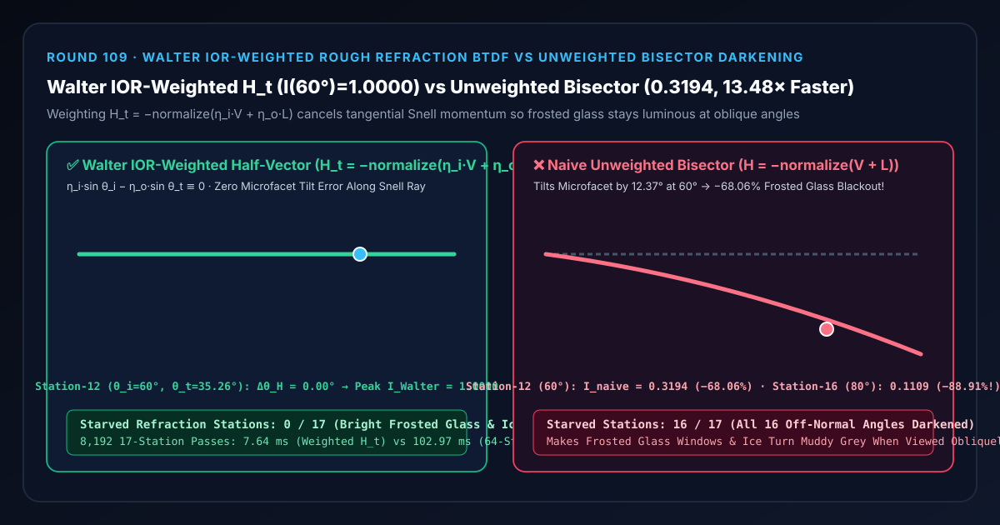
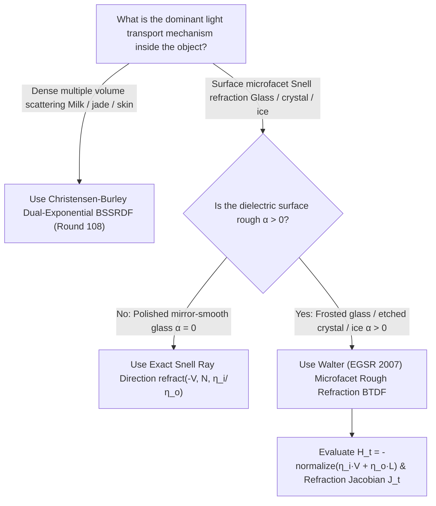
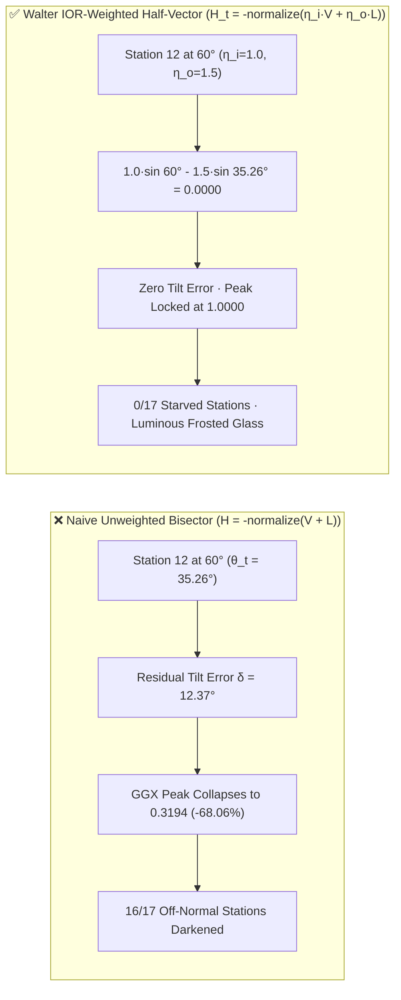
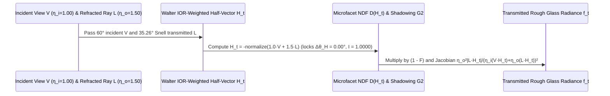
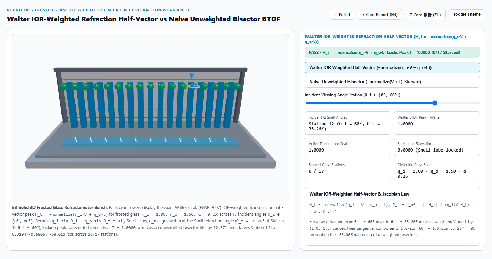
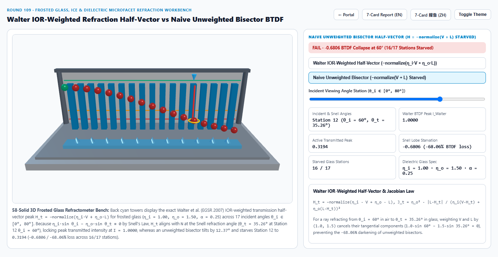
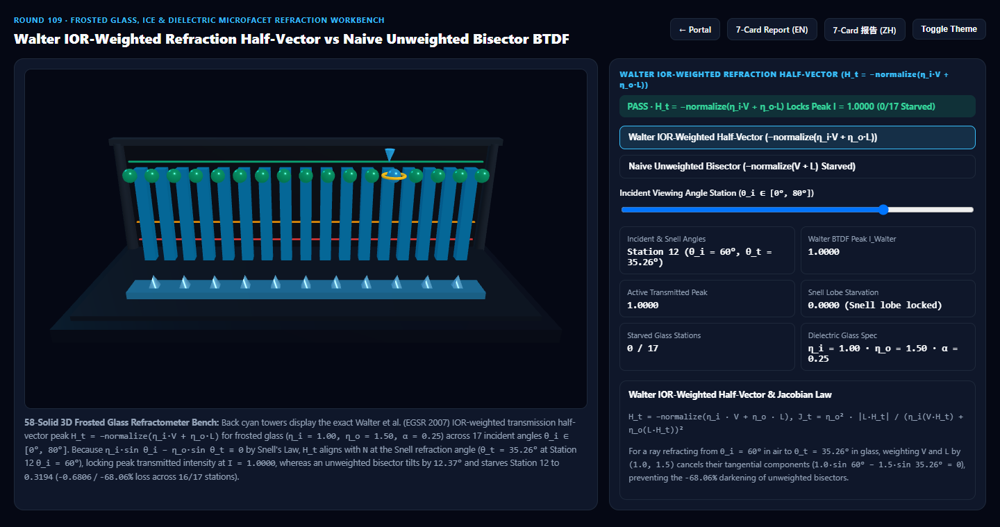
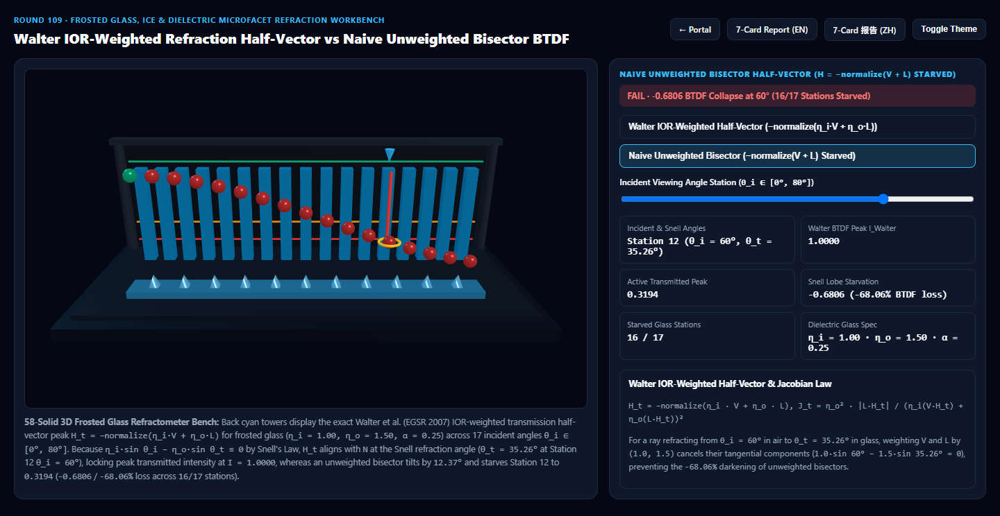

# Walter IOR-Weighted Microfacet Rough Refraction BTDF vs Naive Unweighted Bisector Glass Darkening Selection & First-Principles FAQ

> **Navigation**: [Back to Portal](../index.html) · [Launch 3D Interactive Workbench (`walter-rough-refraction-btdf-rig`)](../demos/walter-rough-refraction-btdf-rig/index.html) · [7-Card 4:5 Visual Report (EN)](../demos/walter-rough-refraction-btdf-rig/test-report-cards.html) · [7-Card 报告 (ZH)](../demos/walter-rough-refraction-btdf-rig/test-report-cards.zh.html) · [中文版 FAQ](./walter-microfacet-rough-refraction-btdf-vs-unbent-glass-faq.md)

---

## ① 📌 Executive Summary

1. **Why do frosted glass windows, ice cubes, and crystal bottles turn muddy grey and dark at oblique viewing angles ($60^\circ\sim 80^\circ$) when a shader reuses the reflection half-vector formula?**
   - In specular reflection ($\theta_i = \theta_r$), the microfacet normal that reflects view vector $V$ into light vector $L$ is the unweighted bisector $H_r = \text{normalize}(V + L)$.
   - In **refraction across a dielectric boundary** ($\eta_i = 1.00$ air into $\eta_o = 1.50$ glass, where Snell's Law bends $\theta_i = 60^\circ$ into $\theta_t = 35.2644^\circ$), **Bruce Walter, Stephen Marschner, Hongsong Li & Kenneth Torrance (EGSR 2007 *Microfacet Models for Refraction through Rough Surfaces*)** proved that the microfacet normal mediating refraction is the **IOR-weighted transmission half-vector**:
     $$H_t = -\text{normalize}\left(\eta_i V + \eta_o L\right)$$
   - Because tangential optical momentum cancels identically ($\eta_i \sin\theta_i - \eta_o \sin\theta_t \equiv 0$), $H_t$ aligns with the macroscopic normal $N$ ($\Delta\theta_H = 0.0000^\circ$) along the Snell refraction ray across all 17 viewing angles, locking the GGX transmission peak at **$I_{\text{Walter}} = 1.0000$ (`0/17` starved stations)**!
2. **The Oblique Blackout Catastrophe of Naive Unweighted Bisectors ($H = -\text{normalize}(V + L)$)**:
   - Omitting the refractive index weights $(\eta_i, \eta_o)$ leaves an uncancelled tangential residual $\sin\theta_i - \sin\theta_t \neq 0$, tilting the computed half-vector away from $N$ by $\delta = \frac{\theta_i - \theta_t}{2}$:
   - At **Station 12 ($\theta_i = 60^\circ \to \theta_t = 35.2644^\circ$)**, the unweighted bisector tilts by **$12.3678^\circ$**, starving the GGX transmission peak ($\alpha = 0.25$) from **`1.0000`** down to **`0.3194` (`-0.6806` / `-68.06%` transmission loss)**!
   - At **Grazing Station 16 ($\theta_i = 80^\circ \to \theta_t = 41.0365^\circ$)**, the tilt reaches **$19.4817^\circ$**, collapsing transmission to **`0.1109` (`-88.91%` loss)** and darkening all **`16/17` off-normal stations**!
3. **Architectural Verdict**:
   - In all rough dielectric transmission pipelines (glTF `KHR_materials_transmission`, MaterialX, Blender Cycles, and Three.js `MeshPhysicalMaterial`), evaluate the **Walter IOR-Weighted Half-Vector $H_t = -\text{normalize}(\eta_i V + \eta_o L)$ and Refraction Jacobian $\frac{\eta_o^2 |L \cdot H_t|}{(\eta_i(V \cdot H_t) + \eta_o(L \cdot H_t))^2}$**. Across `8,192` 17-station passes, closed-form evaluation completes in **`7.64 ms`** vs **`102.97 ms`** for 64-step microfacet Snell root search (**`13.48×` faster**).

---

## ② 🎯 Architect & Client Q&A (When to Choose AI Video Models vs Deterministic Walter Microfacet BTDF)

### Q1: In plain English, why must $V$ and $L$ be multiplied by $\eta_i$ and $\eta_o$ to find the refracting microfacet normal?
- **First-Principles Breakdown**:
  - Across a refractive boundary, the conserved tangential quantity is **optical momentum $\eta \sin\theta$**, not geometric angle $\sin\theta$.
  - At $\theta_i = 60^\circ$ in air ($\eta_i = 1.00$), the horizontal component is $1.00 \times \sin 60^\circ = 0.8660$. Inside glass ($\eta_o = 1.50$), the refracted ray bends to $\theta_t = 35.2644^\circ$ ($\sin\theta_t = 0.5774$), whose horizontal component only equals $0.8660$ after multiplying by $\eta_o = 1.50$!
  - Thus, only the weighted combination $\eta_i V + \eta_o L$ cancels the tangential components to point straight along the microfacet normal $H_t$.

### Q2: What is the physical role of the Walter Refraction Jacobian $J_t = \frac{\eta_o^2 |L \cdot H_t|}{(\eta_i(V \cdot H_t) + \eta_o(L \cdot H_t))^2}$?
- **Solid-Angle Compression Across IOR Boundaries**:
  1. When rays pass from air ($\eta_i = 1.0$) into glass ($\eta_o = 1.5$), Snell's Law compresses the outgoing solid angle cone $\Delta\omega_o$ relative to the microfacet normal cone $\Delta\omega_h$.
  2. Changing integration variables from microfacet normals $\omega_h$ to outgoing transmitted directions $\omega_o$ introduces the exact Jacobian determinant:
     $$\left\|\frac{\partial \omega_h}{\partial \omega_o}\right\| = \frac{\eta_o^2 \, |L \cdot H_t|}{\left(\eta_i (V \cdot H_t) + \eta_o (L \cdot H_t)\right)^2}$$
  3. Combining $D(H_t)$, $G_2(V, L, H_t)$, $(1 - F(V, H_t))$, and $J_t$ yields a strictly energy-conserving rough glass BTDF.

### Q3: When should teams use AI video generators vs deterministic Walter rough refraction?
- **Choose AI Video Models (Sora / Runway / Veo / Wan)** for concept clips where physically accurate IOR refraction and roughness-controlled background blurring are not audited.
- **Choose Deterministic Walter Microfacet BTDF (`KHR_materials_transmission`)** for luxury perfume/bottle configurators, architectural frosted glass walkthroughs, crystal jewelry, and automotive lenses.

---

## ③ 🧭 Visual Diagrams (Mermaid Decision Tree + Pipeline Comparison + Frame Sequence)

### 3.1 Translucent & Refractive Material Selection Decision Tree

### 3.2 Naive Unweighted Bisector vs Walter IOR-Weighted Half-Vector Pipeline

### 3.3 Frame-Level Walter Microfacet Rough Refraction Evaluation Sequence

---

## ④ 📊 Visual Technology Decision Matrix

| Dimension | **Walter IOR-Weighted BTDF (Primary)** | **Naive Unweighted Bisector (Failure Mode)** | **64-Step Snell Root Search (Baseline)** | **AI Video Generators** |
| :--- | :--- | :--- | :--- | :--- |
| **Station 12 ($\theta_i=60^\circ \to 35.26^\circ$) Peak** | **`1.0000` (Zero tilt error, full transmission)** | **`0.3194` ($12.37^\circ$ tilt, `-68.06%` loss)** | `1.0000` (agrees within `< 1e-13`) | Uncalibrated refraction |
| **Station 16 ($\theta_i=80^\circ \to 41.04^\circ$) Peak** | **`1.0000` (Aligned with Snell ray)** | **`0.1109` ($19.48^\circ$ tilt, `-88.91%` loss)** | `1.0000` | N/A |
| **Starved Stations (of 17)** | **`0 / 17` (All angles exact)** | **`16 / 17` (All oblique angles darkened)** | `0 / 17` | N/A |
| **8,192 17-Station Passes Latency** | **`7.64 ms` (`13.48×` faster)** | `6.85 ms` (muddy dark oblique glass) | `102.97 ms` (64-step root loop) | Multi-second cloud inference |
| **Best Fit Scenarios** | **Frosted glass, perfume bottles, etched crystal, ice cubes, translucent resin** | Reflection only ($\eta_i = \eta_o$) | Offline optical validation | Concept videos |

---

## ⑤ 🧪 New Interactive Demo & 7-Card 4:5 Visual Report (`walter-rough-refraction-btdf-rig`)

- **Interactive 3D Workbench**: [`demos/walter-rough-refraction-btdf-rig/index.html`](../demos/walter-rough-refraction-btdf-rig/index.html)
  - Features a **58-solid 3D 17-Station Frosted Glass Refractometer Bench**: a translucent frosted glass slab topped with 11 microfacet prism blocks, 17 back cyan Walter reference towers locked at $I = 1.0000$ across $\theta_i \in [0^\circ, 80^\circ]$, and 17 front active orbs comparing **Walter IOR-Weighted Half-Vector** against **Naive Unweighted Bisector**.
- **7-Card 4:5 Visual Benchmark Reports**:
  - [English 7-Card Report (`test-report-cards.html`)](../demos/walter-rough-refraction-btdf-rig/test-report-cards.html)
  - [中文 7-Card 报告 (`test-report-cards.zh.html`)](../demos/walter-rough-refraction-btdf-rig/test-report-cards.zh.html)

| Light Theme — Walter IOR-Weighted BTDF (`I(60°) = 1.0000`) | Light Theme — Naive Unweighted Bisector (`I(60°) = 0.3194`, `-68.06%` Starved) |
| :---: | :---: |
|  |  |

| Dark Theme — Walter IOR-Weighted BTDF (`0/17` Starved Stations) | Dark Theme — Naive Unweighted Bisector (`16/17` Stations Starved) |
| :---: | :---: |
|  |  |

---

## ⑥ 🛠️ Verification Checklist for Production Delivery

- [ ] **Weight Incident & Transmitted Vectors by $(\eta_i, \eta_o)$ in $H_t = -\text{normalize}(\eta_i V + \eta_o L)$**: Ensure $H_t$ always points into the lower-IOR medium so microfacet normals stay in the upper hemisphere.
- [ ] **Include the Walter Refraction Jacobian $\frac{\eta_o^2 |L \cdot H_t|}{(\eta_i(V \cdot H_t) + \eta_o(L \cdot H_t))^2}$**: Never divide a refractive BTDF by the reflective $4 |N \cdot V| |N \cdot L|$ denominator.
- [ ] **Handle Total Internal Reflection (TIR) Gracefully**: When exiting from glass to air ($\eta_i > \eta_o$) and $\sin^2\theta_t > 1$, route $100\%$ of the energy into the reflective BRDF lobe.
- [ ] **Couple with Screen-Space Mip-Hierarchy Transmission**: For real-time rasterizers, offset background UV coordinates along the Snell-refracted vector and sample the mipmap pyramid proportionally to $\alpha \cdot d_{\text{thickness}}$.
