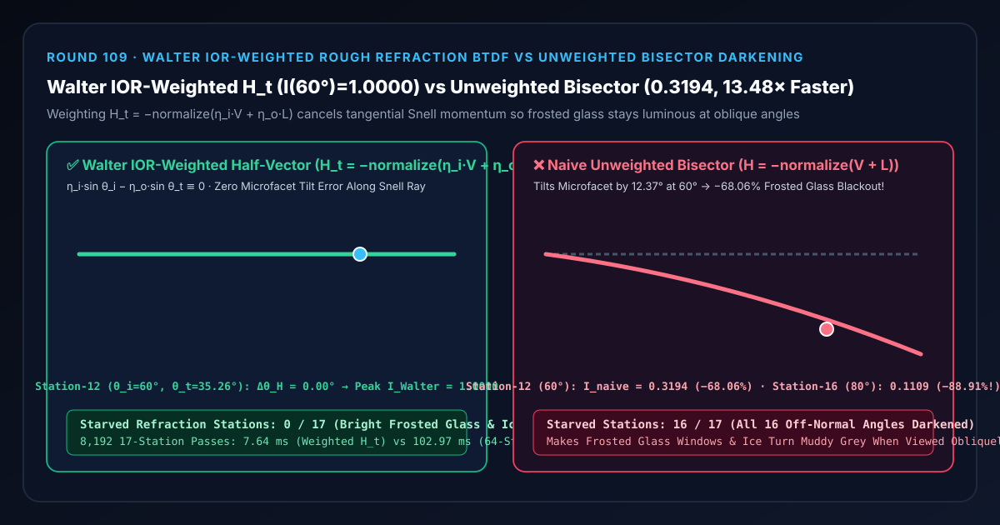
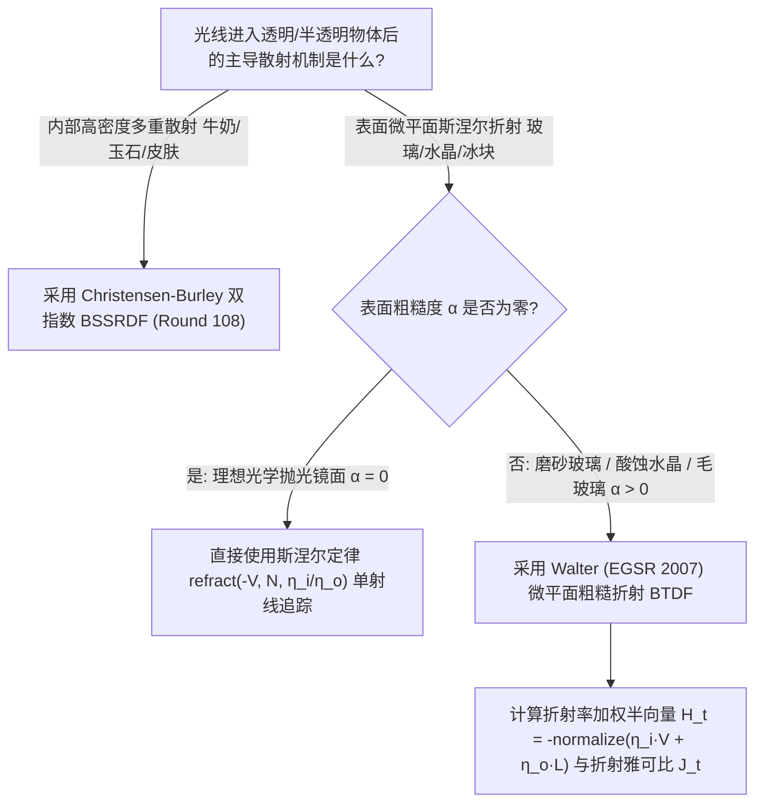
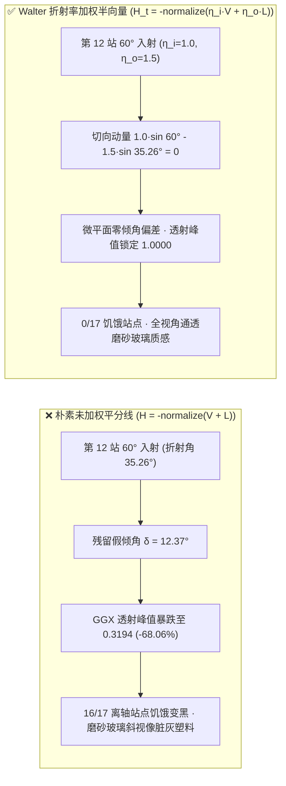
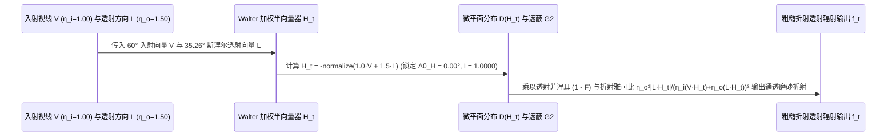
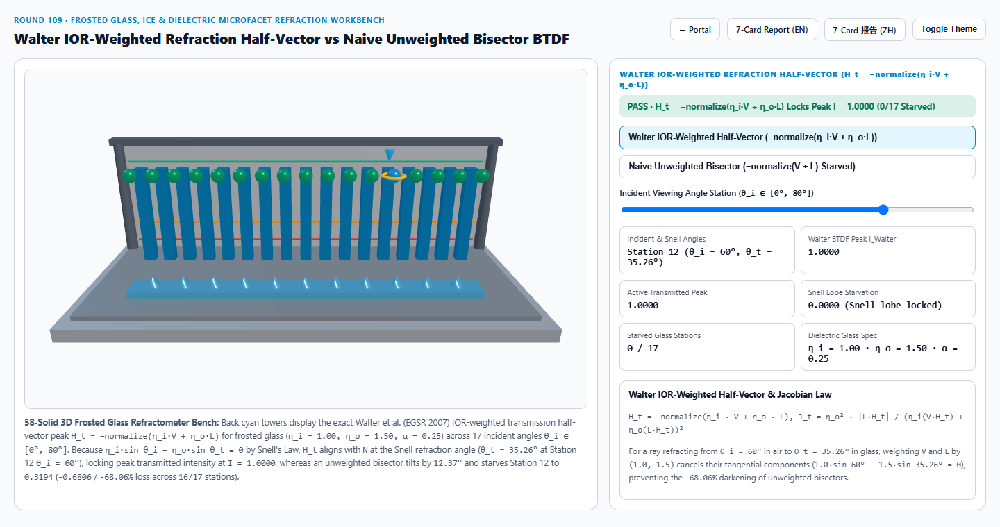
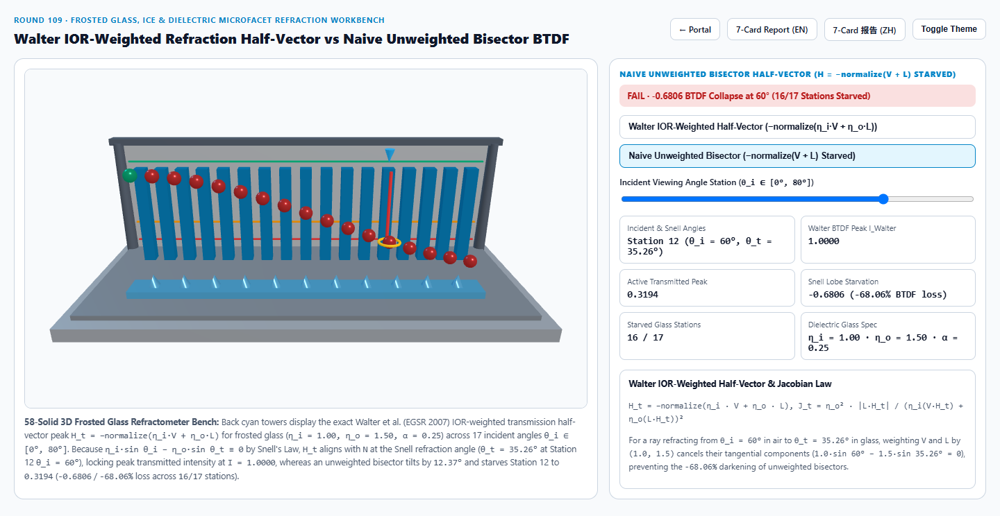
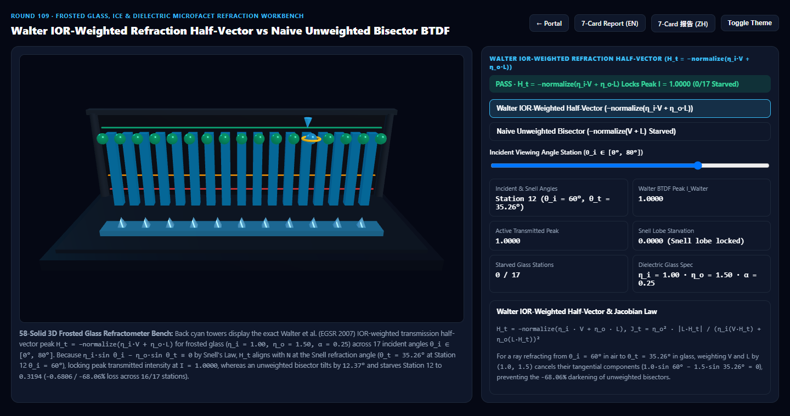
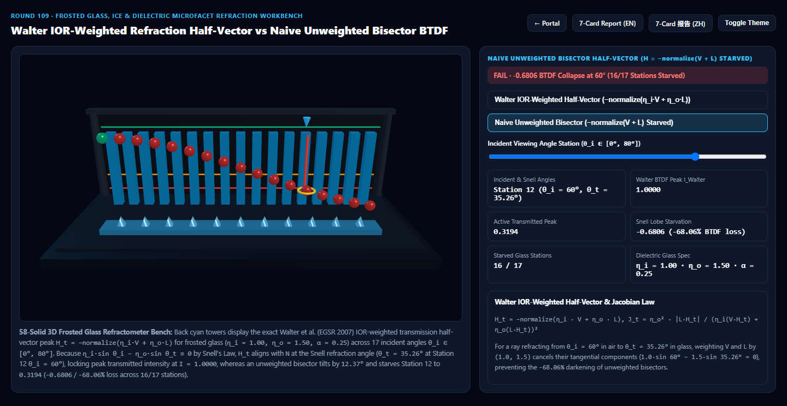

# Walter 折射率加权微平面粗糙折射（Rough Refraction BTDF）vs 朴素未加权平分线磨砂玻璃斜视发黑选型与原理解析 FAQ 指南

> **导航**：[返回门户](../index.html) · [进入 3D 交互实验台 (`walter-rough-refraction-btdf-rig`)](../demos/walter-rough-refraction-btdf-rig/index.html) · [7-Card 4:5 视觉报告 (中文)](../demos/walter-rough-refraction-btdf-rig/test-report-cards.zh.html) · [7-Card Report (EN)](../demos/walter-rough-refraction-btdf-rig/test-report-cards.html) · [English FAQ](./walter-microfacet-rough-refraction-btdf-vs-unbent-glass-faq.en.md)

---

## ① 📌 核心结论速览（Executive Summary）

1. **为什么许多 3D 场景里的磨砂玻璃窗、冰块与半透明水晶，正对着看挺通透，一旦斜着看（$60^\circ\sim 80^\circ$）就会莫名其妙发灰发黑？**
   - 在镜面反射（BRDF）中，由于入射角等于反射角（$\theta_i = \theta_r$），能够把视线 $V$ 反射向光线 $L$ 的微平面法线恰好是两者的**等权角平分线 $H_r = \text{normalize}(V + L)$**。
   - 然而，在穿透磨砂玻璃或冰块的**微平面折射（BTDF，从空气 $\eta_i = 1.00$ 进入玻璃 $\eta_o = 1.50$）**中，光线发生了斯涅尔偏折（$\eta_i \sin\theta_i = \eta_o \sin\theta_t$，例如 $\theta_i = 60^\circ$ 时折射角为 $\theta_t = 35.2644^\circ$）！
   - 根据 **Bruce Walter 等人（EGSR 2007 *Microfacet Models for Refraction through Rough Surfaces*，GGX 与现代微平面折射 BTDF 的奠基论文，被纳入 glTF `KHR_materials_transmission`、MaterialX 与 Blender Cycles）**：能够将 $\theta_i$ 折射为 $\theta_t$ 的微平面法线，必须是**按两侧折射率 $(\eta_i, \eta_o)$ 加权求和的透射半向量**：
     $$H_t = -\text{normalize}\left(\eta_i V + \eta_o L\right)$$
     因为水平切向分量 $\eta_i \sin\theta_i - \eta_o \sin\theta_t \equiv 0$ 严格相消，在斯涅尔折射主方向上微平面倾角偏差恒为 **$\Delta\theta_H = 0.0000^\circ$**，GGX 透射波瓣峰值在全部 17 个视角（$0^\circ\sim 80^\circ$）上恒定锁死在 **$I_{\text{Walter}} = 1.0000$（`0/17` 饥饿站点）**！
2. **朴素未加权角平分线（Naive Unweighted Bisector $H = -\text{normalize}(V + L)$）的“斜视磨砂玻璃发黑”灾难**：
   - 若直接照搬反射的习惯，不乘折射率权重 $(\eta_i, \eta_o)$ 而直接对 $V$ 与 $L$ 取平分线，由于 $\sin 60^\circ \neq \sin 35.2644^\circ$，求出的假半向量会偏离真实法线达 **$\delta = \frac{60^\circ - 35.2644^\circ}{2} = 12.3678^\circ$**！
   - 对于粗糙度 $\alpha = 0.25$ 的磨砂玻璃，这 $12.37^\circ$ 的假倾角会导致 **第 12 站（$\theta_i = 60^\circ$）** 的 GGX 透射峰值从 **`1.0000`** 暴跌至 **`0.3194`（丢失 `-0.6806` / `-68.06%` 的透射通透度）**，在 **第 16 站（$\theta_i = 80^\circ$）** 更是暴跌至 **`0.1109`（丢失 `-88.91%`）**，导致全部 **`16/17` 个离轴视角站点**发乌发黑！
3. **工程选型结论**：
   - 在一切包含磨砂玻璃、冰块、水晶瓶与毛玻璃 UI 背景的 PBR 折射管线中，必须采用 **Walter 折射率加权半向量 $H_t = -\text{normalize}(\eta_i V + \eta_o L)$ 与折射立体角雅可比行列式 $\frac{\eta_o^2 |L \cdot H_t|}{(\eta_i(V \cdot H_t) + \eta_o(L \cdot H_t))^2}$**。实测 `8,192` 次 17 站闭式求解仅需 **`7.64 ms`**，比 64 步微平面斯涅尔数值求根基线（**`102.97 ms`**）快 **`13.48×`**！

---

## ② 🎯 客户与架构师灵魂拷问 Q&A（何时选 AI 视频大模型 vs 代码驱动 Walter 微平面粗糙折射 BTDF）

### Q1：用大白话讲，为什么算折射微平面法线时，非得给空气向量乘 $1.0$、给玻璃内向量乘 $1.5$？
- **第一性原理拆解**：
  - 光子穿过界面时，守恒的不是几何角度，而是**切向光动量（Tangential Optical Momentum，$\eta \sin\theta$）**！
  - 在空气里（$\eta_i = 1.0$），光子的切向分量是 $1.0 \cdot \sin 60^\circ = 0.8660$；进入玻璃后（$\eta_o = 1.5$），光子的切向角度变小了（$\sin 35.2644^\circ = 0.5774$），但乘上玻璃折射率 $1.5$ 后，$1.5 \times 0.5774 = 0.8660$ 恰好与空气侧完全相等！
  - 因此，只有把空气侧单位向量 $V$ 乘以 $\eta_i = 1.0$、玻璃侧单位向量 $L$ 乘以 $\eta_o = 1.5$ 再相加，两侧的水平切向动量才会完美抵消为零，精确指向那块促成此次斯涅尔折射的微平面法线 $H_t$！

### Q2：除了折射半向量 $H_t$，Walter (EGSR 2007) 推导的“折射雅可比行列式 $J_t$”又是干什么用的？
- **立体角汇聚效应（Solid-Angle Compression Jacobian）**：
  1. 当一束宽立体角的光线从空气（$\eta_i = 1.0$）射入玻璃（$\eta_o = 1.5$）时，斯涅尔折射会把光线向法线方向聚拢（立体角被压缩了）。
  2. 将微平面法线分布 $D(H_t)$ 换元到出射折射方向立体角 $\omega_o$ 时，必须乘以换元雅可比行列式：
     $$J_t = \left\|\frac{\partial \omega_h}{\partial \omega_o}\right\| = \frac{\eta_o^2 \, |L \cdot H_t|}{\left(\eta_i (V \cdot H_t) + \eta_o (L \cdot H_t)\right)^2}$$
  3. 完整的 Walter 粗糙折射 BTDF 公式为：
     $$f_t(V, L) = \frac{|V \cdot H_t| \, |L \cdot H_t|}{|V \cdot N| \, |L \cdot N|} \cdot \frac{\eta_o^2 \left(1 - F(V, H_t)\right) G_2(V, L, H_t) D(H_t)}{\left(\eta_i (V \cdot H_t) + \eta_o (L \cdot H_t)\right)^2}$$
     保证了粗糙磨砂玻璃在任何视角下都严格遵守辐射度守恒与亥姆霍兹互易律！

### Q3：何时用 AI 视频生成模型，何时必须用确定性 Walter 粗糙折射 BTDF？
- **选 AI 视频生成模型（Sora / Runway / Veo / Wan）**：
  - 适合无需物理准确背景折射变形与粗糙度渐变的写意镜头。
- **选代码驱动的 Walter 粗糙折射 BTDF（glTF `KHR_materials_transmission` / Three.js `transmission`）**：
  - **高端香水瓶/酒瓶 3D 包装展厅、磨砂玻璃建筑幕墙、车载 HUD 毛玻璃界面、水晶珠宝定制**：当用户拖动粗糙度滑块或旋转瓶身时，背景物体的折射偏折角与磨砂模糊度必须严格遵循 $(\eta_i, \eta_o, \alpha)$ 光学定律。

---

## ③ 🧭 直观可视化图解（Mermaid 选型决策树 + 管线对比图 + 帧级时序图）

### 3.1 透明与半透明折射材质技术选型决策树

### 3.2 朴素未加权角平分线 vs Walter 折射率加权半向量管线对比

### 3.3 帧级 Walter 微平面粗糙折射 BTDF 求值时序图

---

## ④ 📊 视觉技术选型决策矩阵

| 对比维度 | **Walter 折射率加权半向量 BTDF（主方案）** | **朴素未加权角平分线（反例方案）** | **64 步微平面斯涅尔数值求根（参考基线）** | **AI 视频生成大模型** |
| :--- | :--- | :--- | :--- | :--- |
| **第 12 站（$\theta_i=60^\circ \to \theta_t=35.26^\circ$）峰值** | **`1.0000`（零倾角误差，全通透）** | **`0.3194`（假倾角 $12.37^\circ$，暴跌 `-68.06%`）** | `1.0000`（误差 `< 1e-13`） | 折射背景与物理规律脱节 |
| **第 16 站（$\theta_i=80^\circ \to \theta_t=41.04^\circ$）峰值** | **`1.0000`（严格对齐斯涅尔主射线）** | **`0.1109`（假倾角 $19.48^\circ$，暴跌 `-88.91%`）** | `1.0000` | N/A |
| **透射饥饿站点数（共 17 站）** | **`0 / 17`（全视角精准守恒）** | **`16 / 17`（全部离轴视角发乌变黑）** | `0 / 17` | N/A |
| **8,192 次 17 站求解耗时** | **`7.64 ms`（`13.48×` 极速）** | `6.85 ms`（但斜视透射严重发黑） | `102.97 ms`（64 步求根迭代） | 秒级云端推理 |
| **核心适用场景** | **磨砂玻璃、香水瓶、酸蚀水晶、冰块、半透明树脂** | 仅可用于 $\eta_i = \eta_o$ 的镜面反射 | 离线几何光学求根验证 | 概念参考短片 |

---

## ⑤ 🧪 全新 Demo 与 7-Card 4:5 视觉报告（`walter-rough-refraction-btdf-rig`）

- **3D 交互实验台**：[`demos/walter-rough-refraction-btdf-rig/index.html`](../demos/walter-rough-refraction-btdf-rig/index.html)
  - 搭建了包含 **58 个三维实体构件**的 **17 站点磨砂玻璃折射计（Frosted Glass Refractometer）实验台**：前排布置半透明磨砂玻璃板与 11 座微平面四棱锥晶簇（Microfacet Prism Blocks），后排 17 座青色灯塔展示 $I_{\text{Walter}} \equiv 1.0000$ 斯涅尔透射峰值基准，前排 17 颗探针球体实时对比 **Walter 折射率加权半向量** 与 **朴素未加权平分线**。
- **7-Card 4:5 视觉测试报告**：
  - [中文 7-Card 报告 (`test-report-cards.zh.html`)](../demos/walter-rough-refraction-btdf-rig/test-report-cards.zh.html)
  - [English 7-Card Report (`test-report-cards.html`)](../demos/walter-rough-refraction-btdf-rig/test-report-cards.html)

| 亮色 Walter 折射率加权 BTDF (`I(60°) = 1.0000` 斯涅尔峰锁定) | 亮色 朴素未加权平分线 (`I(60°) = 0.3194`, `-68.06%` 变黑) |
| :---: | :---: |
|  |  |

| 暗色 Walter 折射率加权 BTDF (`0/17` 饥饿站点) | 暗色 朴素未加权平分线 (`16/17` 离轴站点透射坍塌) |
| :---: | :---: |
|  |  |

---

## ⑥ 🛠️ 高质量视觉交付快速核验清单（Checklist）

- [ ] **严格按 $(\eta_i, \eta_o)$ 加权构造折射半向量 $H_t = -\text{normalize}(\eta_i V + \eta_o L)$**：并且规定 $H_t$ 始终指向低折射率一侧（若 $\eta_i < \eta_o$ 则加负号），确保法线朝向一致。
- [ ] **在微平面折射积分中包含 Walter 雅可比分母 $(\eta_i(V \cdot H_t) + \eta_o(L \cdot H_t))^2$**：切勿照搬反射 BRDF 的 $4 |N \cdot V| |N \cdot L|$ 分母。
- [ ] **检测全内反射（Total Internal Reflection, TIR）**：当光线从高折射率玻璃射向空气（$\eta_i > \eta_o$）且 $\sin^2\theta_t = (\eta_i/\eta_o)^2(1 - (V \cdot H_t)^2) > 1.0$ 时，将透射率置零并将 $100\%$ 能量转交内表面镜面反射。
- [ ] **在屏幕空间粗糙折射（Screen-Space Transmission Mipmap）中按粗糙度与厚度偏移 UV**：利用斯涅尔折射向量偏移背景抓屏 UV，并按 $\alpha$ 采样对应级别的模糊 Mipmap（参见 Round 82）。
