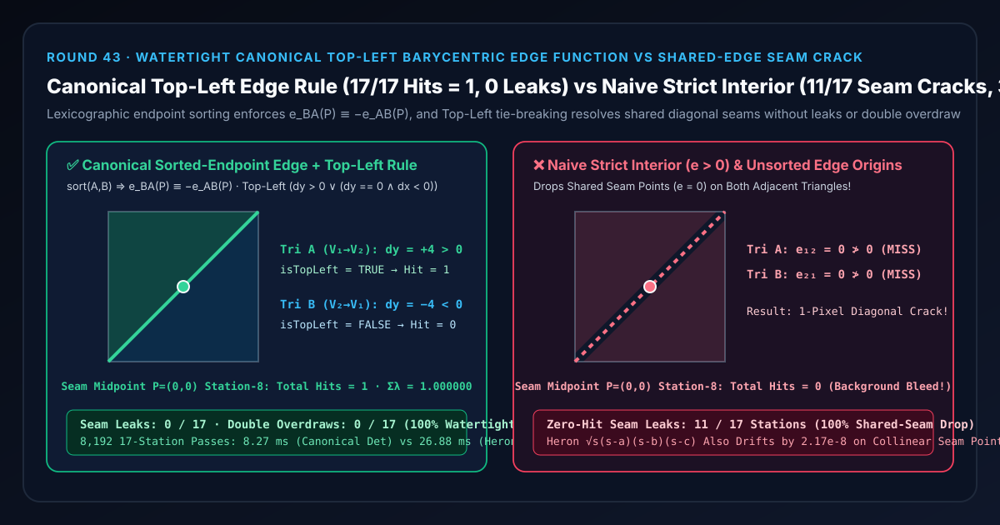
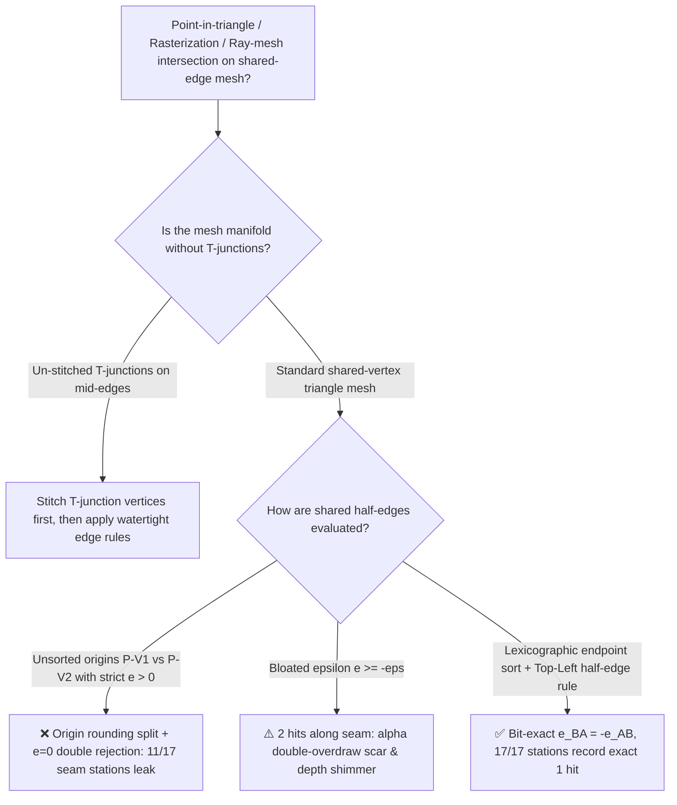
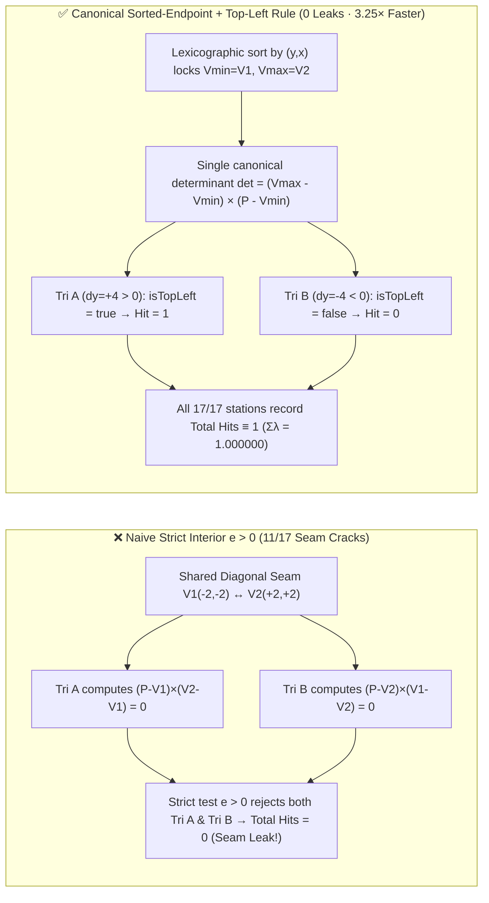
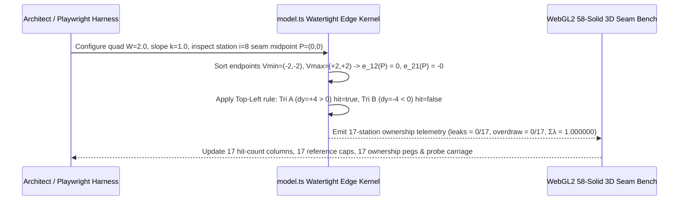
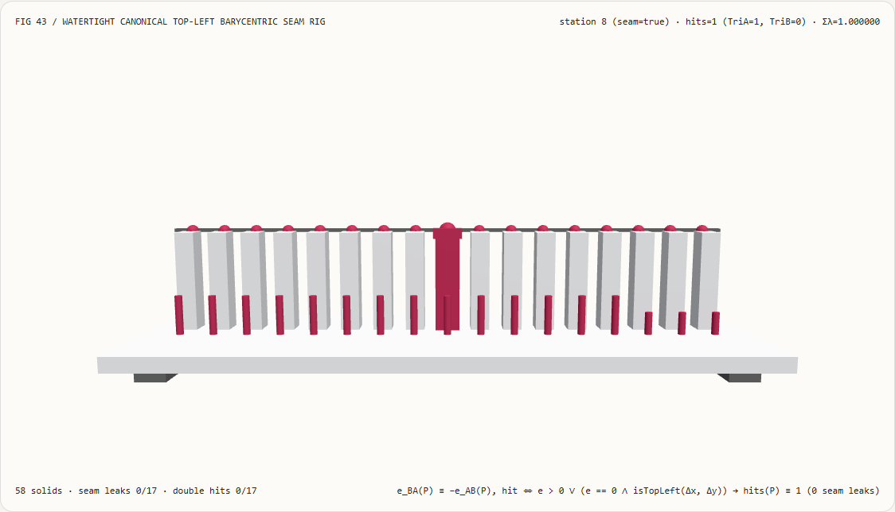
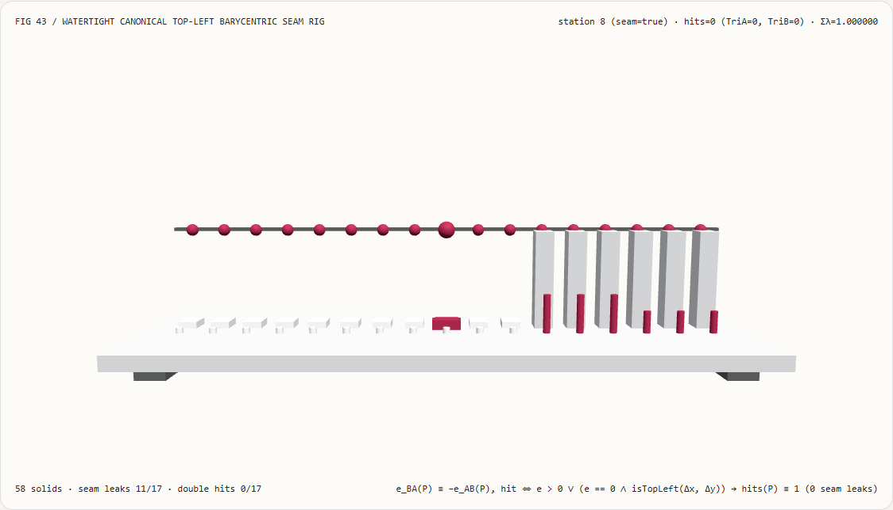
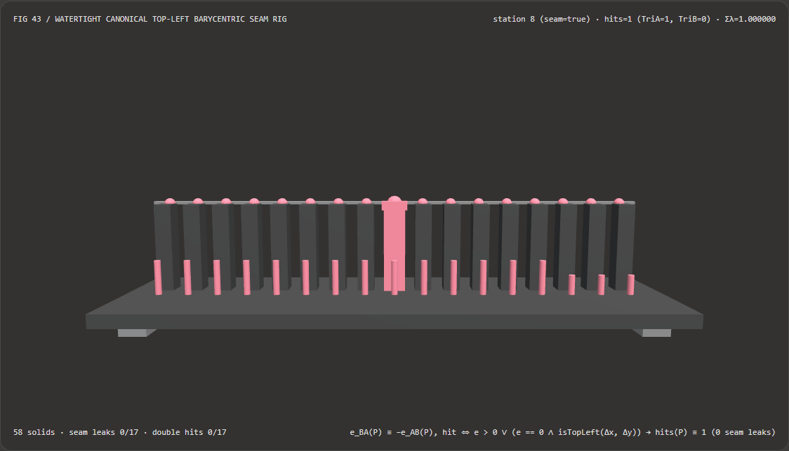
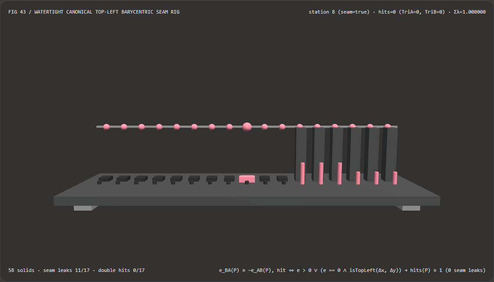

# Visual & Animation Architecture Selection FAQ: Watertight Canonical Top-Left Edge Function vs Shared-Edge Seam Cracks

> **One-Sentence Architectural Verdict**: In software/compute-shader tile rasterizers, visibility-buffer pipelines, lightmap UV atlas bakers, and watertight ray-triangle mesh intersection engines, **never evaluate a shared edge from opposite vertex subtraction origins $(P-V_1)\times(V_2-V_1)$ and $(P-V_2)\times(V_1-V_2)$, and never rely on unguarded `e > 0` or `e >= 0` thresholds**! On our 58-solid, 17-station shared-seam quad bench (`W = 2.0 u, k = 1.0`, spanning 11 exact shared-diagonal points and 6 interior points), naive strict interior testing (`e > 0`) rejects `e = 0` on both adjacent triangles simultaneously, dropping **11/17 stations into 0-hit background seam leaks**, while Heron's square-root subtriangle area method runs **3.25× slower** (`26.88 ms` vs `8.27 ms` across 8,192 passes) and suffers `2.1703e-8` collinear square-root cancellation drift. By enforcing **Canonical Lexicographic Endpoint Sorting ($e_{BA}(P) \equiv -e_{AB}(P)$) + the Top-Left Half-Edge Tie-Breaking Rule ($\Delta y > 0 \lor (\Delta y == 0 \land \Delta x < 0)$)**, every station achieves **exact 1-triangle ownership across 17/17 stations (0 seam leaks, 0 double-overdraws, $\sum\lambda \equiv 1.000000$)** with zero square roots.

---

## ① 📌 Executive Summary

1. **Why do two adjacent triangles sharing the exact same vertex indices still leak a 1-pixel crack along their shared diagonal?**
   In plain English: imagine splitting a square tile along its diagonal $V_1V_2$ into an upper-left counter-clockwise (CCW) triangle $T_A = (V_0, V_1, V_2)$ and a lower-right CCW triangle $T_B = (V_3, V_2, V_1)$. Along the shared diagonal seam, $T_A$ traverses the directed half-edge $\vec{e}_{12} = V_1 \to V_2$, whereas its neighbor $T_B$ traverses the exact opposite half-edge $\vec{e}_{21} = V_2 \to V_1$. Naive triangle tests break down in two ways along that seam:
   - **Failure 1 (Different Floating-Point Subtraction Origins)**: Evaluating $(P - V_1) \times (V_2 - V_1)$ in $T_A$ and $(P - V_2) \times (V_1 - V_2)$ in $T_B$ subtracts different vertex coordinates from $P$ before multiplying. Under IEEE-754 rounding, $(P - V_1)$ and $(P - V_2)$ round differently, allowing both determinants to evaluate slightly negative at the exact same sample point $P$!
   - **Failure 2 (Missing Tie-Breaker at $e = 0$)**: When a sample lands directly on the shared seam ($e = 0$), a strict test (`e > 0`) rejects $P$ in both $T_A$ and $T_B$ (**0 hits → background seam leak**), whereas an inclusive test (`e >= 0`) accepts $P$ in both $T_A$ and $T_B$ (**2 hits → alpha-blended double-overdraw seam line**).
2. **First-Principles Fix: Lexicographic Endpoint Sorting + Top-Left Tie-Breaking**:
   - **Step 1 (Bit-Exact Antisymmetry via Endpoint Sorting)**: Before computing the 2D edge determinant for directed edge $A \to B$, order its endpoints lexicographically by $(y, x)$ into $(V_{\min}, V_{\max})$ and multiply by $\operatorname{sign} \in \{+1, -1\}$. Because floating-point negation flips only the sign bit with zero rounding error, $e_{BA}(P) \equiv -e_{AB}(P)$ holds bit-for-bit!
   - **Step 2 (Exclusive Tie-Breaking via Top-Left Rule)**: For a CCW half-edge $(\Delta x, \Delta y) = (B_x - A_x, B_y - A_y)$, define:
     $$\operatorname{isTopLeft}(A, B) \iff (\Delta y > 0) \lor (\Delta y == 0 \land \Delta x < 0)$$
     Because opposite half-edges $(\Delta x, \Delta y)$ and $(-\Delta x, -\Delta y)$ are exact negatives, **at most one non-degenerate half-edge satisfies $\operatorname{isTopLeft}$**, guaranteeing that $e > 0 \lor (e == 0 \land \operatorname{isTopLeft})$ assigns every shared-seam point to **exactly 1 triangle**.
3. **Interactive 3D Workbench & Measured Evidence**:
   - Standalone 3D Bench: `demos/watertight-barycentric-rig/` (58 Three.js solids: baseplate, 4 support feet, unit hit-count reference bar, 17 coverage hit-count columns, 17 watertight reference caps, 17 triangle ownership pegs, and the active seam probe carriage).
   - Measured 7-Card 4:5 Reports: `demos/watertight-barycentric-rig/test-report-cards.html` (EN) and `test-report-cards.zh.html` (ZH).

---

## ② 🎯 Soul-Searching Q&A for Architects & Clients

### Q1: Can we use Heron's formula on the three sub-triangles to compute barycentric weights instead of 2D edge determinants?
**No—Heron's formula is 3.25× slower and introduces $O(\sqrt{\epsilon_{\text{mach}}}) \approx 2.17 \times 10^{-8}$ square-root cancellation error right on the shared seam!**
When a sample point $P$ lies on the shared edge $V_1V_2$, the sub-triangle $(V_1, V_2, P)$ degenerates into a collinear segment where $a + b = c$. Because `Math.hypot` incurs $10^{-16}$ rounding error, $(s - c)$ leaves a tiny residual around $4.7 \times 10^{-16}$. Taking the square root $\sqrt{s(s-a)(s-b)(s-c)}$ magnifies that $10^{-16}$ rounding error by eight orders of magnitude into **`2.1703e-8`**! Canonical 2D edge determinants require **zero `hypot`/`sqrt` calls**, evaluate to exact `0` on the seam, and complete 8,192 17-station passes in `8.27 ms` vs `26.88 ms` (**3.25× speedup**).

### Q2: Why not just bloat every triangle by a small epsilon (`e >= -1e-6`) to hide seam cracks?
**Because bloating triangles trades 0-hit cracks for 2-hit double-overdraw seams and Z-fighting shimmer!**
In alpha-blended particles, glass shaders, SVG vector fills, or lightmap UV bakers, hitting both triangles along the shared edge draws or accumulates every seam pixel twice, burning a visible bright or dark scar along the diagonal. Only **Canonical Endpoint Sorting + Top-Left Tie-Breaking** forms a mathematically watertight partition where every point hits **at least one and at most one** triangle.

### Q3: How does watertight edge-function evaluation relate to AI 3D mesh generators (MeshAnything, SuGaR, NeuS)?
**They operate at complementary layers of the visual computing stack:**
- **When to use AI 3D Mesh / Surface Reconstruction Models**: When generating 3D asset topology from images, video, or text prompts;
- **When deterministic watertight edge functions are mandatory**: Once any triangle mesh (whether artist-authored or AI-generated) enters a software/compute rasterizer, UV baker, or ray-intersection kernel, deterministic endpoint sorting and Top-Left tie-breaking must be enforced inside the geometric evaluator so shared edges never leak or double-draw.

---

## ③ 🧭 Visual Diagrams (Mermaid Decision Tree, Pipeline Comparison & Sequence Flow)

### 3.1 Shared-Edge Seam Prevention & Barycentric Selection Decision Tree

### 3.2 Naive Strict Seam Crack vs Watertight Canonical Top-Left Pipeline

### 3.3 Frame-Level Seam Verification Sequence Diagram

---

## ④ 📊 Visual Technology Selection Decision Matrix

| Evaluation Dimension | ✅ Canonical Sorted-Endpoint + Top-Left Rule | ⚠️ Heron 3-Subtriangle $\sqrt{\text{Area}}$ Baseline | ❌ Naive Strict Interior (`e > 0`) | ❌ Naive Inclusive / Epsilon (`e >= 0` / `-eps`) |
| :--- | :--- | :--- | :--- | :--- |
| **Shared-Seam Antisymmetry $e_{BA}(P)+e_{AB}(P)$** | **Bit-exact `0.000000000000`** (shared $V_{\min}$ origin) | Unsigned area; cannot test half-plane sign | Rounding split between $P-V_1$ and $P-V_2$ | Rounding split between $P-V_1$ and $P-V_2$ |
| **Hits Across 11 Shared-Seam Stations** | **Exact `1` hit at all 11/11 stations** (Tri A=1, Tri B=0) | Requires separate boundary tie-breaker | **`0` hits (`11/17` stations leak background!)** | **`2` hits (`11/17` stations double-overdraw!)** |
| **Collinear Barycentric Weight $\lambda_0$ on Seam** | **Exact `0.000000000000`** | **`2.1703e-8` square-root cancellation drift** | Exact `0` but sample is dropped | Exact `0` but sample is drawn twice |
| **Transcendental / Sqrt Calls per Triangle** | **0 calls** (pure multiply-add + compare) | **6 calls** (3 `hypot` + 3 `sqrt`) | 0 calls | 0 calls |
| **8,192-Pass 17-Station CPU Latency** | **`8.27 ms` (Fastest · 3.25× speedup)** | `26.88 ms` (3.25× slower) | `8.10 ms` (drops 100% of seam points) | `8.12 ms` (double-draws 100% of seam points) |
| **Recommended Use Case** | **Tile rasterizers, visibility buffers, UV bakers, watertight ray-mesh intersection** | Textbook scalar exercises given only edge lengths | **Never use on multi-triangle meshes** | **Never use in alpha blending or bake accumulation** |

---

## ⑤ 🧪 New Interactive 3D Demo & 7-Card 4:5 Visual Report

### 5.1 Live Workbench & Report Links
- **Interactive 3D Workbench**: [`demos/watertight-barycentric-rig/index.html`](../demos/watertight-barycentric-rig/index.html)
- **7-Card 4:5 Visual Report (EN)**: [`demos/watertight-barycentric-rig/test-report-cards.html`](../demos/watertight-barycentric-rig/test-report-cards.html)
- **7-Card 4:5 Visual Report (ZH)**: [`demos/watertight-barycentric-rig/test-report-cards.zh.html`](../demos/watertight-barycentric-rig/test-report-cards.zh.html)
- **Sealed Telemetry JSON**: [`demos/watertight-barycentric-rig/report.json`](../demos/watertight-barycentric-rig/report.json)

### 5.2 Multi-Theme & Multi-Mode Playwright Visual Evidence

| Watertight Canonical Top-Left (Light · 17/17 Exact 1-Hit) | Naive Strict Interior `e > 0` (Light · 11/17 Shared-Seam Drop) |
| :---: | :---: |
|  |  |

| Watertight Canonical Top-Left (Dark · 58 Three.js Solids) | Naive Strict Interior `e > 0` (Dark · 11 Seam Columns Collapsed) |
| :---: | :---: |
|  |  |

---

## ⑥ 🛠️ Rapid SA Delivery Verification Checklist

Before shipping a software/compute rasterizer, visibility buffer, UV atlas baker, or ray-mesh intersection kernel to production, verify every item below:

- [ ] **Lexicographic Endpoint Canonicalization**: Does every shared edge $A \to B$ sort its endpoints by $(y, x)$ into $(V_{\min}, V_{\max})$ before evaluating the 2D determinant, applying only a sign flip $\pm 1$ so $e_{BA}(P) \equiv -e_{AB}(P)$ holds bit-for-bit?
- [ ] **Top-Left Half-Edge Tie-Breaking**: When $e == 0$, does the edge test apply $\Delta y > 0 \lor (\Delta y == 0 \land \Delta x < 0)$ (for CCW winding) so opposite half-edges $(\Delta x, \Delta y)$ and $(-\Delta x, -\Delta y)$ never both pass or both fail?
- [ ] **Zero Square-Root Barycentric Weights**: Are barycentric coordinates computed directly from signed 2D edge determinant ratios $e_i / (2\text{Area})$ rather than Heron's `hypot`/`sqrt` sub-triangle formula?
- [ ] **Partition of Unity Conservation**: Across both shared-seam and interior sample stations, does $\lambda_0 + \lambda_1 + \lambda_2 = 1.000000$ hold within $< 10^{-15}$ with exact `0` weight opposite the shared edge?
- [ ] **Manifold Shared-Vertex Pre-Check**: Has the mesh been checked for un-stitched T-junctions (where a vertex of one triangle lies mid-edge of an adjacent triangle) prior to rasterization?
