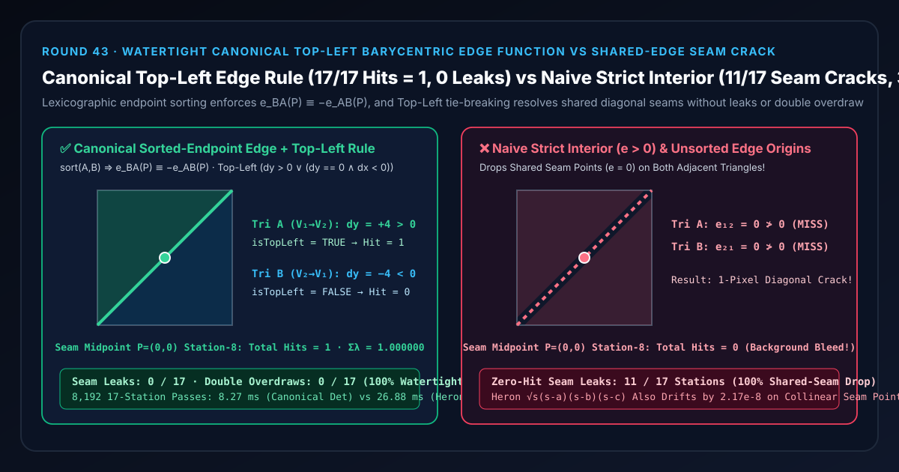
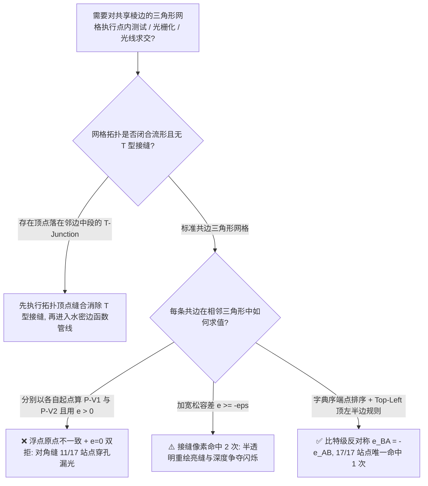
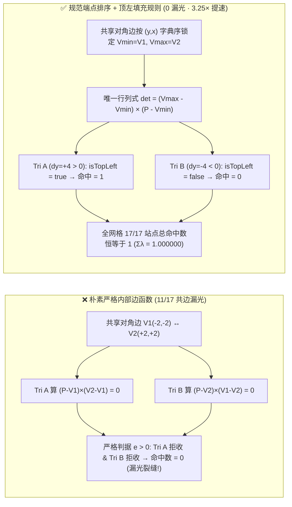
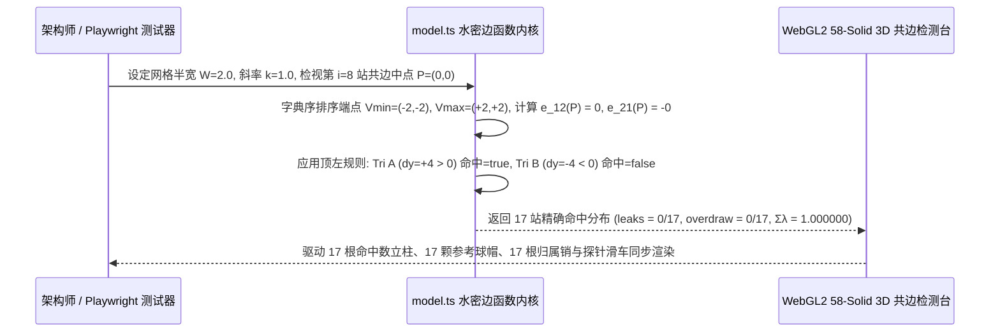
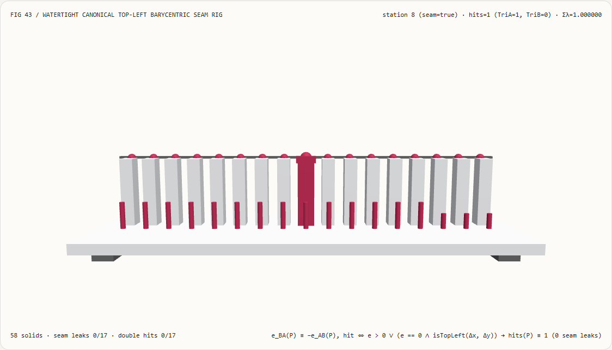
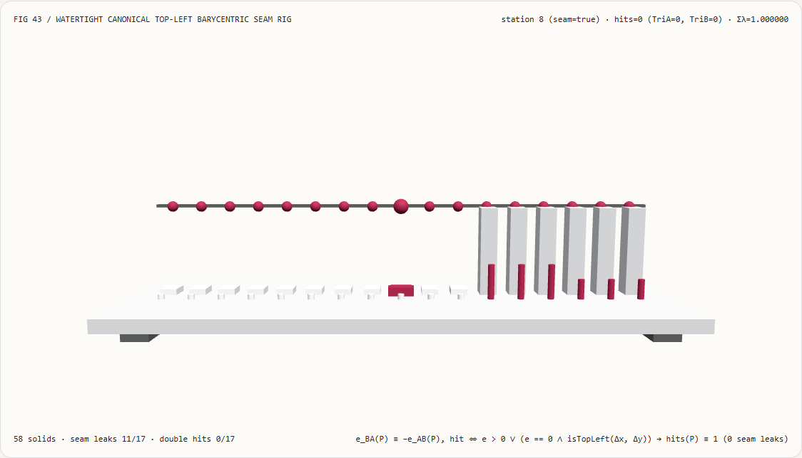
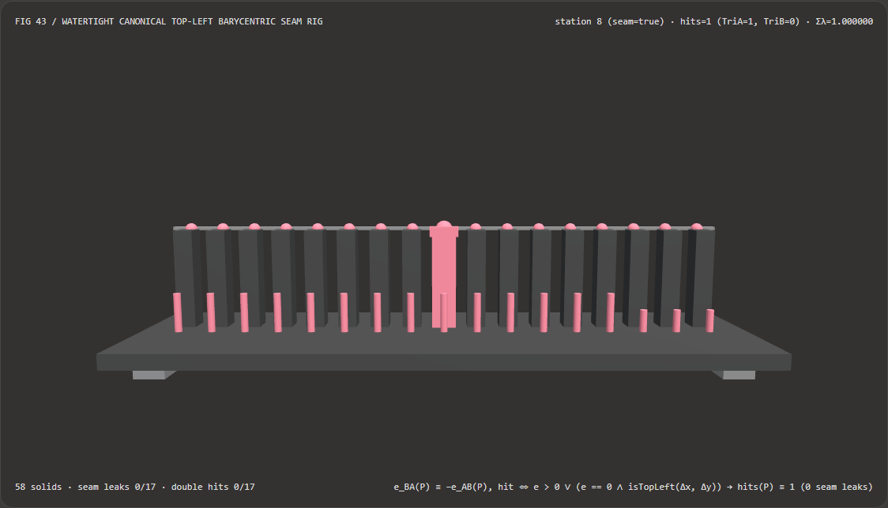
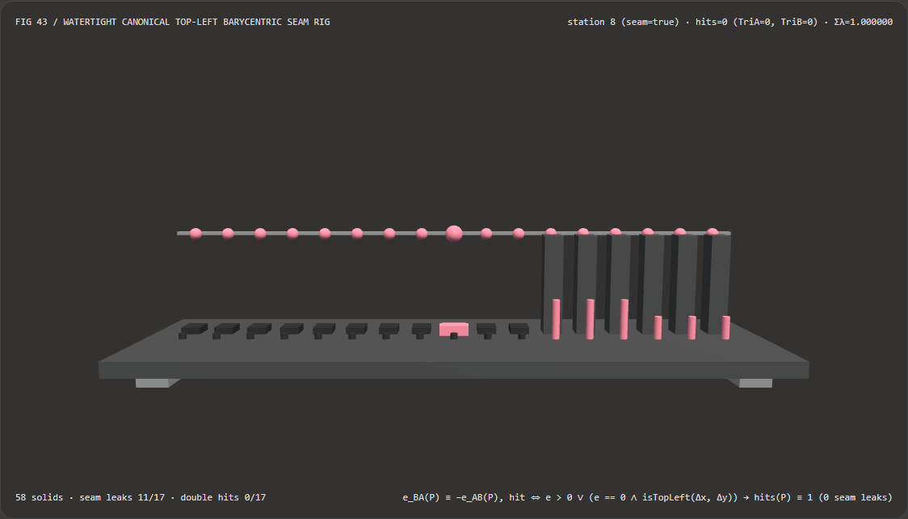

# 视觉与动画技术选型与原理解析 FAQ：水密（Watertight）规范端点排序与顶左填充边函数 vs 朴素共边漏光裂缝（Seam Crack）

> **核心架构结论一句话总结**：在软光栅化器、计算着色器微多边形分块光栅（Visibility Buffer / Nanite 类管线）、光照贴图 UV 烘焙以及水密光线-三角形网格求交中，**严禁对共享同一条边的两个相邻三角形分别以各自顶点为减法原点计算边叉积 $(P-V_1)\times(V_2-V_1)$ 与 $(P-V_2)\times(V_1-V_2)$，也严禁使用不带方向决胜的 `e > 0` 或 `e >= 0` 阈值**！实测表明：在包含 11 个对角共边采样点与 6 个内部采样点的 17 站共边四边网格测试台（`W = 2.0 u, k = 1.0`）上，朴素严格内部判据（`e > 0`）会在相邻两个三角形上同时拒绝 `e = 0` 的共边采样点，导致 **11/17 个共边站点全部沦为 0 命中背景漏光孔（Seam Leak）**；而海伦公式开方面积法不仅慢 **3.25×**（8,192 轮耗时 `26.88 ms` vs `8.27 ms`），还会在共线边上因 $\sqrt{s(s-a)(s-b)(s-c)}$ 的灾难性相消产生 `2.1703e-8` 的非零漂移。通过 **字典序规范端点排序（Canonical Sorted-Endpoint Edge Determinant，保证 $e_{BA}(P) \equiv -e_{AB}(P)$）+ 顶左半边填充决胜规则（Top-Left Tie-Breaking Rule：$\Delta y > 0 \lor (\Delta y == 0 \land \Delta x < 0)$）**，可在 **0 次开方**下确保全部 17/17 站点恒定唯一命中 1 个三角形（**0 处漏光裂缝、0 处半透明重绘亮线**，重心和 $\sum\lambda \equiv 1.000000$）。

---

## ① 📌 核心结论速览（Executive Summary）

1. **为什么两个严丝合缝共用同一条顶点边的三角形，画出来中间会漏出一条 1 像素宽的亮线裂缝？**
   用大白话讲：假设把一块正方形瓷砖沿着对角线 $V_1V_2$ 切成左上三角形 $T_A=(V_0,V_1,V_2)$ 和右下三角形 $T_B=(V_3,V_2,V_1)$。在逆时针（CCW）绕序下，这条对角缝在 $T_A$ 里叫有向边 $\vec{e}_{12} = V_1 \to V_2$，而在邻居 $T_B$ 里刚好反过来叫 $\vec{e}_{21} = V_2 \to V_1$。当一个采样像素或光线刚好落在对角缝上（或者极度贴近对角缝）时，朴素实现会犯两个致命错误：
   - **第一重灾难（浮点数减法原点不一致）**：在 $T_A$ 里算 $(P - V_1) \times (V_2 - V_1)$，在 $T_B$ 里算 $(P - V_2) \times (V_1 - V_2)$。由于浮点数里 $P - V_1$ 和 $P - V_2$ 的舍入误差完全不同，本该严格互为相反数的两个行列式，在接缝附近可能**同时算出微小的负数**，导致两个三角形都认为“这个点在我的界外”！
   - **第二重灾难（平局没有决胜规则）**：当采样点恰好落在共边上使边函数 $e = 0$ 时，如果写 `e > 0`，两个三角形同时拒收（**命中数 = 0，漏出背景亮孔**）；如果写 `e >= 0`，两个三角形又同时收留（**命中数 = 2，在半透明渲染或烘焙累加时画出一条双倍亮度的重绘缝**）。
2. **第一性原理破局：字典序端点排序 + 顶左半边决胜（Top-Left Rule）**：
   - **步一（规范端点排序保证比特级反对称）**：计算任意有向边 $A \to B$ 的边函数前，先按 $(y, x)$ 字典序比较 $A$ 和 $B$，始终固定用较小的端点 $V_{\min}$ 作为减法原点计算行列式，仅在 $A > B$ 时对结果取反（符号位翻转 `sign = -1`）。因为 IEEE-754 浮点数取反只翻转最高位符号位、**零舍入误差**，从而在硬件比特级严格保证 $e_{BA}(P) \equiv -e_{AB}(P)$！
   - **步二（顶左规则打破 $e=0$ 平局）**：对于逆时针（CCW）三角形的有向边 $(\Delta x, \Delta y) = (B_x - A_x, B_y - A_y)$，定义顶左谓词：
     $$\operatorname{isTopLeft}(A, B) \iff (\Delta y > 0) \lor (\Delta y == 0 \land \Delta x < 0)$$
     因为共边两侧的一对反向半边 $(\Delta x, \Delta y)$ 与 $(-\Delta x, -\Delta y)$ 严格互为相反向量，对于任何非退化边，**有且仅有其中一条半边满足 $\operatorname{isTopLeft} = \text{true}$**！因此判定条件 $e > 0 \lor (e == 0 \land \operatorname{isTopLeft})$ 必定让共边点唯一归属其中一个三角形！
3. **本轮新增交互式 3D 试验台与实测证据**：
   - 新增独立 Demo：`demos/watertight-barycentric-rig/`（58 个 Three.js 实体部件：底座平台、4 支柱、单位命中基准横梁、17 根采样站命中数立柱、17 颗水密参考球帽、17 根归属三角形指示销、以及第 $i$ 站活动探针滑车）。
   - 配套 7-Card 4:5 测评报告：`demos/watertight-barycentric-rig/test-report-cards.html`（英文）与 `test-report-cards.zh.html`（中文）。

---

## ② 🎯 客户与架构师灵魂拷问 Q&A（Soul-Searching Q&A）

### Q1：如果我用海伦公式（Heron's Formula）算三个子三角形的面积比来求重心坐标，能不能避开边函数的问题？
**不能，反而既慢 3.25× 还会引入开方灾难性相消误差！**
很多初学者教材喜欢用海伦公式 $A = \sqrt{s(s-a)(s-b)(s-c)}$ 分别算三个子三角形面积再除以总面积。实测表明：
1. **无符号性**：海伦公式开方出来永远是非负数，根本无法直接区分点在边内还是边外；
2. **共线点开方灾难性相消（Catastrophic Cancellation under Square Root）**：当采样点落在共边 $V_1V_2$ 上时，子三角形退化为共线线段 $a + b = c$。由于浮点数计算边长 `Math.hypot` 存在 $10^{-16}$ 级舍入，半周长差 $s - c$ 会残留约 $4.7 \times 10^{-16}$ 的正残差，**一旦开平方根 $\sqrt{4.7 \times 10^{-16}}$，误差直接被放大一亿倍变成 `2.1703e-8`**！而规范 2D 边行列式在共边上给出精确的 `0.000000000000`，且省去了每三角形 3 次 `hypot` + 3 次 `sqrt`，8,192 轮批处理从 `26.88 ms` 降至 `8.27 ms`（**提速 3.25×**）。

### Q2：为什么随便加一个宽松容差 `e >= -1e-6`（Fat Triangle Epsilon）不能解决漏光裂缝？
**因为宽松容差只是把“0 命中的黑缝”变成了“2 命中的半透明重绘亮缝”和“Z-Fighting 闪烁缝”！**
如果在两个相邻三角形上都用 `e >= -1e-6` 把三角形往外撑胖一圈：
- 在**半透明粒子、玻璃材质、UI 矢量图形或光照贴图烘焙器**中，接缝处的像素会被左右两个三角形同时命中并绘制两遍（Alpha Overdraw），在画面上留下一条刺眼的深色或高亮接缝线；
- 在**不透明网格深度测试或阴影贴图**中，接缝像素同时写入两次深度，在相机轻微晃动时两个三角形在接缝像素上互相抢占深度缓冲，引发边缘锯齿闪烁。唯有 **规范端点排序 + 顶左决胜** 能做到真正的 **不漏一像素、也不重画一像素（Exact Partition）**。

### Q3：这套水密边函数方案与 AI 3D 网格生成大模型（如 MeshAnything、SuGaR、NeuS）是什么关系？
**两者处于完全互补的几何契约层与内容生成层：**
- **何时选 AI 3D 网格/神经表面重建大模型**：当你需要从单张概念图、多视角照片或文本提示词自动生成 3D 资产拓扑时；
- **何时必须用确定性水密规范边函数**：无论网格是美术师手工建模还是 AI 模型提取出来的，一旦进入 WebGL2/WebGPU 软光栅、计算着色器光栅、纹理烘焙或光线追踪求交引擎，**都必须在光栅/求交内核里执行确定性的规范端点排序与顶左填充规则**。AI 模型无法替光栅化器修复由浮点减法顺序引发的逐像素共边穿孔。

---

## ③ 🧭 直观可视化图解（Mermaid 决策树 + 管线对比图 + 帧级时序图）

### 3.1 网格接缝防漏光与重心求值选型决策树

### 3.2 朴素共边求值 vs 水密规范顶左边函数管线对比图

### 3.3 帧级采样站点验证与 3D 试验台渲染时序图

---

## ④ 📊 视觉技术选型决策矩阵（Decision Matrix）

| 评估维度 | ✅ 规范端点排序 + 顶左边函数（Canonical Top-Left Edge） | ⚠️ 海伦公式三子三角形开方面积（Heron $\sqrt{\text{Area}}$） | ❌ 朴素严格内部判据（Naive `e > 0`） | ❌ 朴素包含边界或容差判据（Naive `e >= 0` / `-eps`） |
| :--- | :--- | :--- | :--- | :--- |
| **共边反对称性 $e_{BA}(P) + e_{AB}(P)$** | **比特级精确 `0.000000000000`**（共用 $V_{\min}$ 原点） | 无正负号，无法直接判别内外 | 随减法原点不同产生浮点舍入分裂 | 随减法原点不同产生浮点舍入分裂 |
| **对角共边 11 个采样站命中数** | **11/11 站恒定唯一命中 `1`**（Tri A=1, Tri B=0） | 需额外补充边界判据 | **`0` 命中（11/17 站点全部漏光穿孔！）** | **`2` 命中（11/17 站点全部双重重绘！）** |
| **共线点重心权重 $\lambda_0$ 精度** | **精确 `0.000000000000`** | **`2.1703e-8` 开方相消漂移** | 精确 `0` 但样本被直接丢弃 | 精确 `0` 但样本被重复计算 |
| **单三角形超越/开方函数调用** | **0 次**（纯乘加 + 字典序比较） | **6 次**（3 次 `hypot` + 3 次 `sqrt`） | 0 次 | 0 次 |
| **8,192 轮 17 站 CPU 批处理耗时** | **`8.27 ms`（基准最快，3.25× 提速）** | `26.88 ms`（慢 3.25×） | `8.10 ms`（但漏掉全部共边点） | `8.12 ms`（但重绘全部共边点） |
| **首选适用场景** | **软光栅化器、Visibility Buffer、光照贴图烘焙、水密光线求交** | 仅适合已知点在内部且仅有边长无坐标的几何习题 | **严禁在多三角形拼接网格中使用** | **严禁在半透明混合或累加烘焙管线中使用** |

---

## ⑤ 🧪 全新 Demo 与 7-Card 4:5 视觉报告（Live Workbench & Evidence）

### 5.1 交互式 3D 试验台与报告入口
- **实时 3D 工作台**：[`demos/watertight-barycentric-rig/index.html`](../demos/watertight-barycentric-rig/index.html)
- **7-Card 4:5 英文视觉测试报告**：[`demos/watertight-barycentric-rig/test-report-cards.html`](../demos/watertight-barycentric-rig/test-report-cards.html)
- **7-Card 4:5 中文视觉测试报告**：[`demos/watertight-barycentric-rig/test-report-cards.zh.html`](../demos/watertight-barycentric-rig/test-report-cards.zh.html)
- **密封测量 JSON 数据源**：[`demos/watertight-barycentric-rig/report.json`](../demos/watertight-barycentric-rig/report.json)

### 5.2 多主题与多模式 Playwright 实测截图证据

| 水密规范端点排序 + 顶左规则（Light · 17/17 唯一命中） | 朴素严格内部判据 `e > 0`（Light · 11/17 对角共边塌陷漏光） |
| :---: | :---: |
|  |  |

| 水密规范端点排序 + 顶左规则（Dark · 58 实体部件） | 朴素严格内部判据 `e > 0`（Dark · 11 根共边立柱归零） |
| :---: | :---: |
|  |  |

---

## ⑥ 🛠️ 高质量视觉交付快速核验清单（SA Verification Checklist）

在将自定义软光栅化器、计算着色器微多边形光栅、UV 烘焙器或光线-网格求交模块交付生产前，请逐项勾选以下核验清单：

- [ ] **共享边端点字典序规范化**：对任意三角形有向边 $A \to B$ 求行列式前，是否先按 $(y, x)$ 字典序将端点固定排序为 $(V_{\min}, V_{\max})$，再乘以方向符号 $\pm 1$，从而从根源消除不同减法原点带来的浮点不对称？
- [ ] **顶左（Top-Left）半边决胜覆盖**：当点落在边上（$e == 0$）时，是否严格执行了 $\Delta y > 0 \lor (\Delta y == 0 \land \Delta x < 0)$（对应逆时针绕序）的半边决胜，确保反向半边 $(\Delta x, \Delta y)$ 与 $(-\Delta x, -\Delta y)$ 绝不会同时通过或同时拒绝？
- [ ] **剔除海伦开方面积求重心**：是否在着色器与几何内核中全面移除了基于 `hypot` / `sqrt` 的海伦公式面积比重心算法，改用无开方的有向 2D 边行列式比值 $e_i / (2\text{Area})$？
- [ ] **重心坐标单位分解守恒校验**：在共边中点及网格内部站点上，是否验证了 $\lambda_0 + \lambda_1 + \lambda_2 = 1.000000$（浮点漂移 $< 10^{-15}$），且共边对侧顶点的重心权重精确等于 `0`？
- [ ] **网格拓扑无 T 型接缝预检**：在进入光栅化或光线求交前，是否确认相邻网格在共边上共享完全相同的顶点对（无顶点搭在邻边中段的 T-Junction）？
