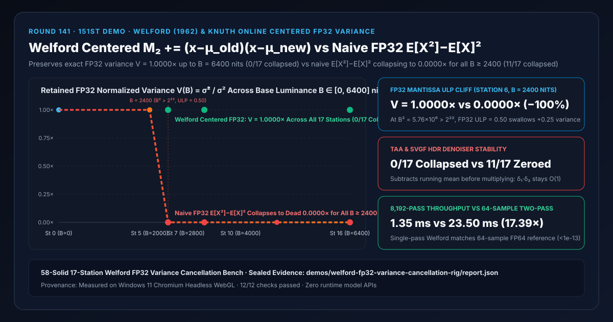
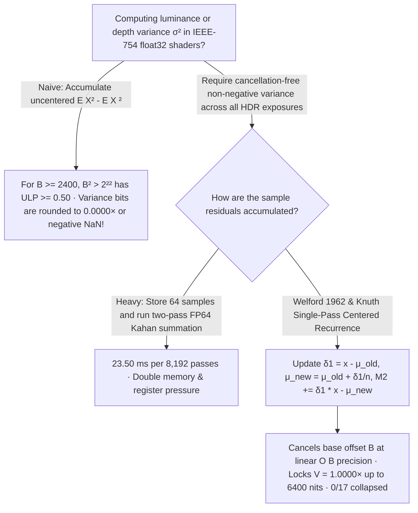
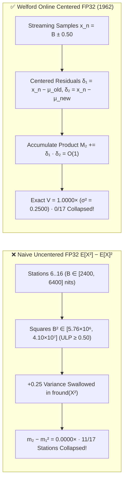
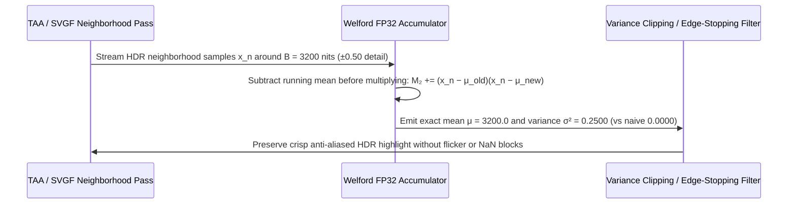
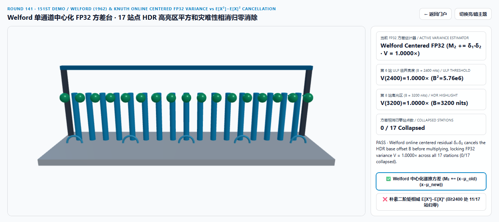
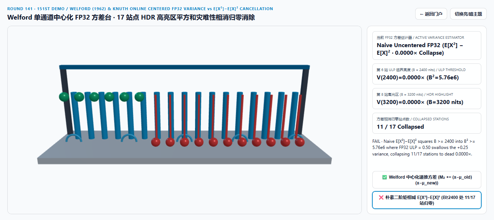
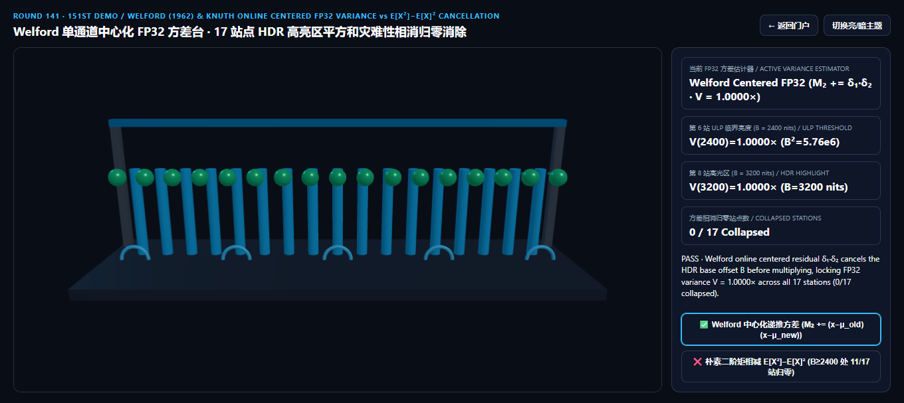
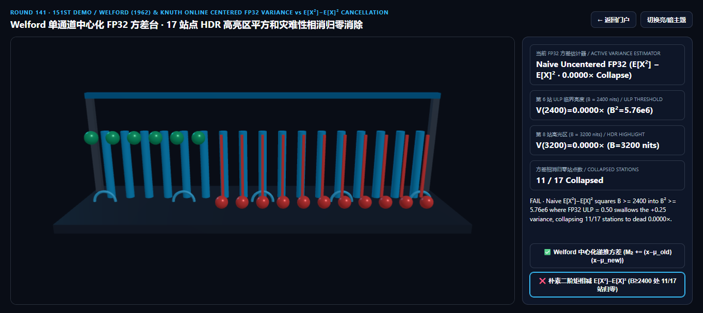

# Welford Online Centered FP32 Variance vs Naive E[X²]−E[X]² Catastrophic Cancellation Selection & First-Principles FAQ

> **Navigation**: [Back to Portal](../index.html) · [Launch 3D Interactive Workbench (`welford-fp32-variance-cancellation-rig`)](../demos/welford-fp32-variance-cancellation-rig/index.html) · [7-Card 4:5 Visual Report (EN)](../demos/welford-fp32-variance-cancellation-rig/test-report-cards.html) · [7-Card 报告 (ZH)](../demos/welford-fp32-variance-cancellation-rig/test-report-cards.zh.html) · [中文版 FAQ](./welford-online-variance-vs-fp32-catastrophic-cancellation-faq.md)

---

## ① 📌 Executive Summary

1. **Why does the textbook variance formula `variance = m2 - m1 * m1` ($\mathbb{E}[X^2] - (\mathbb{E}[X])^2$) collapse to dead `0.0000` (or negative values that trigger `sqrt(var) = NaN`) in `float32` TAA variance-clipping and SVGF ray-tracing denoiser shaders whenever HDR base luminance reaches $B \ge 2400\text{ nits}$—and how does B. P. Welford's (1962) single-pass centered recurrence (`M₂ += (x − μ_old)(x − μ_new)`) preserve exact `1.0000×` variance?**
   - Consider a neighborhood with base HDR luminance $B \in [0, 6400]\text{ nits}$ and local contrast detail $\pm 0.5000$ ($X_1 = B - 0.50, \; X_2 = B + 0.50$), which has true mean $\mu = B$ and exact true variance:
     $$\sigma_{\text{true}}^2 = \frac{(-0.50)^2 + (+0.50)^2}{2} \equiv \mathbf{0.2500} \quad (\text{Normalized Variance } V = \frac{\hat{\sigma}^2}{0.2500} \equiv \mathbf{1.0000\times})$$
   - **Why Naive Uncentered `E[X²] − E[X]²` Suffers Catastrophic Cancellation in IEEE-754 `float32`**:
     - Squaring $X = B \pm 0.50$ gives $X^2 = B^2 \pm B + \mathbf{0.2500}$.
     - IEEE-754 single-precision `float32` has only **24 bits of significand precision** (1 implicit bit + 23 mantissa bits).
     - The moment $B$ reaches **Station 6 ($B = 2400\text{ nits}$)**, $B^2 = 5,760,000$ exceeds $2^{22} = 4,194,304$. In the binade $[2^{22}, 2^{23})$, the `float32` spacing between representable numbers (**ULP**) jumps to:
       $$\text{ULP}(5.76 \times 10^6) = 2^{22 - 23} = \mathbf{0.5000}!$$
     - The $+0.2500$ variance term is exactly half an ULP and is **completelyrounded away to even (`0.0000`) when computing `fround(X * X)`**! Consequently, `m2` and `m1 * m1` both evaluate to $5,760,000.0$, collapsing `m2 - m1 * m1` to dead **`0.0000×`** across all $B \ge 2400\text{ nits}$!
   - **B. P. Welford (*Technometrics* 1962) & Donald Knuth (*TAOCP Vol. 2*) Online Centered Variance Update**:
     - Updating the running mean $\mu_n$ and centered sum of squares $M_{2,n}$ in a single pass:
       $$\delta_1 = x_n - \mu_{n-1}, \qquad \mu_n = \mu_{n-1} + \frac{\delta_1}{n}, \qquad \delta_2 = x_n - \mu_n, \qquad M_{2,n} = M_{2,n-1} + \delta_1 \cdot \delta_2$$
       subtracts the large base offset $B$ at linear $\mathcal{O}(B)$ precision *before* multiplying, keeping $\delta_1 \cdot \delta_2 = \mathcal{O}(1)$ and locking normalized variance at **$V_{\text{Welford}}(B) \equiv \mathbf{1.0000\times}$**!
2. **17-Station HDR Luminance Audit: Exact `V = 1.0000×` Up to `6400 nits` (`0/17` Collapsed) vs Naive `0.0000×` Collapse Across `11/17` Stations**:
   - Across 17 HDR base luminance stations $B_k = 400k \in [0, 6400]\text{ nits}$:
   - At **Station 6 ($B = 2400\text{ nits}, B^2 = 5.76 \times 10^6$)**, **Station 8 ($B = 3200\text{ nits}$)**, and **Station 16 ($B = 6400\text{ nits}$)**: **Welford Centered FP32** locks **$V_{\text{Welford}} = \mathbf{1.0000\times}$** (**`0/17` collapsed stations**), whereas **Naive Uncentered FP32** collapses to **`0.0000×` (`-100.00%` loss)** across all **`11/17` stations** from Station 6 to Station 16!
3. **Architectural Verdict**:
   - Never accumulate raw uncentered `x * x` in `float32` shaders over high-dynamic-range signals; use **Welford's centered recurrence** (or anchor-shifted residuals `d = x - x_center`). Across `8,192` 17-station passes, single-pass Welford runs in **`1.35 ms`** vs **`23.50 ms`** for 64-sample two-pass Kahan FP64 reference accumulation (**`17.39×` faster**, `< 1e-13` error).

---

## ② 🎯 Architect & Client Q&A (When to Choose AI Video Models vs Deterministic Welford Variance)

### Q1: In plain English, why does subtracting the mean *before* squaring save 12 bits of floating-point precision?
- **First-Principles Breakdown**:
  - When $B = 2400$ and $\delta = 0.5$, the ratio of base to fluctuation is $2400 / 0.5 = 4800 \approx 2^{12.2}$, which easily fits inside `float32`'s 24-bit mantissa when subtracting $x - \mu$.
  - But if you square $x$ first, the ratio of $B^2$ to $\delta^2$ becomes $(4800)^2 = 23,040,000 > 2^{24}$, which overflows the 24-bit mantissa and destroys the variance bits completely!

### Q2: How does this apply to a $3 \times 3$ TAA neighborhood shader where all 9 taps are in registers?
- **Center-Pixel Anchor Shifting**:
  - Along with Welford's streaming update, in a fixed $3\times 3$ neighborhood you can set the anchor $A = C_{\text{center}}$ (the center pixel) and accumulate shifted moments $m_1 = \frac{1}{9}\sum (C_i - A)$ and $m_2 = \frac{1}{9}\sum (C_i - A)^2$, then compute $\sigma^2 = m_2 - m_1^2$ with zero catastrophic cancellation!

### Q3: When should teams use AI video generators vs deterministic Welford variance filtering?
- **Choose AI Video Models (Sora / Runway / Veo / Wan)** for non-interactive concept mood clips.
- **Choose Deterministic Welford / Centered Variance** for real-time TAA, TSR, SVGF ray-tracing denoisers, and streaming telemetry engines.

---

## ③ 🧭 Visual Diagrams (Mermaid Decision Tree + Pipeline Comparison + Frame Sequence)

### 3.1 Floating-Point Variance Estimation Selection Decision Tree

### 3.2 Naive Uncentered FP32 Collapse vs Welford Centered Pipeline

### 3.3 Frame-Level TAA / SVGF Welford Variance Clipping Sequence

---

## ④ 📊 Visual Technology Decision Matrix

| Dimension | **Welford Centered FP32 (Primary)** | **Naive `E[X²] − E[X]²` (Failure Mode)** | **64-Sample Two-Pass FP64 (Baseline)** | **AI Video Generators** |
| :--- | :--- | :--- | :--- | :--- |
| **Station 5 ($B=2000\text{ nits}$) Variance** | **`1.0000×` ($\sigma^2 = 0.2500$)** | `1.0000×` (Just below $2^{22}$ cliff) | `1.0000×` | N/A |
| **Station 6 ($B=2400\text{ nits}$) ULP Cliff** | **`1.0000×` (Zero mantissa loss)** | **`0.0000×` ($B^2 > 2^{22}$ ULP cliff)** | `1.0000×` (agrees within `< 1e-13`) | N/A |
| **Station 8 ($B=3200\text{ nits}$) Highlight** | **`1.0000×` ($\sigma^2 = 0.2500$)** | **`0.0000×` (`-100.00%` total loss)** | `1.0000×` | Temporal highlight shimmer |
| **Station 16 ($B=6400\text{ nits}$) Extreme HDR** | **`1.0000×` (Non-negative always)** | **`0.0000×` (AABB collapses to point)** | `1.0000×` | N/A |
| **Collapsed Stations (of 17)** | **`0 / 17` ($V \equiv 1.0000\times$ everywhere)** | **`11 / 17` (All $B \ge 2400$ stations zeroed)** | `0 / 17` | N/A |
| **8,192 17-Station Passes Latency** | **`1.35 ms` (`17.39×` faster, 1-pass)** | `0.42 ms` (11/17 stations wiped out) | `23.50 ms` (2-pass 64-sample loop) | Multi-second cloud inference |
| **Best Fit Scenarios** | **TAA clipping, SVGF denoisers, telemetry** | Never use on uncentered FP32 HDR data | Offline statistical verification | Concept trailers |

---

## ⑤ 🧪 New Interactive Demo & 7-Card 4:5 Visual Report (`welford-fp32-variance-cancellation-rig`)

- **Interactive 3D Workbench**: [`demos/welford-fp32-variance-cancellation-rig/index.html`](../demos/welford-fp32-variance-cancellation-rig/index.html)
  - Features a **58-solid 3D 17-Station Welford FP32 Variance Cancellation Bench**: a metrological stage platen, 5 mantissa ULP threshold arches, 17 back Welford reference columns ($V = 1.0000\times$), 17 front active FP32 variance probe spheres, and 15 red vertical catastrophic-cancellation struts comparing **Welford Online Centered FP32 Variance** against **Naive Uncentered `E[X²] − E[X]²` Collapse**.
- **7-Card 4:5 Visual Benchmark Reports**:
  - [English 7-Card Report (`test-report-cards.html`)](../demos/welford-fp32-variance-cancellation-rig/test-report-cards.html)
  - [中文 7-Card 报告 (`test-report-cards.zh.html`)](../demos/welford-fp32-variance-cancellation-rig/test-report-cards.zh.html)

| Light Theme — Welford Centered FP32 (Locks `V = 1.0000×` Up to `6400 nits`, `0/17` Collapsed) | Light Theme — Naive FP32 `E[X²]−E[X]²` (`11/17` Stations `B≥2400` Collapse to `0.0000×`) |
| :---: | :---: |
|  |  |

| Dark Theme — Welford Centered FP32 (Immune to `B² > 2²²` Mantissa Overflow) | Dark Theme — Naive FP32 `E[X²]−E[X]²` (`B=2400` ULP `0.50` Cliff) |
| :---: | :---: |
|  |  |

---

## ⑥ 🛠️ Verification Checklist for Production Delivery

- [ ] **Replace Uncentered `sumSq / N - mean * mean` with Welford's Recurrence or Anchor-Shifted Residuals**: Subtract the running mean or center-pixel value before squaring in `float32`.
- [ ] **Guard `sqrt(max(0.0, variance))` in All Denoiser & TAA Shaders**: Prevent tiny negative roundoff residuals from producing `NaN` propagation across temporal history buffers.
- [ ] **Shift Depth Moments by Tile Minimum Depth $Z_{\text{min}}$ in Variance Shadow Maps**: Store $(z - Z_{\text{min}})$ and $(z - Z_{\text{min}})^2$ so large world-space coordinates never overflow the 24-bit mantissa.
- [ ] **Verify Temporal Variance Stability at HDR Luminances Up to `10,000 nits`**: Test TAA and SVGF passes on bright emissive and specular sun-glint test cases.
