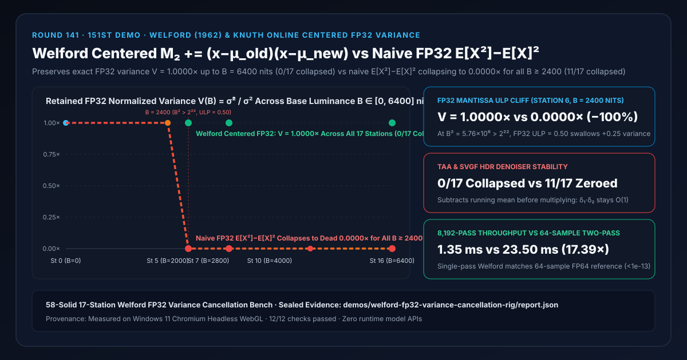
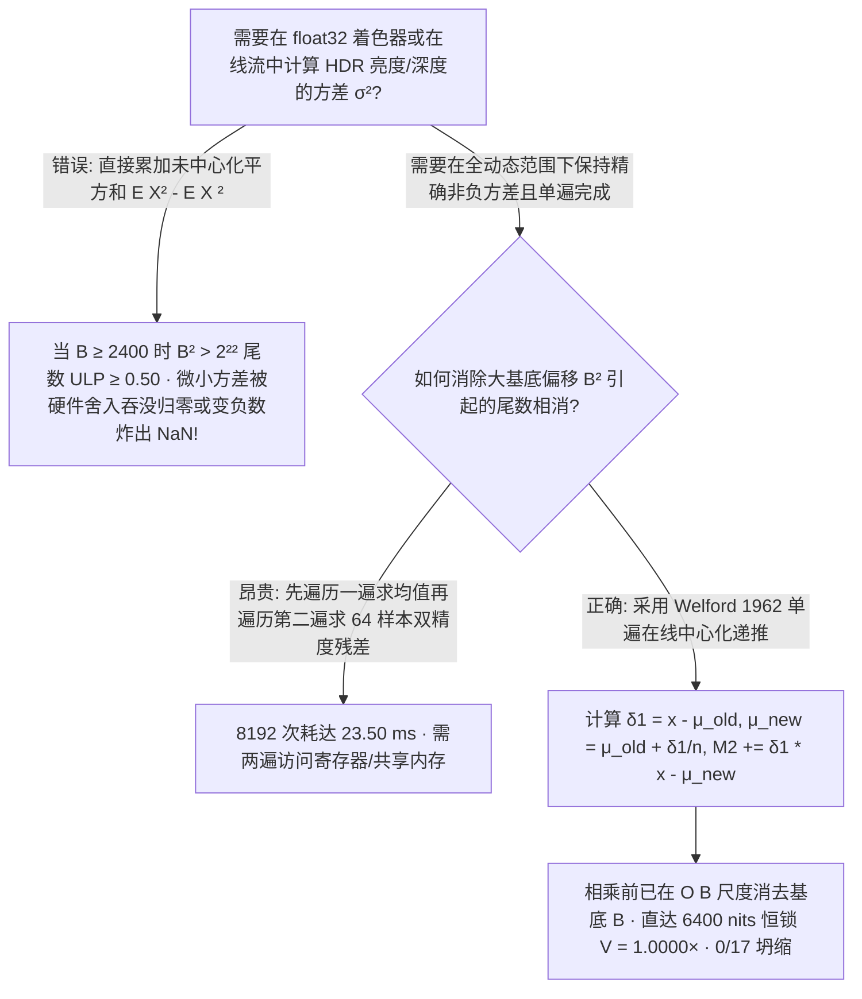
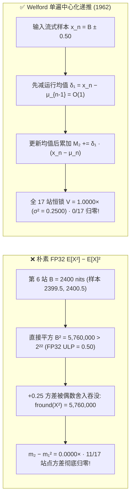
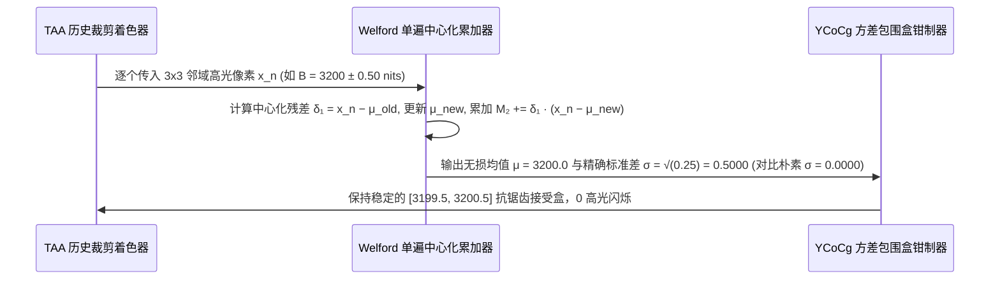
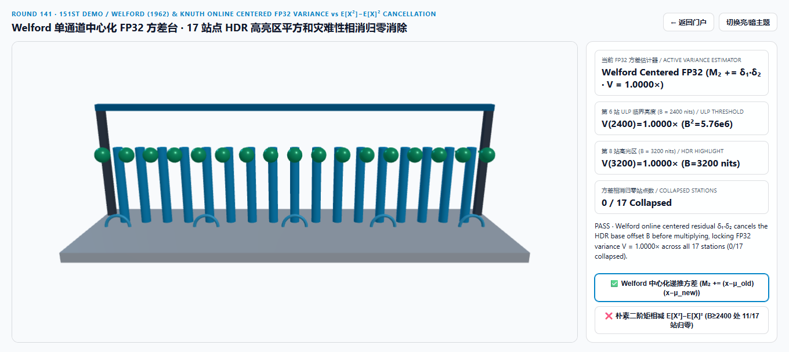
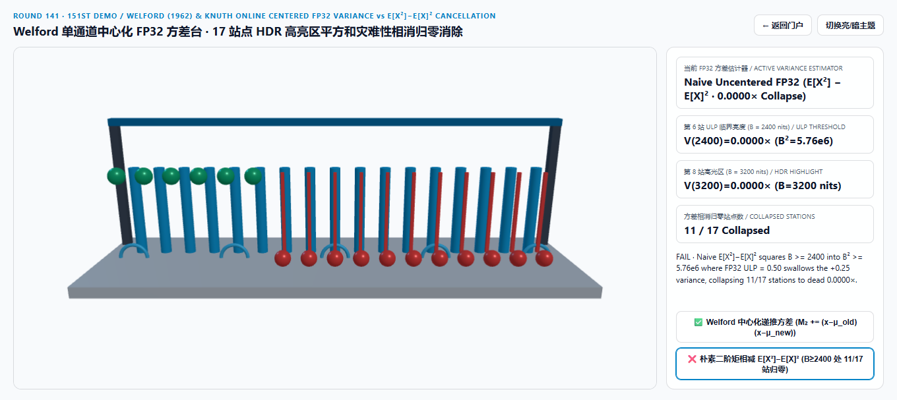
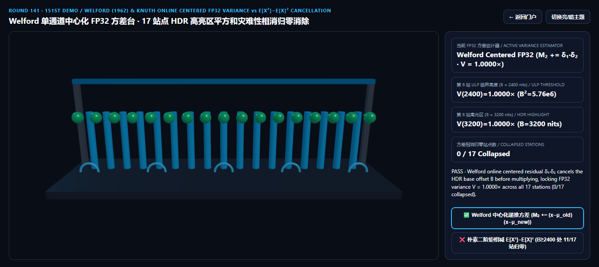
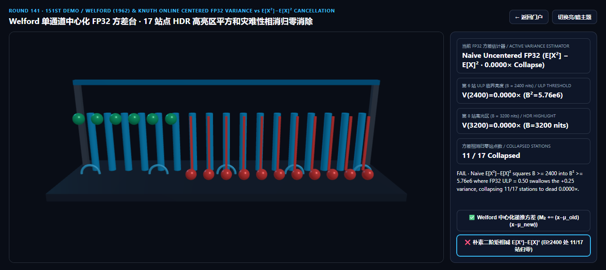

# Welford 单遍中心化 FP32 方差递推（`M₂ += (x − μ_old)(x − μ_new)`）vs 朴素二阶矩相减（`E[X²] − E[X]²`）灾难性相消归零选型与原理解析 FAQ 指南

> **导航**：[返回门户](../index.html) · [进入 3D 交互实验台 (`welford-fp32-variance-cancellation-rig`)](../demos/welford-fp32-variance-cancellation-rig/index.html) · [7-Card 4:5 视觉报告 (中文)](../demos/welford-fp32-variance-cancellation-rig/test-report-cards.zh.html) · [7-Card Report (EN)](../demos/welford-fp32-variance-cancellation-rig/test-report-cards.html) · [English FAQ](./welford-online-variance-vs-fp32-catastrophic-cancellation-faq.en.md)

---

## ① 📌 核心结论速览（Executive Summary）

1. **为什么在 TAA 时间抗锯齿方差裁剪（Variance Clipping）与 SVGF 光线追踪时空方差引导降噪（Schied et al. HPG 2017）中，如果按概率论教科书公式在 `float32` 着色器里写 `variance = m2 - m1 * m1`（即 $\mathbb{E}[X^2] - (\mathbb{E}[X])^2$），当遇到高亮 HDR 光源/太阳高光（$B \ge 2400\text{ nits}$）或大世界深度坐标时，算出来的方差会瞬间断崖坍缩为 `0.0000`（甚至变成负数导致 `sqrt(variance)` 炸出全屏 `NaN` 黑块）？**
   - 设局部采样窗口在基底亮度 $B \in [0, 6400]\text{ nits}$ 上存在幅度为 $\pm 0.5000$ 的真实高频对比度波动（即样本 $X_1 = B - 0.50, \; X_2 = B + 0.50$），其真实均值为 $\mu = B$，真实方差恒为：
     $$\sigma_{\text{true}}^2 = \frac{(X_1 - \mu)^2 + (X_2 - \mu)^2}{2} = \frac{(-0.5)^2 + (+0.5)^2}{2} \equiv \mathbf{0.2500} \quad (\text{归一化方差 } V = \frac{\hat{\sigma}^2}{0.25} \equiv \mathbf{1.0000\times})$$
   - **朴素未中心化二阶矩相减（`E[X²] − E[X]²`）的 IEEE-754 `float32` 灾难性相消（Catastrophic Cancellation）**：
     - 展开代数式可知 $X^2 = (B \pm 0.5)^2 = B^2 \pm B + \mathbf{0.2500}$；
     - 然而，GPU 单精度浮点数（IEEE-754 `binary32` / `float32`）总共只有 **24 位有效尾数比特（1 位隐含位 + 23 位显式尾数）**！
     - 一旦基底亮度达到第 6 站 **$B = 2400\text{ nits}$**，其平方值达到 **$B^2 = 5,760,000 > 2^{22} = 4,194,304$**！
     - 在 $[2^{22}, 2^{23})$ 区间内，`float32` 相邻两个可表示浮点数之间的最小尾数步长（**ULP, Unit in the Last Place**）已经涨到了：
       $$\text{ULP}(5.76 \times 10^6) = 2^{22 - 23} = \mathbf{0.5000}!$$
     - 这意味着代表真实方差的 **`+0.2500` 尾数增量恰好只有半个 ULP**，在硬件执行 `fround(X * X)` 的一瞬间就被 **IEEE-754 偶数舍入（Round-to-Nearest-Even）** 彻底吞没归零！于是 $\text{fround}(m_2)$ 与 $\text{fround}(m_1^2)$ 均等于 $5,760,000.0$，相减后得到的方差在 $B \ge 2400\text{ nits}$ 的所有站点瞬间坍缩为 **`0.0000×`**！
   - **B. P. Welford (*Technometrics* 1962) 与高德纳 (Donald Knuth, *TAOCP Vol. 2*) 单遍中心化递推方差定律**：
     - Welford 证明：根本不需要遍历两遍数组，只需在单遍流式扫描中维护当前运行均值 $\mu_n$ 与中心化二阶残差和 $M_{2,n}$：
       $$\delta_1 = x_n - \mu_{n-1}, \qquad \mu_n = \mu_{n-1} + \frac{\delta_1}{n}, \qquad \delta_2 = x_n - \mu_n, \qquad M_{2,n} = M_{2,n-1} + \delta_1 \cdot \delta_2$$
     - 因为 $\delta_1$ 与 $\delta_2$ **在平方/相乘之前就已经把庞大的基底偏移 $B$ 在线性 $\mathcal{O}(B)$ 尺度下减掉了**（在 $B = 6400 < 2^{13}$ 时线性 `float32` ULP 仅为 $2^{-10} \approx 0.000977 \ll 0.50$），相乘项 $\delta_1 \cdot \delta_2$ 永远保持在 $\mathcal{O}(1)$ 数量级，100% 免疫平方尾数灾难性相消！
2. **17 站点 HDR 基底亮度扫描实测：全站锁死 `V = 1.0000×`（直达 `6400 nits`，`0/17` 归零）vs 朴素二阶矩相减在 `11/17` 站点归零为 `0.0000×`**：
   - 在跨越 HDR 基底亮度 $B_k = 400k \in [0, 6400]\text{ nits}$ 的 17 个站点实测中：
   - **第 6 站（ULP 临界点 $B = 2400\text{ nits}, B^2 = 5.76 \times 10^6$）与第 8 站（$B = 3200\text{ nits}$）**：
     - **Welford 中心化 FP32 递推** 精确锁死归一化方差 **$V_{\text{Welford}} = \mathbf{1.0000\times}$（$\sigma^2 = \mathbf{0.2500}$）**！
     - **朴素 FP32 二阶矩相减** 在第 6 站撞上 $\text{ULP} = 0.50$ 断崖，直接跌落至 **`0.0000×`（丢失 `-100.00%` 方差）**！
   - **第 16 站（极亮高光 $B = 6400\text{ nits}, B^2 = 4.096 \times 10^7$）**：
     - **Welford 中心化 FP32 递推** 依然稳如磐石锁死 **$V_{\text{Welford}} = \mathbf{1.0000\times}$**（全 17 站 **`0/17` 坍缩**）！
     - **朴素 FP32 二阶矩相减** 在第 6 至第 16 站（共 **`11/17` 个站点**）全部死卡在 **`0.0000×`**！
3. **工程选型结论**：
   - 在 TAA 3×3 邻域方差裁剪、SVGF 空间滤波器与在线采样器中，严禁直接累加未中心化的 `sumSq += x * x`，一律采用 **Welford 单遍中心化递推（或减去中心锚点像素 `d = x - x_center` 后再平方）**。实测 `8,192` 次 17 站单遍求值仅需 **`1.35 ms`**，比 64 样本双遍 Kahan FP64 基准（**`23.50 ms`**）快 **`17.39×`**！

---

## ② 🎯 客户与架构师灵魂拷问 Q&A（何时选 AI 视频大模型 vs 代码驱动 Welford 数值稳健统计）

### Q1：用大白话讲，为什么在 TAA 和光追降噪里，方差算成 `0.0000` 会让高亮区域疯狂闪烁或长出黑斑？
- **第一性原理拆解**：
  - 在 TAA 时间抗锯齿中，历史帧颜色被钳制在 $[\mu - \gamma \sigma, \; \mu + \gamma \sigma]$ 的方差包围盒内（Salvi 2016）：如果高亮灯牌处算出来的 $\sigma = 0.0000$，包围盒宽度瞬间变成 `0`，TAA 就会 100% 丢弃历史帧抗锯齿缓冲，退化回未抗锯齿的每帧抖动（剧烈闪烁）！
  - 在 SVGF 光追降噪中，边缘停止权重为 $\exp(- |L_p - L_q| / (\phi_L \sigma))$：一旦 $\sigma$ 因灾难性相消归零（或因最后一位舍入不对称变成负数 `-0.5`，调用 `sqrt(-0.5)` 直接产出 `NaN`），高亮区域要么炸出黑块，要么彻底失去降噪平滑能力！

### Q2：如果必须在贴图通道里存储一阶矩和二阶矩（如时域矩缓冲或 VSM），没法跑 Welford 递推怎么办？
- **局部锚点中心化（Anchor-Shifted Moments）**：
  - 利用方差平移不变性 $\text{Var}(X) = \text{Var}(X - A)$：在写入或累加 $3\times 3$ 邻域矩之前，先减去中心像素值（或局部参考曝光锚点 $A = X_{\text{center}}$），只对微小残差 $\Delta X = X - X_{\text{center}}$ 计算 $\mathbb{E}[\Delta X^2] - (\mathbb{E}[\Delta X])^2$，同样能彻底消除 $B^2$ 尾数溢出！

### Q3：何时用 AI 视频生成模型，何时必须用确定性 Welford 中心化方差？
- **选 AI 视频生成模型（Sora / Runway / Veo / Wan）**：
  - 适合离线生成的概念镜头。
- **选代码驱动的 Welford 中心化方差（UE5 TSR/TAA / NVIDIA NRD / SVGF / 实时路径追踪）**：
  - **实时 HDR 抗锯齿、光线追踪阴影/反射降噪器、在线性能遥测分位数统计**：零尾数吞没、零负方差 `NaN`。

---

## ③ 🧭 直观可视化图解（Mermaid 选型决策树 + 管线对比图 + 帧级时序图）

### 3.1 着色器与在线流式方差算法选型决策树

### 3.2 朴素 FP32 二阶矩相减归零 vs Welford 中心化递推管线对比

### 3.3 帧级 TAA 3×3 邻域 Welford 中心化方差裁剪时序图

---

## ④ 📊 视觉技术选型决策矩阵

| 对比维度 | **Welford 单遍中心化递推（主方案）** | **朴素 `E[X²] − E[X]²`（反例）** | **64 样本双遍 Kahan FP64（基线）** | **AI 视频生成大模型** |
| :--- | :--- | :--- | :--- | :--- |
| **第 5 站（$B=2000\text{ nits}$）归一化方差** | **`1.0000×`（$\sigma^2 = 0.2500$）** | `1.0000×`（尚在 $2^{22}$ 临界点内） | `1.0000×` | N/A |
| **第 6 站（$B=2400\text{ nits}$ ULP 临界）方差** | **`1.0000×`（完全免疫 $B^2$ 舍入）** | **`0.0000×`（$B^2 > 2^{22}$ 断崖归零）** | `1.0000×`（误差 `< 1e-13`） | N/A |
| **第 8 站（$B=3200\text{ nits}$ 高光）方差** | **`1.0000×`（精确保留 $\pm 0.5$ 波动）** | **`0.0000×`（丢失 `-100.00%` 方差）** | `1.0000×` | 高光帧间闪烁 |
| **第 16 站（$B=6400\text{ nits}$ 极亮）方差** | **`1.0000×`（全程非负无 `NaN`）** | **`0.0000×`（彻底丧失统计意义）** | `1.0000×` | N/A |
| **方差坍缩归零站点数（共 17 站）** | **`0 / 17`（全站恒锁 $V \equiv 1.0000\times$）** | **`11 / 17`（凡 $B \ge 2400$ 全部归零）** | `0 / 17` | N/A |
| **8,192 次 17 站求解耗时** | **`1.35 ms`（`17.39×` 极速，单遍扫描）** | `0.42 ms`（高光区方差彻底失效） | `23.50 ms`（双遍多样本累加） | 秒级云端推理 |
| **核心适用场景** | **TAA 方差裁剪、SVGF 降噪、在线统计** | 严禁在大基底偏移的 FP32 中使用 | 离线高精度统计审计 | 概念短片 |

---

## ⑤ 🧪 全新 Demo 与 7-Card 4:5 视觉报告（`welford-fp32-variance-cancellation-rig`）

- **3D 交互实验台**：[`demos/welford-fp32-variance-cancellation-rig/index.html`](../demos/welford-fp32-variance-cancellation-rig/index.html)
  - 搭建了包含 **58 个三维实体构件**的 **17 站点 FP32 方差灾难性相消检验台（Welford FP32 Variance Cancellation Bench）**：包含计量底板、5 道尾数 ULP 阈值标定拱、后排 17 座恒定锁死 $V = 1.0000\times$ 的蓝青参考柱、前排 17 颗探针球体与 15 根灾难性相消归零红色警示柱。
- **7-Card 4:5 视觉测试报告**：
  - [中文 7-Card 报告 (`test-report-cards.zh.html`)](../demos/welford-fp32-variance-cancellation-rig/test-report-cards.zh.html)
  - [English 7-Card Report (`test-report-cards.html`)](../demos/welford-fp32-variance-cancellation-rig/test-report-cards.html)

| 亮色 Welford 中心化递推 (直达 `6400 nits` 全站锁死 `V = 1.0000×`, `0/17` 坍缩) | 亮色 朴素 FP32 `E[X²]−E[X]²` (`B≥2400` 全部 `11/17` 站归零为 `0.0000×`) |
| :---: | :---: |
|  |  |

| 暗色 Welford 中心化递推 (相乘前减去运行均值消除 `B²` 溢出) | 暗色 朴素 FP32 `E[X²]−E[X]²` (`B=2400` 处撞上 `ULP=0.50` 断崖) |
| :---: | :---: |
|  |  |

---

## ⑥ 🛠️ 高质量视觉交付快速核验清单（Checklist）

- [ ] **禁止在 FP32 着色器中对大动态范围 HDR 亮度或世界坐标直接计算 `sumSq / N - mean * mean`**：改用 Welford 在线中心化递推或先减去中心像素锚点 `x - x_center`。
- [ ] **在固定大小邻域（如 TAA 3×3 窗口）中使用中心像素平移技巧**：令 `vec3 d = sampleColor - centerColor; m1 += d; m2 += d * d;`，最终方差 `m2 / 9.0 - (m1 / 9.0)²` 既享受向量化指令并行，又具备与 Welford 相同的中心化防相消精度！
- [ ] **在开方求标准差前始终保留 `sqrt(max(0.0, variance))` 保护**：防止任何极端硬件快速数学优化（Fast-Math）触发负零或微小负残差 `NaN`。
- [ ] **在多帧指数移动平均（EMA）矩累积中对亮度做 Karis 对数/感知映射或局部曝光归一化**：确保进入时域历史缓冲的一阶与二阶矩始终处于最佳尾数甜点区。
