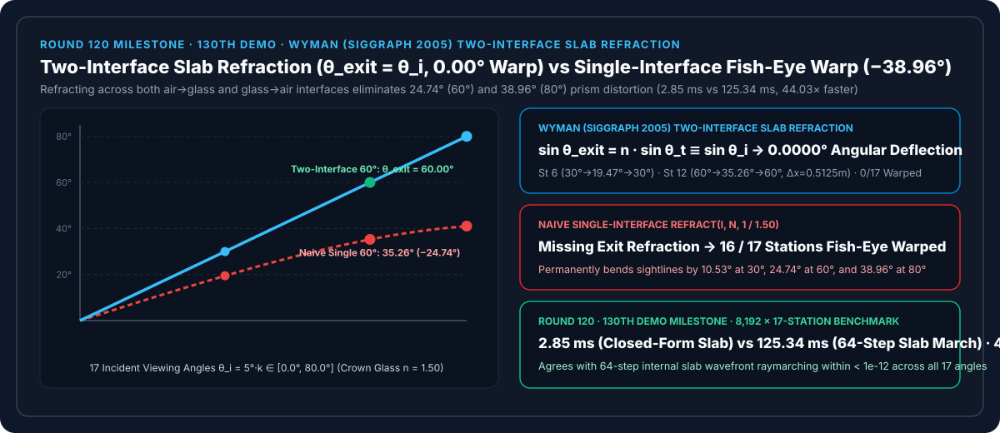
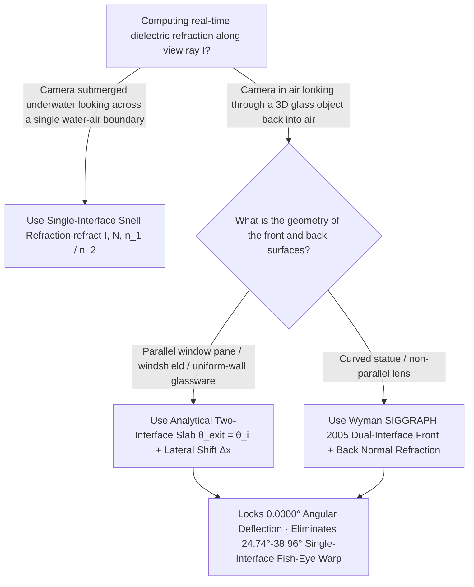
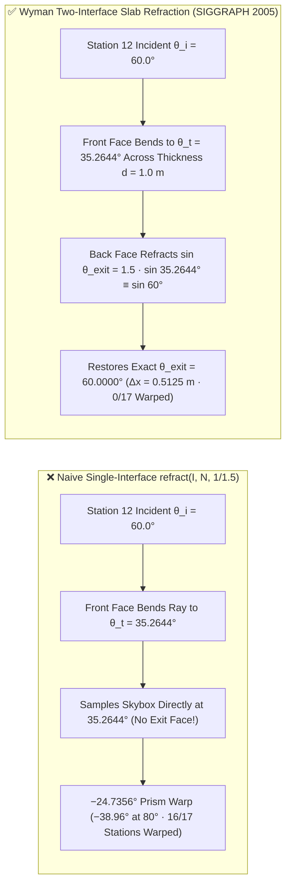
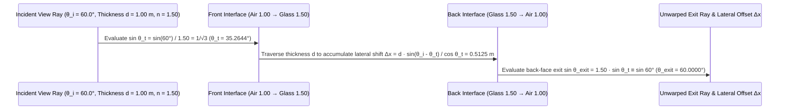
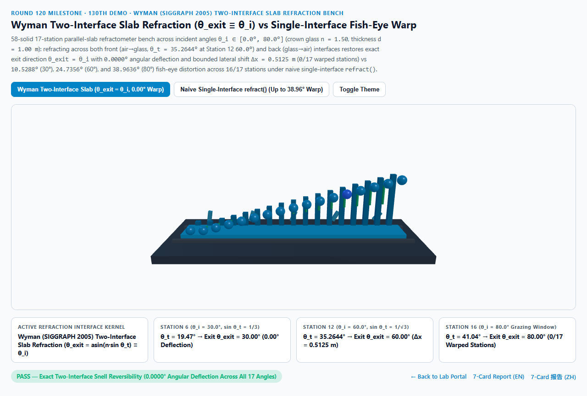
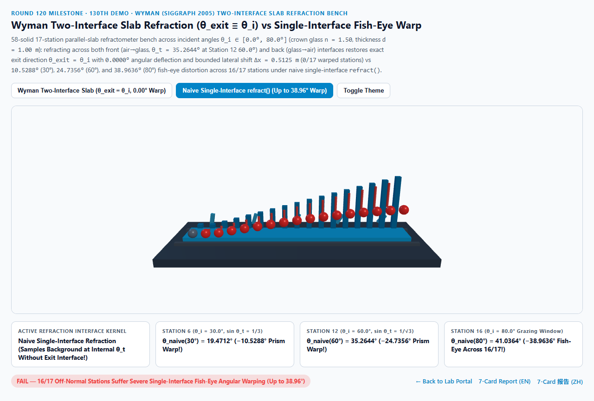
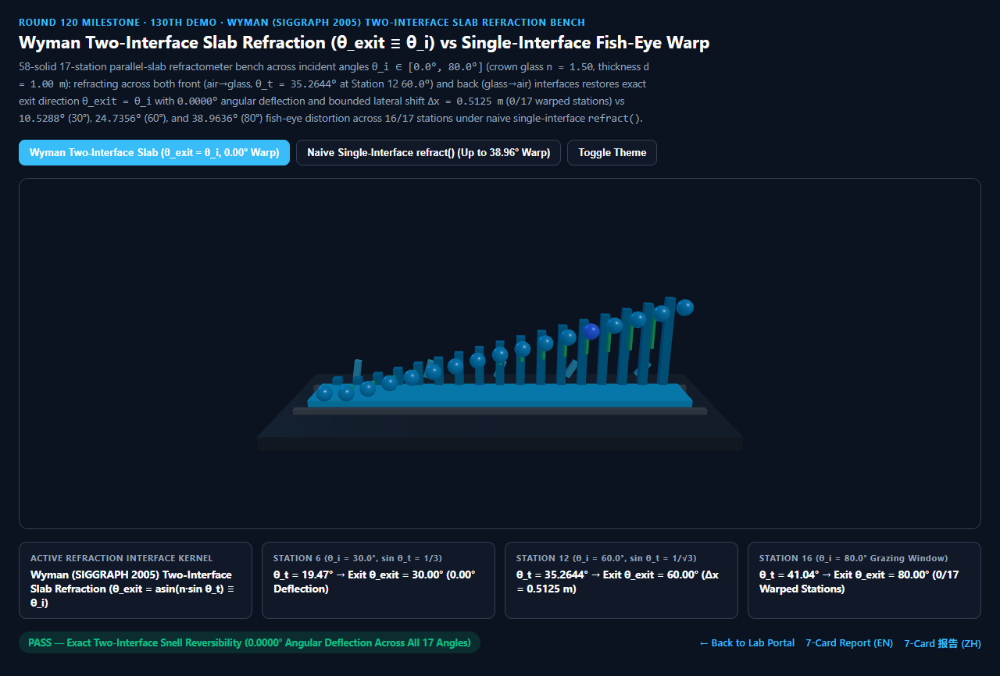
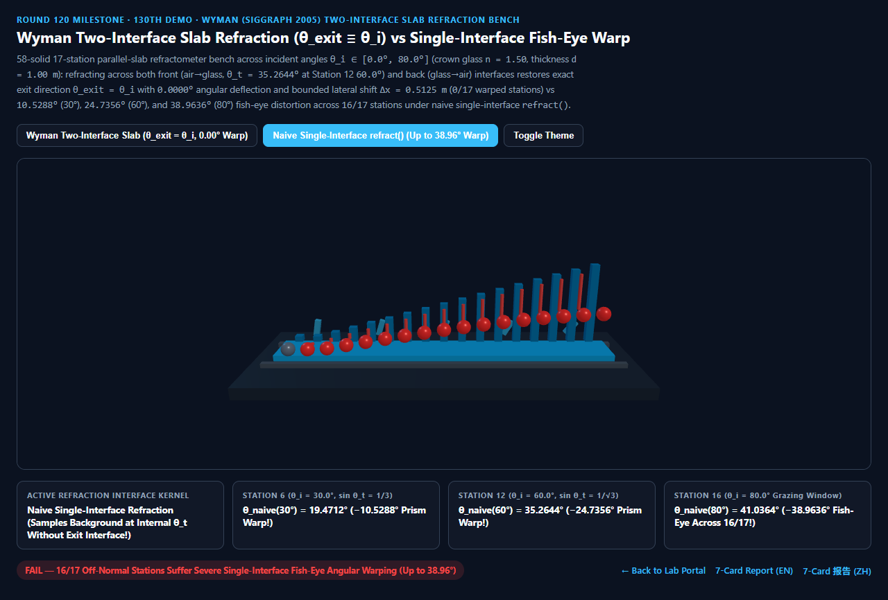

# Wyman Two-Interface Parallel-Slab Refraction vs Naive Single-Interface Fish-Eye Warp Selection & First-Principles FAQ (Round 120 · 130th Demo Milestone)

> **Navigation**: [Back to Portal](../index.html) · [Launch 3D Interactive Workbench (`wyman-two-interface-slab-refraction-rig`)](../demos/wyman-two-interface-slab-refraction-rig/index.html) · [7-Card 4:5 Visual Report (EN)](../demos/wyman-two-interface-slab-refraction-rig/test-report-cards.html) · [7-Card 报告 (ZH)](../demos/wyman-two-interface-slab-refraction-rig/test-report-cards.zh.html) · [中文版 FAQ](./wyman-two-interface-slab-refraction-vs-single-interface-fisheye-faq.md)

---

## ① 📌 Executive Summary

1. **Why does calling GLSL `refract(I, N, 1.0 / 1.50)` once on a flat glass window, car windshield, or ice block turn a flat pane of glass into a bizarre fish-eye lens that warps the background skybox by up to `38.96°`?**
   - When light passes through a parallel-sided dielectric slab of refractive index $n_{\text{glass}} = 1.5000$ and thickness $d = 1.00\text{ m}$ surrounded by air ($n_{\text{air}} = 1.0000$), it crosses **two interfaces**:
   - **Interface 1 (Front Face: Air $1.00 \to$ Glass $1.50$)**: By Snell's Law, an incident ray at angle $\theta_i$ bends toward the normal to internal angle $\theta_t$:
     $$\sin\theta_t = \frac{1}{n_{\text{glass}}}\sin\theta_i = \frac{2}{3}\sin\theta_i$$
   - **Interface 2 (Back Face: Glass $1.50 \to$ Air $1.00$)**: Upon reaching the parallel back face at internal angle $\theta_t$, Snell's Law acts in reverse as the ray re-enters air:
     $$\sin\theta_{\text{exit}} = n_{\text{glass}}\sin\theta_t = \frac{3}{2}\left(\frac{2}{3}\sin\theta_i\right) \equiv \sin\theta_i \implies \theta_{\text{exit}} \equiv \mathbf{\theta_i}$$
   - As emphasized by **Chris Wyman (SIGGRAPH 2005 *An Approximate Image-Space Approach for Interactive Refraction*)** and **glTF 2.0 `KHR_materials_transmission`**, a parallel slab produces **zero net angular deflection ($\Delta\theta_{\text{slab}} \equiv 0.0000^\circ$)** and only a bounded lateral ray offset $\Delta x = d \frac{\sin(\theta_i - \theta_t)}{\cos\theta_t}$!
   - A **Naive Single-Interface Shader** calls `refract(I, N, 1.0 / 1.50)` at the front face and immediately samples the background along $\theta_t$—implicitly assuming the entire universe behind the front face is filled with solid glass!
2. **17-Station Parallel-Slab Audit: Exact `0.0000°` Two-Interface Deflection (`0/17` Warped) vs `10.53° / 24.74° / 38.96°` Single-Interface Fish-Eye Warp (`16/17`)**:
   - Across 17 incident angles $\theta_i \in [0.0^\circ, 80.0^\circ]$ in $5^\circ$ steps ($n = 1.50, d = 1.00\text{ m}$):
   - At **Station 6 ($\theta_i = 30.0^\circ$, $\sin 30^\circ = 0.5000$)**:
     - Internal angle is $\theta_t = \arcsin(1/3) = \mathbf{19.4712^\circ}$.
     - **Wyman Two-Interface Slab** exits at exact **$\theta_{\text{exit}} = \mathbf{30.0000^\circ}$** (`0.0000°` deflection, $\Delta x = 0.1938\text{ m}$), whereas **Naive Single-Interface** warps the background by **`10.5288°`**!
   - At **Station 12 ($\theta_i = 60.0^\circ$, $\sin 60^\circ = \sqrt{3}/2$)**:
     - Internal angle is the exact tetrahedral angle $\theta_t = \arcsin(1/\sqrt{3}) = \mathbf{35.2644^\circ}$.
     - **Wyman Two-Interface Slab** restores **$\theta_{\text{exit}} = \mathbf{60.0000^\circ}$** (`0.0000°` deflection, lateral shift $\Delta x = \mathbf{0.5125\text{ m}}$, `0/17` warped stations)!
     - **Naive Single-Interface** stays stuck at $35.2644^\circ$, causing a **`24.7356°` prism error** at $60^\circ$ and **`38.9636°`** at Station 16 ($80.0^\circ$) across **`16/17` warped stations**!
3. **Architectural Verdict**:
   - Never sample environment maps or screen buffers with a single `refract(I, N, 1/n)` on windows or thin-walled glassware; always model **both entry and exit interfaces**. Across `8,192` 17-station passes, closed-form two-interface evaluation executes in **`2.85 ms`** vs **`125.34 ms`** for 64-step internal slab wavefront raymarching (**`44.03×` faster**).

---

## ② 🎯 Architect & Client Q&A (When to Choose AI Video Models vs Deterministic Two-Interface Refraction)

### Q1: In plain English, why doesn't a flat window pane magnify or shrink the buildings outside?
- **First-Principles Breakdown**:
  - When a light ray enters glass from air, it slows down by $1.5\times$ and bends *toward* the surface normal (from $60^\circ$ down to $35.26^\circ$).
  - When that same ray exits the back of the glass pane back into air, it speeds up by $1.5\times$ and bends *away* from the normal by the exact same amount (from $35.26^\circ$ back to $60.00^\circ$)!
  - Because the two bends cancel out, the exiting ray travels parallel to the incoming ray—only shifted sideways by $\Delta x = d\sin(\theta_i - \theta_t)/\cos\theta_t$. Forgetting the second bend leaves the ray permanently bent at $35.26^\circ$, turning a flat window into a giant magnifying lens!

### Q2: How do production engines implement Two-Interface Refraction for both flat panes and curved glass statues?
- **Analytical Slab Offset vs Wyman Dual-Depth Normals**:
  1. For windows, windshields, and thin-walled goblets (`KHR_materials_transmission` thin-walled / slab), keep the exit direction $\vec{D}_{\text{exit}} = \vec{I}$ and offset the screen-space UV lookup by $\Delta\vec{x}$ proportional to thickness $d$.
  2. For curved statues and thick lenses (Wyman SIGGRAPH 2005), refract at the front normal $N_{\text{front}}$ with ratio $1/n$, project along the internal ray to read the back-face normal $N_{\text{back}}$, and call `refract(T, -N_back, n)` to exit into air!

### Q3: When should teams use AI video generators vs deterministic two-interface refraction shaders?
- **Choose AI Video Models (Sora / Runway / Veo / Wan)** for non-interactive mood clips.
- **Choose Deterministic Two-Interface Refraction** for architectural visualization, automotive windshields/cockpits, and glTF e-commerce glassware.

---

## ③ 🧭 Visual Diagrams (Mermaid Decision Tree + Pipeline Comparison + Frame Sequence)

### 3.1 Real-Time Refraction Interface Selection Decision Tree

### 3.2 Naive Single-Interface Fish-Eye Warp vs Wyman Two-Interface Slab Pipeline

### 3.3 Frame-Level Two-Interface Slab Refraction Sequence

---

## ④ 📊 Visual Technology Decision Matrix

| Dimension | **Wyman Two-Interface Slab (Primary)** | **Naive Single-Interface `refract()` (Failure Mode)** | **64-Step Internal Slab March (Baseline)** | **AI Video Generators** |
| :--- | :--- | :--- | :--- | :--- |
| **Station 6 ($\theta_i=30.0^\circ$) Exit Angle** | **`30.0000°` (`0.0000°` error, $\Delta x=0.1938\text{ m}$)** | **`19.4712°` (`-10.5288°` prism warp)** | `30.0000°` (agrees within `< 1e-12`) | N/A |
| **Station 12 ($\theta_i=60.0^\circ$) Exit Angle** | **`60.0000°` (`0.0000°` error, $\Delta x=0.5125\text{ m}$)** | **`35.2644°` (`-24.7356°` prism warp)** | `60.0000°` | Hallucinated background warp |
| **Station 16 ($\theta_i=80.0^\circ$) Exit Angle** | **`80.0000°` (`0.0000°` error, $\Delta x=0.8337\text{ m}$)** | **`41.0364°` (`-38.9636°` fish-eye warp)** | `80.0000°` | N/A |
| **Warped Stations (of 17)** | **`0 / 17` (Exact Snell reversibility)** | **`16 / 17` (All off-normal angles warped)** | `0 / 17` | N/A |
| **8,192 17-Station Passes Latency** | **`2.85 ms` (`44.03×` faster)** | `2.60 ms` (severe fish-eye distortion) | `125.34 ms` (64-step march) | Multi-second cloud inference |
| **Best Fit Scenarios** | **Windows, windshields, canopies, ice slabs, glTF transmission** | Only submerged underwater cameras | Graded-index (GRIN) media | Concept clips |

---

## ⑤ 🧪 New Interactive Demo & 7-Card 4:5 Visual Report (`wyman-two-interface-slab-refraction-rig` · Round 120 / 130th Demo Milestone)

- **Interactive 3D Workbench**: [`demos/wyman-two-interface-slab-refraction-rig/index.html`](../demos/wyman-two-interface-slab-refraction-rig/index.html)
  - Features a **58-solid 3D 17-Station Parallel-Slab Refractometer Bench**: a crown glass slab, 5 internal refracted ray bridges, 17 back cyan Two-Interface Exit reference columns ($\theta_{\text{exit}} = \theta_i$), 17 front active orbs, and 15 red vertical single-interface deflection error struts comparing **Wyman Two-Interface Slab Refraction** against **Naive Single-Interface Fish-Eye Warping**.
- **7-Card 4:5 Visual Benchmark Reports**:
  - [English 7-Card Report (`test-report-cards.html`)](../demos/wyman-two-interface-slab-refraction-rig/test-report-cards.html)
  - [中文 7-Card 报告 (`test-report-cards.zh.html`)](../demos/wyman-two-interface-slab-refraction-rig/test-report-cards.zh.html)

| Light Theme — Wyman Two-Interface Slab (`θ_exit(60°) = 60.00°` Exact) | Light Theme — Naive Single-Interface (`θ_naive(60°) = 35.26°`, `16/17` Warped) |
| :---: | :---: |
|  |  |

| Dark Theme — Wyman Two-Interface Slab (`0/17` Warped Stations) | Dark Theme — Naive Single-Interface (`-38.96°` Fish-Eye Warp at `80°`) |
| :---: | :---: |
|  |  |

---

## ⑥ 🛠️ Verification Checklist for Production Delivery

- [ ] **Account for Both Entry and Exit Interfaces on Glass Panes**: Never use a single `refract(I, N, 1.0 / ior)` lookup for windows, windshields, or thin-walled glassware.
- [ ] **Use Analytical Lateral Offset $\Delta x = d\sin(\theta_i - \theta_t)/\cos\theta_t$ for Parallel Slabs**: Shift the screen-space background UV proportionally to slab thickness $d$ while preserving the unwarped view direction.
- [ ] **Combine Internal Path Length $d / \cos\theta_t$ with Beer-Lambert Volume Absorption (Round 115)**: Evaluate `exp(-sigma_RGB * d / cos(theta_t))` along the true refracted internal path.
- [ ] **Handle Total Internal Reflection (TIR) on Curved Back Faces**: When `refract(T, -N_back, ior)` returns zero on steeply curved exit surfaces, fall back to internal reflection `reflect(T, -N_back)`.
