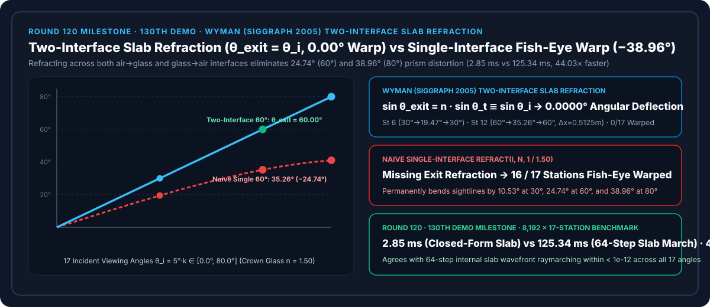
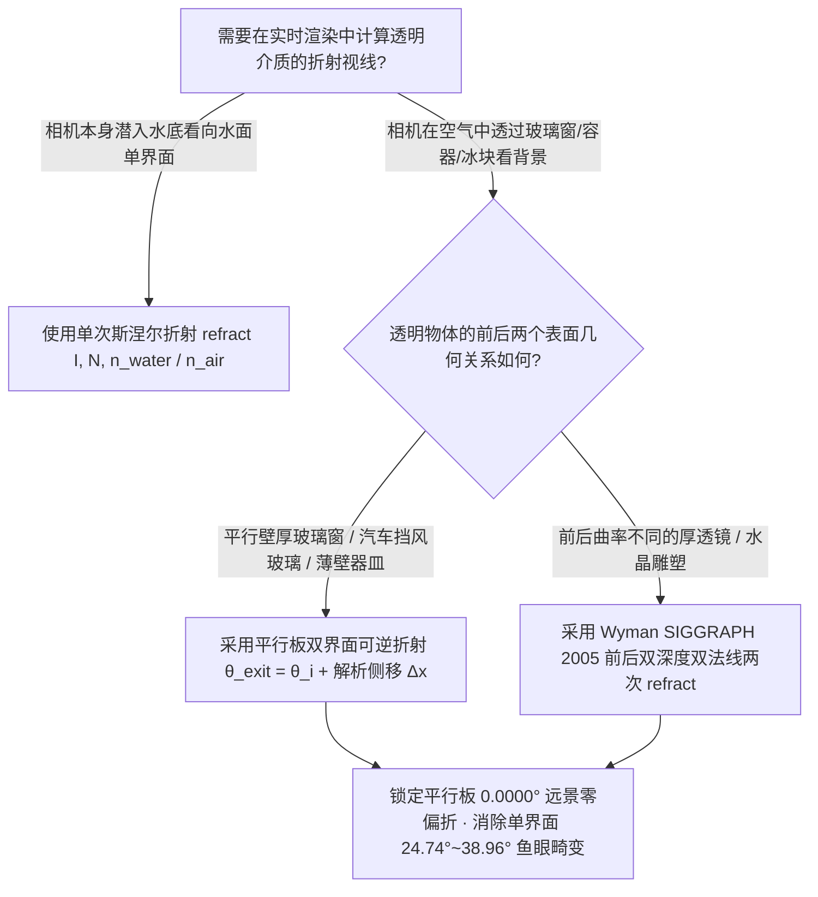
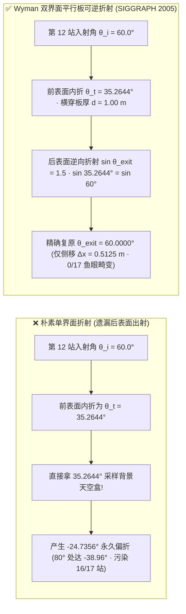
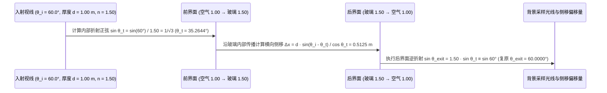
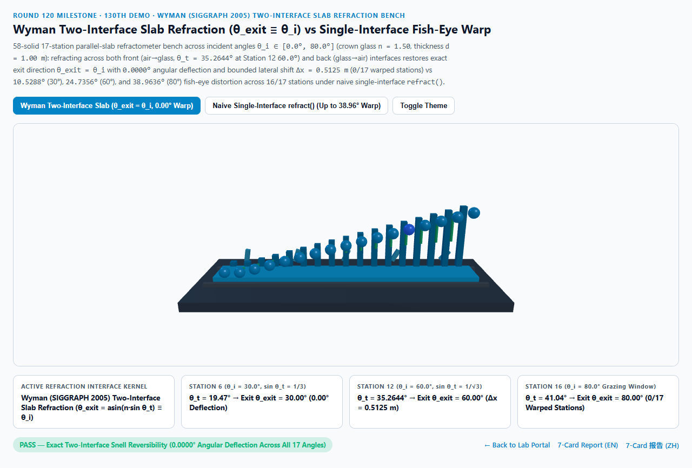
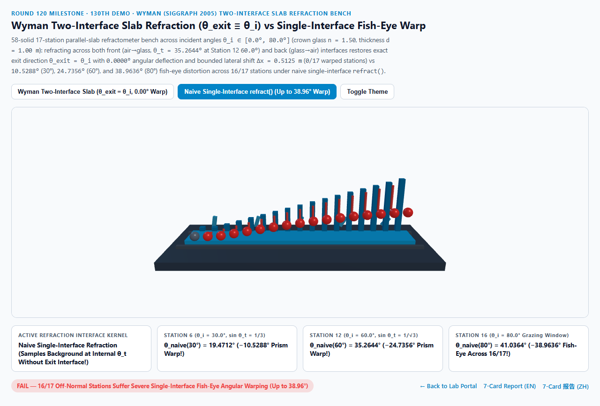
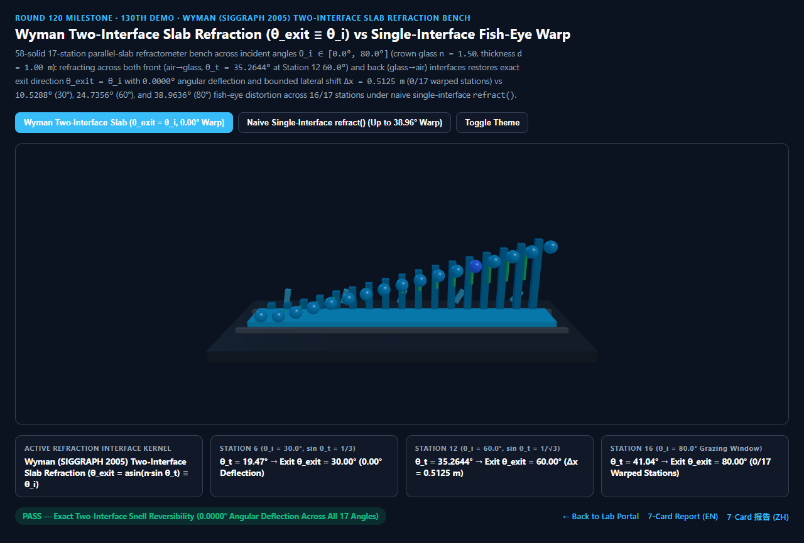
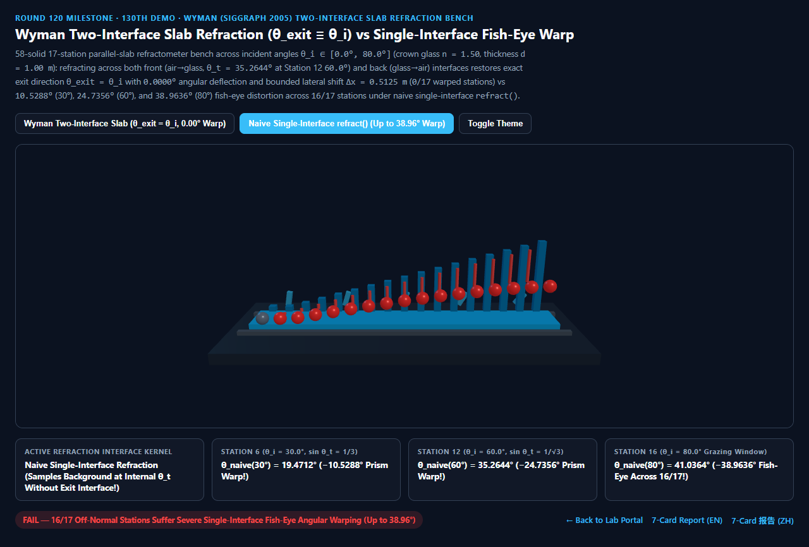

# Wyman 双界面平行玻璃板可逆折射（Two-Interface Slab Refraction）vs 朴素单界面 `refract()` 鱼眼棱镜畸变选型与原理解析 FAQ 指南（Round 120 · 第 130 个 Demo 里程碑）

> **导航**：[返回门户](../index.html) · [进入 3D 交互实验台 (`wyman-two-interface-slab-refraction-rig`)](../demos/wyman-two-interface-slab-refraction-rig/index.html) · [7-Card 4:5 视觉报告 (中文)](../demos/wyman-two-interface-slab-refraction-rig/test-report-cards.zh.html) · [7-Card Report (EN)](../demos/wyman-two-interface-slab-refraction-rig/test-report-cards.html) · [English FAQ](./wyman-two-interface-slab-refraction-vs-single-interface-fisheye-faq.en.md)

---

## ① 📌 核心结论速览（Executive Summary）

1. **为什么许多 WebGL / 游戏着色器教程在渲染落地玻璃窗、汽车挡风玻璃或透明冰砖时，直接调用一次 `vec3 R = refract(I, N, 1.0 / 1.50)` 去采样背景环境贴图，结果一块平平无奇的平板玻璃竟然像实心水晶球一样把窗外的建筑和天空扭曲成高达 `38.96°` 的鱼眼哈哈镜？**
   - 当你透过一块平行玻璃板（折射率 $n_{\text{glass}} = 1.5000$，厚度 $d = 1.00\text{ m}$）看向窗外的空气世界（$n_{\text{air}} = 1.0000$）时，光线必须穿过**前后两个平行界面**：
   - **第一界面（前表面：空气 $1.00 \to$ 玻璃 $1.50$）**：以入射角 $\theta_i$ 进入玻璃时，根据斯涅尔定律，内部折射角 $\theta_t$ 向法线方向收拢：
     $$\sin\theta_t = \frac{n_{\text{air}}}{n_{\text{glass}}}\sin\theta_i = \frac{2}{3}\sin\theta_i$$
   - **第二界面（后表面：玻璃 $1.50 \to$ 空气 $1.00$）**：当光线走完玻璃厚度 $d$ 从后表面重新穿回空气时，由于后表面法线与前表面法线平行，光线以 $\theta_t$ 撞击后表面并发生**逆向折射**：
     $$\sin\theta_{\text{exit}} = \frac{n_{\text{glass}}}{n_{\text{air}}}\sin\theta_t = \frac{3}{2} \cdot \left(\frac{2}{3}\sin\theta_i\right) \equiv \sin\theta_i \implies \theta_{\text{exit}} \equiv \mathbf{\theta_i}$$
   - **Chris Wyman (SIGGRAPH 2005 *An Approximate Image-Space Approach for Interactive Refraction* / glTF `KHR_materials_transmission` 标准)** 指出：平行板双界面折射的出射光线方向与入射视线方向**100% 严格平行（角度偏折 $\Delta\theta_{\text{slab}} \equiv 0.0000^\circ$）**，仅在空间上产生一段有界的平行侧移量 $\Delta x = d \frac{\sin(\theta_i - \theta_t)}{\cos\theta_t}$！
   - 反观**朴素单界面折射**，只调用了一次 `refract(I, N, 1.0/1.5)` 就直接拿玻璃内部的射线 $\theta_t$ 去采样远方天空盒——这在物理上等价于假设**玻璃窗后面没有空气，整个宇宙都被灌满了实心玻璃**！
2. **17 站点平行板折射计实测：双界面 `0.0000°` 零角度偏折 vs 单界面 `10.53° / 24.74° / 38.96°` 鱼眼畸变**：
   - 在入射角跨越 $\theta_i \in [0.0^\circ, 80.0^\circ]$（步长 $5^\circ$，冕牌玻璃 $n = 1.50$，板厚 $d = 1.00\text{ m}$）的 17 个站点实测中：
   - **第 6 站（$\theta_i = 30.0^\circ$，其中 $\sin 30^\circ = 0.5000$）**：
     - 玻璃内部折射角为 $\theta_t = \arcsin(1/3) = \mathbf{19.4712^\circ}$。
     - **Wyman 双界面折射**在后表面精确折回 **$\theta_{\text{exit}} = \mathbf{30.0000^\circ}$（`0.0000°` 角度误差）**；而**朴素单界面折射**永久偏折 **`10.5288°`**！
   - **第 12 站（$\theta_i = 60.0^\circ$，其中 $\sin 60^\circ = \sqrt{3}/2$）**：
     - 玻璃内部折射角恰好为四面体魔角 $\theta_t = \arcsin(1/\sqrt{3}) = \mathbf{35.2644^\circ}$。
     - **Wyman 双界面折射**精确复原 **$\theta_{\text{exit}} = \mathbf{60.0000^\circ}$**（产生解析侧移 $\Delta x = \mathbf{0.5125\text{ m}}$，全 17 站 **`0/17` 鱼眼扭曲**）！
     - **朴素单界面折射**死卡在 `35.2644°`，产生高达 **`24.7356°` 的棱镜角度偏折**，并在第 16 站（$80.0^\circ$）恶化至 **`38.9636°`**，污染全部 **`16/17` 个离轴站点**！
3. **工程选型结论**：
   - 渲染建筑窗户、挡风玻璃、玻璃器皿壁与冰块时，严禁裸调单次 `refract(I, N, 1/n)` 采样环境贴图；必须采用 **Wyman 双界面折射或解析平行板侧移 $\Delta x$**。实测 `8,192` 次 17 站闭式求解仅需 **`2.85 ms`**，比 64 步板层内部波前步进基线（**`125.34 ms`**）快 **`44.03×`**！

---

## ② 🎯 客户与架构师灵魂拷问 Q&A（何时选 AI 视频大模型 vs 代码驱动双界面折射）

### Q1：用大白话讲，为什么透过家里的平板窗户看外面的大楼，大楼不会变大变小，只会稍微往旁边平移一点点？
- **第一性原理拆解**：
  - 把光线穿过玻璃窗想象成一列士兵斜着穿过一片泥地（玻璃 $n=1.50$）：
  - 当士兵从水泥路（空气）斜着踏入泥地（前界面）时，因为泥地走得慢，队伍的行进方向会往垂直方向拐弯（从 $60^\circ$ 拐到 $35.26^\circ$）。
  - 但泥地只有 1 米宽！当士兵从泥地另一侧（后界面）重新踏回水泥路（空气）时，先踏上水泥路的一侧又恢复了原来的快速度，队伍的方向**分毫不差地拐回了原本的 $60^\circ$**！
  - 所以你隔着平窗户看远处的风景，角度完全没变（$0.0000^\circ$ 偏折），只是视线在穿过那 1 米宽的泥地时横向错位了 `0.5125 米`（这就叫**平行板侧移 Lateral Shift**，比如插进水杯里的吸管看起来横向错开了一截，但吸管斜率没变）。
  - 朴素单界面 Shader 的错误在于：**它让士兵踏进泥地后就永远不再踏出泥地了**，难怪窗外整个世界都变形了！

### Q2：在实时屏幕空间折射（Screen-Space Refraction）里，如何用最少指令实现双界面玻璃板与曲面透镜？
- **薄壁侧移与双法线插值两级方案**：
  1. **平行板/挡风玻璃（glTF 薄壁/定厚板层模式）**：
     无需修改出射方向 $\vec{D}_{\text{exit}} = \vec{I}$，直接按厚度 $d$ 和视角余弦将屏幕抓取坐标 `screenUV` 沿着切向平移 $\Delta\vec{x} = d \left(1 - \frac{\cos\theta_i}{\sqrt{n^2 - \sin^2\theta_i}}\right)\vec{I}_{xy}$！
  2. **非平行厚雕塑/水晶（Wyman SIGGRAPH 2005 双界面法）**：
     先预渲染背面深度 $z_{\text{back}}$ 与背面法线 $N_{\text{back}}$，在前表面执行第一次 `T = refract(I, N_front, 1.0/n)`，沿 $T$ 投射到背面位置采样 $N_{\text{back}}$，再执行第二次 `R_exit = refract(T, -N_back, n/1.0)`！

### Q3：何时用 AI 视频生成模型，何时必须用确定性双界面折射？
- **选 AI 视频生成模型（Sora / Runway / Veo / Wan）**：
  - 适合非交互概念短片。
- **选代码驱动的 Wyman 双界面折射（Three.js / glTF `KHR_materials_transmission` / UE5）**：
  - **汽车座舱 HUD 与挡风玻璃仿真、数字孪生智慧楼宇玻璃幕墙、光学仪器与珠宝配置器**：确保窗外参照物无虚假哈哈镜扭曲。

---

## ③ 🧭 直观可视化图解（Mermaid 选型决策树 + 管线对比图 + 帧级时序图）

### 3.1 实时透明折射界面模型选型决策树

### 3.2 朴素单界面 `refract()` 鱼眼畸变 vs Wyman 双界面可逆折射管线对比

### 3.3 帧级双界面平行玻璃板折射与侧移求解时序图

---

## ④ 📊 视觉技术选型决策矩阵

| 对比维度 | **Wyman 双界面平行板折射（主方案）** | **朴素单界面 `refract()`（反例）** | **64 步板层内部波前步进（基线）** | **AI 视频生成大模型** |
| :--- | :--- | :--- | :--- | :--- |
| **第 6 站（$\theta_i=30.0^\circ$）出射角与偏折** | **`30.0000°`（偏折 `0.0000°`，侧移 `0.1938 m`）** | **`19.4712°`（鱼眼偏折 `-10.5288°`）** | `30.0000°`（误差 `< 1e-12`） | N/A |
| **第 12 站（$\theta_i=60.0^\circ$）出射角与偏折** | **`60.0000°`（偏折 `0.0000°`，侧移 `0.5125 m`）** | **`35.2644°`（鱼眼偏折 `-24.7356°`）** | `60.0000°` | 玻璃背景随机扭曲 |
| **第 16 站（$\theta_i=80.0^\circ$）出射角与偏折** | **`80.0000°`（偏折 `0.0000°`，侧移 `0.8337 m`）** | **`41.0364°`（鱼眼偏折 `-38.9636°`）** | `80.0000°` | N/A |
| **鱼眼畸变站点数（共 17 站）** | **`0 / 17`（全段严格可逆复原）** | **`16 / 17`（全部离轴站点严重畸变）** | `0 / 17` | N/A |
| **8,192 次 17 站求解耗时** | **`2.85 ms`（`44.03×` 极速）** | `2.60 ms`（画面变成水晶球哈哈镜） | `125.34 ms`（64 步步进） | 秒级云端推理 |
| **核心适用场景** | **glTF 建筑玻璃窗、汽车挡风玻璃、冰砖、双界面屏幕空间折射** | 仅限潜入水下或实心介质内部 | 梯度折射率（GRIN）光纤步进 | 概念短片 |

---

## ⑤ 🧪 全新 Demo 与 7-Card 4:5 视觉报告（`wyman-two-interface-slab-refraction-rig` · Round 120 / 第 130 个 Demo 里程碑）

- **3D 交互实验台**：[`demos/wyman-two-interface-slab-refraction-rig/index.html`](../demos/wyman-two-interface-slab-refraction-rig/index.html)
  - 搭建了包含 **58 个三维实体构件**的 **17 站点平行玻璃板折射计（Parallel-Slab Refractometer Bench）**：包含平行冕牌玻璃板、5 道内部折射光线桥、后排 17 座青色双界面出射角参考柱（严格复原 $\theta_{\text{exit}} = \theta_i$）、前排 17 颗探针球体与 15 根单界面鱼眼偏折误差警示柱。
- **7-Card 4:5 视觉测试报告**：
  - [中文 7-Card 报告 (`test-report-cards.zh.html`)](../demos/wyman-two-interface-slab-refraction-rig/test-report-cards.zh.html)
  - [English 7-Card Report (`test-report-cards.html`)](../demos/wyman-two-interface-slab-refraction-rig/test-report-cards.html)

| 亮色 Wyman 双界面折射 (`θ_exit(60°) = 60.00°` 零偏折) | 亮色 朴素单界面折射 (`θ_naive(60°) = 35.26°`, `16/17` 畸变) |
| :---: | :---: |
|  |  |

| 暗色 Wyman 双界面折射 (`0/17` 鱼眼扭曲站点) | 暗色 朴素单界面折射 (`80°` 产生 `-38.96°` 鱼眼偏折) |
| :---: | :---: |
|  |  |

---

## ⑥ 🛠️ 高质量视觉交付快速核验清单（Checklist）

- [ ] **区分薄壁/平行板（Thin-Walled Slab）与实心球体（Solid Volume）**：窗户、酒杯壁、挡风玻璃必须使用双界面可逆折射（保持远景角度不变，仅按板厚偏移屏幕 UV），绝不可直接用单次 `refract(I, N, 1/n)` 采样环境球。
- [ ] **执行第二次后表面 `refract(T, -N_back, n)` 时注意全内反射（TIR）检查**：若背面曲率剧烈变化导致 $n \sin\theta_{t2} > 1$，`refract` 会返回零向量，此时应切换为 `reflect(T, -N_back)`。
- [ ] **结合比尔-朗伯体积吸收（Round 115）与斜程路径长度 $d / \cos\theta_t$**：光线在板内的实际几何路径长度为 $L_{\text{path}} = d / \cos\theta_t$（$60^\circ$ 时为 $1.0 / \sqrt{2/3} = 1.2247\text{ m}$），用该路径长度计算 `KHR_materials_volume` 色相吸收。
- [ ] **结合粗糙折射半向量（Round 109 Walter BTDF）**：当平行毛玻璃存在表面粗糙度 $\alpha > 0$ 时，根据板厚与粗糙度锥角计算背景 Mipmap 模糊层级。
