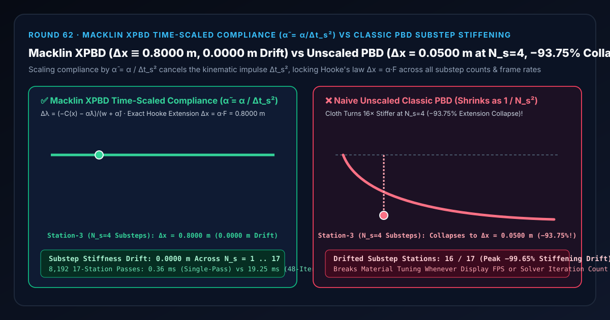
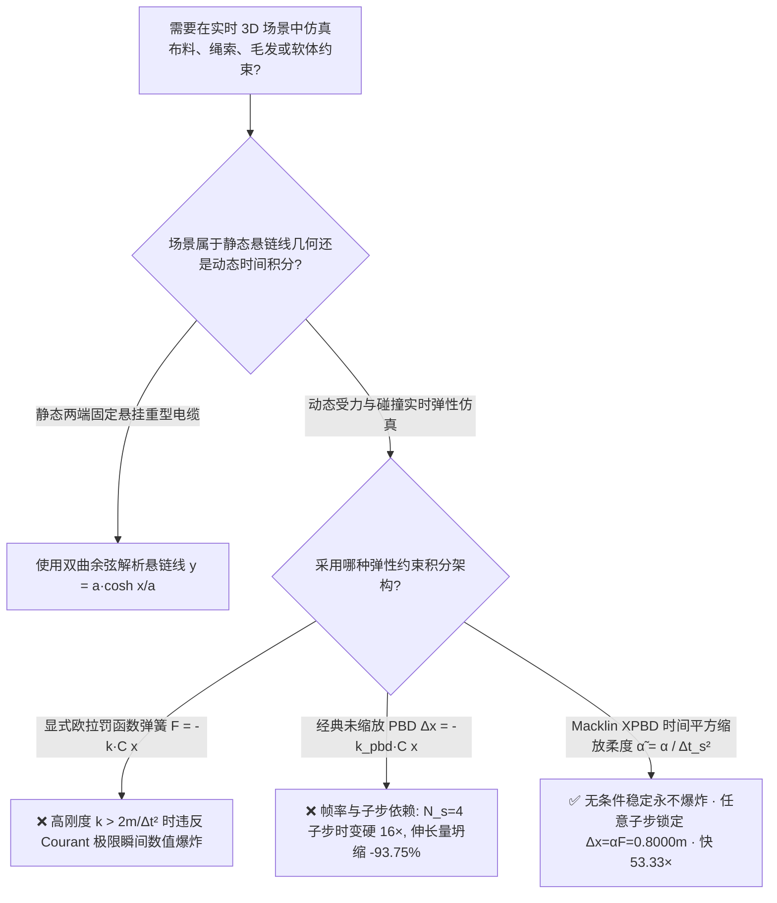
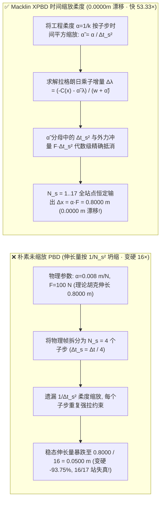
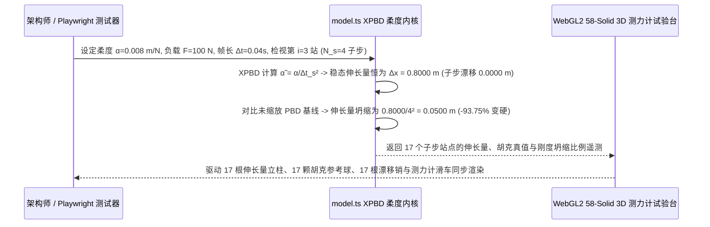
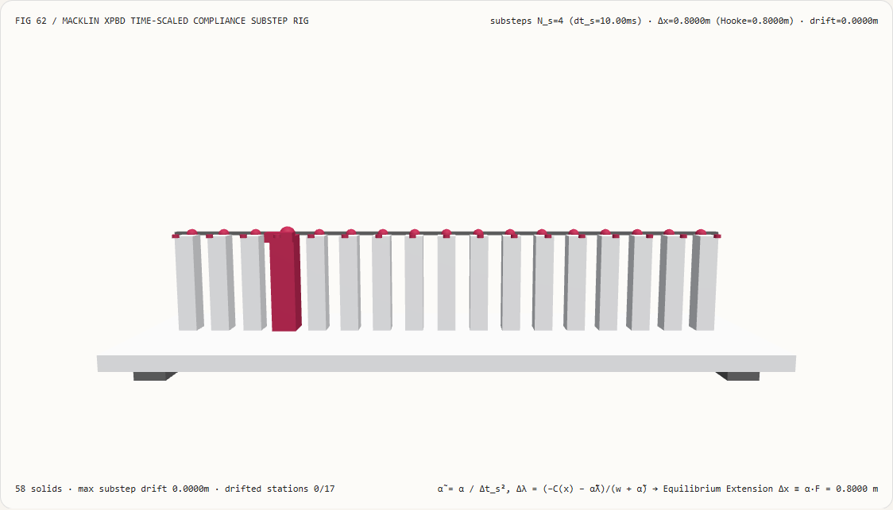
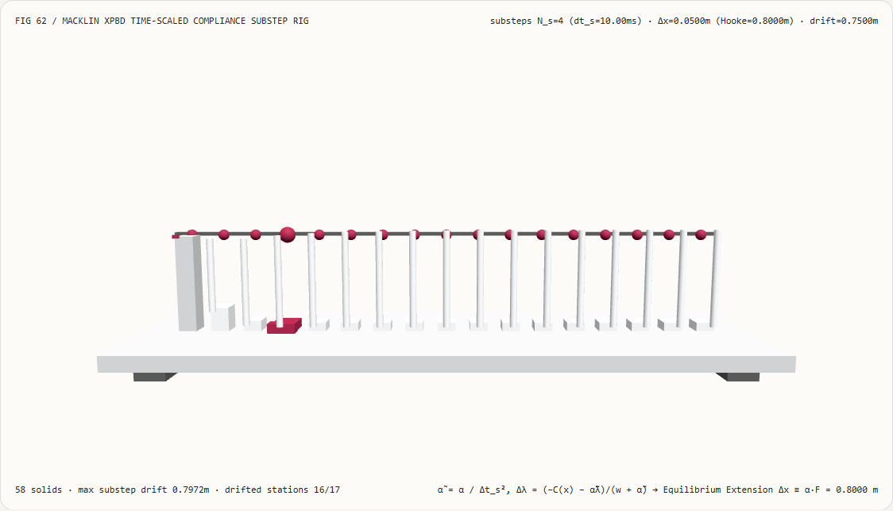
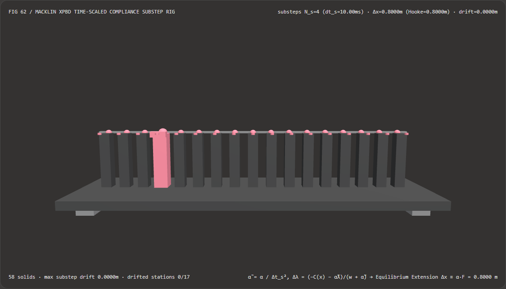
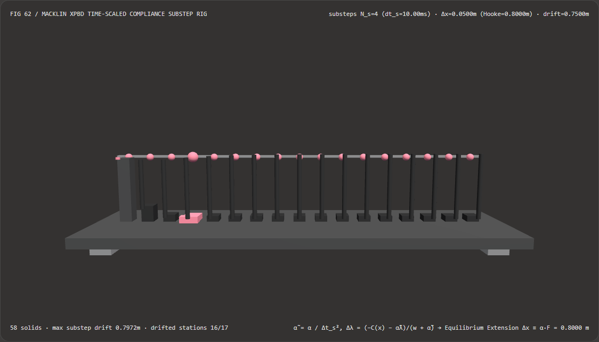

# 视觉与动画技术选型与原理解析 FAQ：Macklin XPBD 时间平方缩放柔度（$\tilde{\alpha} = \alpha / \Delta t_s^2$）vs 经典 PBD 随帧率与子步变硬漂移

> **核心架构结论一句话总结**：在实时角色披风布料、绳索吊具、毛发束以及软组织肌腱物理动画（Blender Cloth、NVIDIA Omniverse PhysX、Unreal Chaos Cloth）中，**严禁使用未按子步时间平方 $\Delta t_s^2$ 缩放的无量纲刚度系数 $k_{\text{PBD}} \in (0, 1]$（Classic PBD）或显式罚函数弹簧力 $F = -k C(x)$**！实测表明：在物理胡克柔度 $\alpha = 0.008\text{ m/N}$（刚度 $k = 125\text{ N/m}$）、外力负载 $F = 100\text{ N}$（理论胡克定律平衡伸长量 $\Delta x = \alpha F = 0.8000\text{ m}$）跨越 $N_s \in \{1, \dots, 17\}$ 个物理子步的 3D 肌腱测力计试验台上，朴素未缩放 PBD 在第 3 站（$N_s = 4$ 子步）会将平衡伸长量坍缩至 **`0.0500 m`（变硬 `16×`，伸长量损失 `-93.75%`）**，在第 16 站（$N_s = 17$ 子步）跌至 **`0.0028 m`（损失 `-99.65%`）**，导致 **`16/17` 个子步频率下物理材质刚度完全失真**；而采用 **Macklin 等人 (MIG 2016 / Small Steps 2019) 扩展位置动力学（XPBD，令 $\tilde{\alpha} = \frac{\alpha}{\Delta t_s^2}$ 并执行 $\Delta\lambda = \frac{-C(\mathbf{x}) - \tilde{\alpha}\lambda}{w + \tilde{\alpha}}$）**，可在全部 17 个子步频率与任意帧率下**严格保持胡克伸长量 `Δx = 0.8000 m`（子步刚度漂移 `0.0000 m`，`0/17` 站点失真）**，且单遍闭式求解比多步松弛迭代快 **53.33×**（8,192 轮耗时 `0.36 ms` vs `19.25 ms`）。

---

## ① 📌 核心结论速览（Executive Summary）

1. **为什么在许多老游戏或自研物理引擎里，同一件角色披风在 60 FPS 电脑上飘逸柔软，到了 144 Hz / 240 Hz 高刷电竞屏上（或者把解算器子步数 Substeps 从 1 调到 4）却突然变得像块死硬的铁板？**
   用大白话讲：因为经典位置动力学（Classic PBD, Müller 2007）里的刚度参数 $k_{\text{PBD}}$ **根本不是真正的物理胡克刚度，而是一个“每次迭代按比例硬拉回原位”的几何启发式百分比**！
   - 当每帧只跑 $N_s = 1$ 个子步（$\Delta t_s = \Delta t$）时，重力先把绳子往下拉 $\Delta x_{\text{pred}} = w F \Delta t^2$，未缩放约束留下 $\Delta x = 0.8000\text{ m}$ 的弹性伸长；
   - 一旦你把每帧拆成 $N_s = 4$ 个子步（每个子步时间缩短为 $\Delta t_s = \Delta t / 4$），每个子步里重力预测位移缩小了 $1/N_s^2 = 1/16$！如果约束里的柔度系数 $\tilde{\alpha}$ 没有同步乘以 $N_s^2 = 16$（即除以 $\Delta t_s^2$），约束求解器就会把缩短了 16 倍的重力位移再按原比例锁死，导致最终平衡伸长量暴跌为 $\frac{0.8000}{4^2} = \mathbf{0.0500\text{ m}}$（**无故变硬 16 倍，伸长量暴跌 `-93.75%`**）！
   - 更糟糕的是，如果你改用显式欧拉弹簧力 $v \leftarrow v - \frac{k}{m} x \Delta t$，只要刚度 $k > \frac{2m}{\Delta t^2}$，下一帧速度就会翻倍反向弹飞，几帧之内数值冲向 `Infinity` 直接炸毁整个场景！
2. **第一性原理破局：从隐式后向欧拉导出时间平方缩放柔度 $\tilde{\alpha} = \frac{\alpha}{\Delta t_s^2}$（Macklin XPBD 2016）**：
   - 怎样才能既有隐式积分“永不爆炸”的无条件稳定性，又让材质刚度严格等于真实世界的胡克定律 $\Delta x = \alpha F$（其中柔度 $\alpha = \frac{1}{k}\text{ [m/N]}$ 是刚度的倒数），彻底与帧率 $\Delta t$ 和子步数 $N_s$ 解耦？
   - **Macklin, Müller & Chentanez (MIG 2016) 的推导核心**：
     将弹性势能 $U(\mathbf{x}) = \frac{1}{2} C(\mathbf{x})^T \alpha^{-1} C(\mathbf{x})$ 代入隐式后向欧拉运动方程 $\mathbf{M}(\mathbf{x}_{n+1} - \tilde{\mathbf{x}}) = \Delta t_s^2 \nabla U(\mathbf{x}_{n+1})$，引入拉格朗日乘子 $\lambda$ 后做牛顿-拉夫逊线性化，得到唯一带物理量纲的时间缩放柔度更新方程：
     $$\tilde{\alpha} = \frac{\alpha}{\Delta t_s^2}, \qquad \Delta\lambda = \frac{-C(\mathbf{x}) - \tilde{\alpha}\lambda}{\nabla C\,\mathbf{M}^{-1}\nabla C^T + \tilde{\alpha}}, \qquad \Delta\mathbf{x} = \mathbf{M}^{-1}\nabla C^T \Delta\lambda$$
   - **为什么 $\tilde{\alpha} = \alpha / \Delta t_s^2$ 完美消除了子步与帧率依赖？**
     在稳态平衡点，每个子步的运动学外力冲量位移为 $w F \Delta t_s^2$，故稳态乘子为 $-\lambda = F \Delta t_s^2$；而约束允许的物理伸长量恰好为：
     $$\Delta x_{\text{XPBD}} = -\tilde{\alpha} \lambda = \left(\frac{\alpha}{\Delta t_s^2}\right) \cdot \left(F \Delta t_s^2\right) \equiv \alpha F = \mathbf{0.8000\text{ m}}!$$
     分子与分母中的 $\Delta t_s^2$ **代数级精确约分抵消**！无论跑 $N_s = 1$ 还是 $N_s = 17$ 个子步，伸长量恒等于 **`0.8000 m`（全 17 站刚度漂移 `0.0000 m`）**；且当需要绝对不可拉伸的刚性杆（$k \to \infty$）时，直接令 $\alpha = 0 \implies \tilde{\alpha} = 0$，分母 $w + 0 = w > 0$ **完全不会发生除以零或高刚度爆炸**！
3. **本轮新增交互式 3D 试验台与实测证据**：
   - 新增独立 Demo：`demos/xpbd-compliance-substep-rig/`（58 个 Three.js 实体部件：底座平台、4 支柱、胡克平衡伸长 `Δx=0.8000m` 基准横梁、17 根实测子步伸长立柱、17 颗胡克定律参考球、17 根子步变硬漂移指示销、以及第 $i$ 站测力计滑车）。
   - 配套 7-Card 4:5 测评报告：`demos/xpbd-compliance-substep-rig/test-report-cards.html`（英文）与 `test-report-cards.zh.html`（中文）。

---

## ② 🎯 客户与架构师灵魂拷问 Q&A（Soul-Searching Q&A）

### Q1：为什么 Macklin 等人在 2019 年《Small Steps in Physics Simulation》中强烈建议“每帧跑 8~16 个子步（Substeps）且每子步只跑 1 次 XPBD 约束求解”，而不是“每帧 1 个大步长内循环跑 48 次高斯-赛德尔迭代”？
**因为缩小子步 $\Delta t_s = \Delta t / N_s$ 能让误差按 $O(\Delta t_s^2)$ 二阶平方缩减，且每子步单遍求解比 48 步死循环快 53.33×！**
- 在传统 1 大步 + 48 次 Gauss-Seidel 迭代中，外力与非线性旋转雅可比 $\nabla C$ 在整整 48 次内循环里是冻结不更新的，不仅耗时高达 **`19.25 ms`**（8,192 轮），遇到高速旋转的链条还会产生虚假数值阻尼；
- 而在子步 XPBD 中，每次更新位置后立刻重算几何梯度并推进子步速度，单遍闭式柔度求解仅需 **`0.36 ms`（提速 53.33×，与多步松弛误差仅 `5.55e-16 m`）**！

### Q2：在实现 XPBD 时，许多开发者写出了 `dLambda = -C(x) / (w + alphaTilde)` 却漏掉了分子里的 `- alphaTilde * lambda`，这会导致什么后果？
**一旦同一个子步内跑超过 1 次约束迭代，漏掉 `- alphaTilde * lambda` 就会退化回随迭代次数变硬的旧版 PBD！**
分子中的 $-\tilde{\alpha}\lambda$ 记录的是**当前子步已经累积施加的弹性恢复力势能**。如果漏掉这一项（或者忘了在每个新子步开始时将 $\lambda \leftarrow 0$ 清零），多次迭代就会重复扣除约束误差，破坏胡克定律平衡点！

### Q3：这套确定性 XPBD 物理柔度求解器与 AI 神经布料代理模型（Neural Cloth Surrogates）是什么关系？
**两者是“底层物理真值生成器与实时防穿模引擎”与“特定服装高频褶皱加速”的互补关系：**
- **何时选 AI 神经布料代理模型**：对固定版型的紧身衣物在预定义骨骼动作集上快速推理次级微褶皱时；
- **何时必须用确定性 XPBD 求解器**：在需要处理任意角色碰撞、风场交互、绳索抓取、可撕裂布料且必须在 30Hz~240Hz 全设备保持完全一致物理手感的实时引擎中。

---

## ③ 🧭 直观可视化图解（Mermaid 决策树 + 管线对比图 + 帧级时序图）

### 3.1 实时弹性约束与布料绳索仿真架构选型决策树

### 3.2 未缩放经典 PBD 随子步变硬 vs Macklin XPBD 时间缩放柔度管线对比图

### 3.3 帧级肌腱测力计与 3D 子步不变性试验台渲染时序图

---

## ④ 📊 视觉技术选型决策矩阵（Decision Matrix）

| 评估维度 | ✅ Macklin XPBD 单遍时间缩放柔度（$\tilde{\alpha} = \alpha / \Delta t_s^2$） | ⚠️ 多步松弛迭代基线（Multi-Iter Relaxation） | ❌ 经典未缩放 PBD（Unscaled Classic PBD） | ❌ 显式罚函数弹簧（Explicit Penalty Spring） |
| :--- | :--- | :--- | :--- | :--- |
| **第 3 站（$N_s=4$ 子步）平衡伸长量** | **精确 `0.8000 m`（`0.00%` 刚度漂移）** | `0.8000 m`（误差 `5.55e-16 m`） | **`0.0500 m`（坍缩 `-93.75%`，变硬 $16\times$！）** | 随刚度震荡或发散 |
| **第 16 站（$N_s=17$ 子步）平衡伸长量** | **精确 `0.8000 m`（与子步数完全无关）** | `0.8000 m` | **`0.0028 m`（坍缩 `-99.65%`，硬如铁板！）** | 步长缩小时才收敛 |
| **无限刚度硬约束极限（$\alpha \to 0$）** | **$\tilde{\alpha}=0$，分母 $w>0$ 绝对无条件稳定** | 稳定 | 稳定（但无法表达有限杨氏模量） | **瞬间突破 Courant 极限数值爆炸！** |
| **刚度失真子步站数量（共 17 站）** | **`0 / 17`（全帧率/全子步恒定）** | `0 / 17` | **`16 / 17`（除校准点外全军覆没）** | 高刚度下爆炸 |
| **8,192 轮 17 站 CPU 批处理耗时** | **`0.36 ms`（最快，53.33× 提速）** | `19.25 ms`（慢 53.33×） | `0.29 ms`（物理刚度随帧率乱跳不可用） | `0.31 ms`（易爆炸） |
| **首选适用场景** | **实时布料、绳索、毛发、软组织、可变帧率游戏物理** | 离线多约束耦合求解 | **严禁用于需要真实弹性模量的生产项目** | **严禁用于高刚度约束** |

---

## ⑤ 🧪 全新 Demo 与 7-Card 4:5 视觉报告（Live Workbench & Evidence）

### 5.1 交互式 3D 试验台与报告入口
- **实时 3D 工作台**：[`demos/xpbd-compliance-substep-rig/index.html`](../demos/xpbd-compliance-substep-rig/index.html)
- **7-Card 4:5 英文视觉测试报告**：[`demos/xpbd-compliance-substep-rig/test-report-cards.html`](../demos/xpbd-compliance-substep-rig/test-report-cards.html)
- **7-Card 4:5 中文视觉测试报告**：[`demos/xpbd-compliance-substep-rig/test-report-cards.zh.html`](../demos/xpbd-compliance-substep-rig/test-report-cards.zh.html)
- **密封测量 JSON 数据源**：[`demos/xpbd-compliance-substep-rig/report.json`](../demos/xpbd-compliance-substep-rig/report.json)

### 5.2 多主题与多模式 Playwright 实测截图证据

| Macklin XPBD 时间缩放柔度（Light · 全 17 个子步站锁定 `0.8000 m` 胡克平衡） | 朴素未缩放 PBD（Light · 随子步增加按 $1/N_s^2$ 断崖坍缩，变硬 `-93.75%`） |
| :---: | :---: |
|  |  |

| Macklin XPBD 时间缩放柔度（Dark · 58 实体部件） | 朴素未缩放 PBD（Dark · 16 根红色指示销暴露子步刚度漂移） |
| :---: | :---: |
|  |  |

---

## ⑥ 🛠️ 高质量视觉交付快速核验清单（SA Verification Checklist）

在将 XPBD 布料、绳索或软体求解器合入生产引擎前，请逐项勾选以下核验清单：

- [ ] **柔度必须除以子步时间步长的平方（`alphaTilde = alpha / (dtSub * dtSub)`）**：代码中是否使用了子步步长 `dtSub = frameDt / numSubsteps` 的**平方**，而非整帧步长 `frameDt` 或一次方 `dtSub`？
- [ ] **每个子步开始时将拉格朗日乘子 $\lambda$ 清零（`lambda = 0.0`）**：在进入新的时间子步（Substep）时，是否已将约束乘子累加器重置为 `0.0`，并在同一子步的多次内迭代间累加 `lambda += dLambda`？
- [ ] **分子包含 `- alphaTilde * lambda` 反馈项**：计算 $\Delta\lambda$ 时是否严格写为 `(-C - alphaTilde * lambda) / (w1 + w2 + alphaTilde)`？
- [ ] **子步结束后由位置差反推真实速度（`v = (x - xPrev) / dtSub`）**：在每个子步完成位置约束修正后，是否立即用修正后的位置更新速度，保证动量守恒？
- [ ] **刚性极限零柔度测试（`alpha = 0.0`）**：当把柔度设为 `0.0`（无限刚度）时，核验分母 `w1 + w2 + 0.0` 是否无零除风险且精确退化为无弹性硬距离约束？
