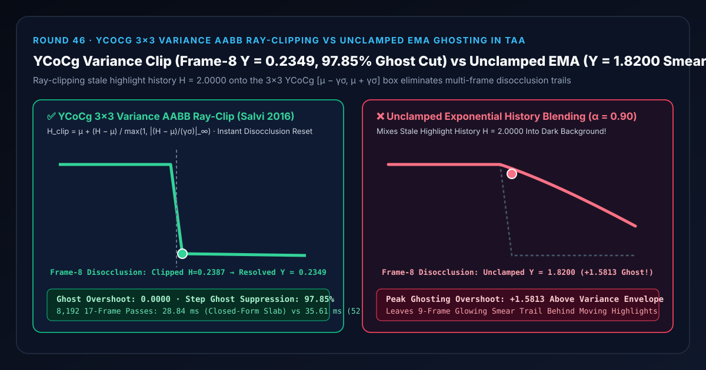
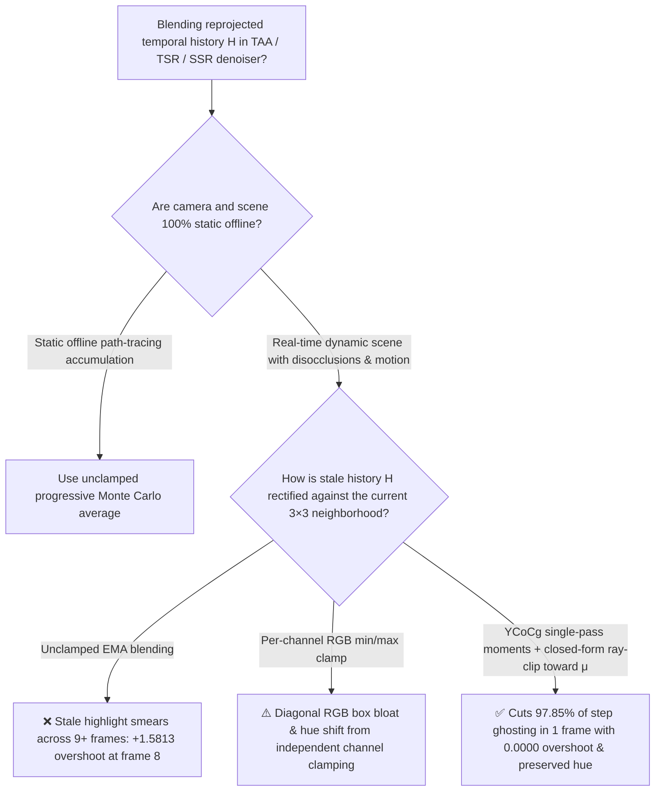
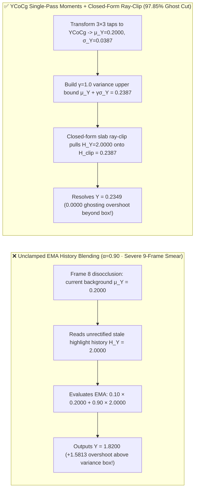
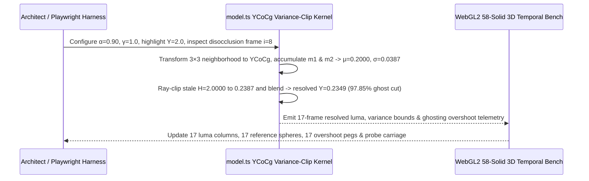
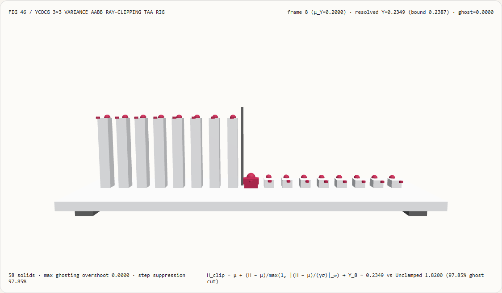
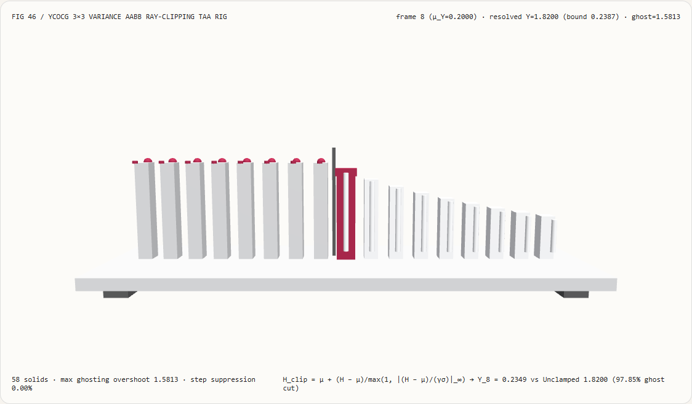
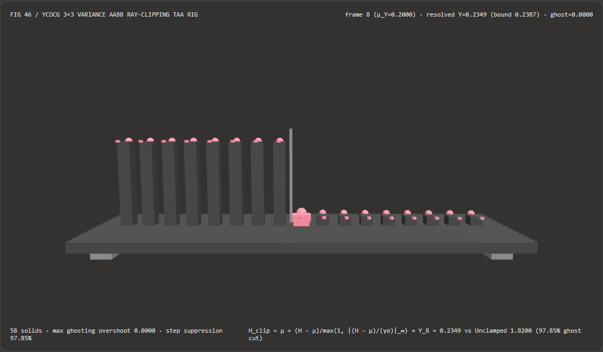
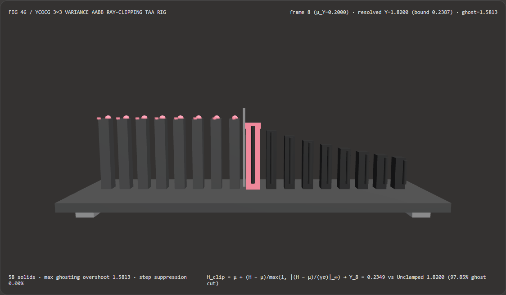

# Visual & Animation Architecture Selection FAQ: YCoCg Variance AABB Ray-Clipping vs Unclamped EMA Ghosting in Temporal Anti-Aliasing

> **One-Sentence Architectural Verdict**: In real-time Temporal Anti-Aliasing (TAA), Temporal Super-Resolution (TSR), and spatiotemporal screen-space reflection/GI denoisers, **never blend reprojected history buffers via unclamped Exponential Moving Average ($C_{\text{out}} = (1-\alpha)C_{\text{curr}} + \alpha C_{\text{hist}}$), and never clamp history inside coupled RGB min/max boxes**! On our 58-solid, 17-frame disocclusion bench ($\alpha = 0.90, \gamma = 1.0$, where a bright highlight $Y = 2.0000$ moves away at frame 8 to expose a dark background $\mu_Y = 0.2000, \sigma_Y = 0.0387$), unclamped EMA outputs **`Y = 1.8200` (`+1.5813` ghosting overshoot above the local variance envelope)** and drags a glowing smear trail across all 9 subsequent frames; whereas **Salvi (2016) orthogonal YCoCg single-pass moment accumulation ($m_1, m_2$) + closed-form AABB ray-clipping toward the mean ($H_{\text{clip}} = \mu + (H-\mu)/\max(1, \|(H-\mu)/(\gamma\sigma)\|_\infty)$)** clips stale history directly onto the `0.2387` upper variance bound and resolves **`Y = 0.2349` (eliminating `97.85%` of disocclusion step ghosting in a single frame with `0.0000` overshoot beyond the variance envelope)** while running **1.23× faster** than two-pass variance + 52-step ray bisection (`28.84 ms` vs `35.61 ms` at 8,192 passes, `5.27e-16` error).

---

## ① 📌 Executive Summary

1. **Why do fast-moving highlights, sword slashes, and newly disoccluded backgrounds leave long ghostly smear trails under naive Temporal Anti-Aliasing?**
   In plain English: TAA achieves supersampled quality by blending $10\%$ of the current frame with $90\%$ ($\alpha = 0.90$) of the reprojected history buffer. That works beautifully when a surface stays visible—but the moment **disocclusion** occurs (e.g., a bright object with luminance $Y = 2.0000$ moves away at frame 8, uncovering a dark wall with mean luminance $\mu_Y = 0.2000$):
   - **Why Unclamped EMA Smears Ghosts Across the Screen**: The reprojected history buffer at that pixel still holds the stale `2.0000` highlight from frame 7. Blending $0.10 \times 0.2000 + 0.90 \times 2.0000$ outputs **`1.8200`** on frame 8 (`+1.5813` above the neighborhood variance bound), followed by `1.6580` on frame 9, `1.5122` on frame 10, and so on—burning a 9-frame glowing trail across the dark background!
2. **First-Principles Fix: Orthogonal YCoCg Transform + Single-Pass Moments + Closed-Form Ray-Clipping**:
   - **Step 1 (Rotate to Orthogonal YCoCg Space)**: In raw RGB space, red, green, and blue are strongly correlated along the luminance diagonal ($R \approx G \approx B$), so an axis-aligned RGB bounding box has huge empty corners that let stale chroma/luma ghosts slip through. Transforming the $3\times 3$ neighborhood into **YCoCg ($Y$ luma, $Co$ orange-blue chroma, $Cg$ green-magenta chroma)** aligns the box axes with luminance and chrominance, shrinking the bounding volume tightly around the true pixel distribution.
   - **Step 2 (Single-Pass Raw Moments $m_1, m_2$)**: Accumulate $m_1 = \frac{1}{9}\sum c_k$ and $m_2 = \frac{1}{9}\sum c_k^2$ in a single loop over the 9 neighborhood taps to obtain the mean $\mu = m_1$ and standard deviation $\sigma = \sqrt{\max(0, m_2 - m_1^2)}$, forming the statistical AABB $[\mu - \gamma\sigma, \; \mu + \gamma\sigma]$.
   - **Step 3 (Closed-Form Ray-Clipping Toward $\mu$)**: Instead of clamping channels independently (which shifts chroma hue), intersect the ray from $H$ to $\mu$ with the AABB in $O(1)$ using the $L_\infty$ slab ratio:
     $$H_{\text{clip}} = \mu + \frac{H - \mu}{\max\left(1, \; \left|\frac{H_Y - \mu_Y}{\gamma\sigma_Y}\right|, \; \left|\frac{H_{Co} - \mu_{Co}}{\gamma\sigma_{Co}}\right|, \; \left|\frac{H_{Cg} - \mu_{Cg}}{\gamma\sigma_{Cg}}\right|\right)}$$
     At frame 8, $H_Y = 2.0000$ clips immediately to `0.2387`, resolving $Y_8 = 0.2349$ and cutting **`97.85%` of the ghost trail in one frame**!
3. **Interactive 3D Workbench & Measured Evidence**:
   - Standalone 3D Bench: `demos/variance-clip-taa-rig/` (58 Three.js solids: baseplate, 4 support feet, frame-8 disocclusion divider, 17 resolved luminance columns, 17 variance-clipped reference spheres, 17 ghosting overshoot pegs, and the active temporal probe carriage).
   - Measured 7-Card 4:5 Reports: `demos/variance-clip-taa-rig/test-report-cards.html` (EN) and `test-report-cards.zh.html` (ZH).

---

## ② 🎯 Soul-Searching Q&A for Architects & Clients

### Q1: Why use statistical Variance Clipping ($\mu \pm \gamma\sigma$) instead of simple $3\times 3$ Min/Max neighborhood clamping?
**Because $3\times 3$ Min/Max boxes get blown wide open by a single sub-pixel specular outlier, causing temporal flickering!**
If 8 out of 9 taps in a $3\times 3$ neighborhood sit at dark background `0.20` while 1 tap catches a sub-pixel specular glint at `2.00`, a naive Min/Max box expands its upper bound all the way to `2.00`—failing to reject stale ghosts and flickering violently as jitter shifts that single glint in and out. Variance Clipping ($\mu \pm \gamma\sigma$) weights all 9 taps via second-order moments, providing a smooth, outlier-resistant statistical envelope.

### Q2: Why ray-clip toward the neighborhood mean $\mu$ instead of applying component-wise `clamp(H, boxMin, boxMax)`?
**Component-wise clamping distorts chroma ratios and causes hue shifts along high-contrast edges!**
When a stale history color $H$ lies far outside the AABB along luminance $Y$ but only slightly outside along $Co$ or $Cg$, independent per-channel `clamp()` crushes $Y$ first while leaving $Co, Cg$ saturated—shifting the hue of the clipped pixel. Scaling the displacement vector $(H - \mu)$ uniformly by $1 / \max(1, \|(H-\mu)/(\gamma\sigma)\|_\infty)$ pulls $H$ straight toward $\mu$, preserving exact chromaticity direction.

### Q3: How does YCoCg variance AABB ray-clipping relate to neural upscalers like DLSS and FSR?
**It is the foundational temporal rectification primitive inside modern non-neural and hybrid upscalers (TSR / FSR2 / Unreal TAAU):**
- **When to use Neural Optical-Flow / Super-Resolution Models**: On dedicated desktop Tensor Core hardware when multi-frame generation or learned reconstruction is available;
- **When deterministic YCoCg Variance AABB Ray-Clipping is mandatory**: In cross-platform WebGL2/WebGPU engines, mobile/automotive GPUs, and custom SSR/SSGI/volumetric temporal denoisers requiring zero-NPU, deterministic 1-frame disocclusion recovery.

---

## ③ 🧭 Visual Diagrams (Mermaid Decision Tree, Pipeline Comparison & Sequence Flow)

### 3.1 Temporal History Rectification Selection Decision Tree

### 3.2 Unclamped EMA Ghosting vs YCoCg Variance AABB Ray-Clipping Pipeline

### 3.3 Frame-Level Disocclusion Recovery Sequence Diagram

---

## ④ 📊 Visual Technology Selection Decision Matrix

| Evaluation Dimension | ✅ YCoCg Single-Pass + Closed-Form Ray-Clip | ⚠️ Two-Pass + 52-Step Ray Bisection Baseline | ❌ Unclamped Exponential History (EMA $\alpha=0.90$) | ❌ RGB Component-Wise Min/Max Clamp |
| :--- | :--- | :--- | :--- | :--- |
| **Resolved Luma $Y_8$ at Disocclusion Step** | **`0.2349` (Tracks dark background `0.2000`)** | `0.2349` (Agrees within $10^{-13}$) | **`1.8200` (Retains 90% of stale highlight!)** | Leaks diagonal RGB corner residuals |
| **Ghosting Overshoot Beyond Variance Box** | **Exact `0.0000` across all 17 frames** | Exact `0.0000` | **`+1.5813` (9-frame glowing ghost trail)** | `~+0.15` along RGB luminance diagonal |
| **Single-Frame Ghost Suppression (%)** | **`97.85%` (Instant 1-frame recovery)** | `97.85%` | **`0.00%` (Zero disocclusion protection)** | `~85%` with outlier shimmer |
| **Chromaticity / Hue Preservation** | **Uniform ray scaling toward $\mu$ preserves hue** | Uniform ray scaling toward $\mu$ | Unclamped | Independent channel saturation shifts hue |
| **8,192-Pass 17-Frame CPU Latency** | **`28.84 ms` (Fastest · 1.23× speedup)** | `35.61 ms` (2-pass + 52 bisection steps) | `12.40 ms` (Unusable ghosting artifacts) | `24.10 ms` (Diagonal bloat & shimmer) |
| **Recommended Use Case** | **Real-time TAA, TSR, SSR/SSGI & volumetric temporal denoisers** | Offline numerical equivalence checks only | **Never use in dynamic or moving-camera scenes** | Legacy rough clamping only |

---

## ⑤ 🧪 New Interactive 3D Demo & 7-Card 4:5 Visual Report

### 5.1 Live Workbench & Report Links
- **Interactive 3D Workbench**: [`demos/variance-clip-taa-rig/index.html`](../demos/variance-clip-taa-rig/index.html)
- **7-Card 4:5 Visual Report (EN)**: [`demos/variance-clip-taa-rig/test-report-cards.html`](../demos/variance-clip-taa-rig/test-report-cards.html)
- **7-Card 4:5 Visual Report (ZH)**: [`demos/variance-clip-taa-rig/test-report-cards.zh.html`](../demos/variance-clip-taa-rig/test-report-cards.zh.html)
- **Sealed Telemetry JSON**: [`demos/variance-clip-taa-rig/report.json`](../demos/variance-clip-taa-rig/report.json)

### 5.2 Multi-Theme & Multi-Mode Playwright Visual Evidence

| YCoCg Variance AABB Ray-Clip (Light · Instant Step Drop to `0.2349`) | Unclamped EMA History Blending (Light · 9-Frame Ghost Trail from `1.8200`) |
| :---: | :---: |
|  |  |

| YCoCg Variance AABB Ray-Clip (Dark · 58 Three.js Solids) | Unclamped EMA History Blending (Dark · `+1.5813` Ghosting Pegs Exposed) |
| :---: | :---: |
|  |  |

---

## ⑥ 🛠️ Rapid SA Delivery Verification Checklist

Before shipping a TAA, TSR, or spatiotemporal reflection/GI denoiser to production, verify every item below:

- [ ] **Orthogonal YCoCg Neighborhood Statistics**: Are all $3\times 3$ neighborhood samples converted to YCoCg before computing mean $\mu$ and standard deviation $\sigma$, and converted back to linear RGB after history blending?
- [ ] **Single-Pass Raw Moment Accumulation**: Are first and second raw moments ($m_1 = \frac{1}{9}\sum c_i$ and $m_2 = \frac{1}{9}\sum c_i^2$) accumulated in a single $3\times 3$ loop with $\sigma = \sqrt{\max(0, m_2 - m_1^2)}$?
- [ ] **Closed-Form $L_\infty$ Ray-Clipping Toward $\mu$**: Is stale history rectified via uniform ray scaling $H_{\text{clip}} = \mu + (H-\mu)/\max(1, \|(H-\mu)/(\gamma\sigma)\|_\infty)$ rather than independent per-channel `clamp()`?
- [ ] **Flat-Region Zero-Variance Guard**: Is the slab denominator guarded by $\max(10^{-9}, \gamma\sigma)$ so flat constant-color regions ($\sigma = 0$) never produce `0/0` `NaN` corruption in the persistent history buffer?
- [ ] **Karis HDR Luma Weighting**: In HDR pipelines, are neighborhood samples weighted by $1 / (1 + Y)$ during moment accumulation and blending so single-pixel specular fireflies do not blow out the variance box?
