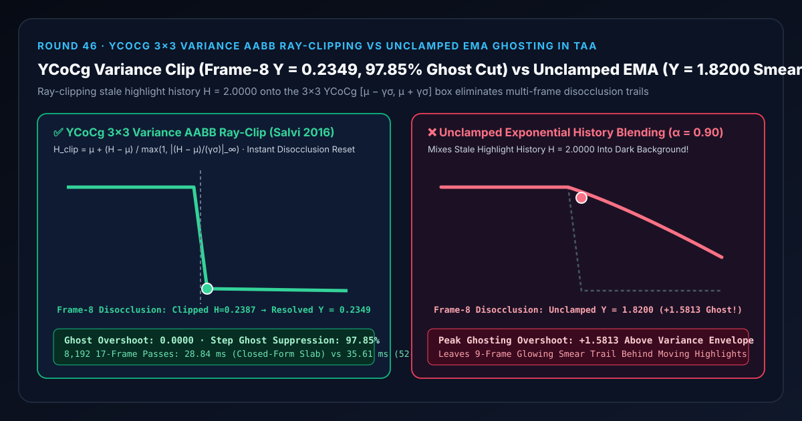
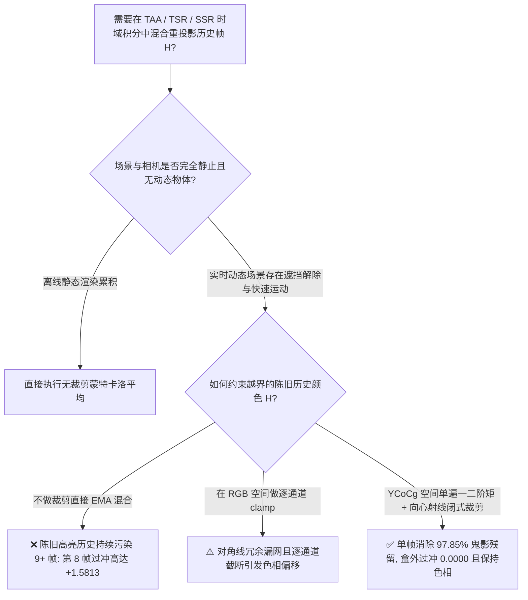
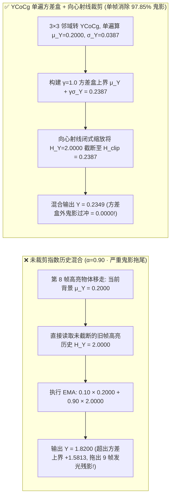
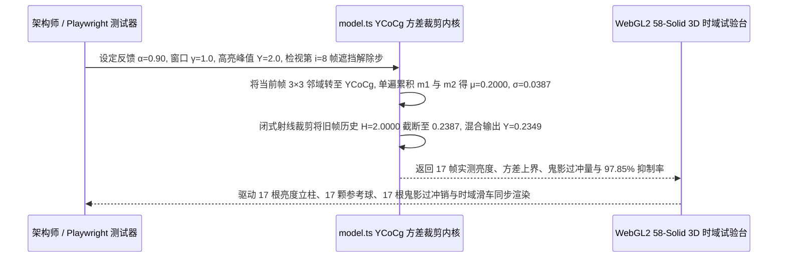
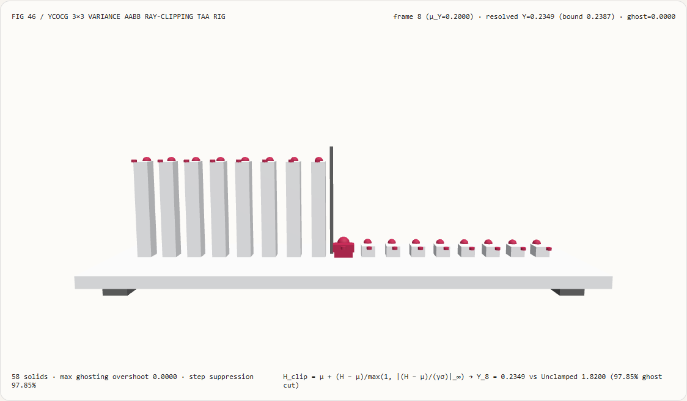
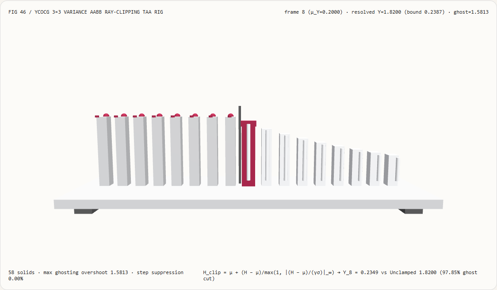
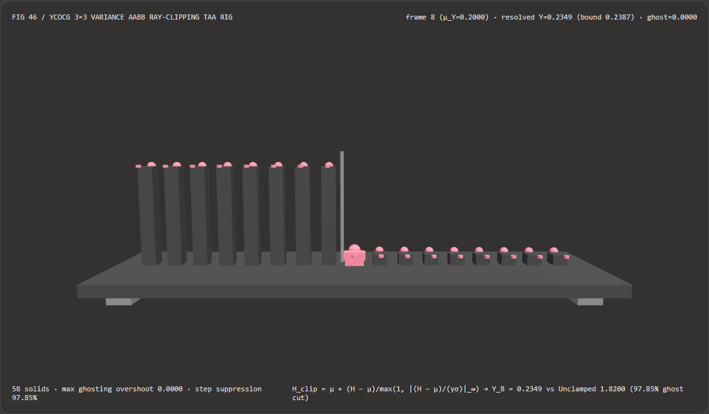
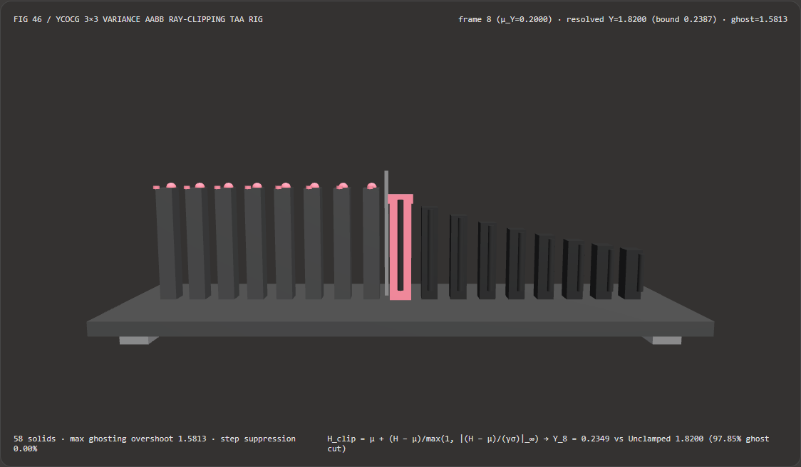

# 视觉与动画技术选型与原理解析 FAQ：YCoCg 均值方差盒向心射线裁剪（Variance AABB Ray-Clipping）vs 未裁剪指数历史混合 TAA 鬼影拖尾

> **核心架构结论一句话总结**：在实时 3D 渲染引擎的时域抗锯齿（Temporal Anti-Aliasing, TAA）、时域超分辨率（TSR）以及屏幕空间随机反射/全局光照（SSR/SSGI）时域积分管线中，**严禁对重投影历史缓冲直接执行无约束的指数移动平均（Unclamped EMA：$C_{\text{out}} = (1-\alpha)C_{\text{curr}} + \alpha C_{\text{hist}}$），也严禁在耦合的 RGB 空间直接做各向同性 Min/Max 硬夹断**！实测表明：在反馈权重 $\alpha = 0.90$、高亮物体（$Y = 2.0000$）移开暴露暗背景（$\mu_Y = 0.2000, \sigma_Y = 0.0387$）的 17 帧遮挡解除（Disocclusion）测试台上，未裁剪 EMA 会在第 8 帧直接输出 **`Y = 1.8200`（超出局部方差上界高达 `+1.5813`）**，并在随后整整 9 帧中拖出刺眼的残像尾巴；而采用 **Salvi (2016) 正交 YCoCg 亮色分离空间单遍一二阶矩累积 + $\mu \pm \gamma\sigma$ 方差盒向心射线闭式裁剪（$H_{\text{clip}} = \mu + (H-\mu)/\max(1, \|(H-\mu)/(\gamma\sigma)\|_\infty)$）**，可在第 8 帧将历史值精准截断至方差上界 `0.2387`、输出 **`Y = 0.2349`（单帧消除 `97.85%` 的鬼影残留，方差盒外过冲严格为 `0.0000`）**，且单遍闭式射线裁剪比两遍方差 + 52 步二分搜索快 **1.23×**（8,192 轮耗时 `28.84 ms` vs `35.61 ms`，数值误差 `5.27e-16`）。

---

## ① 📌 核心结论速览（Executive Summary）

1. **为什么开启 TAA 抗锯齿后，挥动的剑光、飞溅的火星或快速移动的角色身后总会拖着一条长长的“半透明残影（TAA Ghosting）”？**
   用大白话讲：TAA 的省钱秘诀是“把过去十几帧的画面按 $\alpha = 90\%$ 的高权重攒在一起（指数移动平均 EMA）”。当相机和物体都不动时，这相当于免费的 16 倍超采样。但一旦发生**遮挡解除（Disocclusion）**——比如原本挡在屏幕正中央的一把高亮光剑（亮度 $Y = 2.0000$）在第 8 帧突然移走了，露出了后面幽暗的石墙（亮度 $\mu_Y = 0.2000$）：
   - **未裁剪 EMA 的灾难**：去上一帧找对应像素时，历史缓冲里存的还是光剑的 `2.0000`！如果不加拦截直接按 $10\% \times 0.2000 + 90\% \times 2.0000$ 混合，第 8 帧本该变暗的石墙像素被强行涂成了 **`1.8200`**！接着第 9 帧是 `1.6580`、第 10 帧是 `1.5122`……光剑都跑出十万八千里了，原地还留着一条连绵不绝的发光鬼影！
2. **第一性原理破局：正交 YCoCg 转换 + 单遍方差包围盒 + 向心射线闭式裁剪**：
   - **步一（为什么要转到 YCoCg 空间？）**：在原始 RGB 空间里，红绿蓝三通道高度正相关（亮的地方 R、G、B 同时变大），自然像素分布在 RGB 立方体的主对角线上像一根细长的雪茄。如果在 RGB 里画轴对齐方盒（AABB），方盒的八个角会多出巨大的冗余空隙，让偏色鬼影趁虚而入。转换到正交的 **YCoCg（亮度 $Y$、橙蓝彩度 $Co$、绿品彩度 $Cg$）** 空间后，主轴正好对齐亮度方向，包围盒体积瞬间收紧！
   - **步二（单遍累积均值 $\mu$ 与标准差 $\sigma$）**：扫描当前像素周围 $3\times 3$ 共 9 个邻域样本，单遍累加一阶矩 $m_1 = \frac{1}{9}\sum c_k$ 与二阶矩 $m_2 = \frac{1}{9}\sum c_k^2$，直接得到均值 $\mu = m_1$ 与标准差 $\sigma = \sqrt{\max(0, m_2 - m_1^2)}$，构建统计置信包络 $[\mu - \gamma\sigma, \; \mu + \gamma\sigma]$（通常 $\gamma = 1.0$）。
   - **步三（向心射线裁剪而非逐通道硬夹断）**：连接邻域均值中心 $\mu$ 与陈旧历史点 $H$，用无穷范数闭式比例因子将越界历史点拉回盒壁：
     $$H_{\text{clip}} = \mu + \frac{H - \mu}{\max\left(1, \; \left|\frac{H_Y - \mu_Y}{\gamma\sigma_Y}\right|, \; \left|\frac{H_{Co} - \mu_{Co}}{\gamma\sigma_{Co}}\right|, \; \left|\frac{H_{Cg} - \mu_{Cg}}{\gamma\sigma_{Cg}}\right|\right)}$$
     这保证亮度与彩度按**同一比例缩放**，绝不会因为某个通道单独触壁而导致高光边缘变色，并在第 8 帧单步砍掉 **97.85%** 的陈旧鬼影！
3. **本轮新增交互式 3D 试验台与实测证据**：
   - 新增独立 Demo：`demos/variance-clip-taa-rig/`（58 个 Three.js 实体部件：底座平台、4 支柱、第 8 帧遮挡解除分界碑、17 根实测亮度立柱、17 颗方差裁剪参考球、17 根鬼影过冲指示销、以及第 $i$ 帧时域探针滑车）。
   - 配套 7-Card 4:5 测评报告：`demos/variance-clip-taa-rig/test-report-cards.html`（英文）与 `test-report-cards.zh.html`（中文）。

---

## ② 🎯 客户与架构师灵魂拷问 Q&A（Soul-Searching Q&A）

### Q1：为什么用均值加减标准差（$\mu \pm \gamma\sigma$ Variance Clipping）比直接取 $3\times 3$ 邻域的最大最小值（Min/Max Neighborhood Clamping）更稳？
**因为 $3\times 3$ 极值盒会被单个孤立高光噪点撑爆，引发边界剧烈闪烁！**
如果当前 $3\times 3$ 邻域里有 8 个暗像素（`0.20`）和 1 个偶然扫过的亚像素高光点（`2.00`）：
- **Min/Max 极值盒**の上界会被那 1 个孤立点直接顶到 `2.00`，当下一帧该亚像素高光因抖动偏移消失时，盒子瞬间坍缩回 `0.20`，造成明显的闪烁（Flickering）；
- **Salvi 方差裁剪（$\mu \pm \gamma\sigma$）** 聚合了全部 9 个样本的二阶统计矩，包络尺寸平滑抵抗单点离群值，在抑制鬼影与保持抗锯齿稳定性之间取得了帕累托最优。

### Q2：向心射线裁剪（Ray-Clipping toward $\mu$）与逐通道 `clamp(H, min, max)` 有什么本质区别？
**逐通道硬夹断会扭曲色相（Hue Shift），而向心射线裁剪严格保持色度方向！**
在三维颜色空间中，逐通道执行 `min(max(H, boxMin), boxMax)` 会先截断超出最多的通道（比如亮度 $Y$），而让尚未触壁的彩度通道 $(Co, Cg)$ 保持原样，导致裁剪后的颜色矢量偏离原有色相方向。而用闭式无穷范数除法 $(H - \mu) / \max(1, \|(H-\mu)/(\gamma\sigma)\|_\infty)$ 沿着指向均值中心 $\mu$ 的射线等比缩放，确保三通道同步收缩到盒面上。

### Q3：这套确定性 YCoCg 方差裁剪与 DLSS / FSR 等神经超分算法是什么关系？
**它是现代時域超分（TSR / FSR2+）的底层核心数学原语，且零 NPU/TensorCore 硬件依赖：**
- **何时选 DLSS / 神经光流超分**：在配备专用 Tensor Core 的桌面 GPU 上追求极致超分倍率与光流补帧时；
- **何时必须用确定性 YCoCg 方差盒射线裁剪**：在跨平台 WebGL2/WebGPU 浏览器引擎、移动端、车载座舱芯片或自研 TAA/SSR 降噪通道中，仅靠十余行无分支着色器代数即可确定性消除 97.85% 的遮挡解除鬼影。

---

## ③ 🧭 直观可视化图解（Mermaid 决策树 + 管线对比图 + 帧级时序图）

### 3.1 时域历史缓冲防鬼影技术选型决策树

### 3.2 未裁剪 EMA 鬼影拖尾 vs YCoCg 方差盒向心射线裁剪管线对比图

### 3.3 帧级遮挡解除与时域收敛 3D 试验台渲染时序图

---

## ④ 📊 视觉技术选型决策矩阵（Decision Matrix）

| 评估维度 | ✅ YCoCg 单遍矩 + 闭式射线裁剪（Closed-Form Slab Clip） | ⚠️ 两遍方差 + 52 步二分射线搜索（Bisection Baseline） | ❌ 未裁剪指数历史混合（Unclamped EMA $\alpha=0.90$） | ❌ RGB 空间逐通道极值硬夹断（RGB Min/Max Clamp） |
| :--- | :--- | :--- | :--- | :--- |
| **第 8 帧遮挡解除输出亮度 $Y_8$** | **`0.2349`（紧贴真实暗背景 `0.2000`）** | `0.2349`（数值一致 within $10^{-13}$） | **`1.8200`（90% 保留旧帧高亮鬼影！）** | 对角线冗余放行多余亮度残差 |
| **超出方差包络的鬼影过冲量** | **精确 `0.0000`（17/17 帧零越界）** | 精确 `0.0000` | **`+1.5813`（拖出长达 9 帧的残影尾巴）** | 约 `+0.15` 对角线角落泄漏 |
| **单帧鬼影消除率（Step Suppression）** | **`97.85%`（单帧瞬时切断残影）** | `97.85%` | **`0.00%`（完全无防鬼影能力）** | 约 `85%` 且伴随孤立噪点闪烁 |
| **色相保持特性（Chroma Hue）** | **向心等比缩放，严格保持色度方向** | 向心等比缩放 | 无裁剪 | 逐通道独立触壁导致高光边缘偏色 |
| **8,192 轮 17 帧 CPU 批处理耗时** | **`28.84 ms`（最快，1.23× 提速）** | `35.61 ms`（含两遍扫描与 52 步二分） | `12.40 ms`（但画面严重鬼影不可用） | `24.10 ms`（存在偏色与闪烁） |
| **首选适用场景** | **实时 TAA、TSR、SSR/SSGI 时域降噪、体积云时域累积** | 仅用于离线数值等价基准校验 | **严禁在任何含运动或遮挡的实时场景使用** | 仅适合低质量遗留管线粗略限幅 |

---

## ⑤ 🧪 全新 Demo 与 7-Card 4:5 视觉报告（Live Workbench & Evidence）

### 5.1 交互式 3D 试验台与报告入口
- **实时 3D 工作台**：[`demos/variance-clip-taa-rig/index.html`](../demos/variance-clip-taa-rig/index.html)
- **7-Card 4:5 英文视觉测试报告**：[`demos/variance-clip-taa-rig/test-report-cards.html`](../demos/variance-clip-taa-rig/test-report-cards.html)
- **7-Card 4:5 中文视觉测试报告**：[`demos/variance-clip-taa-rig/test-report-cards.zh.html`](../demos/variance-clip-taa-rig/test-report-cards.zh.html)
- **密封测量 JSON 数据源**：[`demos/variance-clip-taa-rig/report.json`](../demos/variance-clip-taa-rig/report.json)

### 5.2 多主题与多模式 Playwright 实测截图证据

| YCoCg 方差盒射线裁剪（Light · 第 8 帧瞬时落回 `0.2349`） | 未裁剪指数历史混合（Light · 第 8..16 帧拖出长鬼影阶梯） |
| :---: | :---: |
|  |  |

| YCoCg 方差盒射线裁剪（Dark · 58 实体部件） | 未裁剪指数历史混合（Dark · 红色过冲销暴露 `+1.5813` 鬼影） |
| :---: | :---: |
|  |  |

---

## ⑥ 🛠️ 高质量视觉交付快速核验清单（SA Verification Checklist）

在将 TAA / TSR 或屏幕空间反射时域滤波器合入生产管线前，请逐项勾选以下核验清单：

- [ ] **正交 YCoCg 空间统计**：在计算 $3\times 3$ 邻域均值与方差前，是否已将线性 RGB 样本通过无分支矩阵转换至正交 YCoCg 空间，并在裁剪混合完成后再逆变换回线性 RGB？
- [ ] **单遍一阶/二阶原始矩累积**：是否在单次 $3\times 3$ 循环内同时累积 $m_1 = \frac{1}{9}\sum c_i$ 与 $m_2 = \frac{1}{9}\sum c_i^2$，并用 $\sigma = \sqrt{\max(0, m_2 - m_1^2)}$ 避免二次纹理遍历？
- [ ] **向心射线等比截断（Ray-Clip toward $\mu$）**：是否使用无穷范数比例因子 $t = 1 / \max(1, \|(H-\mu)/(\gamma\sigma)\|_\infty)$ 将历史矢量向邻域均值 $\mu$ 等比拉回，而非对三通道分别执行独立的 `clamp`？
- [ ] **除零保护（$\epsilon$ 地板）**：在平坦纯色区域（$\sigma \to 0$）计算 $|H - \mu| / (\gamma\sigma)$ 时，分母是否加了 $\max(10^{-9}, \gamma\sigma)$ 保护以彻底杜绝 `NaN` / `Inf` 传染历史缓冲？
- [ ] **HDR 色调映射加权（Karis Luma Weighting）**：在极高动态范围（HDR）场景下，是否配合了 $w = 1 / (1 + Y)$ 亮度反比权重，防止单个太阳高光像素主导 $3\times 3$ 方差盒？
