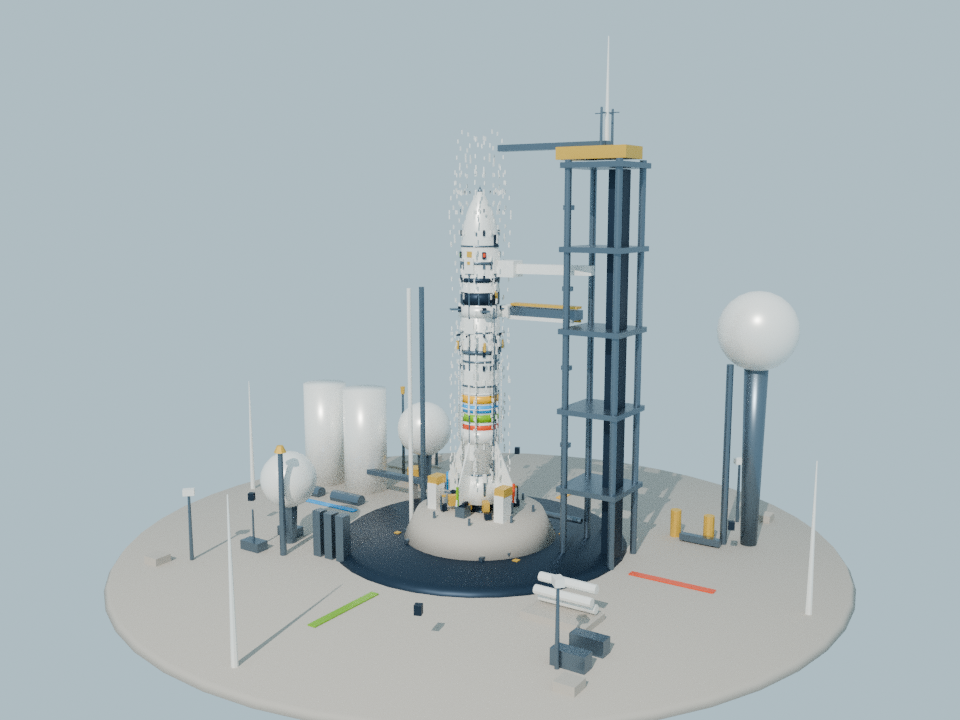
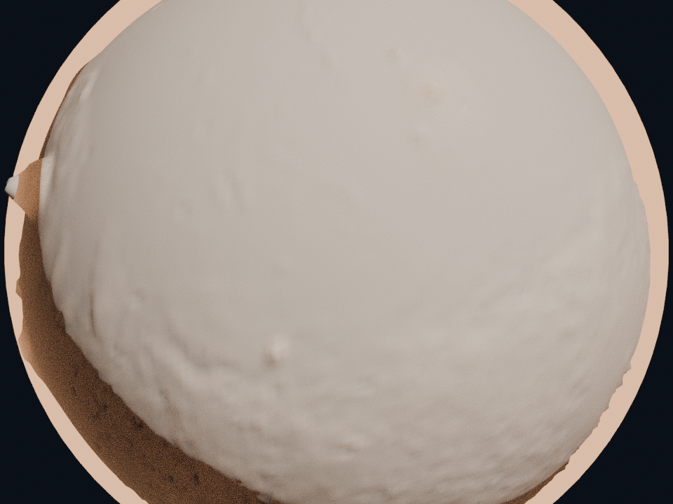
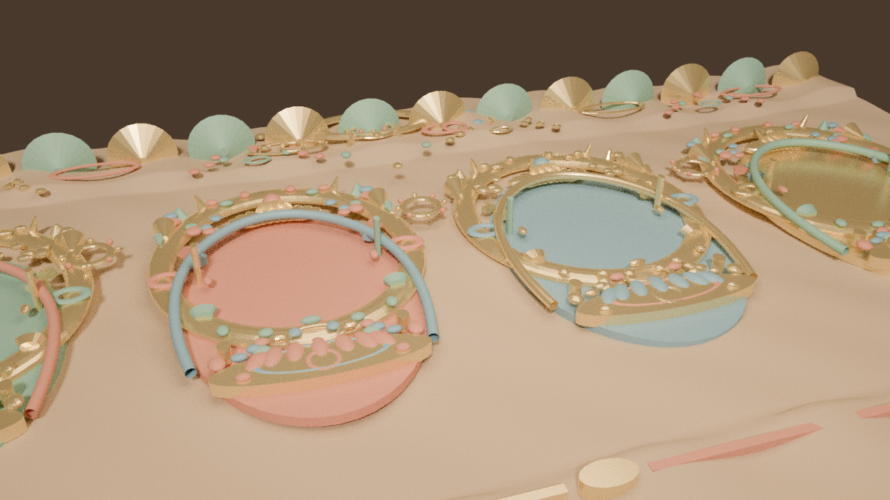

# Gemini 4 Argon + Blender 4.5 LTS MCP 混合渲染架构研究

> 🌐 **Language / 语言**: **中文** | [English (`blender-mcp-pipeline.en.md`)](blender-mcp-pipeline.en.md)

本文记录 `generative-visual-lab` 在切换至 **Gemini 4 Argon (`gemini-4-argon`)** 后，如何接入本地 **Blender 4.5.10 LTS** 与 **`blender-mcp` (v2.0.0)**，构建“离线高精度三维建模/Cycles 光线追踪烘焙 + 浏览器实时 WebGL2/Canvas 2D 交互渲染”的混合管线。

---

## 1. 为什么选择“离线 Blender MCP 烘焙 + 实时前端渲染”

浏览器端科学可视化与艺术叙事面临两个天然张力：

1. **纯程序化实时生成（Procedural-only）的几何/光影上限**：完全依赖手写 Canvas 2D 路径或简单 Three.js 基础几何体（Cylinder/Cone），难以表现复杂机械倒角、钛合金栅格翼、石窟深浮雕环境光遮蔽（AO）以及无缝微地貌切线法线。
2. **纯离线视频/预渲染帧（Pre-rendered Video）失去实时交互与可验证性**：预录 Cycles 视频无法支持用户自由拖拽火星轨道、切换科学高程夸张倍率、实时检验网格接缝或随时触发飞天揭色与火箭点火。

因此，本实验室采用 **Hybrid Offline-Bake + Real-Time Rendering** 路线：
- **构建期（Build-time via Blender MCP）**：由 `scripts/blender/*.mjs` 通过标准 MCP JSON-RPC 2.0 协议调用 `blender-mcp.exe`，连接无头运行的 `Blender 4.5.10 LTS` (`127.0.0.1:9876`)，执行 `bpy`/`bmesh` 高精度参数化建模与 Cycles 光线追踪烘焙，落盘为紧凑的 `.glb` 与 `.png` 静态资产，同时保存 Cycles 独立渲染图与 MCP 执行记录作为可复现证据。
- **运行期（Runtime in Browser）**：纯静态部署于 GitHub Pages，零外部模型 API、零 CDN 依赖，保持 60fps 交互预算与完整的科学/几何可检验性。

---

## 2. Blender MCP 协议链路与无头守护进程

```
Node.js 构建脚本 (scripts/blender/build-*.mjs)
   │  stdio (JSON-RPC 2.0: initialize -> tools/call)
   ▼
blender-mcp.exe (mcp-for-blender v2.0.0)
   │  TCP Socket (127.0.0.1:9876, protocol v13)
   ▼
Blender 4.5.10 LTS (-b --python scripts/blender/mcp-headless-daemon.py)
   ├─ execute_blender_code (bpy / bmesh / mathutils / Cycles)
   ├─ get_scene_info / get_object_info
   └─ 导出 GLB 资产 / Cycles 烘焙贴图 / Cycles 光追样张
```

- **守护进程 (`scripts/blender/mcp-headless-daemon.py`)**：在 `blender -b` 后台模式中加载 `blender_mcp_addon.BlenderMCPServer`，并将主线程调度队列绑定到无头循环，使 `execute_blender_code`、`get_scene_info`、`get_object_info` 在无 GUI 环境下确定性执行。
- **客户端 (`scripts/blender/mcp-client.mjs`)**：封装标准 MCP `initialize` 与 `tools/call` 请求，自动采集工具返回文本并写入 `docs/evidence/blender-mcp-*.json`。

---

## 3. 三个演示的 Blender MCP 资产与实时合成细节

### 3.1 Launch · 白色火箭 (`demos/rocket-launch/`)

- **生成脚本**：`scripts/blender/build-rocket-assets.mjs`
- **导出资产**：`demos/rocket-launch/assets/rocket-kit.glb`（188,268 字节，glTF 2.0 二进制）
- **Cycles 样张**：[blender-rocket-cycles-render.png](evidence/blender-rocket-cycles-render.png) · [MCP 记录](evidence/blender-mcp-rocket.json)

- **三层级命名节点结构**：
  1. `RocketVehicle`：25 段相切卵形（Tangent-Ogive）平滑鼻锥、级间环、纵向电缆槽、4 片钛合金蜂窝栅格翼（Grid Fins）、4 枚气动尾翼及翼尖微软四色条带（`#F25022` / `#7FBA00` / `#00A4EF` / `#FFB900`）、5 台带再生冷却环的拉瓦尔喷管（De Laval Nozzles）。
  2. `UmbilicalArm`：可旋转分离的脐带连接臂与夹持头，点火离台时由前端状态机驱动实时后摆分离。
  3. `LaunchPadStatic`：导流锥、四组固箭液压爪、桁架发射塔、锤头起重机与水幕消音球罐。
- **前端合批优化**：`demos/rocket-launch/main.ts` 使用 `GLTFLoader` 解析后，按材质桶自动调用 `mergeGeometries` 合批，将整套复杂发射场控制在 **27 draw calls / 32,876 triangles**，T+9s 升空稳态 `p95 = 33.4ms`（本地预算 ≤ 50ms）。

### 3.2 Astra · 火星造景 (`demos/astra-planet/`)

- **生成脚本**：`scripts/blender/build-astra-assets.mjs`
- **导出资产**：`demos/astra-planet/public/data/mars-micro-normal.png`（165,301 字节，256×256 无缝烘焙贴图）
- **Cycles 样张**：[blender-astra-cycles-render.png](evidence/blender-astra-cycles-render.png) · [MCP 记录](evidence/blender-mcp-astra.json)

- **科学边界与微地貌分层**：
  - 宏观地形（1440×720 基础包与 4096×2048 高清包）100% 来自 NASA MOLA MEGDR 实测高程，顶点半径、海岸线归属与面积/高度统计完全不变。
  - Blender Cycles 烘焙的 `mars-micro-normal.png` 将火星玄武岩断崖裂隙、风成沙垄与微陨石坑编码于 G/B 通道（切线空间斜率）与 R 通道（环境凹腔遮蔽），仅在 `realistic` 模式下对片元着色器法线进行微扰动；切换至 `gray`（灰模）或 `wireframe`（线框）检验模式时自动旁路，确保科学几何检验纯粹透明。

### 3.3 风起壁间 · 飞天 (`demos/feitian/`)

- **生成脚本**：`scripts/blender/build-feitian-assets.mjs`
- **导出资产**：`demos/feitian/assets/grotto-relief-bake.png`（430,243 字节，640×360 Cycles 正交浮雕烘焙）
- **Cycles 样张**：[blender-feitian-cycles-render.png](evidence/blender-feitian-cycles-render.png) · [MCP 记录](evidence/blender-mcp-feitian.json)

- **零逐帧开销合成**：
  - 在 Blender 中建立 16:9 莫高窟砂岩洞窟壁面、四座与飞天归位坐标对齐的拱券佛龛（`NicheArch_0..3`）、莲瓣龛楣、立体飘带浮雕与顶部藻井垂幔，以暖色酥油灯侧光通过 Cycles 正交相机烘焙。
  - 前端 `demos/feitian/main.ts` 在 `buildWall()` 与 `renderPortrait()` 初始化阶段通过 `soft-light` 与 `multiply` 混合模式一次性合成至静态缓存画布，动画循环零额外绘制开销，四时同游稳态 `p95 = 16.7ms`（预算 ≤ 33.3ms）。
